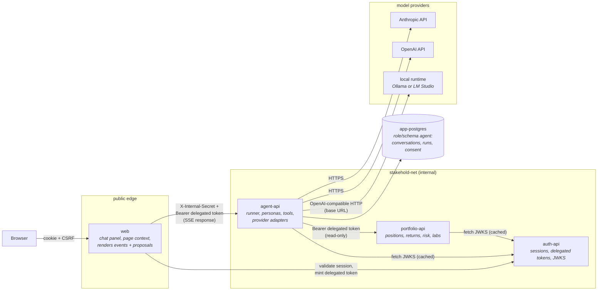
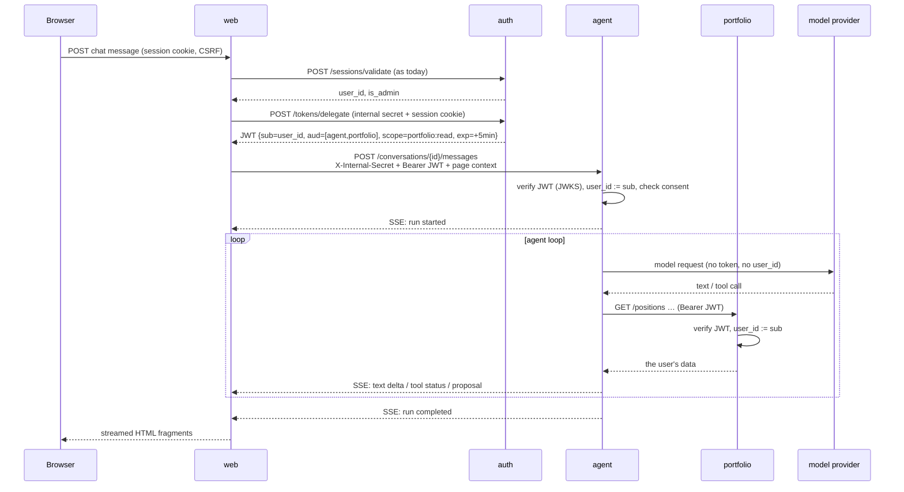
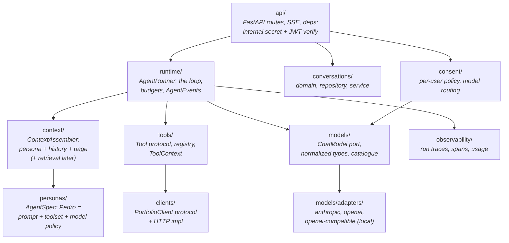

# agent architecture

**Status: design only, first iteration. Nothing is built.** The package is an empty skeleton
(`src/agent/__init__.py`) so the uv workspace resolves. No route, table, prompt or tool exists
yet. Statements below describe the *intended* design. Each section says plainly what's decided
and what's deferred. When code lands, this document is updated in the same change as the code,
per [`.claude/rules/architecture.md`](../../../.claude/rules/architecture.md).

The eval harness has its own document:
[`../../agent-evals/docs/architecture.md`](../../agent-evals/docs/architecture.md).

## Responsibility

`agent` hosts Stakehold's conversational agents. The first, and for now only, one is **Pedro**.
The user talks to Pedro through a chat panel in `web`.

- **Stage 1 (first target):** Pedro reads the user's portfolio, its risk metrics and its
  backtests, which is the same data the user's pages show. It gives an evaluation of the
  portfolio and suggests areas to improve.
- **Stage 2 (later):** the user can ask Pedro to change what's on the page, e.g. "add MSFT at
  10% to the backtest". Pedro *proposes* the change and the user applies it (see
  "Action proposals").

`agent` owns:

- conversations and their messages;
- agent runs (one per user turn) and their traces;
- each user's AI-processing consent.

It owns **no** financial data. Everything Pedro knows about a portfolio comes from `portfolio`'s
HTTP API, fetched *as that user*.

The service is named `agent` rather than `pedro` so a second persona (a tax helper, an onboarding
guide) doesn't force a rename. Pedro is a persona the service hosts (see "Personas"), not the
service's identity.

**Non-goals:**

- Not a source of truth for any figure. Pedro never computes a return, a volatility or a backtest
  itself. It reads the figures `portfolio` computes, so the chat can't disagree with the page.
  Arithmetic over figures it has read (e.g. "these two holdings are 41% of the portfolio") is
  allowed, and the evals check it (see the eval doc's "numeric grounding" grader).
- Never writes user data. There is no write path from `agent` to `portfolio` at any stage (see
  "Action proposals").
- Not browser-facing. `web` stays the only public edge, and `agent` is reachable only on
  `stakehold-net`.
- Not financial advice in the regulated sense. The persona's prompt and the evals enforce
  plain-language framing, with no guarantees and no instructions to trade.

## Topology



`agent` never talks to `data-store` directly, for the same reason `web` doesn't. `portfolio`
already exposes every figure the pages render, computed against `data-store` on its side. A
direct read would add a second path that could disagree with the page.

## Identity and authorization: the delegated token

### The problem

Today `portfolio` trusts any caller holding its shared `X-Internal-Secret` and takes `user_id`
as a plain query or body parameter (`portfolio/api/security.py`, `portfolio/api/routes.py`).
That's sound for `web`, whose code decides `user_id` from a validated session. It isn't sound for
an LLM-driven service. If `agent` held that secret, any path by which model output influenced a
`user_id` would read another user's data:

- a bug in a tool;
- a prompt injection hidden in an imported transaction's free text;
- a future tool that accepts an id.

The secret proves "a legitimate internal caller", and here that isn't enough.

### Decision

`web` obtains a **short-lived, read-scoped, audience-bound JWT** from `auth` for each chat
request and hands it to `agent`. `agent` forwards it to `portfolio`, and both verify it. `agent`
holds no credential that reaches any data on its own.



Token shape. The exact claims are fixed when `auth` builds it:

| Claim | Value | Why |
|---|---|---|
| `iss` | `auth` | only `auth` mints |
| `sub` | the user's UUID | the **only** source of `user_id` in `agent` and on this path into `portfolio` |
| `aud` | `["agent", "portfolio"]` | a token minted for this path is useless anywhere else |
| `azp` | `agent` | names the party acting for the user, for logs and future policy |
| `scope` | `portfolio:read` | stage 2 adds no write scope (see "Action proposals") |
| `exp` | about 5 minutes | bounds a leaked token; longer than a turn's wall-clock budget |
| `jti` | random | traceability; no deny-list is needed at this TTL |

- **Signing: EdDSA (Ed25519), asymmetric.** `auth` holds the private key, and `agent` and
  `portfolio` hold only public keys, fetched from an internal JWKS endpoint on `auth` and cached.
  A `kid` header allows key rotation without coordinated redeploys. HMAC was rejected: a shared
  key would let every verifier mint tokens too, so a compromised `agent` could forge tokens for
  any user, which is the exact failure this design exists to prevent.
- **Why a JWT, not an opaque token checked by introspection.** A turn can make several tool
  calls, and each would become an `auth` round trip. Introspection would put `auth` on every
  tool call's hot path. A JWT verifies offline. The usual JWT weakness, no revocation, is
  neutralised by the 5-minute TTL and the read-only scope. After a logout, the worst case is
  under 5 minutes of reads of data the user just had on screen. `auth` keeps opaque cookies for
  browser sessions. Nothing here changes that decision (`auth/docs/architecture.md`, "Session
  cookies, not JWTs"), because the two tokens solve different problems.
- **Why `web` mints it, not `agent`.** `web` already holds the user's session, and `agent` should
  never see the session cookie. A session cookie is a full-power, long-lived credential: it can
  log out, mint more tokens, and act as the user everywhere `web` does. Passing it one hop further
  widens its blast radius for no gain.
- **Why `agent` checks `X-Internal-Secret` as well.** The secret proves the caller is `web`, and
  the JWT proves which user. A JWT leaked from a log is still not usable against `agent` from
  another container on `stakehold-net`.
- **Token hygiene.** The token lives only in the request's `ToolContext`. It isn't persisted, not
  logged, not written to traces, and **never placed in model context**.

Rejected alternatives:

- *Forward the session cookie, and give `agent` portfolio's internal secret.* This is the least
  new code, but it puts a key that reads every user's data inside the most
  injection-exposed service in the system.
- *`web` pre-fetches the data and sends it in the request.* `agent` would then have no data access
  at all, which is safe and simple. It doesn't scale to stage 1's tool-driven reading, where the
  model chooses what to look at (e.g. drilling into one position's risk), let alone stage 2.

Confidence: high on delegated tokens and asymmetric signing; medium on the exact TTL and claim
set, which get fixed when `auth` builds them.

### Cross-service work this implies (not part of this design task)

- **`auth`:** an Ed25519 key pair from env or a mounted file, `POST /tokens/delegate`, and an
  internal `GET /.well-known/jwks.json`. This is the "signed identity assertions" upgrade that
  `auth/docs/architecture.md` lists under "Open questions". Pedro is the trigger that question
  was waiting for.
- **`portfolio`:** a verifying dependency on its read routes. It takes `user_id` from `sub` and
  rejects a request whose `user_id` parameter disagrees. During the transition it accepts either
  the internal secret (`web`, unchanged) or a valid delegated token (`agent`). Whether `web` later
  moves to delegated tokens too is an open question below.
- **`shared`:** the JWKS fetch-and-cache and verification helper is used by at least two services
  (`agent`, `portfolio`), so it belongs in `services/shared` rather than in two copies.
- **`web`:** mints the token per chat request and forwards it.

## Internal layering



**Dependency rule:** arrows point inward. `runtime/` doesn't know HTTP, SSE or Postgres exist.
It receives a `ChatModel`, a toolset and an assembled context, and yields `AgentEvent`s. The rule
exists because **two drivers run the same runner**: the API (streaming events to `web`) and the
eval harness (collecting events to grade them). If the loop depended on the transport, the evals
would be testing something other than what ships.

- **`api/`: FastAPI, `async def` throughout.** This service, unlike `auth`, should be async.
  Each turn holds an outbound streaming connection to a model provider for roughly 10–60
  seconds. Sync handlers run on Starlette's fixed-size threadpool, so the number of concurrent
  chats would be capped at that pool's size, with every thread blocked on a socket. The official
  provider SDKs ship async clients, and the SSE response is natively async. Sketch of the surface,
  not a contract:
  - `POST /conversations` and `GET /conversations` (the user's own, from `sub`);
  - `GET /conversations/{id}`;
  - `POST /conversations/{id}/messages`, which returns `text/event-stream` of `AgentEvent`s;
  - `GET /health`, which checks the schema as `auth`'s does.
- **`runtime/`: `AgentRunner`.** The loop: assemble context, call the model (streaming), execute
  any tool calls, append their results, and repeat until the model gives a final answer or a
  budget trips. Budgets are per turn: maximum steps, maximum input and output tokens, wall clock
  (below the token TTL) and estimated cost. A tripped budget ends the turn with a typed
  `budget_exceeded` event, never a silent truncation. Events are a closed, typed set:
  - `run_started`;
  - `text_delta`;
  - `tool_started` / `tool_finished` (name and status only; arguments and results stay
    server-side);
  - `action_proposed`;
  - `run_completed` (usage and cost);
  - `run_failed` (a typed reason).
- **`tools/`:** `Tool` is a Protocol: a name, a description, a pydantic model for its input (so
  its JSON Schema is generated, not hand-written) and `async run(ctx: ToolContext, args)`. It
  returns a `ToolResult` (content for the model plus structured data for graders). A registry
  holds tools, and each persona declares the subset it may use. **`ToolContext` carries identity
  (`user_id`, the delegated token) and page context. Tool arguments never do.** A tool that needs
  "whose portfolio" reads it from the context. That removes a whole class of injection escalation
  by construction: there is no argument the model could set to another user's id. Tools come in
  two kinds, *read tools* (call `portfolio`) and *proposal tools* (return an `ActionProposal`, and
  never perform it). **Which tools exist is deliberately not designed yet.**
- **`clients/`:** `PortfolioClient` is a Protocol with one HTTP implementation that sends the
  bearer token. The eval harness substitutes a fake serving a frozen synthetic portfolio, so evals
  need no running services and no real data.
- **`conversations/`, `consent/`, `observability/`:** persistence-backed modules, each split into
  a domain model, a repository that only executes SQL, and a service that owns the transaction
  boundary. That split is the reasoning `auth/docs/architecture.md` "Transaction boundaries"
  records after a real bug: a unit of work spanning two repositories can't be composed if each
  repository commits itself.
- **`settings.py`, `cli.py`:** `agent serve` and `agent db init`, with
  `shared.logging_config` for output.

## Provider abstraction

### Decision: `agent` owns a thin port; adapters wrap official SDKs

```text
ChatModel (Protocol)
    capabilities: ModelCapabilities
    stream(request: ModelRequest) -> AsyncIterator[ModelEvent]

ModelRequest      system blocks, messages, tool specs (JSON Schema), sampling params,
                  optional hints (cache breakpoints, reasoning budget)
Message           role + ordered content blocks: text | tool_call | tool_result
ModelEvent        text_delta | tool_call (complete, parsed args) | usage | stop(reason)
ModelCapabilities tool_calling, parallel_tool_calls, streaming, context_window,
                  max_output_tokens, prompt_caching, reasoning
```

All of these are `agent`'s own types, and no vendor type crosses the port. Adapters translate both
ways: request out, stream in. They own everything provider-specific:

- the SDK client;
- authentication;
- the provider's tool-call wire format (Anthropic's `tool_use` content blocks vs OpenAI's
  `tool_calls`);
- reassembling streamed tool-call argument fragments into one parsed call;
- mapping stop reasons and usage;
- **retries with backoff on transient errors** (rate limits, 5xx, dropped streams before the
  first token).

Provider-specific features enter as **optional hints** on the request: prompt-cache breakpoints
for Anthropic, a reasoning budget. An adapter whose model lacks the capability ignores the hint.
The runner never branches on the provider; it reads `capabilities`, e.g. to cap the history it
sends to the context window.

**Model catalogue.** This is a config file, not code. It maps a catalogue id (e.g.
`anthropic:<model>`) to:

- an adapter name;
- the provider's model name;
- capabilities;
- per-token pricing (for budgets and cost reports);
- a **residency class**, `cloud` or `local`, which consent routing depends on.

An adapter registry maps adapter names to factories. A persona names catalogue ids, never adapter
classes.

**Adding a provider is three steps, by design:**

1. Write one adapter module implementing `ChatModel`.
2. Add catalogue entries for its models.
3. Pass the **adapter conformance suite**. These are shared, parametrized tests every adapter
   runs against *recorded* provider responses, asserting identical normalized output:
   - a plain answer;
   - one tool call;
   - parallel tool calls;
   - a tool call whose arguments stream in fragments;
   - a refusal or stop by length;
   - each transient-error class and its retry.

A provider isn't supported until it passes. That turns "relatively easy to add" from a hope into
a checklist.

**Rollout order.**

1. `anthropic` (official `anthropic` SDK, async client).
2. `openai` (official `openai` SDK).
3. A local runtime. Both candidates, Ollama and LM Studio, document OpenAI-compatible HTTP
   endpoints, so the expectation is that step 3 needs only catalogue entries pointing the
   OpenAI-compatible adapter at a `base_url`. **That is an expectation to verify against each
   runtime's docs and the conformance suite when step 3 starts, not a fact this design relies
   on.** In particular, tool-call support and streaming tool-call fragments vary by runtime and
   by model.

**No automatic cross-provider fallback.** If the configured provider is down, the turn fails
with a typed `provider_unavailable` event. It doesn't retry on another provider. Silent fallback
from a local model to a cloud model would send a user's portfolio to a third party they didn't
consent to (see "Consent"). Fallback is allowed only *within* the set of models the user's
consent permits, and only when a persona declares an ordered fallback list.

**Rejected alternatives:**

- *pydantic-ai* (agent loop, tools, providers and a companion eval library). This is the
  least code. But the core loop, the part every eval and every stage-2 behaviour depends on,
  would follow a fast-moving framework's release cadence. Provider features would be available
  only when and as the framework exposes them.

  This rejection covers the *runtime loop* only. The eval harness, pydantic-evals, pins
  `pydantic-ai-slim` exactly and uses it for its LLM judge, so pydantic-ai is in the workspace's
  shared venv. A unit test asserts that no module under `src/agent` imports `pydantic_ai` (or
  `agent_evals`), so the port can't quietly start depending on it. See the eval doc's "Harness
  choice".
- *LiteLLM plus our own loop.* It covers many providers at once, but it's a heavy dependency that
  normalizes everything to the OpenAI wire shape. That's exactly where provider differences
  (Anthropic's content blocks, prompt caching) get flattened.

The cost of owning the port is real, and the trade-off is named. Adapter code to write and
maintain is roughly one module per provider. Conformance cases must be re-recorded when a
provider changes its API. Confidence: medium. The thing that would change this call is if the
adapters end up reimplementing most of a framework (e.g. we need ten providers, not three).

## Consent and model routing

Sending a portfolio to a cloud provider is a privacy decision the user makes, not one the
operator makes for them.

- **Per-user policy**, owned by `agent`: `off` (Pedro is unavailable), `local_only`, or
  `cloud_allowed`. The default for a user who has never chosen is `off`. Consent is opt-in.
- **Resolved before every run**, in the request path. The persona's model list is filtered by
  the policy against each catalogue entry's residency class. If nothing remains (e.g.
  `local_only` and no local model configured), the turn ends with a typed
  `consent_required` / `no_permitted_model` event, which `web` renders as an explanation and a
  link to the setting. It's never a silent downgrade or upgrade.
- **What leaves the deployment under `cloud_allowed`:** the system prompt, the conversation, the
  page context, and every tool result. The tool results include the figures from the user's
  positions, returns, risk and backtests. Account labels and ticker symbols are in there too. The
  user's email, display name and `user_id` are not, because tools take identity from context and
  return portfolio content only. `web`'s consent screen says this in plain words.
- **Iteration 1** can ship with a single deployment-level model. The consent check still runs on
  every request, so adding per-user model choice later changes data, not control flow.

## Personas

An `AgentSpec` is the unit a conversation runs under:

- a persona (system prompt template, voice);
- a toolset (names from the tool registry);
- a model policy (ordered catalogue ids, sampling defaults, budgets).

**Pedro** is the first. Who he is, how he speaks and how he handles edge cases are in
[`persona.md`](persona.md). That file is the reasoning behind his prompt and the voice rubric.

- **Prompts are versioned files**, not string literals in code. They live in
  `src/agent/personas/prompts/<persona>/v<N>.md`, inside the package so they ship in the image with
  the code that loads them. Each run records the prompt's content hash, so a trace or an eval result
  always says exactly which prompt produced it. A prompt change is then reviewable as a diff and
  measurable as an eval delta. A version is **frozen once its hash is recorded somewhere that's
  kept**: a committed eval baseline, or a run recorded by a deployed `agent`. From then on it's
  never edited, and a change is a new `v<N+1>.md`. Editing a frozen file would leave a recorded
  hash that no file in the repo produces. Until then the file is a draft and is edited in place.
  Freezing earlier would turn every wording fix before the first baseline into a new version that
  nothing ever referenced. Pedro's `v1.md` is a draft until the first baseline (PD-17) or the first
  recorded run.
- **Voice follows the brand charter's chapter IV** (`brand/brand-charter.html`): plain verbs, no
  hype on gains, no panic on losses, numbers doing the talking. The evals' rubric grader checks
  this rather than trusting the prompt to have achieved it. The rubric lives in `agent-evals`
  (`rubrics/voice/v<N>.md`), since the harness owns its graders.
- **v1 answers in English only.** A per-user reply-language setting is planned (PD-28). It will
  add a prompt version rather than branching inside one.
- A conversation is pinned to its persona at creation. History written under one persona's tools
  isn't replayed under another's.

## Context assembly and the RAG extension point

`ContextAssembler` builds each `ModelRequest`, in order:

1. The persona's system prompt.
2. Page context (see below).
3. Conversation history, trimmed by a `HistoryPolicy` to fit the model's context window from the
   catalogue.
4. *(Later)* retrieved context.

**Page context** is how "Pedro sees what the user sees" goes beyond "reads the same API". With
each message, `web` sends a small, schema-validated description of the page the user is on:

- the route (`/labs`, `/risk`, …);
- its parameters (e.g. the Labs mix, which already lives in the URL);
- the account filter, if any.

"What's wrong with this backtest?" then needs no clarification. Page context is *descriptive*: it
says where the user is, and Pedro fetches the figures through tools. That keeps a single source of
truth and keeps tampered page context from smuggling figures in. An unknown route is passed
through as "unknown page", never rejected.

**History policy, iteration 1:** keep whole recent turns that fit the budget, oldest first out,
and always keep tool-call/tool-result pairs together. The obvious next step, summarizing
dropped turns, is an open question. It's an interface, so swapping it touches nothing else.

**RAG (not a requirement yet) plugs in here and only here.** A future `Retriever` port, e.g.
over glossary entries, methodology docs or past conversations, adds context blocks in step 4, or
is exposed to the model as a read tool. Neither option touches the runner, the adapters or the
API. Where embeddings would live (pgvector in `app-postgres` is the obvious candidate) is a
schema decision for that later task.

## Chat UX contract with `web`

`agent` is presentation-free. `web` owns everything the user sees.

- **Transport.** Browser → `web` is a normal `POST` with the existing CSRF double-submit. `web`
  → `agent` returns `text/event-stream` of typed JSON `AgentEvent`s. `web` translates each event
  into an HTML fragment and streams that to the browser. `agent` never emits HTML, so `web` keeps
  sole control of escaping, the CSP and the brand rules. A JS-off browser gets the complete answer
  as one page render after the run finishes. Choosing between the htmx SSE extension (vendored,
  like htmx itself) and a small vanilla fetch-stream script is left to `web`'s UI docs.
- **The panel** lives in `web`'s app shell, so it's available on every page and can attach that
  page's context.
- **Rendering model output.** Text is markdown, rendered server-side by `web` with raw HTML
  disabled and links restricted to same-origin routes. Model output is untrusted input, and an
  injected `<script>` or an off-site link is the XSS/phishing path. Figures render in
  `--font-mono` per the brand rules. A gain or loss colour on a figure Pedro *mentions* is out of
  scope for iteration 1, since colour needs a sign the renderer can trust.
- **Availability.** If `agent` is down or slow, `web`'s pages are unaffected. The panel says Pedro
  is unavailable. `web`'s `/health` doesn't probe `agent`, on the same reasoning it doesn't probe
  `auth` (`web/docs/architecture.md`, "/health does not probe auth").

## Action proposals (stage 2)

Pedro **proposes**, and the user **applies**.

- An `ActionProposal` is a discriminated union of typed, versioned kinds, e.g. `labs.set_mix`
  with a ticker→weight map. A proposal tool validates it (schema, plus "does this ticker exist"
  via a read tool) and emits it as an `action_proposed` event. It's stored on the message.
- `web` maps each kind it knows to one of its existing routes or URLs and renders a button.
  `labs.set_mix` becomes a link to `/labs?…`, since the Labs mix is already the URL
  (`web/docs/labs-ui.md`). Applying a proposal goes through `web`'s normal route, with CSRF, form
  validation and `portfolio`'s own checks, exactly as if the user had typed it. An unknown or
  newer-version kind is shown as text only, never executed.
- **Consequence: `agent` never needs a write scope.** No prompt injection can change a user's
  data, because nothing `agent` holds is able to.
- **Later:** a per-kind flag can let navigational, side-effect-free kinds (changing a backtest
  mix that's just a URL) apply automatically. Kinds that write data (recording a transaction)
  always require a click.

Rejected: *Pedro calls write endpoints with a write-scoped token*. It's more autonomous, but a
wrong model or an injected instruction then changes real records. Even with an undo, the user
learns about it after the fact.

## Persistence

**Database:** `app-postgres`, under its own role and schema `agent`, set up through the same
admin-role step `portfolio db init` uses for its own (`portfolio/docs/deployment.md`). It isn't a
fourth Postgres instance. Conversation content is sensitive, but it isn't credentials, and
`auth-postgres`'s isolation exists specifically for credentials. A per-service role already
fences `agent`'s tables from `portfolio`'s and vice versa.

**Conceptual entities only. The DDL is not designed here** and waits for explicit sign-off per
[`.claude/rules/data-schema.md`](../../../.claude/rules/data-schema.md), recorded in
`docs/schema.md` when it exists.

- **Conversation:** owner `user_id` (a trusted plain UUID, no cross-database FK, as in
  `portfolio`), persona, title, and created/updated times.
- **Message:** belongs to a conversation, ordered. It holds role and content blocks (text, tool
  call, tool result, action proposal), mirroring the normalized `Message` type.
- **Run:** one per user turn. It records:
  - catalogue model id and adapter;
  - prompt hash;
  - status and failure reason;
  - latency.
  Its spans (each model call and tool call, with timings) are what "Observability" describes.
  The run holds no token or cost totals: those are derived from its model calls.
- **Model call:** one per call to a `ChatModel`, retries included, child of a run. It records the
  four token counts (`input`, `output` including thinking, `cache_read`, `cache_write`, each 0 when
  the provider lacks the concept), the cost snapshotted from the catalogue's pricing when the call
  finished (plus the pricing version used), a status (`ok`, `error`, `aborted`) and its latency.
  Failed and aborted calls are recorded with whatever usage the provider reported, since they can
  still bill. *Why per call, not per run:* a per-run total can't show which step spent the tokens
  or whether the prompt cache hit. *Why snapshot the cost:* a later price change must not rewrite
  past spend. A run's totals and a per-user daily budget are SUMs over these rows. See
  `.claude/rules/consumption.md` in this service. Cache-write TTL tiers (5 minute and 1 hour) are
  priced through the catalogue; whether they need their own column is left to the schema proposal.
- **Consent:** per user, the policy, when it was set, and the text version shown.

**Async database access.** `shared` provides only a sync pool today (`shared.db.pool`). A sync
call inside an `async def` route blocks the event loop, which is the failure `auth`'s doc warns
against. The recommendation is a small `shared` helper around `psycopg_pool.AsyncConnectionPool`,
since psycopg 3 ships an async driver. The alternative, offloading each repository call to a
thread, works but spreads `to_thread` across every call site.

## Observability

Per [`.claude/rules/logging.md`](../../../.claude/rules/logging.md):

- every run logs its start (conversation, persona, model, page route);
- one checkpoint line per model call and per tool call (name, status, latency, tokens);
- a completion summary (steps, tokens, cost, outcome).

A run that ended on a budget, a consent refusal or a provider error says so as clearly as one
that answered.

**Traces** are the persisted form of the same thing: one trace per run, with spans named after
OpenTelemetry's GenAI semantic conventions (`gen_ai.*` attributes). Those conventions are still
marked experimental upstream, so the names are a mapping we own, not a dependency. That keeps the
door open to exporting to an OTel backend, or a tracing tool such as Langfuse or Phoenix, without
re-instrumenting. Traces are also the raw material for future eval cases (see the eval doc's
tier 3).

**Never in logs or traces:** the delegated token, the session cookie, provider API keys. Full
prompt and tool-result content goes in the database trace (it's already the conversation's
content) but not in container logs. That keeps the container logs free of portfolio figures, the
same reasoning as `auth`'s `log_parameter_max_length=0` keeping emails out of its logs.

## Failure isolation and limits

- **Run boundary.** A run is the unit of failure. A provider error, a tool error or a tripped
  budget ends that run with a typed event, records the run with its status, and leaves the
  conversation usable for the next message.
- **A tool error is shown to the model**, as a tool result saying the tool failed. Pedro can then
  say "I couldn't load your risk figures", rather than the turn dying or the model inventing
  figures. The eval harness checks that it says so.
- **Persistence boundary.** The user's message is saved before the run starts. The assistant's
  message and the run record are saved when the run ends, whatever the outcome. A crash mid-run
  leaves a visible failed or incomplete run, never a silently missing turn. Partial assistant text
  from an aborted stream (a disconnect, a tripped budget) is kept and marked incomplete, not
  dropped, so the record shows what the user actually saw.
- **Limits.** There are per-turn budgets (above). A per-user daily token or cost budget comes
  later, and is needed before more than one trusted user has access, since every turn costs real
  money on a cloud provider. Concurrent runs per conversation: one; a second message while a run
  is streaming is rejected.

## Security review

`agent` is the most prompt-injection-exposed service in the system. Untrusted text reaches the
model from:

- the user's own messages;
- broker-imported fields (instrument names, descriptions);
- ticker metadata from `data-store`'s providers, via `portfolio`;
- later, retrieved documents.

The design assumes the model *will* sometimes follow an injected instruction, and limits what
that can achieve:

| Threat | Mitigation |
|---|---|
| Read another user's data | identity only from the verified JWT's `sub`; no tool argument carries identity; `portfolio` re-verifies |
| Modify data | no write scope exists; actions are proposals the user applies through `web` |
| Steal credentials | the token, cookie and API keys never enter model context, logs or traces |
| XSS / phishing via output | `web` renders markdown with raw HTML off and same-origin links only |
| Forged tokens | asymmetric signing: verifiers hold only public keys |
| Run away cost | per-turn budgets; per-user daily budget before wider access |
| Exfiltration to a third party | no tool fetches arbitrary URLs; the model can reach only `portfolio`, through the client |

Provider API keys come from the environment only, per
[`.claude/rules/security.md`](../../../.claude/rules/security.md). This review is repeated when
tools are designed, since each tool is new attack surface.

## Deployment

Intended shape, mirroring the other services:

- **`agent-api`** runs `agent serve`. Its own `services/agent/docker-compose.yml` plus a
  `docker-compose.stakehold-net.yml` overlay join it to `stakehold-net`. It isn't published to
  the host in the networked setup, since only `web` is public.
- **`agent-db-init`** runs `agent db init` once and exits. `api` waits on it
  (`service_completed_successfully`), for the reason `auth`'s doc gives: idempotent but not
  concurrency-safe schema application.
- **Dockerfile** built from the repo root with the multi-`COPY` of every workspace member, because
  `uv sync --frozen` resolves the whole workspace lock. Adding `agent` and `agent-evals` as
  members already required adding their `COPY` lines to every other image's Dockerfile. The eval
  harness's dependencies are kept out of every image by making `agent-evals` a root optional
  extra rather than a root dependency. That's verified, and lands with the first eval code; see
  the eval doc's "Packaging".
- **Environment.**
  - Credentials: provider API keys and `AGENT_INTERNAL_SECRET` (shared with `web`).
  - Behaviour-changing: `AGENT_DATABASE_URL` (named per service, for the root `conftest.py`'s
    test-database guard), `AGENT_AUTH_JWKS_URL`, `AGENT_PORTFOLIO_API_URL`,
    `AGENT_MODEL_CATALOGUE` (path), and a local-runtime base URL.
  - A local runtime on the host is reached from the container via `host.docker.internal`, which
    needs an `extra_hosts` entry on Linux.

## Testing

- **Unit tests:** `services/agent/tests/unit/`, with no `__init__.py`, per `CLAUDE.md`. The
  runner is driven by a **scripted fake `ChatModel`** that replays a fixed sequence of events, so
  loop behaviour is deterministic and free:
  - budgets;
  - tool-error handling;
  - event order;
  - consent refusals;
  - "identity never comes from args".
- **Import boundary:** a test asserts that no module under `src/agent` imports `agent_evals` or
  `pydantic_ai` (see "Provider abstraction").
- **Adapter conformance suite:** see "Provider abstraction". It runs on recorded responses in the
  normal unit run, with no network and no keys.
- **Integration tests:** persistence against the disposable `app-postgres` test instance
  (`docker-compose.test.yml`), under the root `conftest.py`'s guard.
- **Evals** are not tests. They live in `agent-evals` (on pydantic-evals), cost money, are
  statistical, and run only when started by hand, never in pre-commit or on a schedule. The
  exception is a free smoke run with the scripted fake model that checks the harness wiring. See
  [`../../agent-evals/docs/architecture.md`](../../agent-evals/docs/architecture.md).

## Open questions

- **Local runtime: Ollama or LM Studio.** Decide at rollout step 3, by running both through the
  conformance suite and the eval smoke suite with the same candidate models. Tool-calling
  reliability, not raw speed, is the likely deciding factor.
- **History beyond the context window.** Summarization vs hard truncation. Revisit when real
  conversations hit the budget.
- **Retention and deletion.** How long conversations are kept, and what deletes them when a user
  is removed. No user-deletion flow exists anywhere yet. Decide before wider access.
- **Does `web` move to delegated tokens too?** It would let `portfolio` drop the
  internal-secret-plus-`user_id` path entirely, closing `auth`'s "Open questions" item for all
  callers. That's not needed for Pedro. Revisit once `portfolio` supports both.
- **A dedicated eval service.** Not justified yet (see the eval doc). The trigger is online
  scoring of live conversations, or wanting eval history as a dashboard rather than files.
- **Which tools Pedro has.** This is deliberately out of scope for this design (PD-4). His persona
  and the prompt draft are in [`persona.md`](persona.md). The draft names no tools, so the tool
  list can change without a new prompt version.
