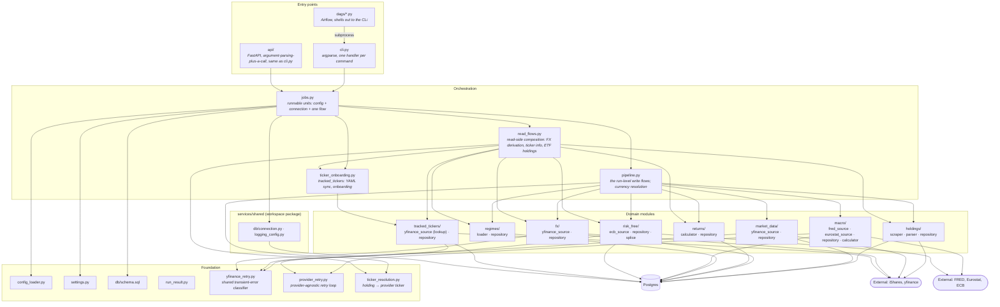
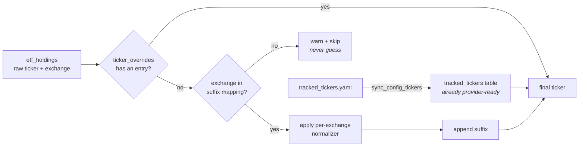
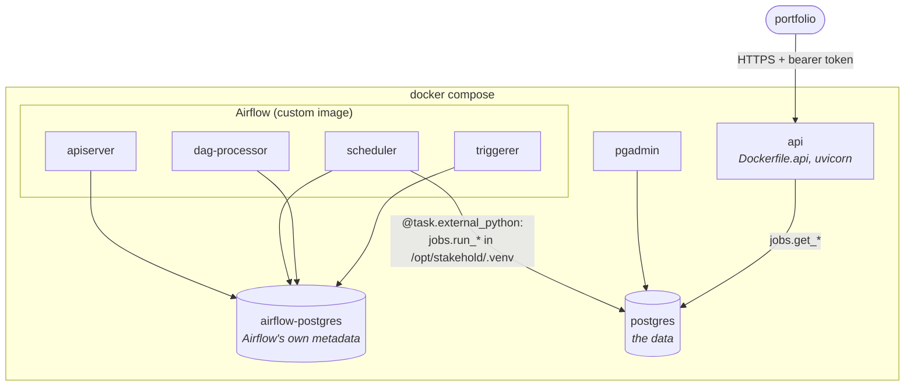

# data-store architecture

How this service is put together and why. For *what the tables look like* see
[`schema.md`](schema.md); for *how to run it* see [`../README.md`](../README.md). This document
covers the parts neither of those does: the layering, the boundaries between modules, and the
decisions that would otherwise look arbitrary. The read API's endpoints and their design are in
[`read-api.md`](read-api.md), split out of this file for size and part of it.

## What the service is responsible for

Getting external financial data into Postgres, correctly and repeatably. Five things go in:

- **ETF holdings** — scraped from a fund provider's website (iShares today).
- **Raw daily market data** — OHLCV prices, dividends and stock splits, for every ticker those
  holdings contain plus directly tracked ones. One fetch, one table (`raw_market_data`) —
  unprocessed, matching the source's own grain, not decomposed into a return calculation there.
- **Daily FX rates** — currency-conversion rates for every currency in `config/currencies.yaml`,
  plus every enabled tracked ticker's currency, against its `base_currency`, landed in `fx_rates`. Kept separate from `raw_market_data`
  deliberately — an FX rate isn't a security's price and has no OHLC, dividends, or splits to
  carry.
- **Macro indicators** — monthly/quarterly US inflation and GDP (FRED) and EU/euro-area
  inflation and GDP growth (Eurostat), landed verbatim in `raw_macro_indicators`.
- **Daily risk-free rates** — the ECB's euro overnight rates, €STR and the discontinued EONIA,
  landed verbatim in `risk_free_rates`. They're joined into one risk-free series on read
  (`risk_free/splice.py`, served by `GET /rates/risk-free`), so each stored number can still be
  checked against the ECB.

Two things are derived, not fetched: **`market_returns`** — split-adjusted price and
price/dividend/simple/log returns, rebuilt from `raw_market_data` by `calculate-returns` — and
**`macro_indicator_rates`** — comparable year-over-year inflation/growth percentages, rebuilt from
`raw_macro_indicators` by `calculate-macro-indicator-rates` (FRED's raw levels need the YoY
computed; Eurostat's chosen dimension slices already are one, and pass through unchanged). Both
still fit the service's remit because they involve no judgment about portfolios or holdings — it's
arithmetic on data already landed here, kept in this service so each raw table's sharp edges (the
split-restatement behaviour below for prices; the level-vs-rate distinction for macro data) are
handled once, next to the table that has them, rather than relearned by every consumer.

It does *not* value portfolios or decide what's worth owning — that belongs to `portfolio`, which
reads `market_returns`. The dividing line is deliberate: this service's job is that the data in
Postgres is a faithful, complete record of what the sources said, plus the one derived table close
enough to that record to need no portfolio-level context.

## Layering

Dependencies point one way, downward. Nothing in a lower layer imports from a higher one.



`db/connection.py` and `logging_config.py` are not this service's own code — they live in
[`services/shared`](../../shared/docs/architecture.md), a workspace package this service depends
on rather than duplicates. `auth` depends on the same package for the same reason. Everything else
in the diagram above is `data-store`-specific.

**`jobs.py` is the seam that matters.** Each `run_*` there is one complete operation: load
settings and configuration, open a connection, run the flow, close the connection, return its
result. `cli.py` is argument parsing plus a call into it, and nothing else. An Airflow task will
be a call into it and nothing else. Anything that lived in only one of those two would be, by
construction, untested by the other — which is exactly how a CLI and a scheduled job drift apart.

**The read API's jobs deviate from that contract on purpose.** `get_price_series`,
`get_fx_series` and `get_ticker_info` are named `get_*` rather than `run_*`, and return a data
payload rather than `run_result.py`'s `{"status", "rows_saved"}` — there is nothing to save and
no run to summarize, only a query to answer. `read_flows.py` is a sibling of `pipeline.py`, not
an addition to it: `pipeline.py` is already close to the file-size guidance in
[`context-management.md`](../../../.claude/rules/context-management.md), and FX cross-rate
derivation is a read-side decision with no write-flow analogue.

**`ticker_onboarding.py` is a second sibling, for the same file-size reason.** It holds the flows
that bring a ticker into the `tracked_tickers` table and through onboarding (`tasks.md`, the
ticker-onboarding chunk): `sync_config_tickers` (the YAML-to-table sync), the symbol lookup a
user's request goes through, and the onboarding run (TK-5).

`tracked_tickers/` follows the standard three-file shape, with one twist: its `*_source.py` doesn't
fetch data to store, it *classifies* a symbol. `base.py`'s `TickerLookupSource.lookup()` returns
one of four outcomes:

- `found`: has prices, and can be held.
- `unsupported`: has prices, but is an index or a currency pair.
- `not_found`.
- `unavailable`: the provider didn't answer.

A provider's answer is never an exception, so "Yahoo didn't answer" can't be mistaken for "no
such symbol". The orchestration around it lives in `ticker_onboarding.py`:

- **Normalisation:** `normalize_symbol` whitelists and uppercases a symbol before it reaches the
  provider.
- **Caching:** `lookup_symbol` keeps definite answers in an in-process `LookupCache` for 15
  minutes. It never caches `unavailable`, which says nothing about the symbol.

**Known limitation:** the cache is per process. The read API runs one uvicorn worker today, so
that's one cache; a second worker would cost at most one extra provider call per symbol.

Its arguments are plain builtins, including `earliest_date` as an ISO string rather than a `date`.
That looks like a weaker type until you notice both callers hand it over as text — argparse from
the command line, Airflow from a DAG parameter — so parsing it inside the job keeps that
conversion in one place instead of two.

The rule that keeps this honest: **`pipeline.py` never touches SQL or HTTP directly, and the
domain modules never decide *what* to fetch.** Orchestration knows which tickers matter and in
what order; the domain modules know how to talk to one source or one table. When those blur, the
next data source becomes a rewrite instead of a new file.

## The three-file shape of a domain module

Each domain follows the same split, and a new one should too:

| File | Owns | Never does |
|---|---|---|
| `base.py` | The `Protocol` a source must satisfy | Anything concrete |
| `*_source.py` | Talking to one external provider; reshaping its response into long-form rows | Touch the database |
| `repository.py` | Reading and writing one table | Know where the data came from |

`holdings/` has an extra pair because scraping is two steps: `scraper.py` drives a real browser to
resolve the download URL, and `parser.py` fetches and parses the CSV. They're split because only
the first needs Playwright — the resolved URL is a plain unauthenticated GET, so the expensive
browser dependency stays confined to the one function that genuinely needs it.

`column_mapping.py` is the single declaration of how provider CSV columns map to database columns
and types. A provider renaming a column is a one-line change there, not a hunt through parsing
code.

`returns/` deviates the other way: just `calculator.py` (pure arithmetic, no I/O) and
`repository.py`. There is no `base.py` because there's no provider Protocol to satisfy, and no
`*_source.py` because there's no external call — the input is `raw_market_data`, this service's
own table. Disclosed rather than silently different: a domain reading another domain's table
instead of an external source is a shape the original three-file split didn't anticipate.

`regimes/` has a similar two-file shape: `loader.py` (reads and validates a local CSV into
`RegimeConfig` dataclasses, following the `config_loader.py` vocabulary for errors and validation)
and `repository.py` (writes the `regimes` table, and reads it for `GET /regimes`). There is no
external provider — the only source is a hand-curated CSV in `config/`, updated manually — and
no base Protocol.

`macro/` combines both patterns seen so far, because it has both a provider-backed raw table and
a derived one: `base.py` (the `MacroIndicatorSource` Protocol, shared by both providers),
`fred_source.py` and `eurostat_source.py` (one `*_source.py` per provider, not one — the two
talk to genuinely different APIs, a fixed-series pull vs. a dimension-filtered dataset query —
and `repository.py` (raw upsert plus the read-back `get_raw_indicators` the calculator needs),
plus `calculator.py` (pure YoY-normalization arithmetic, no I/O, mirroring `returns/calculator.py`
exactly). Both `*_source.py` files retry through `provider_retry.py`, a foundation module. It
began as `macro/retry.py`, scoped to this domain while both its callers lived here. It moved out
when `risk_free/` needed the same loop, for the same reason `yfinance_retry.py` left
`market_data/`: one domain importing another's helper isn't a foundation to build on. Its
classifier knows no provider's specific errors (unlike `yfinance_retry.py`'s), which is what
lets a third provider share it.

`fx/` follows the standard three-file shape exactly, and is the second implementation of it (after
`market_data/`) rather than the first — deliberately kept as a *separate* domain rather than folded
into `market_data/`: an FX rate has no OHLC, dividends, or splits, so reusing `raw_market_data`'s
table and Protocol would mean either forcing zero-filled columns onto data that doesn't have that
shape, or narrowing the `MarketDataSource` Protocol in a way the trade-off below already explains
isn't free. `fx/yfinance_source.py` and `market_data/yfinance_source.py` do share one thing:
`yfinance_retry.py`'s `_is_transient` classifier, promoted out of `market_data/_yfinance_retry.py`
to a foundation module (not under either domain package) when `fx/` needed it too — sibling domain
modules reaching into each other's private helpers wasn't a foundation worth building on.

`risk_free/` is the standard three-file shape again, for the ECB's €STR and EONIA (the inputs to
the risk measures' risk-free rate), plus `splice.py`, the pure read-side rule that joins them
(see [`read-api.md`](read-api.md)). The splice sits in the domain package rather than in
`read_flows.py` because the cutoff and the spread define the risk-free series. They aren't
choices about orchestrating an HTTP read, and a pure function can be tested without faking a
repository. It's a domain of its own rather than a third `macro/` provider,
because the two don't fit the same interface. `MacroIndicatorSource.fetch` takes regions and
returns monthly or quarterly indicators. A risk-free series has no region, and it's fetched by
date range like `fx/`. Some details:

- **One series per call.** `RiskFreeRateSource.fetch` takes one series, so the flow can count a
  failed series rather than have it disappear inside the source, which is what happens to a
  failed Eurostat dataset.
- **The source declares its series and which of them are closed** (`series`, `discontinued`).
  The flow then decides what to fetch without knowing it's talking to the ECB.
- **Retries go through `provider_retry.py`, with one change.** `requests.HTTPError` is an
  `OSError`, so the shared classifier would retry a 404. `ecb_source.py` re-raises a 4xx other
  than 429 as a non-retried type. This is kept local rather than changed in the classifier,
  because changing the classifier would change how Eurostat retries, outside RK-2's scope.
  **Known sharp edge:** the `eurostat` package also uses `requests`, so a permanent 4xx from
  Eurostat is probably retried as if it were transient. The fix is to classify
  `requests.HTTPError` by status code in `provider_retry.is_transient`, and then drop the
  ECB-local re-raise.

## Extension points

New providers are registry entries, not new branches. All five registries live at the top of
`pipeline.py`:

```python
SCRAPERS              = {"ishares": get_holdings_csv_url}
MARKET_DATA_SOURCES   = {"yfinance": YFinanceMarketDataSource}
FX_RATE_SOURCES       = {"yfinance": YFinanceFxRateSource}
MACRO_INDICATOR_SOURCES = {"fred": FredMacroIndicatorSource, "eurostat": EurostatMacroIndicatorSource}
RISK_FREE_RATE_SOURCES  = {"ecb": EcbRiskFreeRateSource}
```

Adding a second market-data (or FX-rate) provider means writing a class satisfying
`market_data/base.py`'s `MarketDataSource` (or `fx/base.py`'s `FxRateSource`) Protocol and adding
one line. No flow function changes. `FX_RATE_SOURCES` has one entry today and, unlike
`MARKET_DATA_SOURCES`, its key isn't selected from user config (`config/currencies.yaml` has no
per-currency `price_source` field — there was nothing to choose between yet) — `ingest_fx_rates`
and `backfill_fx_rates` both look it up under the literal `"yfinance"` key. Revisit that the day a
second FX source actually exists.

`MACRO_INDICATOR_SOURCES` is shaped differently from the other three registries: it isn't a
*choice* between interchangeable providers for the same data — `fred` and `eurostat` cover
disjoint regions (US vs. EU), so both are constructed unconditionally rather than one being
looked up by a config-selected key. Whether each is actually *called*, though, depends on
`eu_regions`: `ingest_macro_indicators` skips Eurostat's `fetch()` (and says so in its log) when
`config/macro_regions.yaml` is absent or empty — see the `macro_regions.yaml` note below.

`RISK_FREE_RATE_SOURCES` is like `FX_RATE_SOURCES`: one entry, looked up under the literal
`"ecb"` key, with no config choosing it. Which series to fetch is the source's own `series`, not
config, because the risk-free rate is defined as these two series (spec §4.1). Adding a series
there is a change to that definition, not a deployment setting.

**A disclosed trade-off of one combined registry**: before the OHLCV/dividend fetch merge, prices
and dividends had separate registries and Protocols, because they were genuinely separate
fetches with different `fetch()` shapes. Now that one fetch returns both, a future
price-only or dividend-only-shaped provider (e.g. a source with prices but no dividend concept)
has to implement the full `MarketDataSource` Protocol and return an empty/zero-filled frame for
whichever columns it doesn't have, rather than being a narrower Protocol of its own. Accepted
because it matches the actual shape of the one HTTP call each provider makes, and there's
currently exactly one provider (yfinance) to generalize from.

**One sharp edge if you add a source:** the registry *key* and the class's `.name` attribute are
two different strings. `.name` is what gets stamped into the `source` column and what backfill
floors are read under; the key is what config files reference. Keep them equal unless you have a
reason not to.

## The flows

Ten live in `pipeline.py`. Two, the tracked-ticker sync and ticker onboarding, live in
`ticker_onboarding.py`. All are exposed as CLI subcommands.

| Flow | Command | Cadence | Reads | Writes |
|---|---|---|---|---|
| Holdings ingest | `ingest-holdings` | weekly | provider site | `etf_holdings` |
| Market data ingest | `ingest-market-data` | daily, in parallel with regimes, FX and risk-free ingest | `etf_holdings` + `tracked_tickers` (`ready` rows only) | `raw_market_data` |
| Market data backfill | `backfill-market-data` | manual | `raw_market_data` + `tracked_tickers` (every enabled row) | `raw_market_data` |
| Returns calculation | `calculate-returns` | daily, immediately after market data ingest succeeds (same run) | `raw_market_data` | `market_returns` |
| Regimes ingest | `ingest-regimes` | daily, in parallel with market data, FX and risk-free ingest | `config/regimes.csv` | `regimes` |
| FX rates ingest | `ingest-fx-rates` | daily, in parallel with market data, regimes and risk-free ingest | `config/currencies.yaml` + `tracked_tickers` currencies | `fx_rates` |
| FX rates backfill | `backfill-fx-rates` | manual | `fx_rates` | `fx_rates` |
| Risk-free rates ingest | `ingest-risk-free-rates` | daily, in parallel with market data, regimes and FX ingest | ECB Data Portal + `risk_free_rates` (latest date per series) | `risk_free_rates` |
| Macro indicators ingest | `ingest-macro-indicators` | monthly, own DAG | FRED + Eurostat + `config/macro_regions.yaml` | `raw_macro_indicators` |
| Macro indicator rates | `calculate-macro-indicator-rates` | monthly, immediately after macro ingest succeeds (same run) | `raw_macro_indicators` | `macro_indicator_rates` |
| Tracked-ticker sync | `sync-tracked-tickers` | at the start of every market data ingest, backfill and onboarding run; also runnable on its own | `config/tracked_tickers.yaml` | `tracked_tickers` |
| Ticker onboarding | `process-ticker-requests` | every 5 minutes, own DAG (`ticker_onboarding`) | `tracked_tickers` (due `pending` rows) | `raw_market_data`, `fx_rates`, `market_returns`, `tracked_tickers` |

**Returns calculation is the odd one out**: it reads no config and does no ticker resolution — it
discovers both sources and tickers directly from `raw_market_data` (`returns/repository.py`'s
`get_sources`/`get_tickers`), and is always a **full rebuild** of whatever tickers it's asked
about, never an incremental append. A split retroactively changes the correct value of every
earlier row for that ticker (see `docs/schema.md`, `market_returns`), so an incremental design
would serve stale values after a split rather than merely being slower to catch up. It's batched
by ticker (`RETURNS_BATCH_SIZE`, a few hundred at a time) rather than loaded as one DataFrame,
since `raw_market_data` is 8.95M rows — and a batch's save failure is isolated from the batches
around it the same way a ticker's failure is isolated in backfill.

Before the market-data merge shipped, price and dividend ingest/backfill were four separate flows,
each resolving the same ticker universe and hitting yfinance separately. They merged into one
because a single `Ticker.history()` call already returns OHLCV, dividends and stock splits together
— fetching them through two flows was paying for two HTTP round trips per ticker to get data that
came back in one.

**Market data ingest has a second, conditional fetch.** Normally it is one fetch per
(source, asset_type) group, or a few after an outage (see the catch-up below). But the provider retroactively rescales a ticker's *entire* price and
dividend history when that ticker splits (see [`schema.md`](schema.md), "What `close` actually
contains"), while this flow only re-fetches a rolling window — so a split would leave one ticker's
stored rows on two different scales, a step change indistinguishable from a real
several-hundred-percent move. When an ingested batch contains a non-zero `stock_splits`, the flow
therefore re-fetches that ticker's full stored range and rewrites it
(`pipeline._refresh_split_histories`). This is the one place the daily flow issues an unbounded
historical request rather than a windowed one; splits are rare enough that the cost is negligible.

**The daily ingests catch up after an outage instead of trusting a fixed window.**
`ingest-market-data` and `ingest-fx-rates` fetch `today − days`, but a ticker or currency pair
whose latest stored date is older than that is fetched from that date instead, up to
`jobs.CATCH_UP_DAYS` (a year) back (`pipeline._fetch_windows`). Keys behind to the same date
share one fetch, so an outage that hit everything costs one extra request per group, not one per
ticker. Each window is its own failure unit, so a failed catch-up doesn't cost today's rows.

*Why:* the DAG didn't run from 2026-09-04 to 09-22. The next run's 7-day window started at
09-15, so 09-04..09-14 was never fetched for any ticker or pair. Backfill couldn't repair it
either, since it only fetches below a ticker's earliest stored date. A gap like that is silent:
the returns across it read NULL (see `schema.md`'s "Daily catch-up after an outage"), and the
gap itself shows up nowhere.

*Rejected:* one run-wide start at the oldest key's latest date — a single delisted ticker would
then drag every ticker's fetch back a year, every run. *Rejected:* Airflow `catchup=True` — the
jobs take `date.today()`, not the run's logical date, so replaying missed runs would fetch the
same window again each time; and a run that's down for a day would still depend on the DAG
history being intact. *Rejected:* no limit — a delisted ticker never catches up, so it would
re-request its whole gap on every run forever. The limit is warned about by name when hit.

**A key with nothing stored is fetched from the start of its history**, not the rolling window,
by the same `_fetch_windows`. All such keys in a group share one fetch.

*Why:* the daily ingest and backfill disagreed about who fills a new key's history. The daily
ingest left it to backfill, but a plain backfill rerun treats any stored row as "already walked
back" (`_backfill_window`). So once the daily ingest stored a rolling window, backfill skipped the
key for good, and nothing schedules a backfill anyway. Six holdings the 2026-08-20 backfill missed
(BRK-B among them) sat at about 30 rows. The fix belongs at the point where the first rows are
written, which is the only moment "nothing stored" really does mean "no history fetched yet".

*Rejected:* making backfill's skip rule stricter, e.g. "done only if rows reach back N years". The
table records how far back rows exist, not how far back anything looked, and a recent listing
legitimately has little history. *Rejected:* a scheduled backfill in `daily_pipeline` — on its
own it still hits the same skip rule.

*Cost:* a key the provider has no data for (delisted, mistyped) has nothing stored on every run,
so it's requested from the start of its history every run. That costs one request per key, the
same as the windowed request it replaces, and it comes back empty.

*Known limit:* the catch-up starts from the latest stored date, so a hole *behind* it (one made
before this rule existed) is not found. Repair is a one-off `--days N` run over it. Keys that
already got a window before the full-history rule existed need a `backfill-market-data
--force-refresh --ticker …`.

**Market data ingest, regimes ingest, FX rates ingest, risk-free rates ingest and returns
calculation share one DAG, `daily_pipeline`.** `ingest-market-data`, `ingest-regimes`,
`ingest-fx-rates` and `ingest-risk-free-rates` start together with no dependency between any pair
of them — a hand-curated CSV of market regimes, a currency conversion rate, an overnight interest
rate, and a security's price have nothing to do with each other, so there is no reason for one to
wait on another, and running them in parallel gets them all done faster. Risk-free rates are
daily rather than in the monthly `macro_indicators` DAG because €STR is published every business
day, and the risk measures read it day by day.
`calculate-returns` runs afterward, but is gated specifically on `ingest-market-data`'s result
check succeeding, not merely on the task finishing: it rebuilds `market_returns` from whatever
`ingest-market-data` just landed in `raw_market_data`, so an "ok" ingest that silently saved zero
rows must not unlock a returns rebuild any more than a raised exception would. It has no
dependency on the regimes, FX or risk-free branches, which touch different, unrelated tables. Each
`ingest-regimes` run still replaces the entire `regimes` table from the current CSV file — the
source is still a hand-curated CSV, edited manually when new market events occur or existing
regime definitions change, but the load into the database is now scheduled daily like the other
data-source flows rather than triggered by hand after every edit. `ingest-fx-rates` has its own
manual-trigger counterpart, `backfill-fx-rates` (DAG `backfill_fx_rates`), mirroring
`backfill-market-data`'s shape — one currency pair at a time, rate-limited, using `fx_rates` itself
as the checkpoint via `get_earliest_fx_dates` — but without market data's split-restatement
concern, since an FX rate has no split to restate.

**Macro indicators get their own DAG (`macro_indicators`), scheduled `@monthly` rather than
joining `daily_pipeline`.** CPI/HICP publish monthly and GDP quarterly — nothing here changes
day to day, so a daily run would mostly re-save identical figures. `ingest-macro-indicators`
lands `raw_macro_indicators`; `calculate-macro-indicator-rates` runs after, gated on the ingest's
check succeeding, the same pattern as `calculate-returns` after `ingest-market-data`. No backfill
counterpart exists: FRED and Eurostat both return a series' full available history in one call
(unlike yfinance, there's no per-ticker rate-limit concern driving a slow, one-at-a-time backfill
mode), so `ingest-macro-indicators` already fetches everything available each run.

**Ticker onboarding gets its own DAG (`ticker_onboarding`), every 5 minutes, one run at a
time.** A user who adds a ticker should wait minutes, not until tomorrow's `daily_pipeline`.
Each run:

1. syncs the YAML;
2. returns any row left `backfilling` for over an hour (a run that died) to `pending`;
3. takes up to 50 due `pending` rows, oldest request first. For each it:
   - claims the row (`pending` → `backfilling`, a conditional update, so two runs can never both
     work on one ticker);
   - backfills the ticker's full history by reusing `backfill_market_data` with
     `only_tickers` and no funds;
   - backfills its currency's FX rates, if it isn't the base currency;
   - calculates its returns;
   - marks it `ready`.

Why it's shaped this way:

- **Success is judged by what landed, not by the flows' statuses.** The row only becomes `ready`
  once `raw_market_data` holds prices for it and `fx_rates` holds the pair. Only then can a
  portfolio value it.
- **The recorded reason says whether Yahoo answered.** A backfill that couldn't reach the provider
  (`tickers_unreachable`) is saved as "the provider couldn't be reached"; one that reached it and
  got nothing is "the provider returned no price history". They were once the same message, so a
  DNS failure right after the host woke from sleep read to an admin as a bad symbol.
- **A failed attempt is retried after 10, then 20 minutes, and given up (`failed`) on the 3rd.**
  Only giving up makes the run `partial` and the DAG red. A retry still to come is a warning, so
  a passing Yahoo blip doesn't page anyone, while a ticker that will never load does.
- **A config row arrives with no currency**, since the YAML doesn't carry one. Onboarding looks
  it up first (the same lookup a user's request uses) and stores it with the exchange. Failing to
  is a warning, not a failed attempt, because the prices can still load.
- **Why not trigger a backfill from the API directly?** A queue table read by a frequent DAG
  survives restarts, keeps retries and logs in Airflow with the rest of the pipeline, needs no
  Airflow credentials in the API container, and never waits behind a multi-hour full backfill.
  The cost is up to five minutes' delay, which the user sees as "loading".

### What a flow returns

The four run-level flows return a structured result, not a row count:

```python
{"status": "ok" | "partial" | "nothing_to_do",
 "tickers_resolved": int, "rows_saved": int, ...}   # plus per-flow counts
```

`status` carries the judgement so callers don't re-derive it from counts. Zero rows saved is
ambiguous on its own — it is the correct outcome for a run with nothing to do, and an alarm for a
run whose every group failed. Separating them is what lets an automated check react to the second
without crying wolf about the first, and it's the same distinction the logging rules require of the
human-readable output.

A request that matches nothing is a **failure**, not an empty success: asking for
`--ticker NOPE` and getting nothing means the run didn't do what it was asked, so it reports
`partial` rather than `nothing_to_do`. More generally a failure outranks emptiness — a run that
ended up with nothing to work on *because* something broke must not show green.

`run_result.py` owns this contract — `RUN_RESULT_KEYS` names the two keys *every* run carries, so
a caller can react to any of them without knowing which ran. Only two, deliberately: a pricing run
counts tickers and a holdings run counts funds, so a shared "units" key would mean something
different in each and be a trap rather than a contract. Each run adds its own named counts on top
(`tickers_resolved`, `groups_failed`, `funds_failed`, and so on).

It lives in its own module rather than in `pipeline.py` because four layers depend on it —
`pipeline` builds these, `jobs` builds and forwards them, the CLI turns them into exit codes, and
Airflow reads them back as XCom values. One definition is what stops those drifting.

**The value is plain builtins on purpose.** It is destined to cross a process boundary as an
Airflow XCom — pickled in this service's interpreter and unpickled in Airflow's, where
`data_store` is not importable. A dataclass, enum, `date` or numpy integer would fail there with
`ModuleNotFoundError`. A test asserts the contract rather than trusting it.

`ingest_holdings` is the exception: it stays a bare row count because it is a per-fund primitive,
not a run. Run-level aggregation across funds belongs to its caller.

**They are deliberately independent.** The pricing flows read whatever ticker list is currently in
`etf_holdings`; they never trigger a scrape. So a holdings scrape failing doesn't cascade into
prices going stale, and each flow can run on its own schedule. The coupling is through the table,
not through the call graph.

**Daily and backfill are separate commands, not one command with a flag**, because they have
opposite performance shapes. The daily flows batch many tickers per request and are expected to
finish in seconds; the backfills fetch one ticker at a time with a deliberate sleep between them
and can run for hours. Merging them would mean one set of rate-limit and batching decisions
serving two incompatible needs.

### Ticker resolution, the load-bearing part

Everything that prices anything goes through the same resolution step, and it's where most of the
service's accumulated knowledge lives:



Three things about this are intentional:

1. **An unmapped exchange is skipped with a warning, never guessed.** The provider returns *no
   rows* rather than an error for a bad symbol, so a guessed ticker would look like a ticker that
   simply had no trading activity. Refusing to guess is what keeps "no data" meaningful.
2. **Resolution happens at fetch time, not at scrape time.** `etf_holdings.holding_ticker` stays
   exactly as scraped, so fixing a mapping takes effect on the next pricing run with no re-scrape.
   The read API resolves on read for the same reason (`GET /tickers/{ticker}`'s currency, and
   `GET /etf-holdings`' `yfinance_ticker`), with the same function and tables.
3. **Tracked tickers bypass it entirely.** They're configured in provider-ready form already, so
   putting them through exchange resolution would corrupt them.

**Tracked tickers are read from the `tracked_tickers` table, not the YAML.** Each market data
ingest and backfill first syncs `tracked_tickers.yaml` into the table, then reads it back, so the
YAML keeps working as the default list while users and admins can add rows of their own. The two
flows read it differently, on purpose:

- **The daily ingest takes only `enabled` rows whose `status` is `ready`.** Backfill's resume rule
  skips any ticker that already has data. If the ingest landed a 7-day window for a ticker that
  hadn't been backfilled yet, the backfill would then see data, skip it, and its history would
  never be fetched. Keeping not-yet-ready tickers out of the ingest is what makes "backfill
  first" hold.
- **Backfill takes every `enabled` row**, ready or not, since filling the history is what makes a
  ticker ready.

A consequence: a ticker added to the YAML is not priced daily until onboarding (TK-5) has
backfilled it and marked it `ready`.

The rules live in `ticker_resolution.py`, not `pipeline.py`, because the read API needs the
same answer (which holding a priced ticker came from, for its currency). They return `None` for
an unmapped exchange without logging; ingest warns at its own call site. The read API resolves
every holding on each call, so a warning there would only be noise.

The per-exchange normalizers (`TICKER_NORMALIZERS`) encode verified quirks — Hong Kong codes need
zero-padding, London tickers ending in `.` must not double it, Nordic and Toronto share classes use
a hyphen. These were confirmed against real provider responses, not inferred. Treat them as
findings, not guesses, and verify before adding more.

Full details in [`schema.md`](schema.md).

### How yfinance answers a symbol lookup (verified)

Ticker onboarding (`tasks.md`, TK-3) has to tell "Yahoo doesn't know this symbol" apart from
"Yahoo didn't answer". These are observed responses (yfinance 1.7.0, 2026-10-10, with
`hide_exceptions = False` as `market_data/yfinance_source.py` sets it), not inferences:

| Symbol | `Ticker(s).history(...)` |
|---|---|
| Unknown (`NOTAREALTICKER123`) or long-delisted (`TWTR`) | Raises `curl_cffi` `HTTPError`, `response.status_code == 404` |
| Recently delisted (`SIVB`) | Raises `YFPricesMissingError` (`period="5d"`) or `YFTzMissingError` (`period="max"`), both subclasses of `YFTickerMissingError` |
| Throttled | `YFRateLimitError("Too Many Requests. Rate limited. ...")`, read from the installed source; not provoked live |
| Valid | Rows, plus `history_metadata` with `symbol`, `currency`, `exchangeName`, `fullExchangeName`, `instrumentType`, `longName`, `shortName` |

What follows from it:

- **A 404 is an `OSError`.** `curl_cffi`'s `HTTPError` subclasses `OSError`, so
  `yfinance_retry._is_transient` classifies an unknown symbol as *transient*. A lookup must check
  for a 404 (and for `YFTickerMissingError`) **before** asking `_is_transient`, or every typo would
  read as "Yahoo is down, try again". That check is `yfinance_retry._is_missing_symbol`, shared by
  the lookup and the market-data source; `_is_unreachable` is "transient and not missing". The
  market-data source still retries a 404 like a network blip (wasted calls, nothing worse), but
  doesn't report it as unreachable, so a delisted holding stays "no data" in a backfill.
- **`instrumentType` values seen**: `EQUITY`, `ETF`, `CRYPTOCURRENCY`, `MUTUALFUND`, `FUTURE`,
  `INDEX`, `CURRENCY`. The first five can be held; an index or a currency pair can't.
- **`currency` is per listing, and can be a minor unit.** `VOD.L` is `GBp` (pence), `VUSA.L` is
  `GBP` and `CSPX.L` is `USD`, all on the LSE. So a lookup has to show the currency for the user to
  confirm. Nothing in the system rescales a minor-unit price yet; see `tasks.md`'s known
  limitations.
- **Symbols are case-insensitive** (`asml.as` works), and `history_metadata["symbol"]` returns the
  canonical spelling (`ASML.AS`), which is what should be stored.
- `longName` can be `null` (`GC=F`), so a display name falls back to `shortName`.
- A valid lookup took 0.1–0.6 s and a 404 about 0.9 s, which is fast enough for a request path.

## Read API

A fourth entry point, alongside `cli.py` and `dags/*.py`: a FastAPI app (`api/`) over tables this
service already owns, for `portfolio` and `web` to consume over HTTP rather than opening a
database connection of their own. It is mostly read-only; the tracked-ticker routes are the
exception. Its endpoints, and the design choices peculiar to them, are in
[`read-api.md`](read-api.md), split out of this file for size.

## Configuration

Four files, split by whether they're personal or reference data:

| File | Committed? | Why |
|---|---|---|
| `config/etfs.yaml` | no — gitignored | Someone's actual holdings. A fund's optional `ticker` (e.g. `IWDA.AS`) links it to the ticker it trades under, for `GET /etf-holdings` ([`read-api.md`](read-api.md)) |
| `config/tracked_tickers.yaml` | no — gitignored | Same, and optional. The platform's default tracked tickers, synced into the `tracked_tickers` table rather than read directly |
| `config/currencies.yaml` | no — gitignored | Someone's own base/tracked currencies |
| `config/yfinance_exchange_suffixes.yaml` | **yes** | Generic reference data, useful to everyone |
| `config/macro_regions.yaml` | no — gitignored | Someone's own choice of EU regions, and optional |

`.example` templates are committed for the first three. Paths are environment-overridable via
`settings.py`, which is also where `DATABASE_URL` comes from — no credential is ever read from a
config file or hardcoded.

**The FX universe is `currencies.yaml` widened by tracked tickers' currencies.** A ticker
nobody can convert into the base currency can't be valued, so `currencies_with_tracked_tickers`
(`ticker_onboarding.py`) adds the currency of every enabled `tracked_tickers` row before FX
ingest, FX backfill and `GET /fx` use the list. That way adding a Johannesburg stock doesn't also
need someone to edit a file on the server.

- Minor units map to their major currency first (`GBp`→`GBP`, `ZAc`→`ZAR`, `ILA`→`ILS`), since
  FX rates exist only for the major one. That picks the pair only: a pence-quoted price is still
  stored in pence, and nothing rescales it yet (a known limitation, in `tasks.md`).
- **A currency the YAML explicitly disables stays disabled**, with a warning naming the tickers
  it leaves unconvertible. `enabled: false` is an operator decision, and the ticker list
  shouldn't override it silently.
- The widening is done in the job layer, not `pipeline.py`. The FX flows still take a plain
  `CurrenciesConfig` and don't know where its entries came from.

`config/currencies.yaml` sits between the other two gitignored files in one way: it's required,
not optional (`load_currencies` raises `ConfigError` on a missing file, the same as `load_funds`)
— unlike `tracked_tickers.yaml`, there's no sensible "not configured yet" state for the currency
list an FX ingest needs to run at all. It names one `base_currency` and every other enabled
currency is tracked as a rate against it; see [`schema.md`](schema.md)'s `fx_rates` section for
the exact convention.

`config_loader.py` validates on load and raises `ConfigError` with the specific problem. Two
loaders read the same file: `load_exchange_suffixes` and `load_ticker_overrides` take different
top-level keys from `yfinance_exchange_suffixes.yaml`, since a one-off ticker rewrite and an
exchange mapping are the same kind of reference data maintained together.

**`INTERNAL_API_SECRET`** is the read API's shared secret, read via `settings.py` like every other
value here — never from a config file. It is `Settings.internal_api_secret: str | None`, optional
at the `Settings` level (every CLI/Airflow caller has no need of it, so making it required would
break them) but required by `api/app.py` at its own startup: the API fails loudly with
`SettingsError` if it's unset, rather than silently accepting every caller once the check would
otherwise run.

**`DATA_STORE_TICKER_REQUESTS_PER_DAY`** (default 10) is the per-user limit on new tickers
via `POST /tracked-tickers`. It's a behavioural setting rather than a credential, but lives in the
environment like the rest because it's per deployment. `load_settings` refuses a value that isn't
a non-negative integer, rather than letting the API fall back to some default.

**`FRED_API_KEY`** follows the identical pattern: `Settings.fred_api_key: str | None`, optional at
the `Settings` level (only `ingest-macro-indicators` needs it), but `run_ingest_macro_indicators`
raises `SettingsError` at its own point of use if it's unset — the same "fail loudly at the one
call site that needs it, not at every caller" shape as `INTERNAL_API_SECRET`.

**`config/macro_regions.yaml` is optional, unlike `config/currencies.yaml`.** `load_macro_regions`
itself returns `[]` for a missing or empty file, rather than splitting that check into `jobs.py`
the way `tracked_tickers.yaml` does — a deliberately simpler version of the same "not configured
yet" tolerance, since there was no second caller here that needed the file-existence check
separated out. FRED's US data ingests regardless; only the Eurostat half of a run is skipped
(and says so in its log) when this file is absent.

## Deployment



**Two separate Postgres instances.** Airflow's metadata database and the data warehouse share
nothing. Airflow's is disposable; the data one is not.

**`postgres` (the data warehouse, not `airflow-postgres`) runs with `log_statement=mod`**
(`docker-compose.yml`'s `command:`), logging every `INSERT`/`UPDATE`/`DELETE`/`TRUNCATE` —
including a direct `psql` connection bypassing `data_store`'s own code — to the container's own
log. See `auth/docs/architecture.md`'s "Deployment" section for the incident that prompted this
across all three app-data instances.

**Airflow runs a custom image** (`Dockerfile.airflow`) that layers `uv` and this workspace onto the
official Airflow image. The DAGs call the same `jobs.run_*` functions the CLI calls, through
`@task.external_python`.

**The read API is its own container** (`Dockerfile.api`), not folded into the Airflow image: it
serves live traffic on its own lifecycle, independent of whatever the scheduler is doing, and
needs none of Airflow's own image (no Playwright browser, no Airflow package at all — just this
workspace's dependencies via `uv sync` and `uvicorn`). Like the Airflow containers, it reaches
`postgres` by the compose network's service name, not `localhost:${POSTGRES_PORT}` — `DATABASE_URL`
is overridden in `docker-compose.yml` the same way `x-airflow-common`'s is.

**`api` also joins `stakehold-net`** (task 13's cross-service network, see `docs/smoke-test.md`),
opted into via `services/data-store/docker-compose.stakehold-net.yml` rather than baked into this
file directly — `portfolio` reaches it there as `http://data-store-api:8000` for `rebuild-returns`.
`web` never calls `data-store` directly (see `web/docs/architecture.md`'s "Talks to" section), so
only `portfolio`'s benefit justifies this. The Airflow containers and `pgadmin` stay off that
network — nothing cross-service talks to either.

**Two interpreters, on purpose.** Airflow's own is Python 3.13; this workspace requires 3.14 and
pulls in pandas, yfinance and Playwright. `@task.external_python` runs the task body in
`/opt/stakehold/.venv` while Airflow's environment stays clean — so a dependency change here can't
break the scheduler, and DAG parsing never imports pandas. `expect_airflow=False` is required
because that venv deliberately has no Airflow in it.

**And the task returns a value.** The operator pickles the function's return in the external
interpreter and unpickles it in Airflow's, where it becomes the task's XCom `return_value`. That
is why the result contract is plain builtins: `data_store` is not importable on the receiving
side, so a dataclass or `date` would fail to unpickle. Each DAG's final `check_run` task reads
that value and fails the run on a partial failure, or on an "ok" run that saved nothing — the
alert that was structurally impossible when a task could only report a shell's exit code.

A side effect worth noting: with no shell in the path, the `shlex.quote` escaping the old
`BashOperator` needed for `--ticker` values is gone entirely, along with the injection surface it
guarded.

### Build-time vs. runtime

`dags/` and `config/` are bind-mounted, so DAG edits and configuration changes take effect on the
next run. **Application code under `src/data_store/` is baked into the image**, along with every
other workspace member — `services/auth`, `services/portfolio`,
[`services/shared`](../../shared/docs/architecture.md), and `services/web` — even the ones this
service's code never imports at runtime. That's not caution, it's a hard requirement: the root
`pyproject.toml` depends on all of them (`package = false`), so `uv sync --frozen` inside the image
resolves the *whole* workspace lock and needs every member's source present to build it. One
missing from the `COPY` list isn't a smaller image, it's a build that fails at `uv sync` — the gap
this bit before `services/shared` existed, when `auth` and `web` were never copied in. So:

```bash
docker compose build   # required after changing src/data_store/ code
```

`config/` is mounted rather than baked because it changes far more often than code — adding a fund
or an exchange suffix is routine — and silently running yesterday's configuration is a
particularly unpleasant way to discover a build step you forgot.

**The `api` container follows the same rule.** `Dockerfile.api` `COPY`s the whole `services/`
tree at build time (every workspace member, not just `data-store` — the root `pyproject.toml`
lists all four as dependencies of the `package = false` root project, so `uv sync` needs each
one's source present even though the API only imports `data_store` itself), so it too needs
`docker compose build` after a code change; nothing under it is bind-mounted. Because that
`COPY` is service-agnostic, the root `.dockerignore` excludes `**/.env` rather than one named
service's file — any workspace member's secrets would otherwise be baked into the image.

## Cross-cutting decisions

**Logs go to stderr, results go to stdout.** Every entry point calls `configure_logging()`
(`shared.logging_config`), so `logger.info` is visible — in a plain CLI run and in Airflow's
captured task output alike. The one remaining `print` is a command's actual result (the row count
`cli.py` writes), which stays on stdout so the CLI is pipeable.

This replaced an earlier `print(..., flush=True)` convention that existed only because nothing
configured logging, which meant `logger.info` was silently dropped and `print` was the sole
mechanism that worked. Configuring it once removed the constraint. A side effect worth keeping:
progress and warnings now share one stream and are therefore ordered relative to each other —
previously a warning could surface in a captured log nowhere near the work it concerned. See
[`../.claude/rules/logging.md`](../.claude/rules/logging.md).

**Every flow reports a completion summary, including when it did nothing.** A run that legitimately
had nothing to do and a run that failed silently must never look the same. This is why an empty
resolved ticker set prints a line rather than returning quietly, and why a `--ticker` value matching
nothing is warned about by name.

**A partially failed run exits non-zero.** `nothing_to_do` is a success — a quiet day is not a
broken one — but `partial` is not, so whatever scheduled the command can tell the difference
without reading logs.

**Failures are isolated at the natural unit of work** — per fund when scraping, per source-and-type
group when ingesting, per ticker when backfilling, per ticker-batch when calculating returns, and
(since the market-data merge) per ticker within a group's *fetch* too: `YFinanceMarketDataSource`
retries and gives up on one ticker at a time, so a single permanently-failing ticker no longer
costs every other ticker fetched alongside it in the same group, the way one bad ticker used to
fail an entire batched `yf.download()` call. One failure never costs the work queued behind it, and
the summary reports the failure count.

A ticker the source gave up on comes back as an empty frame, exactly like one with no data, so
the source also lists the tickers it **couldn't reach the provider for** in `unreachable` (part of
the `MarketDataSource` Protocol, replaced on every `fetch()`). `backfill_market_data` counts those
as failed (`tickers_unreachable`, making the run `partial`), and still counts a ticker the
provider has nothing for, including an unknown or delisted symbol, as "no data". The split is
deliberate: over thousands of ETF holdings, some symbols are always missing from Yahoo, and
failing the run for them would make it red every day, while a network outage passing as "no
data" is exactly the silent success the run-result contract exists to prevent.
**Known gap:** `ingest_market_data` doesn't read `unreachable` yet, so a daily ingest during an
outage still reports those tickers as having no data. It's the next place to use it. Configuration errors are the exception: an unknown provider
is fatal, because it will fail identically on every retry.

**`market_returns`'s upsert never deletes.** A full rebuild self-heals any row whose inputs changed
or whose ticker is newly followed, but a row removed from `raw_market_data` leaves an orphaned row
behind in `market_returns` rather than being cleaned up. Not a normal occurrence today (rows aren't
currently deleted from `raw_market_data`), but worth stating plainly rather than overselling "full
rebuild" as a complete self-healing guarantee.

The post-split history refresh sits deliberately *outside* its group's `try`/`except`, as its own
isolation boundary. A repair fetch failing is not the group failing: the group's own rows are
already fetched, saved and correct, and attributing the failure to the group would misreport a
good day's ingest as a bad one. It is counted separately (`splits_refresh_failed`) and still makes
the run `partial`, because the ticker really is left in an inconsistent state. This is also the one
failure the flow cannot retry indefinitely — the trigger is the split row itself, which disappears
once it ages out of the rolling window — so the warning names the `--force-refresh` recovery path
rather than relying on a later run to notice. A durable pending-refresh table was considered and
rejected as disproportionate for an event this rare.

**Transactions are per flow-step.** Each `save_*` commits, so an interrupted run leaves completed
work durable. Combined with the loading strategies in [`schema.md`](schema.md), every flow is
re-runnable without cleanup. On failure, `save_raw_market_data` rolls back before re-raising —
Postgres leaves a transaction aborted after an error, so without an explicit rollback every later
statement on that connection would fail too, breaking the per-ticker isolation described above.
Callers that catch a save failure and keep going (backfill's per-ticker loop) depend on this to
leave the connection usable for the next ticker.

**Row-level validation guards COPY, not just fetch.** `save_raw_market_data` checks each row
against its columns' numeric ranges before handing it to `COPY`, dropping (and warning about) any
row that would overflow — e.g. a garbage `adjclose` Yahoo's API occasionally returns. `COPY` has no
partial-failure mode: one bad value aborts the whole staged batch, which would otherwise cost a
ticker's entire fetched history for the run over a single bad day.

## Testing

Split by what they need, and the split is enforced by a marker:

| | Needs | Covers |
|---|---|---|
| `tests/unit/` | nothing | Logic, resolution rules, output, error handling — with fake connections and stubbed sources |
| `tests/integration/` | live Postgres | What a fake can't: `COPY` upserts, `ON CONFLICT` semantics, migration idempotency |

`pytest` deselects `integration` by default, so a plain run is *not* the whole suite. CI runs both.
The integration suite always runs against the disposable test databases in the repo root's
`docker-compose.test.yml`, in CI and locally, and never against this service's own `postgres`
container, because its tests delete rows. The root `conftest.py` aborts an integration run aimed
anywhere else. Details in [`../README.md`](../README.md).

The unit tests stub at the layer boundaries above, which is the practical payoff of having them:

- **Repository tests** fake the connection and cursor, so the SQL that gets built and the rows
  handed to `COPY` stay observable — the assertions are about what was sent to the database, not
  about a mock having been called.
- **Pipeline tests** stub the `save_*` functions and swap the source registries for fakes. That
  leaves orchestration decisions — which tickers resolve, how they group, what gets skipped, what
  gets printed — testable with no database and no network.
- **Route tests** (`tests/unit/api/`) build a bare `FastAPI()` app from `api/routes.py` with
  `require_internal_secret` dependency-overridden to a no-op, and monkeypatch `jobs.get_*` —
  the same "stub one layer down" approach the pipeline tests use, so a route test asserts on
  status codes and response shape without a database or a real secret. Security itself
  (`require_internal_secret`) is tested directly as a plain function, bypassing FastAPI's
  dependency injection entirely, since it takes no state beyond its two arguments.

Progress output is treated as behaviour and asserted with `capsys`/`caplog`, on the grounds that a
run's summary is as much a part of its contract as its return value.

## Where to start reading

1. `pipeline.py` — the five flows; everything else is in service of these.
2. `jobs.py` — how configuration, a connection and a flow become one runnable operation.
3. `cli.py` — how a command becomes a job. Thin on purpose; if it is growing, something belongs
   in `jobs.py` instead.
4. One domain module end to end (`market_data/` is the most representative of a
   provider-backed one; `returns/` is the most representative of a derived one).
5. [`schema.md`](schema.md) — why the tables load the way they do.
6. `api/routes.py` and `read_flows.py` — the read side's equivalent of 2 and 3, once the write
   side above makes sense; [`read-api.md`](read-api.md) covers the design choices peculiar to it.
