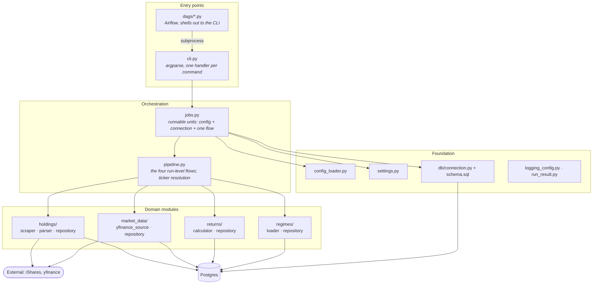
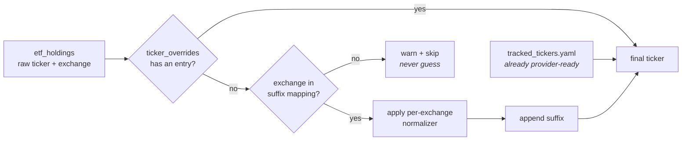
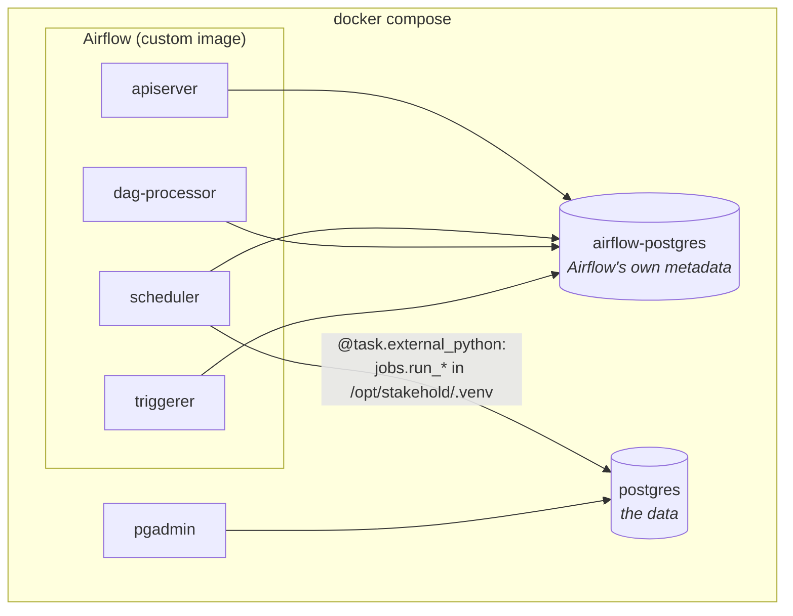

# data-store architecture

How this service is put together and why. For *what the tables look like* see
[`schema.md`](schema.md); for *how to run it* see [`../README.md`](../README.md). This document
covers the parts neither of those does: the layering, the boundaries between modules, and the
decisions that would otherwise look arbitrary.

## What the service is responsible for

Getting external financial data into Postgres, correctly and repeatably. Two things go in:

- **ETF holdings** — scraped from a fund provider's website (iShares today).
- **Raw daily market data** — OHLCV prices, dividends and stock splits, for every ticker those
  holdings contain plus directly tracked ones. One fetch, one table (`raw_market_data`) —
  unprocessed, matching the source's own grain, not decomposed into a return calculation there.

One thing is derived, not fetched: **`market_returns`** — split-adjusted price and
price/dividend/simple/log returns, rebuilt from `raw_market_data` by `calculate-returns`. This
still fits the service's remit because it involves no judgment about portfolios or holdings — it's
arithmetic on data already landed here, kept in this service so `raw_market_data`'s sharp edges
(the split-restatement behaviour below) are handled once, next to the table that has them, rather
than relearned by every consumer.

It does *not* value portfolios or decide what's worth owning — that belongs to `portfolio`, which
reads `market_returns`. The dividing line is deliberate: this service's job is that the data in
Postgres is a faithful, complete record of what the sources said, plus the one derived table close
enough to that record to need no portfolio-level context.

## Layering

Dependencies point one way, downward. Nothing in a lower layer imports from a higher one.



**`jobs.py` is the seam that matters.** Each `run_*` there is one complete operation: load
settings and configuration, open a connection, run the flow, close the connection, return its
result. `cli.py` is argument parsing plus a call into it, and nothing else. An Airflow task will
be a call into it and nothing else. Anything that lived in only one of those two would be, by
construction, untested by the other — which is exactly how a CLI and a scheduled job drift apart.

Its arguments are plain builtins, including `earliest_date` as an ISO string rather than a `date`.
That looks like a weaker type until you notice both callers hand it over as text — argparse from
the command line, Airflow from a DAG parameter — so parsing it inside the job keeps that
conversion in one place instead of two.

The rule that keeps this honest: **`pipeline.py` never touches SQL or HTTP directly, and the
domain modules never decide *what* to fetch.** Orchestration knows which tickers matter and in
what order; the domain modules know how to talk to one source or one table. When those blur, the
next data source becomes a rewrite instead of a new file.

## The three-file shape of a domain module

Each domain follows the same split, and a new one should too:

| File | Owns | Never does |
|---|---|---|
| `base.py` | The `Protocol` a source must satisfy | Anything concrete |
| `*_source.py` | Talking to one external provider; reshaping its response into long-form rows | Touch the database |
| `repository.py` | Reading and writing one table | Know where the data came from |

`holdings/` has an extra pair because scraping is two steps: `scraper.py` drives a real browser to
resolve the download URL, and `parser.py` fetches and parses the CSV. They're split because only
the first needs Playwright — the resolved URL is a plain unauthenticated GET, so the expensive
browser dependency stays confined to the one function that genuinely needs it.

`column_mapping.py` is the single declaration of how provider CSV columns map to database columns
and types. A provider renaming a column is a one-line change there, not a hunt through parsing
code.

`returns/` deviates the other way: just `calculator.py` (pure arithmetic, no I/O) and
`repository.py`. There is no `base.py` because there's no provider Protocol to satisfy, and no
`*_source.py` because there's no external call — the input is `raw_market_data`, this service's
own table. Disclosed rather than silently different: a domain reading another domain's table
instead of an external source is a shape the original three-file split didn't anticipate.

`regimes/` has a similar two-file shape: `loader.py` (reads and validates a local CSV into
`RegimeConfig` dataclasses, following the `config_loader.py` vocabulary for errors and validation)
and `repository.py` (writes to the `regimes` table). There is no external provider — the only
source is a hand-curated CSV in `config/`, updated manually — and no base Protocol.

## Extension points

New providers are registry entries, not new branches. Both registries live at the top of
`pipeline.py`:

```python
SCRAPERS            = {"ishares": get_holdings_csv_url}
MARKET_DATA_SOURCES = {"yfinance": YFinanceMarketDataSource}
```

Adding a second market-data provider means writing a class satisfying `market_data/base.py`'s
`MarketDataSource` Protocol and adding one line. No flow function changes.

**A disclosed trade-off of one combined registry**: before the OHLCV/dividend fetch merge, prices
and dividends had separate registries and Protocols, because they were genuinely separate
fetches with different `fetch()` shapes. Now that one fetch returns both, a future
price-only or dividend-only-shaped provider (e.g. a source with prices but no dividend concept)
has to implement the full `MarketDataSource` Protocol and return an empty/zero-filled frame for
whichever columns it doesn't have, rather than being a narrower Protocol of its own. Accepted
because it matches the actual shape of the one HTTP call each provider makes, and there's
currently exactly one provider (yfinance) to generalize from.

**One sharp edge if you add a source:** the registry *key* and the class's `.name` attribute are
two different strings. `.name` is what gets stamped into the `source` column and what backfill
floors are read under; the key is what config files reference. Keep them equal unless you have a
reason not to.

## The five flows

All five live in `pipeline.py` and are exposed as CLI subcommands.

| Flow | Command | Cadence | Reads | Writes |
|---|---|---|---|---|
| Holdings ingest | `ingest-holdings` | weekly | provider site | `etf_holdings` |
| Market data ingest | `ingest-market-data` | daily | `etf_holdings` + config | `raw_market_data` |
| Market data backfill | `backfill-market-data` | manual | `raw_market_data` | `raw_market_data` |
| Returns calculation | `calculate-returns` | after new data lands | `raw_market_data` | `market_returns` |
| Regimes ingest | `ingest-regimes` | manual | `config/regimes.csv` | `regimes` |

**Returns calculation is the odd one out**: it reads no config and does no ticker resolution — it
discovers both sources and tickers directly from `raw_market_data` (`returns/repository.py`'s
`get_sources`/`get_tickers`), and is always a **full rebuild** of whatever tickers it's asked
about, never an incremental append. A split retroactively changes the correct value of every
earlier row for that ticker (see `docs/schema.md`, `market_returns`), so an incremental design
would serve stale values after a split rather than merely being slower to catch up. It's batched
by ticker (`RETURNS_BATCH_SIZE`, a few hundred at a time) rather than loaded as one DataFrame,
since `raw_market_data` is 8.95M rows — and a batch's save failure is isolated from the batches
around it the same way a ticker's failure is isolated in backfill.

Before the market-data merge shipped, price and dividend ingest/backfill were four separate flows,
each resolving the same ticker universe and hitting yfinance separately. They merged into one
because a single `Ticker.history()` call already returns OHLCV, dividends and stock splits together
— fetching them through two flows was paying for two HTTP round trips per ticker to get data that
came back in one.

**Market data ingest has a second, conditional fetch.** Normally it is one fetch per
(source, asset_type) group. But the provider retroactively rescales a ticker's *entire* price and
dividend history when that ticker splits (see [`schema.md`](schema.md), "What `close` actually
contains"), while this flow only re-fetches a rolling window — so a split would leave one ticker's
stored rows on two different scales, a step change indistinguishable from a real
several-hundred-percent move. When an ingested batch contains a non-zero `stock_splits`, the flow
therefore re-fetches that ticker's full stored range and rewrites it
(`pipeline._refresh_split_histories`). This is the one place the daily flow issues an unbounded
historical request rather than a windowed one; splits are rare enough that the cost is negligible.

**Regimes ingest is CLI-only, not scheduled.** The source is a hand-curated CSV, edited manually
when new market events occur or existing regime definitions change — no automation needed. Each
`ingest-regimes` run replaces the entire `regimes` table from the current CSV file. Unlike the
data-source flows above, this has no Airflow DAG, no schedule, and no provider integration — it's
a manual operation, run after editing `config/regimes.csv`.

### What a flow returns

The four run-level flows return a structured result, not a row count:

```python
{"status": "ok" | "partial" | "nothing_to_do",
 "tickers_resolved": int, "rows_saved": int, ...}   # plus per-flow counts
```

`status` carries the judgement so callers don't re-derive it from counts. Zero rows saved is
ambiguous on its own — it is the correct outcome for a run with nothing to do, and an alarm for a
run whose every group failed. Separating them is what lets an automated check react to the second
without crying wolf about the first, and it's the same distinction the logging rules require of the
human-readable output.

A request that matches nothing is a **failure**, not an empty success: asking for
`--ticker NOPE` and getting nothing means the run didn't do what it was asked, so it reports
`partial` rather than `nothing_to_do`. More generally a failure outranks emptiness — a run that
ended up with nothing to work on *because* something broke must not show green.

`run_result.py` owns this contract — `RUN_RESULT_KEYS` names the two keys *every* run carries, so
a caller can react to any of them without knowing which ran. Only two, deliberately: a pricing run
counts tickers and a holdings run counts funds, so a shared "units" key would mean something
different in each and be a trap rather than a contract. Each run adds its own named counts on top
(`tickers_resolved`, `groups_failed`, `funds_failed`, and so on).

It lives in its own module rather than in `pipeline.py` because four layers depend on it —
`pipeline` builds these, `jobs` builds and forwards them, the CLI turns them into exit codes, and
Airflow reads them back as XCom values. One definition is what stops those drifting.

**The value is plain builtins on purpose.** It is destined to cross a process boundary as an
Airflow XCom — pickled in this service's interpreter and unpickled in Airflow's, where
`data_store` is not importable. A dataclass, enum, `date` or numpy integer would fail there with
`ModuleNotFoundError`. A test asserts the contract rather than trusting it.

`ingest_holdings` is the exception: it stays a bare row count because it is a per-fund primitive,
not a run. Run-level aggregation across funds belongs to its caller.

**They are deliberately independent.** The pricing flows read whatever ticker list is currently in
`etf_holdings`; they never trigger a scrape. So a holdings scrape failing doesn't cascade into
prices going stale, and each flow can run on its own schedule. The coupling is through the table,
not through the call graph.

**Daily and backfill are separate commands, not one command with a flag**, because they have
opposite performance shapes. The daily flows batch many tickers per request and are expected to
finish in seconds; the backfills fetch one ticker at a time with a deliberate sleep between them
and can run for hours. Merging them would mean one set of rate-limit and batching decisions
serving two incompatible needs.

### Ticker resolution, the load-bearing part

Everything that prices anything goes through the same resolution step, and it's where most of the
service's accumulated knowledge lives:



Three things about this are intentional:

1. **An unmapped exchange is skipped with a warning, never guessed.** The provider returns *no
   rows* rather than an error for a bad symbol, so a guessed ticker would look like a ticker that
   simply had no trading activity. Refusing to guess is what keeps "no data" meaningful.
2. **Resolution happens at fetch time, not at scrape time.** `etf_holdings.holding_ticker` stays
   exactly as scraped, so fixing a mapping takes effect on the next pricing run with no re-scrape.
3. **Tracked tickers bypass it entirely.** They're configured in provider-ready form already, so
   putting them through exchange resolution would corrupt them.

The per-exchange normalizers (`_TICKER_NORMALIZERS`) encode verified quirks — Hong Kong codes need
zero-padding, London tickers ending in `.` must not double it, Nordic and Toronto share classes use
a hyphen. These were confirmed against real provider responses, not inferred. Treat them as
findings, not guesses, and verify before adding more.

Full details in [`schema.md`](schema.md).

## Configuration

Three files, split by whether they're personal or reference data:

| File | Committed? | Why |
|---|---|---|
| `config/etfs.yaml` | no — gitignored | Someone's actual holdings |
| `config/tracked_tickers.yaml` | no — gitignored | Same, and optional |
| `config/yfinance_exchange_suffixes.yaml` | **yes** | Generic reference data, useful to everyone |

`.example` templates are committed for the first two. Paths are environment-overridable via
`settings.py`, which is also where `DATABASE_URL` comes from — no credential is ever read from a
config file or hardcoded.

`config_loader.py` validates on load and raises `ConfigError` with the specific problem. Two
loaders read the same file: `load_exchange_suffixes` and `load_ticker_overrides` take different
top-level keys from `yfinance_exchange_suffixes.yaml`, since a one-off ticker rewrite and an
exchange mapping are the same kind of reference data maintained together.

## Deployment



**Two separate Postgres instances.** Airflow's metadata database and the data warehouse share
nothing. Airflow's is disposable; the data one is not.

**Airflow runs a custom image** (`Dockerfile.airflow`) that layers `uv` and this workspace onto the
official Airflow image. The DAGs call the same `jobs.run_*` functions the CLI calls, through
`@task.external_python`.

**Two interpreters, on purpose.** Airflow's own is Python 3.13; this workspace requires 3.14 and
pulls in pandas, yfinance and Playwright. `@task.external_python` runs the task body in
`/opt/stakehold/.venv` while Airflow's environment stays clean — so a dependency change here can't
break the scheduler, and DAG parsing never imports pandas. `expect_airflow=False` is required
because that venv deliberately has no Airflow in it.

**And the task returns a value.** The operator pickles the function's return in the external
interpreter and unpickles it in Airflow's, where it becomes the task's XCom `return_value`. That
is why the result contract is plain builtins: `data_store` is not importable on the receiving
side, so a dataclass or `date` would fail to unpickle. Each DAG's final `check_run` task reads
that value and fails the run on a partial failure, or on an "ok" run that saved nothing — the
alert that was structurally impossible when a task could only report a shell's exit code.

A side effect worth noting: with no shell in the path, the `shlex.quote` escaping the old
`BashOperator` needed for `--ticker` values is gone entirely, along with the injection surface it
guarded.

### Build-time vs. runtime

`dags/` and `config/` are bind-mounted, so DAG edits and configuration changes take effect on the
next run. **Application code under `src/data_store/` is baked into the image**, so:

```bash
docker compose build   # required after changing src/data_store/ code
```

`config/` is mounted rather than baked because it changes far more often than code — adding a fund
or an exchange suffix is routine — and silently running yesterday's configuration is a
particularly unpleasant way to discover a build step you forgot.

## Cross-cutting decisions

**Logs go to stderr, results go to stdout.** Every entry point calls
`logging_config.configure_logging()`, so `logger.info` is visible — in a plain CLI run and in
Airflow's captured task output alike. The one remaining `print` is a command's actual result (the
row count `cli.py` writes), which stays on stdout so the CLI is pipeable.

This replaced an earlier `print(..., flush=True)` convention that existed only because nothing
configured logging, which meant `logger.info` was silently dropped and `print` was the sole
mechanism that worked. Configuring it once removed the constraint. A side effect worth keeping:
progress and warnings now share one stream and are therefore ordered relative to each other —
previously a warning could surface in a captured log nowhere near the work it concerned. See
[`../.claude/rules/logging.md`](../.claude/rules/logging.md).

**Every flow reports a completion summary, including when it did nothing.** A run that legitimately
had nothing to do and a run that failed silently must never look the same. This is why an empty
resolved ticker set prints a line rather than returning quietly, and why a `--ticker` value matching
nothing is warned about by name.

**A partially failed run exits non-zero.** `nothing_to_do` is a success — a quiet day is not a
broken one — but `partial` is not, so whatever scheduled the command can tell the difference
without reading logs.

**Failures are isolated at the natural unit of work** — per fund when scraping, per source-and-type
group when ingesting, per ticker when backfilling, per ticker-batch when calculating returns, and
(since the market-data merge) per ticker within a group's *fetch* too: `YFinanceMarketDataSource`
retries and gives up on one ticker at a time, so a single permanently-failing ticker no longer
costs every other ticker fetched alongside it in the same group, the way one bad ticker used to
fail an entire batched `yf.download()` call. One failure never costs the work queued behind it, and
the summary reports the failure count. Configuration errors are the exception: an unknown provider
is fatal, because it will fail identically on every retry.

**`market_returns`'s upsert never deletes.** A full rebuild self-heals any row whose inputs changed
or whose ticker is newly followed, but a row removed from `raw_market_data` leaves an orphaned row
behind in `market_returns` rather than being cleaned up. Not a normal occurrence today (rows aren't
currently deleted from `raw_market_data`), but worth stating plainly rather than overselling "full
rebuild" as a complete self-healing guarantee.

The post-split history refresh sits deliberately *outside* its group's `try`/`except`, as its own
isolation boundary. A repair fetch failing is not the group failing: the group's own rows are
already fetched, saved and correct, and attributing the failure to the group would misreport a
good day's ingest as a bad one. It is counted separately (`splits_refresh_failed`) and still makes
the run `partial`, because the ticker really is left in an inconsistent state. This is also the one
failure the flow cannot retry indefinitely — the trigger is the split row itself, which disappears
once it ages out of the rolling window — so the warning names the `--force-refresh` recovery path
rather than relying on a later run to notice. A durable pending-refresh table was considered and
rejected as disproportionate for an event this rare.

**Transactions are per flow-step.** Each `save_*` commits, so an interrupted run leaves completed
work durable. Combined with the loading strategies in [`schema.md`](schema.md), every flow is
re-runnable without cleanup. On failure, `save_raw_market_data` rolls back before re-raising —
Postgres leaves a transaction aborted after an error, so without an explicit rollback every later
statement on that connection would fail too, breaking the per-ticker isolation described above.
Callers that catch a save failure and keep going (backfill's per-ticker loop) depend on this to
leave the connection usable for the next ticker.

**Row-level validation guards COPY, not just fetch.** `save_raw_market_data` checks each row
against its columns' numeric ranges before handing it to `COPY`, dropping (and warning about) any
row that would overflow — e.g. a garbage `adjclose` Yahoo's API occasionally returns. `COPY` has no
partial-failure mode: one bad value aborts the whole staged batch, which would otherwise cost a
ticker's entire fetched history for the run over a single bad day.

## Testing

Split by what they need, and the split is enforced by a marker:

| | Needs | Covers |
|---|---|---|
| `tests/unit/` | nothing | Logic, resolution rules, output, error handling — with fake connections and stubbed sources |
| `tests/integration/` | live Postgres | What a fake can't: `COPY` upserts, `ON CONFLICT` semantics, migration idempotency |

`pytest` deselects `integration` by default, so a plain run is *not* the whole suite. CI runs both,
the second against a service container. Details in [`../README.md`](../README.md).

The unit tests stub at the layer boundaries above, which is the practical payoff of having them:

- **Repository tests** fake the connection and cursor, so the SQL that gets built and the rows
  handed to `COPY` stay observable — the assertions are about what was sent to the database, not
  about a mock having been called.
- **Pipeline tests** stub the `save_*` functions and swap the source registries for fakes. That
  leaves orchestration decisions — which tickers resolve, how they group, what gets skipped, what
  gets printed — testable with no database and no network.

Progress output is treated as behaviour and asserted with `capsys`/`caplog`, on the grounds that a
run's summary is as much a part of its contract as its return value.

## Where to start reading

1. `pipeline.py` — the five flows; everything else is in service of these.
2. `jobs.py` — how configuration, a connection and a flow become one runnable operation.
3. `cli.py` — how a command becomes a job. Thin on purpose; if it is growing, something belongs
   in `jobs.py` instead.
4. One domain module end to end (`market_data/` is the most representative of a
   provider-backed one; `returns/` is the most representative of a derived one).
5. [`schema.md`](schema.md) — why the tables load the way they do.
