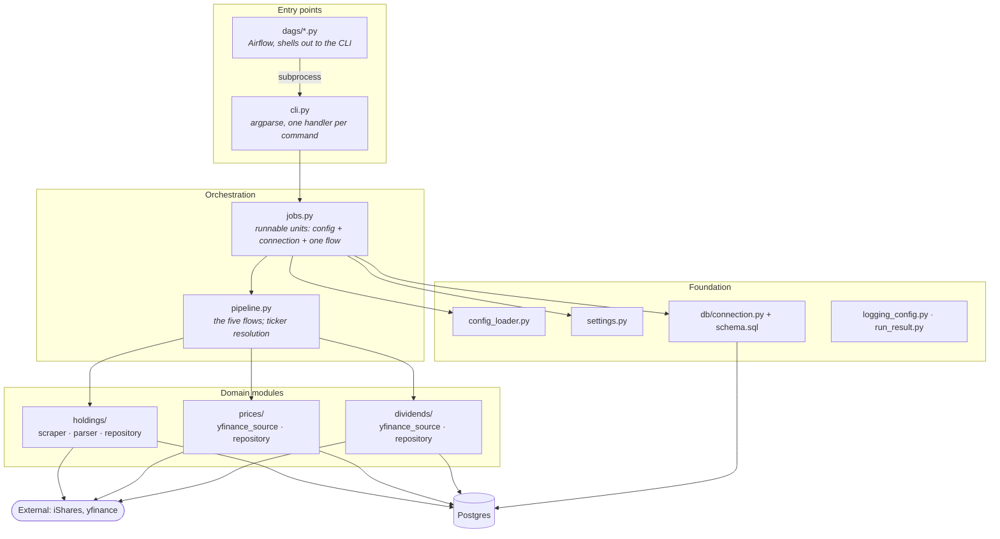
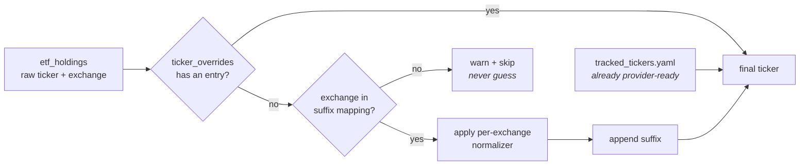
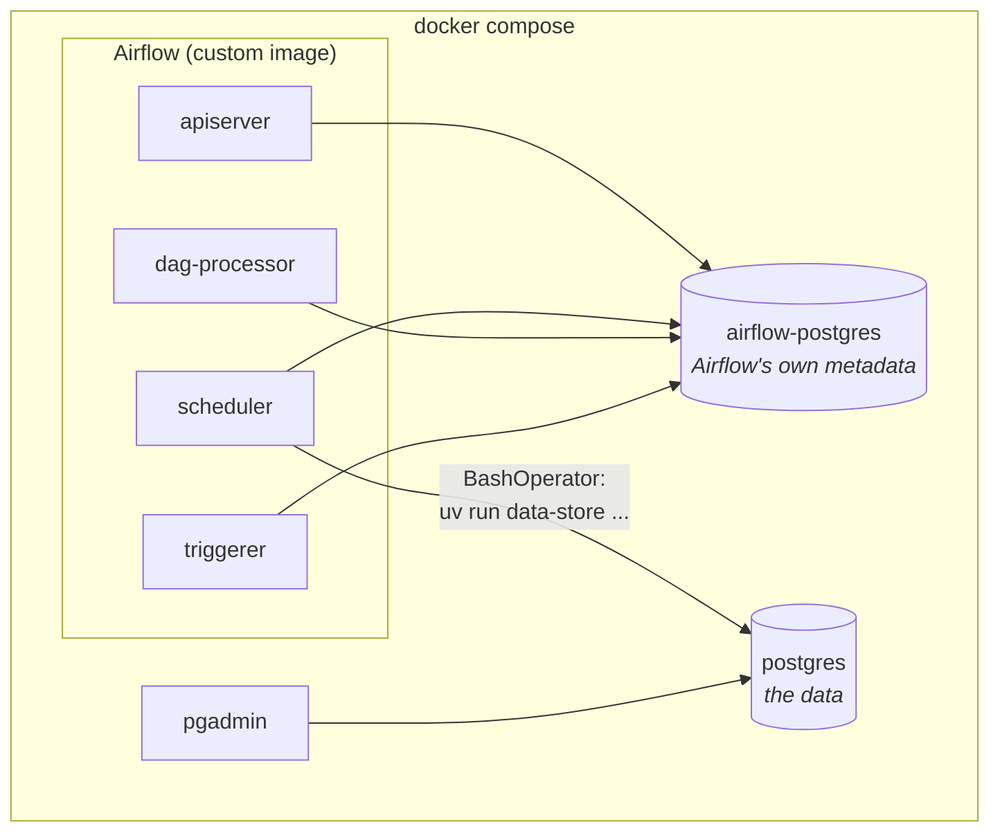

# data-store architecture

How this service is put together and why. For *what the tables look like* see
[`schema.md`](schema.md); for *how to run it* see [`../README.md`](../README.md). This document
covers the parts neither of those does: the layering, the boundaries between modules, and the
decisions that would otherwise look arbitrary.

## What the service is responsible for

Getting external financial data into Postgres, correctly and repeatably. Three things go in:

- **ETF holdings** — scraped from a fund provider's website (iShares today).
- **Daily OHLCV prices** — for every ticker those holdings contain, plus directly tracked ones.
- **Dividend events** — for that same ticker universe.

It does *not* calculate returns, value portfolios, or decide what's worth owning. Those belong to
`portfolio`, which reads these tables. The dividing line is deliberate: this service's only job is
that the data in Postgres is a faithful, complete record of what the sources said.

## Layering

Dependencies point one way, downward. Nothing in a lower layer imports from a higher one.



**`jobs.py` is the seam that matters.** Each `run_*` there is one complete operation: load
settings and configuration, open a connection, run the flow, close the connection, return its
result. `cli.py` is argument parsing plus a call into it, and nothing else. An Airflow task will
be a call into it and nothing else. Anything that lived in only one of those two would be, by
construction, untested by the other — which is exactly how a CLI and a scheduled job drift apart.

Its arguments are plain builtins, including `earliest_date` as an ISO string rather than a `date`.
That looks like a weaker type until you notice both callers hand it over as text — argparse from
the command line, Airflow from a DAG parameter — so parsing it inside the job keeps that
conversion in one place instead of two.

The rule that keeps this honest: **`pipeline.py` never touches SQL or HTTP directly, and the
domain modules never decide *what* to fetch.** Orchestration knows which tickers matter and in
what order; the domain modules know how to talk to one source or one table. When those blur, the
next data source becomes a rewrite instead of a new file.

## The three-file shape of a domain module

Each domain follows the same split, and a new one should too:

| File | Owns | Never does |
|---|---|---|
| `base.py` | The `Protocol` a source must satisfy | Anything concrete |
| `*_source.py` | Talking to one external provider; reshaping its response into long-form rows | Touch the database |
| `repository.py` | Reading and writing one table | Know where the data came from |

`holdings/` has an extra pair because scraping is two steps: `scraper.py` drives a real browser to
resolve the download URL, and `parser.py` fetches and parses the CSV. They're split because only
the first needs Playwright — the resolved URL is a plain unauthenticated GET, so the expensive
browser dependency stays confined to the one function that genuinely needs it.

`column_mapping.py` is the single declaration of how provider CSV columns map to database columns
and types. A provider renaming a column is a one-line change there, not a hunt through parsing
code.

## Extension points

New providers are registry entries, not new branches. All three registries live at the top of
`pipeline.py`:

```python
SCRAPERS         = {"ishares": get_holdings_csv_url}
PRICE_SOURCES    = {"yfinance": YFinancePriceSource}
DIVIDEND_SOURCES = {"yfinance": YFinanceDividendSource}
```

Adding a second price provider means writing a class satisfying `prices/base.py`'s `PriceSource`
and adding one line. No flow function changes.

`PRICE_SOURCES` and `DIVIDEND_SOURCES` are kept separate even though yfinance is currently the only
entry in both, because a price source and a dividend source are different Protocols with different
`fetch()` shapes. Merging them would mean pulling a class out of one registry and hoping it also
happens to expose the other's surface.

**One sharp edge if you add a source:** the registry *key* and the class's `.name` attribute are
two different strings. `.name` is what gets stamped into the `source` column and what backfill
floors are read under; the key is what config files reference. Keep them equal unless you have a
reason not to.

## The five flows

All five live in `pipeline.py` and are exposed as CLI subcommands.

| Flow | Command | Cadence | Reads | Writes |
|---|---|---|---|---|
| Holdings ingest | `ingest-holdings` | weekly | provider site | `etf_holdings` |
| Price ingest | `ingest-ohlcv` | daily | `etf_holdings` + config | `daily_ohlcv` |
| Dividend ingest | `ingest-dividends` | daily | `etf_holdings` + config | `dividend_events` |
| Price backfill | `backfill-ohlcv` | manual | `daily_ohlcv` | `daily_ohlcv` |
| Dividend backfill | `backfill-dividends` | manual | `dividend_events` | `dividend_events` |

### What a flow returns

The four run-level flows return a structured result, not a row count:

```python
{"status": "ok" | "partial" | "nothing_to_do",
 "tickers_resolved": int, "rows_saved": int, ...}   # plus per-flow counts
```

`status` carries the judgement so callers don't re-derive it from counts. Zero rows saved is
ambiguous on its own — it is the correct outcome for a run with nothing to do, and an alarm for a
run whose every group failed. Separating them is what lets an automated check react to the second
without crying wolf about the first, and it's the same distinction the logging rules require of the
human-readable output.

`run_result.py` owns this contract — `RUN_RESULT_KEYS` names the two keys *every* run carries, so
a caller can react to any of them without knowing which ran. Only two, deliberately: a pricing run
counts tickers and a holdings run counts funds, so a shared "units" key would mean something
different in each and be a trap rather than a contract. Each run adds its own named counts on top
(`tickers_resolved`, `groups_failed`, `funds_failed`, and so on).

It lives in its own module rather than in `pipeline.py` because four layers depend on it —
`pipeline` builds these, `jobs` builds and forwards them, the CLI turns them into exit codes, and
Airflow reads them back as XCom values. One definition is what stops those drifting.

**The value is plain builtins on purpose.** It is destined to cross a process boundary as an
Airflow XCom — pickled in this service's interpreter and unpickled in Airflow's, where
`data_store` is not importable. A dataclass, enum, `date` or numpy integer would fail there with
`ModuleNotFoundError`. A test asserts the contract rather than trusting it.

`ingest_holdings` is the exception: it stays a bare row count because it is a per-fund primitive,
not a run. Run-level aggregation across funds belongs to its caller.

**They are deliberately independent.** The pricing flows read whatever ticker list is currently in
`etf_holdings`; they never trigger a scrape. So a holdings scrape failing doesn't cascade into
prices going stale, and each flow can run on its own schedule. The coupling is through the table,
not through the call graph.

**Daily and backfill are separate commands, not one command with a flag**, because they have
opposite performance shapes. The daily flows batch many tickers per request and are expected to
finish in seconds; the backfills fetch one ticker at a time with a deliberate sleep between them
and can run for hours. Merging them would mean one set of rate-limit and batching decisions
serving two incompatible needs.

### Ticker resolution, the load-bearing part

Everything that prices anything goes through the same resolution step, and it's where most of the
service's accumulated knowledge lives:



Three things about this are intentional:

1. **An unmapped exchange is skipped with a warning, never guessed.** The provider returns *no
   rows* rather than an error for a bad symbol, so a guessed ticker would look like a ticker that
   simply had no trading activity. Refusing to guess is what keeps "no data" meaningful.
2. **Resolution happens at fetch time, not at scrape time.** `etf_holdings.holding_ticker` stays
   exactly as scraped, so fixing a mapping takes effect on the next pricing run with no re-scrape.
3. **Tracked tickers bypass it entirely.** They're configured in provider-ready form already, so
   putting them through exchange resolution would corrupt them.

The per-exchange normalizers (`_TICKER_NORMALIZERS`) encode verified quirks — Hong Kong codes need
zero-padding, London tickers ending in `.` must not double it, Nordic and Toronto share classes use
a hyphen. These were confirmed against real provider responses, not inferred. Treat them as
findings, not guesses, and verify before adding more.

Full details in [`schema.md`](schema.md).

## Configuration

Three files, split by whether they're personal or reference data:

| File | Committed? | Why |
|---|---|---|
| `config/etfs.yaml` | no — gitignored | Someone's actual holdings |
| `config/tracked_tickers.yaml` | no — gitignored | Same, and optional |
| `config/yfinance_exchange_suffixes.yaml` | **yes** | Generic reference data, useful to everyone |

`.example` templates are committed for the first two. Paths are environment-overridable via
`settings.py`, which is also where `DATABASE_URL` comes from — no credential is ever read from a
config file or hardcoded.

`config_loader.py` validates on load and raises `ConfigError` with the specific problem. Two
loaders read the same file: `load_exchange_suffixes` and `load_ticker_overrides` take different
top-level keys from `yfinance_exchange_suffixes.yaml`, since a one-off ticker rewrite and an
exchange mapping are the same kind of reference data maintained together.

## Deployment



**Two separate Postgres instances.** Airflow's metadata database and the data warehouse share
nothing. Airflow's is disposable; the data one is not.

**Airflow runs a custom image** (`Dockerfile.airflow`) that layers `uv` and this workspace onto the
official Airflow image. The DAGs shell out to the same `data-store` CLI you run locally, so what
executes in production is what you can reproduce by hand. The alternative — importing `data_store`
into Airflow's own interpreter — isn't currently possible anyway: the image ships Python 3.13 and
this workspace requires 3.14.

The cost of that choice is that **Airflow still only learns whether the shell exited zero.** The
flows now produce a structured result (above), and the CLI turns a partial run into a non-zero
exit — so a half-failed run no longer reports success. But the counts themselves stop at the
subprocess boundary, so you cannot yet alert on "the daily run saved zero rows".

Closing that is the remaining work: moving the DAG tasks to `@task.external_python`, which invokes
the flow in this service's interpreter and hands its return value back to Airflow as an XCom, while
keeping the dependency isolation described above. The result contract exists and is tested; only
the transport is missing.

### Build-time vs. runtime, a real gotcha

`dags/` is bind-mounted, so DAG edits are picked up live. **Everything else is baked into the image
at build time** — including `data_store/` *and* `config/`. So:

```bash
docker compose build   # required after changing application code OR config/*.yaml
```

Editing `etfs.yaml` and triggering a DAG without rebuilding runs the *old* config. This is worth
fixing by bind-mounting `config/` the way `dags/` already is.

## Cross-cutting decisions

**Logs go to stderr, results go to stdout.** Every entry point calls
`logging_config.configure_logging()`, so `logger.info` is visible — in a plain CLI run and in
Airflow's captured task output alike. The one remaining `print` is a command's actual result (the
row count `cli.py` writes), which stays on stdout so the CLI is pipeable.

This replaced an earlier `print(..., flush=True)` convention that existed only because nothing
configured logging, which meant `logger.info` was silently dropped and `print` was the sole
mechanism that worked. Configuring it once removed the constraint. A side effect worth keeping:
progress and warnings now share one stream and are therefore ordered relative to each other —
previously a warning could surface in a captured log nowhere near the work it concerned. See
[`../.claude/rules/logging.md`](../.claude/rules/logging.md).

**Every flow reports a completion summary, including when it did nothing.** A run that legitimately
had nothing to do and a run that failed silently must never look the same. This is why an empty
resolved ticker set prints a line rather than returning quietly, and why a `--ticker` value matching
nothing is warned about by name.

**A partially failed run exits non-zero.** `nothing_to_do` is a success — a quiet day is not a
broken one — but `partial` is not, so whatever scheduled the command can tell the difference
without reading logs.

**Failures are isolated at the natural unit of work** — per fund when scraping, per source-and-type
group when ingesting, per ticker when backfilling. One failure never costs the work queued behind
it, and the summary reports the failure count. Configuration errors are the exception: an unknown
provider is fatal, because it will fail identically on every retry.

**Transactions are per flow-step.** Each `save_*` commits, so an interrupted run leaves completed
work durable. Combined with the loading strategies in [`schema.md`](schema.md), every flow is
re-runnable without cleanup.

## Testing

Split by what they need, and the split is enforced by a marker:

| | Needs | Covers |
|---|---|---|
| `tests/unit/` | nothing | Logic, resolution rules, output, error handling — with fake connections and stubbed sources |
| `tests/integration/` | live Postgres | What a fake can't: `COPY` upserts, `ON CONFLICT` semantics, migration idempotency |

`pytest` deselects `integration` by default, so a plain run is *not* the whole suite. CI runs both,
the second against a service container. Details in [`../README.md`](../README.md).

The unit tests stub at the layer boundaries above, which is the practical payoff of having them:

- **Repository tests** fake the connection and cursor, so the SQL that gets built and the rows
  handed to `COPY` stay observable — the assertions are about what was sent to the database, not
  about a mock having been called.
- **Pipeline tests** stub the `save_*` functions and swap the source registries for fakes. That
  leaves orchestration decisions — which tickers resolve, how they group, what gets skipped, what
  gets printed — testable with no database and no network.

Progress output is treated as behaviour and asserted with `capsys`/`caplog`, on the grounds that a
run's summary is as much a part of its contract as its return value.

## Where to start reading

1. `pipeline.py` — the five flows; everything else is in service of these.
2. `jobs.py` — how configuration, a connection and a flow become one runnable operation.
3. `cli.py` — how a command becomes a job. Thin on purpose; if it is growing, something belongs
   in `jobs.py` instead.
4. One domain module end to end (`prices/` is the most representative).
5. [`schema.md`](schema.md) — why the tables load the way they do.
