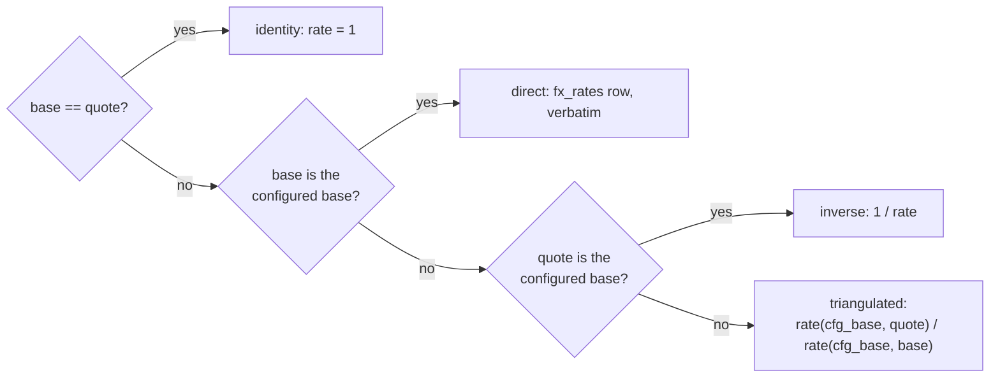

# data-store read API

The read API part of [`architecture.md`](architecture.md), split out for size: the endpoints
`data-store` serves and the design choices peculiar to them. It's part of that document, so
`.claude/rules/architecture.md` applies to it too: adding, removing or changing a route updates
this file in the same change.

A fourth entry point, alongside `cli.py` and `dags/*.py`: a FastAPI app (`api/`) over tables this
service already owns, for `portfolio` and `web` to consume over HTTP rather than opening a
database connection of their own — the cross-service boundary `portfolio/docs/architecture.md`
insists is always an API, never a shared table.

It is mostly read-only. The exception is the tracked-ticker routes (below), which add and change
`tracked_tickers` rows. They're still not a backfill trigger: a request only queues a ticker, and
the `ticker_onboarding` DAG does the fetching. So the API process never makes a long provider
call beyond one quick lookup.

| Endpoint | Backed by | Notes |
|---|---|---|
| `GET /prices/{ticker}` | `market_returns` + `raw_market_data.volume` | Returns come from `market_returns`, not `raw_market_data`. schema.md calls `market_returns` "the table a portfolio or chart should read", and serving raw OHLCV would push return computation onto every consumer. The one raw column is each row's `volume` (RK-31), which portfolio's VaR day mask uses to tell a holiday's stale, flat row from a traded day. It's a LEFT JOIN, so `market_returns` still decides which rows exist. A row with no raw counterpart is served with a `null` volume, and `null` means unknown, never 0, as the returns suppression rule in schema.md also treats it. |
| `GET /fx/{base}/{quote}` | `fx_rates` | See below — the endpoint derives pairs `fx_rates` never stores directly. |
| `GET /rates/risk-free` | `risk_free_rates` | The risk measures' `rf_eur` (spec §4.1), spliced from €STR and EONIA on read. See below. |
| `GET /regimes` | `regimes` | Every regime overlapping `[start, end]`, with the table's `total_regimes`. Built for the risk regime view (RK-28). See below. |
| `GET /etf-holdings` | `config/etfs.yaml` + `etf_holdings` | Every configured fund, enabled or not, with its tradeable `ticker` and `latest_as_of_date` (null if never scraped). How a caller gets from a ticker it holds (`IWDA.AS`) to a `fund_key`. See below. |
| `GET /etf-holdings/{fund_key}/latest` | `etf_holdings` | Every line of the fund's newest snapshot, heaviest first, each with the yfinance ticker ingest prices it as. 404 for a fund not in `etfs.yaml`, and for one with no snapshot. See below. |
| `GET /tickers` | `raw_market_data` | Every ingested ticker for `source`, sorted and unpaginated (~1.3k tickers, ~10 KB). Built for `portfolio`'s manual-entry picker, which needs the whole set at once. Uses the same "ingested universe" definition as `GET /tickers/{ticker}`'s `exists` (`returns/repository.py`'s `list_tickers` sits next to `ticker_exists`), so a ticker in the list always reports `exists: true`. The query is a recursive-CTE loose index scan over the primary key: Postgres 17 has no skip scan, and a plain `SELECT DISTINCT` would read all ~9M rows to find the ~1.3k tickers. Measured at ~25 ms on the dev database. |
| `GET /tickers/{ticker}` | `raw_market_data` + `market_returns` + `tracked_tickers` + `etf_holdings` | Existence and whether returns have been computed are reported separately — a ticker can be ingested before `calculate-returns` has run for it. `status` is the ticker's onboarding status when it's tracked, else `null`. `currency` and `fx_currency`: see below. |
| `GET /tickers/{ticker}/lookup` | `tracked_tickers`, then the provider | What adding a ticker would do. `outcome` is one of: `tracked` (with its `status`), `available`, `unsupported` (an index or a currency pair), `not_found`, or `unavailable` (the provider didn't answer). Always 200, except 422 for a symbol that can't be one. |
| `POST /tracked-tickers` | `tracked_tickers` | Adds a user's ticker as `pending`. 201 when added, 200 when already tracked (free, and not counted). Errors: 404 not on the provider, 422 invalid or can't be held, 429 over the requester's daily limit, 503 provider unavailable. |
| `GET /tracked-tickers` | `tracked_tickers` | Filterable by `requested_by`, repeated `status`, repeated `ticker`. |
| `PATCH /tracked-tickers/{ticker}` | `tracked_tickers` | Admin changes: `enabled`, or `retry` a `failed` ticker. 409 for enabling or disabling a config row (the next YAML sync would undo it) or retrying one that isn't `failed`. |

**A ticker's currency** comes from `tracked_tickers.currency` when that is set. Otherwise it comes
from the newest `etf_holdings` row that resolves to the ticker, else `null`. It is the
provider's spelling verbatim (`GBp` stays `GBp`). `fx_currency` is
`ticker_onboarding.major_currency(currency)`, the code `fx_rates` is keyed by. That function is
the one minor→major map; a consumer picks its FX pair from `fx_currency` instead of keeping a
copy (portfolio's Labs backtest does this).

- **Holdings are matched by resolving forward**, with ingest's own rules (`ticker_resolution.py`),
  not by stripping the suffix. iShares reuses a raw symbol across exchanges (`DG` is Vinci in
  Paris and Dollar General in New York), and overrides and normalizers can't be reversed. All
  ~1.3k listings are resolved on each call, which is cheap.
- **Every snapshot counts, not just the latest**, so a holding that left the index keeps a
  currency for its stored history.
- **iShares writes `GBP` where yfinance writes `GBp`** (`AZN`, `SHEL` on the LSE), so a
  holdings-only London ticker reports `GBP`. This does no harm: a percentage return doesn't
  depend on the unit, and `fx_currency` is `GBP` either way. A price in that currency is still
  in pence.

**`source` is an explicit, defaulted query parameter, not hardcoded.** `source` is part of the
primary key on every table these routes read — the schema's own hook for a second provider to
coexist with `yfinance` (or `ecb`) for the same ticker/pair/series/date. Hardcoding it would silently return duplicate dates the
day a second source exists.

**The FX endpoint owns cross-rate derivation**, rather than pushing schema.md's documented
division formula onto every caller. `fx_rates` only ever stores `(configured_base, X)` pairs
(see schema.md's "No cross-rates stored"), so a request for any other pair is satisfied one of
four ways:

This is exactly the identity schema.md documents for a cross-rate (e.g. `rate(GBP, CHF) =
rate(EUR, CHF) / rate(EUR, GBP)` when `EUR` is the base) — the API just applies it once instead
of leaving every future caller to re-derive it. The response's `derivation` field names which
path produced the numbers, and `via` names the currency triangulated through when it applies, so
a caller can tell a real stored rate from a computed one without knowing the formula itself. An
identity request (`base == quote`) has no `fx_rates` row of its own to answer from — the trading
calendar it reports rate `1` for comes from `get_dates_with_rate`, every date the requested
currency appears on either side of a stored pair.

Two details fall out of deriving rather than reading:

- **A stored rate that isn't a usable quote (`<= 0`) drops its date from every derivation**, with
  a warning, rather than being served verbatim on the direct path and dividing by zero on the
  inverse and triangulated ones. `save_fx_rates` only rejects rates too *large* for the column,
  so a `0` can reach the table; serving it would just move the division by zero into the caller.
  This mirrors the write side's own convention — skip the row, warn, keep the rest of the range.
- **Derived rates are quantized to `fx_rates.rate`'s `NUMERIC(18,8)` scale.** A `Decimal`
  division carries the default context's 28 significant digits, which would have made a
  triangulated pair look far more precise than a stored one when both only ever had 8dp of truth
  behind them. Every response is on one scale as a result.

**Errors follow the service's existing "a match on nothing is a failure" stance**
(see "What a flow returns" in [`architecture.md`](architecture.md#what-a-flow-returns)): a
ticker with no ingested rows at all, or a currency outside the FX universe ("Configuration" in
[`architecture.md`](architecture.md#configuration)), is a 404 — a typo must be loud. A valid
ticker or pair whose requested date range simply has no rows is a 200 with an empty `points`
list — a quiet range is not a broken one, the same distinction the write flows draw between
"nothing to do" and "failed".

**The risk-free endpoint joins €STR and EONIA on read.** `risk_free_rates` stores both series
as the ECB publishes them ([`schema.md`](schema.md#risk_free_rates)). `GET
/rates/risk-free?start&end` serves the joined series, `rf_eur`: €STR from 2019-10-01, and EONIA −
0.085 pp before that. Each point says which series it came from, `estr` or `eonia_adjusted`, and
the rate is a string at the column's four places. The rule and its two constants are in
`risk_free/splice.py` (`ESTR_FIRST_DAY`, `EONIA_SPREAD`), the only place either fact is written.

- **The date alone picks the series.** EONIA was published until 2021-12-31, but from 2019-10-01
  it was €STR + 0.085 by definition. So those rows are never served, even on a day €STR is
  missing. Filling that day with the other series would switch source in the middle of a window.
  The consumer forward-fills instead, as it does for any unpublished day.
- **No forward-fill here.** Only published days get a point. §4.1's convention, the latest rate
  on or before each calendar day, is applied by portfolio (`risk/risk_free.py`), which also
  decides what a day with nothing before it means. Filling here as well would make two copies of
  the convention, and would hide which days were really published.
- **`first_date` covers the whole series, not the window.** It's the first day `rf_eur` covers
  for that `source` (1999-01-04 once EONIA is stored). A consumer needs it for R4: a window that
  starts before it earns rf = 0 for the uncovered part and is flagged `rf_partial`. That is
  impossible to tell from the window's own points when the window starts before 1999 and they
  are empty.
- **Splicing on read, not in SQL or at ingest.** Joining in Python keeps the rule a pure,
  unit-tested function. Storing the joined series would bake the spread into ~5,000 rows that
  could then no longer be checked against the ECB. Reading both series in full over the window
  is at most ~7.7k rows, so the reads aren't clamped at the cutoff, which would need a second
  copy of it.
- **An empty table is a 200 with `first_date: null`, not a 404.** This is the one exception to
  the stance above. The request names no ticker or currency that could be a typo: a window with
  no points is normal (weekends, before 1999), and `first_date` tells it apart from "nothing
  stored". The flow logs that case as a warning ("has ingest-risk-free-rates run?").
  **Sharp edge:** a misspelt `source` gets the same answer. A consumer must treat a null
  `first_date` as "no risk-free data", never as "rf = 0 everywhere". RK-4 (the portfolio
  client) has to build that in.

**Regimes are served whole, for the caller to clip** (built for RK-27, spec §11 phase 5).
`GET /regimes?start&end` → `{total_regimes, regimes: [...]}`, each regime with every column
but `ingested_at`, ordered by `start_date, regime_id`.

- **Overlap is inclusive at both ends**, and a NULL `end_date` is an ongoing regime, so it
  overlaps every range ending on or after its start.
- **Dates are the regime's own, not clipped to the range.** The caller measures returns inside
  the regime on its own calendar, so it knows where to clip, and data-store doesn't.
- **No filters beyond the range.** The table holds about a hundred hand-curated rows, so a
  caller filters by `dimension` or `scope` itself. Filters can be added when a caller needs them.
- **No `source` parameter.** Here `source` is a citation (`NBER`, `CEPR-EABCDC`,
  `manual_approx`), not a provider in the primary key, so the stance above doesn't apply.
- **`known_from` is served but not applied.** The regime view is descriptive, so it doesn't need
  it. Filtering on it only matters if regimes ever become a signal (spec §11).
- **An empty table is a 200 with `total_regimes: 0`**, as risk-free's `first_date: null` is.
  An empty range has a non-zero total. `ingest-regimes` loads nothing when
  `config/regimes.csv` is missing (it's gitignored), so the flow logs a zero total as a
  warning.

**ETF holdings serve a fund's look-through** (spec §8, built for RK-22). A fund is linked to the
ticker it trades under by `etfs.yaml`'s optional `ticker`. Nothing else connects
`ishares_msci_world` to `IWDA.AS`: `isin` is often null, and `tracked_tickers` doesn't know which
fund a ticker is. So `GET /etf-holdings` lists the funds with their tickers, and a caller looks
up the one it holds. A duplicate ticker is a config error, so the lookup is never ambiguous.

- **Every line is served, not just the priced equity lines.** Cash, FX, futures and money-market
  lines are about 0.5% of IWDA, and the caller needs them to put the weight that isn't equity
  somewhere. Each line keeps its `asset_class`.
- **`yfinance_ticker` is resolved here, not by the caller.** It's what ingest prices the line
  as: an equity line with a symbol, resolved with `ticker_resolution.py` and the same suffix and
  override tables. It is null otherwise, and for an exchange that has no mapping. A caller
  matching a stock it holds directly (`0700.HK`) to a constituent would otherwise need a second
  copy of the rules, which `ticker_resolution.py` exists to prevent. `ticker` is the raw symbol
  (`-` becomes null).
- **Weights are served as stored, not normalised.** A snapshot sums to a little over 100
  (100.03 for IWDA on 2026-08-30). Rescaling it, or not, is the consumer's decision.
- **`as_of_date` is the scrape date**, not iShares' own as-of date ([`schema.md`](schema.md#etf_holdings)'s
  v1 simplification). It can be a day or two later than the composition it describes.
- **`currency` is the listing's currency**, iShares' "market currency", verbatim. It's a proxy
  for currency exposure, not where the revenue comes from. iShares writes `GBP` where yfinance
  writes `GBp` (above).
- **Both 404s keep the "a match on nothing is a failure" stance.** A `fund_key` outside
  `etfs.yaml` is likely a typo. A configured fund with no snapshot has had nothing ingested,
  and is logged as a warning ("has ingest-holdings run?"). The messages tell the two apart. A
  disabled fund still serves its last snapshot: disabling stops scraping, not reading.

**Security**: every route but `/health` requires `Authorization: Bearer <INTERNAL_API_SECRET>`,
compared with `secrets.compare_digest`. This is the same trust model `auth/docs/architecture.md`
describes for `auth`/`portfolio`: the secret proves "a legitimate internal caller", not
cryptographically that a specific caller made the request — an accepted gap, not an oversight,
revisited on the same trigger `auth`'s doc names (before this deployment is reachable beyond a
single trusted host, or before real user data is involved).

**`/docs`, `/redoc` and `/openapi.json` are switched off**, so that "every route but `/health`"
is literally true. FastAPI mounts them as plain Starlette routes, which neither the router's
dependency nor an app-level one covers — they served the full route and parameter surface to
anyone. Putting them behind the bearer isn't an option either: Swagger UI fetches the schema
from the browser with no way to attach the secret. For a service-to-service API whose contract
is already written down in README.md and this file, an interactive explorer is not worth an open
endpoint.

**Known limitations, stated plainly rather than oversold:**

- **One connection per request**, opened and closed the same way every `run_*` job does. Fine at
  today's load; `psycopg_pool` is the intended fix if request volume ever makes per-request
  connection setup a bottleneck.
- **`calculated_at` is not a usable freshness signal** for a price series. `market_returns`'s
  upsert never deletes (see "Cross-cutting decisions" in
  [`architecture.md`](architecture.md#cross-cutting-decisions)), and the column only advances on
  a row that was actually rewritten — a caller cannot tell "just computed" from "computed weeks ago
  and untouched since" by looking at it.
- **The shared secret is caller-agnostic.** Any holder of it can query any ticker or currency;
  there is no per-caller scoping, matching `auth`'s own accepted gap rather than inventing a
  stricter model data-store alone would need to maintain.

**Who may add a ticker, and how often, is the caller's word.**

- `POST /tracked-tickers` takes `requested_by` (an `auth` user id) and `enforce_limit`. `web` sets
  `enforce_limit` to false for admins, through `portfolio`.
- This service enforces the limit (`DATA_STORE_TICKER_REQUESTS_PER_DAY`, default 10 per rolling
  24 hours) but doesn't decide who is exempt, the same trust model the ticker-mapping routes use.
  It counts the rows a user created, so adding a ticker that is already tracked costs nothing.
- The limit is checked before the provider is asked, which spares the rate limit, and the
  provider is asked again on add rather than trusting an earlier lookup.
- Two simultaneous adds by one user can both pass the count. That's accepted: the limit exists to
  stop volume, not to be exact.
