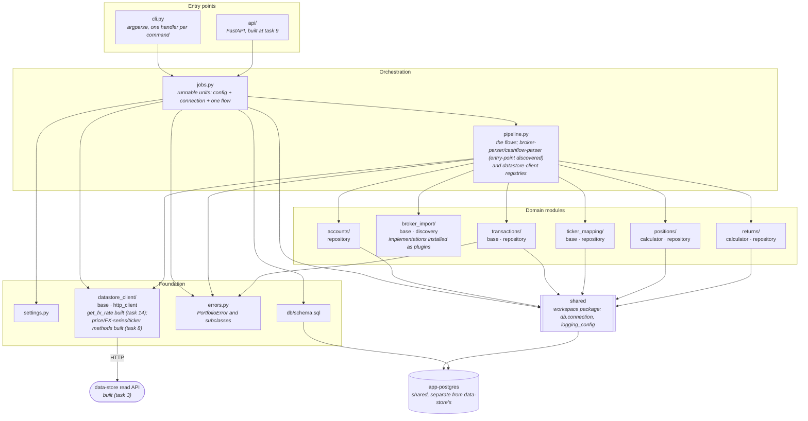
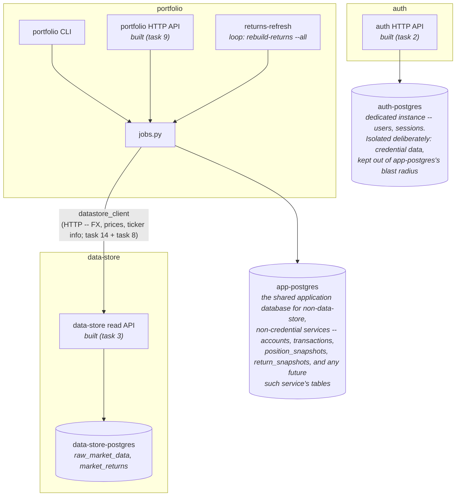

# portfolio architecture

How this service is put together and why. For *what the tables look like* see
[`schema.md`](schema.md), the column-level proposal signed off on per
[`../../../.claude/rules/data-schema.md`](../../../.claude/rules/data-schema.md); every entity
below is still described conceptually rather than as DDL. This document covers the layering, the
boundaries between modules, and the decisions that would otherwise look arbitrary — mirroring the
shape of [`data-store`'s own architecture doc](../../data-store/docs/architecture.md).

## What the service is responsible for

Recording every transaction across brokerage accounts — for multiple users, each seeing only their
own — and deriving positions and returns from that record at any point in time, not just "now."
Two things go in:

- **Transactions** — entered manually, or imported from a broker's export file via an installed
  broker-parser plugin. Every transaction's native-currency amount is stored exactly as the
  broker reported it — the immutable source of truth — alongside a EUR-equivalent frozen at
  transaction time.
- **Ticker mappings** — the mapping from a broker-reported instrument (an ISIN or a ticker symbol,
  depending on the broker) to the canonical ticker `data-store` prices (e.g. `0700.HK`). Global,
  stored in the `ticker_mappings` table and managed by an admin from `web`'s admin page (see the
  cross-cutting decision below). Never inferred, never fuzzy-matched. Manual entry doesn't need
  one: it records a `data-store` ticker directly (`TICKER`).

Two things are derived, not entered — both **materialized**, not computed live:

- **Position snapshots** — quantity and average cost per account per instrument, rebuilt by
  replaying the transaction log.
- **Return snapshots** — realized and unrealized returns per position, rebuilt from position
  snapshots plus prices and FX rates read from `data-store`.

It does **not** fetch or store market prices or FX rates itself, and does **not** run its own
yfinance (or any other) ingestion — `data-store` already owns getting external market data into
Postgres correctly; portfolio consumes it through a read API rather than duplicating that
machinery. See "Cross-service prerequisite" below.

**Explicit non-goals:**

- Not a source of truth for market prices or FX rates — that's `data-store`.
- Not a tax-lot / FIFO engine — cost basis is average-cost, blended (see cross-cutting decisions).
- Not a place that guesses a ticker mapping. An unmapped instrument blocks its own calculation,
  visibly, never a silent skip.
- Not the owner of *authentication or user identity* — credentials, sessions, login, and the
  `users` record itself belong to `auth` from the start (see
  [`auth/docs/architecture.md`](../../auth/docs/architecture.md)). Portfolio keeps no local `users`
  table, not even a placeholder — `accounts.user_id` is a plain UUID column holding the id `auth`
  issues at signup.

## Layering

Dependencies point one way, downward. Nothing in a lower layer imports from a higher one.



**Portfolio owns no `db/connection.py`.** Opening a connection, wrapping a transaction, and
applying a schema file are identical in every service here, so they live once in the
[`shared`](../../shared/docs/architecture.md) workspace package — extracted during the auth build
when its copy turned out near-identical to data-store's. Portfolio imports
`shared.db.connection` and `shared.logging_config` rather than growing a third copy; `db/` here
holds only `schema.sql`, which is genuinely portfolio's own. Repository modules import
`transaction`; `jobs.py` imports `get_connection` and `apply_schema`.

**`jobs.py` is the seam that matters**, for the same reason as data-store's: each `run_*`/`get_*`
there is one complete operation — load settings, open a connection, run the flow, close the
connection, return a result. `cli.py` is argument parsing plus a call into it, and nothing else.
`api/routes.py` (built at task 9) is a call into it and nothing else, too. Anything that lived in
only one of those two would be, by construction, untested by the other.

That result is a plain dict of builtins, built by portfolio's own `run_result.py` — following the
same two-key `{"status", "rows_saved"}` plus per-flow named-counts contract as
[`data-store/run_result.py`](../../data-store/src/data_store/run_result.py), and the same
`ok` / `partial` / `nothing_to_do` status vocabulary. **Replicated independently, not imported** —
the two services don't share code across their boundary any more than they share a database.

The rule that keeps this honest, same as data-store's: **`pipeline.py` never touches SQL or HTTP
directly, and the domain modules never decide *what* to import or rebuild.** Orchestration knows
which account, which file, which date range; domain modules know how to parse one broker's file or
read/write one table.

**Built as of task 5** — `add_account`, `list_accounts`, `add_manual_transaction`. `pipeline.py`
(not a per-flow `service.py`) is where the `with transaction(conn):` boundary lives, the role
`auth/src/auth/service.py` plays for that service; repository functions never commit, matching
`accounts/repository.py` and `transactions/repository.py` below.

**Built as of task 6** — `import_transactions`, `list_unmapped_instruments`, and the real
`BROKER_PARSERS` registry replacing task 5's placeholder `KNOWN_BROKERS` tuple.

**Revised after task 6** — `add_account` no longer reads `BROKER_PARSERS` at all. The original
version gated account creation on `broker in tuple(BROKER_PARSERS)`, which meant an install with
no broker-parser plugins available (`BROKER_PARSERS` empty) could create *no* account at all —
and since `add_manual_transaction` requires an existing account, that also silently broke manual
entry, a flow with no real dependency on any parser. `broker` is now a free-text label at account
creation, validated only for non-blank and within the column's length (`InvalidBroker`);
`BROKER_PARSERS` is read only by
`import_transactions` (and the parallel `import_cashflow`, below), the one place a parser is
actually needed. `pipeline.list_available_brokers()` / `portfolio broker list` / `GET /brokers`
reports what's currently registered, and which import kinds each broker supports.

**Revised again — broker code extracted.** `BROKER_PARSERS`/`CASHFLOW_PARSERS` are no longer
hardcoded dicts; both are built once, at import time, by `broker_import/discovery.py` reading
`importlib.metadata.entry_points()` under the `stakehold.broker_parsers` /
`stakehold.cashflow_parsers` groups. `pipeline.py` itself imports nothing broker-specific — see
"Extension points" below. No concrete parser implementation lives in this package at all — they
moved to a separate, privately-installed plugin package (not a dependency of this one; this repo
has no reference to it, by name or otherwise) that registers under the same two groups. A
deployment with no such plugin installed still creates accounts and records transactions
manually — see the "Revised after task 6" note above — and `import-transactions`/`import-cashflow`
fail with a named, self-diagnosing error (`BrokerParserNotFound`) rather than a missing-file
crash.

**Revised once more — a malformed plugin install no longer takes every command down with it.**
Discovery for each of the two registries still runs once, at `pipeline.py` import time, but a
`BrokerPluginError` raised during either one (a duplicate entry-point name, a `broker_key` that
disagrees with its registered name, or a plugin that fails to load/instantiate at all) is now
caught right there and stashed as `_BROKER_DISCOVERY_ERROR`/`_CASHFLOW_DISCOVERY_ERROR` instead
of propagating out of the module import. It's re-raised lazily, only from the functions that
actually read the affected registry (`import_transactions` for `BROKER_PARSERS`,
`import_cashflow` for `CASHFLOW_PARSERS`, `list_available_brokers` for both) — so a broken broker-parser plugin
still can't block `db init`, `account add`, `add-transaction`, or `list-unmapped-instruments`,
none of which read either registry. The two registries fail independently of each other too: a
broken cashflow-parser plugin doesn't stop `import-transactions` from working.

**Built as of task 14** — `import_cashflow`, and `datastore_client/http_client.py`'s
`get_fx_rate`, pulled forward from task 8 because one broker's cash-ledger export needed a live
FX lookup mid-parse (see "Cross-service prerequisite" below). `import_cashflow` is a separate
flow function, not a branch inside `import_transactions` — see "Cash-ledger imports needing a
live FX lookup" below for why. Its `broker` parameter and the parallel `CASHFLOW_PARSERS`
registry are a later generalization (same extraction prep as above) — task 14 itself built it
hardcoded to that one broker.

**Built as of task 7** — `rebuild_positions`, and the new `positions/calculator.py` +
`positions/repository.py` it composes. Needed a new read this task added to
`transactions/repository.py`: `list_by_accounts(conn, account_ids, *, transaction_types=None)`,
which fetches every one of `account_ids`' transaction logs in one round trip and groups them by
`account_id` — every prior read there was either scoped by `user_id`
(`list_distinct_instruments`) or a write. `list_by_account(conn, account_id)` is a thin
single-account wrapper over it, kept for a caller that only ever needs one. Unlike every flow
above it, this one opens more than one transaction boundary per call: one `with transaction(conn):`
per `(account, canonical_ticker)` pair, so each pair's delete-then-insert replacement is atomic on
its own without making the whole rebuild one all-or-nothing transaction (`schema.md`'s "Loading
strategy" for `position_snapshots`). That same per-pair boundary is also the run's
failure-isolation unit: a driver-level failure (not a `PortfolioError`) writing or pruning one
pair is caught there, logged, and reported in the run result rather than aborting every account
still left to process — see "A rebuild's own failure isolation" below. See "Three decisions task 7
had to settle" below the flows table for the cost-basis, transaction-type, and anomaly-handling
choices that weren't pinned down before this task.

**Built as of task 8** — `rebuild_returns`, and the new `returns/calculator.py` +
`returns/repository.py` it composes, plus `datastore_client`'s `get_price_series`,
`get_fx_rate_series`, and `get_ticker_info`. For each `(account, ticker)` pair
`positions_repository.list_tickers` reports, `get_ticker_info` runs first, cached per ticker for
the whole run: a ticker data-store doesn't track, or hasn't had `calculate-returns` run for,
blocks only that pair — reported in `blocked`, loudly, never a silent skip, the returns-side
equivalent of `rebuild_positions`' unmapped-instrument handling. The fetch window per pair is
bounded, not open-ended: from `position_snapshots`' first stored row (always the position's
opening date) through today if the latest snapshot is still open, or through its closing date if
not — `compute_returns` itself never invents a date outside what `get_price_series` actually
returns for that window. Every pair's compute-and-save (`get_price_series`, `get_fx_rate_series`
per distinct non-EUR currency, `compute_returns`, `returns_repository.upsert_snapshots` inside its
own `with transaction(conn):`) is wrapped in one `try/except Exception`, deliberately *broader*
than `rebuild_positions`' own per-pair catch (which only wraps driver-level exceptions, since
repositories never raise `PortfolioError`): this is the first rebuild flow with an HTTP
dependency, and a `DataStoreApiError` for one ticker must not abort every other account/ticker
still left to process, the same reasoning `rebuild_positions` used to justify its own isolation in
the first place. Caught failures land in `failed_pairs`, same shape as `rebuild_positions`'.

**Schema amendment, decided mid-task-8**: `return_snapshots` as originally signed off computed
only `unrealized_return_eur` (mark-to-market), with no path for `DIVIDEND` transactions at all —
contradicting this document's own task-7 note (below) that cash events are "left entirely to
`returns/`." Three columns were added — `dividends_received_eur`, `total_return_eur`,
`total_return_pct` — see `schema.md`'s amended `return_snapshots` section for the full proposal
and sign-off. The practical consequence for this module: `rebuild_returns` needs `mappings:
TickerMappings` after all (reversing what an earlier pass of this document implied `returns/`
wouldn't need), because resolving a `DIVIDEND` transaction's `instrument_identifier`/`kind` to the
same `canonical_ticker` its account's `BUY`/`SELL` rows resolved to is exactly
`accounts_repository`/`mappings.resolve`'s existing job — `position_snapshots.canonical_ticker`
being pre-resolved doesn't help here, since dividends are read from `transactions` directly, not
from `position_snapshots`. `transactions_repository.list_by_accounts(transaction_types=
("DIVIDEND",))` is fetched once per run, batched across every account in scope, the same
regression the positions rebuild's own batched fetch guards against. A `DIVIDEND` row that
doesn't resolve is silently excluded from `dividends_received_eur` — the identical sharp edge
already documented below for positions (an instrument split across a mapped and an unmapped
identifier kind for one broker), not a new one, and it does not block the ticker's rebuild, since
the ticker may still be fully computable from its `BUY`/`SELL` rows regardless.

## The three-file shape of a domain module

| Module | Shape | Deviation from the three-file default, and why |
|---|---|---|
| `accounts/` | `repository.py` only | No external source and no `base.py` — a broker and an account are user-declared reference data, created through a CLI command, not parsed or fetched. Every read here takes a `user_id`, and every other domain module's queries are reached only by first going through an account scoped to that user — this is the one place multi-user isolation is enforced, not repeated independently by each module. **Deliberately no unscoped `get_by_id(account_id)`** alongside `get_by_label` — that absence is the design, not an oversight: it removes the one shortcut that would let a caller reach an account without proving it owns it. |
| `broker_import/` | `base.py` (the `BrokerParser` and `CashflowParser` Protocols) + `discovery.py` (entry-point lookup, populating `pipeline.py`'s two registries) | **No `repository.py`.** A parser hands back in-memory `CanonicalTransaction` records; persistence is owned entirely by `transactions/repository.py`, so a manually-entered transaction and an imported one are written through the exact same path. Splitting persistence into `broker_import/` would let the two paths drift. **No concrete implementation lives in this module at all** — every `BrokerParser`/`CashflowParser` is an entry-point plugin from a separately-installed package; `discovery.py` is the only file here `pipeline.py` imports directly, and it never imports a concrete parser either. |
| `ticker_mapping/` | `base.py` (the `TickerMappings` lookup) + `repository.py` | `base.py` holds the in-memory lookup every rebuild resolves through, `resolve(kind, identifier, broker)`; `repository.py` persists the global `ticker_mappings` table and loads it into that lookup once per run (`load_all`), so a rebuild resolves every row against one consistent set rather than querying per row. No `*_source.py` — mappings are entered by an admin, not fetched. Until the admin page existed this was a YAML file and `loader.py`; see the cross-cutting decision on ticker-mapping storage. |
| `transactions/` | `base.py` (the `CanonicalTransaction` record shape) + `repository.py` | `base.py` here holds a **data shape**, not a `Protocol` — the contract is "what a normalized transaction looks like," which multiple producers (`broker_import` parsers, manual CLI entry) must fill in, not a swappable behavior one class implements. |
| `positions/` | `calculator.py` (pure) + `repository.py` | **Built at task 7.** Same shape as data-store's `returns/`: no `base.py`, no `*_source.py` — the input is this service's own `transactions` and `ticker_mapping` tables, not an external provider. One deliberate deviation from "repositories never commit": `positions/repository.py` still never commits, but `pipeline.rebuild_positions` opens the `with transaction(conn):` boundary once *per `(account, canonical_ticker)` pair* rather than once per flow, because `schema.md`'s delete-then-insert contract requires each pair's replacement to be atomic on its own, not the whole rebuild run. |
| `returns/` | `calculator.py` (pure) + `repository.py` | **Built at task 8.** Same shape again, plus one more thing to disclose: it also needs prices and FX rates from `datastore_client`. Those are fetched by `pipeline.py` and handed into `calculator.py` as plain data — the calculator itself stays pure and knows nothing about HTTP, keeping it as unit-testable as data-store's `returns/calculator.py`. A second thing to disclose, surfaced only once `return_snapshots`' original mark-to-market-only design turned out not to account for dividend income: `calculator.py` also takes a `DividendEvent` sequence per pair, needing no `datastore_client` call at all (`transactions.eur_amount` is already frozen in EUR) — but resolving which `DIVIDEND` transactions belong to which ticker is `pipeline.rebuild_returns`'s job, via the same `mappings.resolve` `rebuild_positions` already uses for `BUY`/`SELL`. `returns/` is therefore not quite as decoupled from `ticker_mapping/` as `position_snapshots` being pre-resolved might suggest. |
| `datastore_client/` | `base.py` (a `DataStoreClient` Protocol) + `http_client.py` | This is the `*_source.py` role, but the "provider" is another in-house service's read API rather than a third party. **`get_fx_rate` built at task 14**, pulled forward from its original task 8 slot because a cash-ledger import needed it. **`get_price_series`, `get_fx_rate_series`, and `get_ticker_info` built at task 8** — see "Cross-service prerequisite" below. `get_fx_rate_series` is a range-returning sibling of `get_fx_rate`, not a replacement: `returns/calculator.py` needs a whole date range's rates per `(account, ticker)` pair, and repeating a single-date `get_fx_rate` call per priced day would cost one HTTP round trip per day instead of one per pair; `get_fx_rate` itself is untouched and still serves `import_cashflow`'s single-date lookup. |

**`errors.py` is not a domain module** — it's a single Foundation-layer file (`PortfolioError` plus
`InvalidBroker`, `AccountNotFound`, `AccountLabelConflict`, `InvalidTransaction`, and, as of task 6,
`BrokerFileError`, `TickerMappingError`, plus `BrokerParserNotFound` and `BrokerPluginError` from
the broker-plugin extraction, `DataStoreApiError` from task 14, and `UnknownTicker`,
`InvalidTickerMapping` and `TickerMappingNotFound` from manual ticker entry and the admin mapping
page), not one per module, so every
domain-level failure `pipeline.py` or a pure validator raises shares one parent. Repositories
never raise these — they let the driver's own exceptions (e.g. `psycopg.errors.UniqueViolation`)
propagate uncaught, same as `auth`. **`jobs.py` itself no longer catches `PortfolioError`** — see
"HTTP API" below for why that changed at task 9 and what each entry point does with it instead.

**Revised — `--broker` dropped from `import-transactions`/`import-cashflow`, and `BrokerMismatch`
removed with it.** The original design took `--broker` as an explicit argument on both commands
and raised `BrokerMismatch` if it disagreed with the resolved account's own `broker` column — but
that column is *always* available once `--account` resolves (`AccountNotFound` fires first if it
doesn't), which made `--broker` pure input to re-validate against data the system already had.
Both flows now look the parser up from `account.broker` directly, which removes `BrokerMismatch`
as an error class entirely (nothing is left that can disagree with itself) and one CLI flag users
had to get right on every import.

**One cross-domain dependency worth disclosing up front**, in the spirit of data-store's disclosed
deviations: `broker_import/base.py`'s `BrokerParser.parse()` and `CashflowParser.parse()` both
return `list[CanonicalTransaction]`, so `broker_import` imports the record shape from
`transactions/base.py` — and so, transitively, does any installed plugin implementing either
Protocol. That's the one place a domain module reaches into another domain's module rather than
staying self-contained — accepted because the alternative (each parser inventing its own
intermediate shape, reconciled later) is exactly the drift the extension point exists to prevent.

## Extension points: the broker-import registries

Same pattern as data-store's `SCRAPERS` / `MARKET_DATA_SOURCES` — a `Protocol` plus a registry
dict, no branching in flow functions — but populated by `broker_import/discovery.py` reading
entry points rather than hardcoded in `pipeline.py`. Two independent Protocol/registry pairs, not
one: `BrokerParser`/`BROKER_PARSERS` (plain export files, read by `import_transactions`) and
`CashflowParser`/`CASHFLOW_PARSERS` (cash-ledger formats needing a live FX lookup mid-parse, read
by `import_cashflow`). A broker key can appear in one registry, the other, both, or neither,
independently — one broker key is in both today, since that plugin implements both Protocols;
nothing enforces they agree.

```python
# broker_import/base.py  (built as of task 6; CashflowParser added during extraction prep)
class BrokerParser(Protocol):
    broker_key: str  # the registry key (e.g. "acme"). accounts.broker is the persisted
                      # source of truth for which broker an account belongs to; nothing on
                      # CanonicalTransaction repeats it (see below).

    def parse(self, file_path: Path, account_id: int) -> list["CanonicalTransaction"]:
        """Parse one broker export file into normalized transactions for one account.

        account_id is the resolved accounts.id (BIGINT), supplied by the caller after
        resolving --account through accounts/repository.py's get_by_label -- not discovered
        from the file itself. Neither known export format self-identifies its account.
        """
        ...


ResolveFxRate = Callable[[str, date], Decimal | None]


class CashflowParser(Protocol):
    broker_key: str  # same role as BrokerParser.broker_key, in the separate CASHFLOW_PARSERS
                      # registry.

    def parse(
        self, file_path: Path, account_id: int, resolve_fx_rate: ResolveFxRate
    ) -> list["CanonicalTransaction"]:
        """Parse one cash-ledger export. Unlike BrokerParser.parse, carries resolve_fx_rate
        explicitly -- only for formats whose rows have no EUR-equivalent at all."""
        ...
```

```python
# broker_import/discovery.py
BROKER_PARSER_GROUP = "stakehold.broker_parsers"
CASHFLOW_PARSER_GROUP = "stakehold.cashflow_parsers"


def discover_broker_parsers() -> dict[str, "BrokerParser"]:
    return _discover(BROKER_PARSER_GROUP)


def discover_cashflow_parsers() -> dict[str, "CashflowParser"]:
    return _discover(CASHFLOW_PARSER_GROUP)
```

`_discover` instantiates every class registered under the group (`entry_points(group=...)`),
raising `BrokerPluginError` — fail-fast, matching this file's "unrecognized type is a parse
error" ethos — on either two installed plugins claiming the same key within one group, or a
loaded parser's own `broker_key` disagreeing with the name it registered under. Editing a
`[project.entry-points]` table does nothing until the owning package is reinstalled
(`entry_points()` reads installed `.dist-info/entry_points.txt`, not `pyproject.toml` live) —
worth remembering before assuming a registration change took effect.

`broker_import/base.py` and the two Protocols it defines are built as of task 6 -- what follows
here records the design-level facts; each installed plugin's own module docs cover its exact
parsing rules, several of which corrected assumptions an earlier pass of this document made
before real export files were available to check them against.

The canonical intermediate representation every plugin's very different raw export shape gets
parsed into -- **built as of task 5** (`transactions/base.py`), so this is the real shape, not a
proposal:

```python
# transactions/base.py
@dataclass(frozen=True)
class CanonicalTransaction:
    account_id: int                                 # the resolved accounts.id, not a label
    broker_transaction_ref: str                      # natural id if the broker gives one,
                                                       # else a stable content hash (see risk below)
    transaction_type: str                             # BUY | SELL | DEPOSIT | WITHDRAWAL |
                                                       # DIVIDEND | FX | FEE | ADJUSTMENT
    trade_datetime: datetime
    instrument_identifier: str | None                 # ISIN or symbol, whichever the broker
                                                       # reports; None for cash-only rows
                                                       # (deposits, adjustments)
    instrument_identifier_kind: str | None             # "ISIN" | "SYMBOL"
    quantity: Decimal | None                          # signed: +buy, -sell
    price: Decimal | None                             # per unit, native currency
    native_currency: str                               # ISO 4217, as the broker reports it
    native_amount: Decimal                             # signed cash-flow, broker's own figure --
                                                        # the source of truth
    eur_amount: Decimal                                # signed, frozen at transaction time
    fx_rate: Decimal | None                            # required whenever native_currency != EUR
    fx_rate_source: str | None                          # "broker_reported" | "companion_row" |
                                                        # "datastore_series" | "manual"
    fees_native: Decimal | None
```

**Two corrections against the version of this shape drafted before task 5 was built.** No
`broker` field: `schema.md` dropped the functionally-dependent `transactions.broker` *column* at
sign-off (task 4), and keeping it on the in-memory record would let a producer disagree with its
own account about who the broker is for no benefit — a parser fills `CanonicalTransaction` without
it, and `broker_key` above stays purely a registry key. `account_id` is `int`
(`accounts.id`, a `BIGSERIAL`), not `str` — resolving a caller-supplied label to that id, scoped by
`user_id`, is `accounts/repository.py`'s job, done before a `CanonicalTransaction` is ever built.
`transactions/base.py`'s `validate()` enforces the field-level rules above, including that a
non-EUR row must carry an `fx_rate` — a producer (manual entry, or a future broker parser) that
skips resolving one is rejected, not persisted as a gap to patch up later.

Registries, populated once at import time:

```python
# pipeline.py
BROKER_PARSERS: dict[str, BrokerParser] = discover_broker_parsers()
CASHFLOW_PARSERS: dict[str, CashflowParser] = discover_cashflow_parsers()
```

Today's two `BROKER_PARSERS` entries and one `CASHFLOW_PARSERS` entry all resolve to
implementations installed from a separate, privately-maintained plugin package — see the
"Revised again — broker code extracted" note above. Nothing in this repo names that package or
depends on it; it's discovered purely through the two entry-point groups above, at whatever
process picks up its installed metadata.

**`BROKER_PARSERS` is read in exactly one place outside its own definition: `import_transactions`**
(via `BROKER_PARSERS.get(broker)`, raising `BrokerParserNotFound` when nothing is registered for
the given key). **`CASHFLOW_PARSERS` is read the same way, exactly once, by `import_cashflow`.**
`add_account` deliberately reads neither — see the "Revised after task 6" note above for why
account creation and manual entry must work with both registries empty.
`pipeline.list_available_brokers()` (`portfolio broker list`, `GET /brokers`) reads both
registries, read-only, and returns one `AvailableBroker` per broker key found in either, with the
import kinds it supports: `"transactions"` (in `BROKER_PARSERS`) and/or `"cashflow"` (in
`CASHFLOW_PARSERS`). This is what `web`'s import page offers as its importer choice. Before
that page existed, it reported `BROKER_PARSERS` keys alone, so a broker with only a cashflow
parser (one exists today) was invisible to every caller and could only be imported through the
CLI. Because it reads both registries, a stashed discovery error from either one is raised here,
rather than that registry's brokers silently showing fewer imports than they have.

**Worked example — adding a third broker** (e.g. Trading212): implement `BrokerParser` and
register it under the `stakehold.broker_parsers` entry-point group as `trading212 = "...:
Trading212Parser"` in whatever package provides it (this one, today; a separate installable
package, once the extraction below completes) — no change to `pipeline.py`'s flow function,
`jobs.py`, or `cli.py`'s argument shape. `import-transactions --file ... --account ...` works
against a Trading212 account as soon as that package is installed and its metadata is picked up
(`entry_points()`, at next process start) — the account's own `broker` column, not a CLI flag,
is what selects `trading212` from the registry.

**A plugin's own parsing rules — locale formats, id-collision handling, per-broker FX
conventions — are documented in that plugin package's own docs, not here.** This document owns
the shape of the extension point (the Protocols, the registries, the flow functions), not any
particular implementation. (The two plugins this deployment actually installs, and the real
production risks their authors found — a non-unique natural key, an undocumented base-currency
convention — are written up in that private package's own `docs/architecture.md`, in the same
verified-against-a-real-export style this document uses elsewhere.)

**Disclosed trade-off, matching data-store's style**: `parse(file_path, account_id)` assumes a
broker's history always arrives as one downloadable file. A future broker exposing only a
paginated API, not a file export, would have to be adapted into "write it to a temp file, then
parse it," or the Protocol would need broadening. Accepted for now, same reasoning data-store used
for its single `MarketDataSource` Protocol: both known brokers are file-export-based, and there's
nothing to generalize from yet.

**A real natural key can turn out not to be unique, and a real installed plugin found exactly
that case.** `broker_transaction_ref`'s uniqueness (with `account_id`) is the whole idempotent-
reimport contract, so a parser can't simply trust whatever id field a broker export happens to
provide — one real broker's plugin found its export's obvious-looking id column collides on a
partial fill, and had to fall back to a content hash plus an occurrence index instead. Written up
in that plugin's own docs, not here, since the specifics (which broker, which column) are exactly
what stays out of this repo.

## Conceptual entity model

Per [`data-schema.md`](../../../.claude/rules/data-schema.md), this is the entity shape and
identity — not column-level DDL, which needs its own sign-off pass.

- **User** — owned entirely by `auth`, not portfolio (see "Explicit non-goals" above). There is no
  `users` table here, not even a stand-in: `Account` holds `user_id` as a plain UUID column
  referencing the id `auth` issues at signup — the same non-owning reference shape used for
  `canonical_ticker` into `data-store`'s world, except there's no local row backing it at all.
  Nothing here enforces the UUID is real; it's trusted input, the same way a `canonical_ticker` is
  trusted without a foreign key. Authentication — credentials, sessions, login — is out of scope for
  this document and belongs to `auth`.
- **Broker** — identified by a short, free-text key an account's `--broker` names (not validated
  against a fixed list — see the "Extension points" section). A key with an installed parser is
  also a `BROKER_PARSERS`/`CASHFLOW_PARSERS` registry key; one without is still a legitimate
  broker, just one this deployment can't auto-import from.
- **Account** — identified by a user-chosen id/label; references one Broker and exactly one User (an
  `auth`-issued UUID, not a local row).
  Any broker-side account identifier a plugin's export happens to carry is **not stored at all**
  — no known export format self-identifies its account, so matching is always by the
  caller-supplied `--account`, which leaves a stored broker-side id as display-only data with no
  reader. See [`schema.md`](schema.md)'s `accounts` section. Every downstream entity (Transaction,
  PositionSnapshot, ReturnSnapshot) is scoped by Account and therefore transitively by User — there
  is no cross-user query path. **Stated assumption, not confirmed**: one user per account, no
  shared/joint accounts.
- **TickerLink** (the mapping) — identified by `(instrument_identifier_kind,
  instrument_identifier)`, e.g. `(ISIN, IE00B4L5Y983)` or `(SYMBOL, IWDA)`; maps to a
  `canonical_ticker` string (a `data-store` `raw_market_data.ticker` spelling, e.g. `IWDA.AS`).
  Stored in the global `ticker_mappings` table — see [`schema.md`](schema.md) and the cross-cutting
  decision on ticker-mapping storage. `PositionSnapshot`/`ReturnSnapshot` reference the resolved
  `canonical_ticker` string directly rather than a mapping id, so re-pointing or deleting a mapping
  never cascades into derived rows; the next rebuild recomputes them instead.
  - **Key scoping, carried over unchanged**: `ISIN` mappings are global (an ISIN is globally
    unique by design, so one mapping covers every ISIN-based broker); `SYMBOL` mappings are scoped
    per-broker (a raw ticker symbol is *not* globally unambiguous — two exchanges can reuse the
    same symbol for different instruments). Enforced by a CHECK (an ISIN row has no broker, a
    SYMBOL row must have one) and two partial unique indexes, one per kind. Keying `SYMBOL`
    mappings without a broker qualifier risks silently reusing a mapping that isn't actually the
    same instrument on a future symbol-based broker.
- **Transaction** — identified by a surrogate id; references an Account; carries `(account_id,
  broker_transaction_ref)` unique together for idempotent re-import (the broker is the account's,
  not the row's — see [`schema.md`](schema.md)); carries the raw
  `instrument_identifier`/`kind` as reported (for traceability back to the source file/row) — **not**
  a hard foreign key to TickerLink at write time, since a transaction must be importable *before*
  its instrument is mapped. The mapping gap is a first-class, visible state (surfaced by the
  positions/returns rebuild, not by import failing).
- **PositionSnapshot** — identified by `(account, ticker_link, as_of_date)`; wholly derived,
  rebuildable, never hand-edited. **Proposed grain, flagged for schema sign-off**: event-driven —
  one row per date a transaction actually changed the position, with "position as of date D" read
  as "the latest snapshot ≤ D." Cheap, and matches how the position genuinely changes (only on a
  transaction).
- **ReturnSnapshot** — identified by `(account, ticker_link, price_date)`; derived from
  PositionSnapshot plus `data-store` prices/FX; wholly derived, rebuildable. **Proposed grain,
  flagged for schema sign-off**: daily — one row per priced trading day the position was open,
  since a *return* changes every day the price moves even with zero transactions, so it can't be
  event-driven the same way. Mirrors `market_returns`'s own daily grain in data-store. **Bounded,
  not open-ended**: "was open" means from the position's first non-zero `PositionSnapshot` through
  the trading day it closes to zero, inclusive — `rebuild-returns` stops generating new rows for a
  ticker once the latest `PositionSnapshot` shows zero quantity with no later re-opening
  transaction. Rows already written for the open window are never deleted, so they remain available
  for historical charting; the grain just doesn't grow forever for a position nobody still holds.

## The flows

| Flow | Command | HTTP endpoint (task 9) | Cadence | Reads | Writes |
|---|---|---|---|---|---|
| Account setup | `account add --user <id> --broker <key> --label <label>` | `POST /accounts` | rare, manual | — | `accounts` |
| Account listing | `account list --user <id>` | `GET /accounts` | manual, on demand | `accounts`, scoped by `user_id` | — (read-only report) |
| Broker-plugin discovery | `broker list` | `GET /brokers` | manual, on demand | `BROKER_PARSERS`, `CASHFLOW_PARSERS` (in-memory) | — (read-only report: each broker and its import kinds) |
| Ticker mapping: set | `ticker-mapping set --kind ISIN\|SYMBOL --identifier <id> [--broker <b>] --ticker <t> --user <admin id>` | `PUT /ticker-mappings` | manual, by an admin, as unmapped instruments surface | data-store's `GET /tickers/{ticker}` (the ticker must exist), then `transactions` joined to `accounts` (every account, across users, using the instrument) | `ticker_mappings` (upsert), then `position_snapshots` for each affected account |
| Ticker mapping: delete | `ticker-mapping delete --id <n> --user <admin id>` | `DELETE /ticker-mappings/{id}?updated_by=` | manual, by an admin | `transactions` joined to `accounts` (affected accounts) | `ticker_mappings` (delete), then `position_snapshots` for each affected account |
| Ticker mapping listing | `ticker-mapping list` | `GET /ticker-mappings` | on demand | `ticker_mappings` | — (read-only report) |
| Ticker list | — (CLI has none) | `GET /instruments/tickers` | on demand | `data-store`'s `GET /tickers` (`datastore_client.list_tickers`), passed through so `web` only ever talks to `portfolio` | — (read-only report) |
| List unmapped instruments | `list-unmapped-instruments --user <id>` | `GET /instruments/unmapped` | manual, on demand | `transactions` joined to `accounts` (scoped by `user_id`, and to pick up each instrument's owning broker), `ticker_mappings` | — (read-only report) |
| List unmapped instruments, every user | `list-unmapped-instruments --all` | `GET /instruments/unmapped/all` | on demand (the admin page) | `transactions` joined to `accounts`, unscoped; `ticker_mappings`. Returns identifiers only, never whose they are; an ISIN appears once, with no broker | — (read-only report) |
| Manual transaction entry | `add-transaction --user <id> --account <label> --ref <key> --type <type> --datetime <iso8601> --amount <decimal> --currency <ISO4217> [--instrument <id> --instrument-kind ISIN\|SYMBOL\|TICKER] [--quantity <d>] [--price <d>] [--fx-rate <d>] [--fees <d>]` | `POST /transactions` | ad hoc | `accounts`, scoped by `user_id` | `transactions` (idempotent on `(account_id, broker_transaction_ref)`, keyed by the mandatory `--ref`) |
| Broker file import | `import-transactions --user <id> --file <path> --account <label>` | `POST /transactions/import` (multipart) | manual, on demand | export file, `accounts` scoped by `user_id` | `transactions` (idempotent on `(account_id, broker_transaction_ref)`) |
| Cash-ledger import | `import-cashflow --user <id> --file <path> --account <label>` | `POST /cashflows/import` (multipart) | manual, on demand | export file, `accounts` scoped by `user_id`, data-store's FX read API (`datastore_client`) for non-EUR rows | `transactions` (idempotent on `(account_id, broker_transaction_ref)`) |
| Transaction listing | — (CLI has none) | `GET /transactions` | on demand | `transactions`, scoped through the resolved account | — (read-only report) |
| Positions rebuild | `rebuild-positions --user <id> [--account <label>]` | `POST /positions/rebuild` | automatically after every transaction write that saves rows (see "Positions and returns follow every transaction write") and, for each affected account, after every ticker-mapping change | `transactions`, `ticker_mappings` | `position_snapshots` |
| Position listing | — (CLI has none) | `GET /positions` | on demand | `position_snapshots`, latest row per ticker | — (read-only report) |
| Returns rebuild | `rebuild-returns --user <id> [--account <label>]` | `POST /returns/rebuild` | automatically after every positions rebuild that follows a write or a mapping change (see "Positions and returns follow every transaction write") | `position_snapshots`, `transactions` (`DIVIDEND` rows), `ticker_mappings`, `data-store` read API | `return_snapshots` |
| Returns refresh, every user | `rebuild-returns --all` | — | every `PORTFOLIO_RETURNS_REFRESH_SECONDS` (default 6h), by the `returns-refresh` container (see "Returns follow new prices") | as for one user, for each user with an account | `return_snapshots` |
| Return listing | — (CLI has none) | `GET /returns`, `GET /returns/latest` | on demand | `return_snapshots`, optionally filtered by ticker/date range | — (read-only report) |

**No separate `brokers` table** ever materialized — `schema.md` settled on `broker` as a plain
string on `accounts`, so `account add` writes only to `accounts`, never a second table.
`account add --broker <key>` is free text, checked only for non-blank and within the column's
length (`InvalidBroker`) — it is
**not** validated against `BROKER_PARSERS` or any other fixed list of names, on purpose: account
creation and manual transaction entry must both work with zero broker-parser plugins installed.
The stored `broker` only needs to match a registered parser once `import-transactions`/
`import-cashflow` looks it up from the account -- neither command takes its own `--broker`.

**A load-bearing consequence of the entity model above, worth stating directly:** `rebuild-positions`
needs no price data at all — quantity and average cost are pure functions of the transaction log.
So **everything except `returns/` and the "current market value" feature can be built, tested and
shipped before `data-store`'s read API exists.** That sequencing fact changes what "blocked on the
prerequisite" actually means in practice — it's one flow, not the whole service.

**Both rebuilds are full rebuilds, same reasoning as data-store's `calculate-returns`**: a
late-arriving ticker mapping, or a corrected/added historical transaction, changes every snapshot
from that point forward, so incremental append would serve stale rows. Rebuild scope is per
account (an isolatable failure unit, mirroring data-store's per-ticker/per-group isolation).

**An unmapped instrument blocks its own rebuild, loudly** — `rebuild-positions`/`rebuild-returns`
process every other account/instrument normally, and report the blocked ones by name in the
completion summary with a `partial` status, following the same `run_result` contract and
`nothing_to_do` vs. `partial` vs. `ok` distinction data-store already established (and the
repo-wide logging rule: "nothing to do" must never look like "something failed silently").

**A known sharp edge in that blocking rule**: it's keyed by
`(instrument_identifier_kind, instrument_identifier)`, the only key `mappings.resolve` can look
up — there is no way to tell, from an unresolved identifier alone, which resolved ticker (if any)
names the same real-world instrument. If one account's transactions for a single holding are
split across a mapped identifier kind (e.g. `ISIN`) and an unmapped one for that broker (e.g.
`SYMBOL`), that ticker's snapshot is built only from the mapped rows — silently a partial view,
not the blocked-and-untouched outcome described above. The fix lives in the ticker mappings (map
every identifier kind a broker actually emits for an instrument), not in `rebuild_positions` itself — there's no reliable way for the code to infer
that two different identifier strings name the same instrument without the mapping saying so for
both.

**A rebuild's own failure isolation** — the per-`(account, ticker)` transaction boundary above is
also where a driver-level failure (a constraint violation, a dropped connection; anything that
isn't a `PortfolioError`, since repositories never raise those) is caught, logged with its
traceback, and reported in `failed_pairs`/`pairs_failed` rather than propagating and aborting
every account still left to rebuild. This is deliberately narrower than a general "catch
everything" policy: it only wraps the two repository calls inside the per-pair loop
(`replace_snapshots`, `delete_snapshots`), the same boundary `shared.db.connection.transaction`
already rolls back on any exception — which is what leaves the connection usable for the next
pair instead of stuck in Postgres's aborted-transaction state. Every other flow in this file keeps
the plain "an uncaught exception means nothing committed" contract; `rebuild_positions` earns
this extra handling specifically because it is the one flow that is *not* single-transaction, so
without it a failure partway through would silently discard the accurate count of what had
already, durably, succeeded.

**Three decisions task 7 had to settle, none of which were pinned down before it started:**

- **Cost basis is sourced from `native_amount`/`eur_amount`**, the broker's own frozen cash-flow
  figures (`schema.md`'s "immutable source of truth"), not `quantity * price`. The consequence
  worth keeping in mind: `average_cost_eur` needs no FX arithmetic in `positions/calculator.py` at
  all — it never divides by `fx_rate` — because `eur_amount` already froze that conversion at
  transaction time. One corollary that isn't obvious from the columns alone: `average_cost_eur` is
  a *blend of each purchase's own frozen `eur_amount`*, not derivable from `average_cost_native` by
  any single `fx_rate` — see `schema.md`'s note on the same instrument held in two currencies.
- **Only `BUY` and `SELL` move a position.** Every other `transaction_type` is a cash event —
  `validate()` doesn't even guarantee a `DIVIDEND`/`FEE`/`ADJUSTMENT` row carries a `quantity` or
  `price` — so none of them touch `position_snapshots` here. **Correction against this
  document's own earlier wording**: only `DIVIDEND` actually went on to feed `returns/` (task 8,
  `return_snapshots.dividends_received_eur`) — `FEE` and `ADJUSTMENT` still feed nothing anywhere
  in the service, the same open gap as the missing `realized_gains` table (`schema.md`).
- **A ledger anomaly warns but still computes, rather than blocking.** Two cases:
  `position_snapshots.native_currency`'s single-currency-per-instrument-per-account assumption
  being violated within one account, and a running quantity going negative. Both are logged
  (`positions_with_anomalies` in the run result) and the snapshot is still written; only an
  unmapped instrument flips the run to `partial`. Rationale: unlike an unmapped instrument, there
  is no action a user can take from the CLI to resolve either anomaly, so blocking the rebuild
  would only make the portfolio look emptier without giving them a way to fix it.

**Pruning a ticker `rebuild-positions` no longer produces** (e.g. a ticker mapping was re-pointed
to a different `canonical_ticker`) is handled, but
conservatively: `pipeline.rebuild_positions` only deletes a stale `(account, ticker)` pair when
that account currently has **zero** blocked instruments. A blocked instrument's old
`canonical_ticker` — from before its mapping was removed — is indistinguishable from a genuinely
stale one at rebuild time, and "blocked means don't touch, not delete" means the ambiguous case
must never delete. An account with any blocked instrument simply skips pruning for that run.

### Positions and returns follow every transaction write

`run_add_transaction`, `run_import_transactions` and `run_import_cashflow` each end by calling
`run_rebuild_positions` and then `run_rebuild_returns` for the one account they just wrote to
(`jobs._rebuild_after_write`), and report their outcomes as `positions_rebuild` and
`returns_rebuild` alongside their own `status`.

**Why:** `GET /positions` reads only `position_snapshots`, and before this nothing but an explicit
`rebuild-positions` ever wrote it — so a transaction entered through the web UI was durably saved,
reported as saved, and then simply absent from the portfolio view, with the only remedy a CLI
command a web user has no access to. That looked exactly like data loss. A positions rebuild is
cheap enough to run inline: it's one account, needs no price data (see above), and is a full,
idempotent replacement, so running it on every write can never leave a stale or duplicated row.

**Where, and why there:** in `jobs.py`, not in `web` and not in `pipeline.py`. Every entry point —
CLI, HTTP API, and through it `web` — reaches a write via these three jobs, so putting it here
covers all of them with one call site, and a future write path that goes through a job gets it
for free. `pipeline.py` was rejected because each pipeline flow is one unit of work over one
connection with one transaction contract; composing two of them is orchestration, which is
`jobs.py`'s job. Having `web` call `POST /positions/rebuild` after each write was rejected because
it would fix only the web UI and leave the CLI and any other API caller with the same gap.

**Returns second, and only on top of good positions.** `return_snapshots` is computed from
`position_snapshots`, so the returns rebuild runs after the positions one and is skipped
(`returns_rebuild: skipped`) when the positions rebuild failed: returns over stale positions
would be wrong, not just late. It's also skipped when data-store isn't configured
(`DATASTORE_API_URL`/`INTERNAL_API_SECRET`), with a WARNING naming the `rebuild-returns` command to
run once it is, so a CLI-only setup without data-store still saves transactions.

*Why returns joined the write path after first being kept off it:* this section used to leave
returns out on purpose, because `rebuild-returns` makes HTTP calls to data-store and that put a
cross-service failure mode on the write. In practice that left every new transaction's returns
chart empty until someone ran a CLI command a web user can't reach — the same "saved but
invisible" problem positions had. The failure mode is contained the same way positions' is: the
call happens after the write has committed, and any failure is reported, never raised.

**Skipped when the write saved nothing** (`positions_rebuild`/`returns_rebuild: skipped`): an
idempotent resubmit leaves the transaction log unchanged, so the snapshots derived from it are
unchanged too.

**Failure isolation:** the rebuild opens its own connection only after the write's connection has
closed and its transaction committed, so nothing the rebuild does can roll a saved transaction
back. A rebuild that *raises* (a dropped connection, say) is
therefore caught, logged with its traceback, and reported as `positions_rebuild: failed` rather
than propagated — propagating would turn a durably saved write into an error response and invite
the caller to act on a false signal. The returns rebuild is isolated the same way, separately: it
reports `returns_rebuild: failed` without touching `positions_rebuild`. These follow-on steps are
the one place a write job catches a non-domain exception, deliberately never the write itself.

**The write's own `status` never reflects the rebuild.** An unmapped instrument blocks its own
ticker's rebuild (`positions_rebuild: partial`), but the transaction was still saved, and
`status`/HTTP 201 must keep meaning exactly that.

**Known limitations:**

- **`web` surfaces `positions_rebuild`/`returns_rebuild` (UI-7)** as a one-line outcome on its
  confirmation banners, and lists the account's unmapped instruments (from
  `GET /instruments/unmapped`) on the holdings page. That list is per user and carries the broker
  but not the account, so `web` can only filter it by broker. An exact per-account list would need
  a new endpoint here; see `services/web/docs/architecture.md`.
- **Accounts whose transactions predate this change** have no position snapshots until their next
  write or a manual `rebuild-positions`; nothing backfills them. (Returns do get backfilled, by
  the scheduled refresh below, for any account that has positions.)
- **The rebuilds are synchronous**, so a write's response time includes them — and, since
  returns, a few data-store HTTP calls for that one account's tickers. Fine at today's volumes; a
  large broker import into a long-lived account is where to look first if that stops being true.

### Returns follow new prices

Every day data-store's `daily_pipeline` DAG ingests new closes, which moves every holder's return
whether or not they touched their account. The `returns-refresh` container
(`docker-compose.stakehold-net.yml`) runs `rebuild-returns --all` in a loop, every
`PORTFOLIO_RETURNS_REFRESH_SECONDS` (default six hours). `jobs.run_rebuild_returns_all` runs
`run_rebuild_returns` for each user with an account, isolated per user: one raising is logged and
counted in `users_failed`, and the rest still run. Blocked tickers and failed pairs are summed and
make the run `partial`. A run when nothing changed only re-upserts the same rows.

*Why portfolio polls instead of data-store calling it when the DAG finishes:* portfolio depends on
data-store and never the reverse, and Airflow isn't even on `stakehold-net`. A DAG step would
need Airflow on that network, portfolio's inbound secret in data-store's config, and data-store
knowing portfolio exists — a new dependency in the wrong direction, to save at most one polling
interval of lag on daily closes. *Rejected: compute returns on read* — see the cross-cutting
decision on materialization. *Known cost:* every run rebuilds every user's returns in full,
including users whose holdings have no new prices. Fine at this scale; the place to start if it
isn't is skipping users whose latest snapshot is already at data-store's latest price date.

### Positions follow every ticker-mapping change

A mapping is global, so saving or deleting one can change positions in any user's accounts.
`jobs.run_set_ticker_mapping`/`run_delete_ticker_mapping` therefore find every account whose
transactions use that instrument (`transactions.list_accounts_using_instrument` — every broker for
an ISIN, the mapping's own broker for a SYMBOL) in the same connection as the write, close it, and
then rebuild each of those accounts' positions and returns with the same isolation the
transaction-write rebuild uses (`_rebuild_derived_isolated`): one account's rebuild failing is
logged and counted (`rebuilds_failed` for positions, `returns_rebuilds_failed` for returns),
never raised, and never stops the others. The response's `status` describes the mapping change
alone; the counts sit beside it. The CLI exits non-zero when any rebuild failed, so a
retry-worthy outcome isn't a clean exit.

*Rejected: rebuild every account in the deployment* — simplest, but its cost grows with every
user, for a change that typically touches a handful of accounts. *Rejected: leave the rebuild to
the next transaction write* — that's exactly the stale-positions bug the transaction-write rebuild
exists to fix.

**Deleting a mapping doesn't remove the positions it produced.** The rebuild after a delete finds
the instrument blocked, and blocked means don't touch (see "Pruning" above), so the old ticker's
snapshots stay until the instrument is mapped again. Re-pointing doesn't have this problem, unless
the account holds some other unmapped instrument (pruning is skipped for the whole account then).

### Manual transaction entry

`add-transaction`'s `--ref` is **mandatory**, unlike a broker import where `broker_transaction_ref`
comes from the file. That's what makes manual entry idempotent by construction: re-running the
same command with the same `--ref` hits `(account_id, broker_transaction_ref)`'s `ON CONFLICT ...
DO NOTHING` and reports `nothing_to_do`, exactly like re-importing an overlapping file. A caller
who wants a one-off, throwaway entry still has to choose a ref (e.g. a UUID) — there's no
auto-generated fallback, because a generated ref would make every invocation a *new* row instead of
a safe re-run, silently defeating the idempotency the mandatory flag exists to give.

The EUR side of a transaction is computed locally, not fetched. `--currency EUR` requires no rate:
`eur_amount = native_amount`. Any other currency requires `--fx-rate`, read as **native currency
units per 1 EUR** (e.g. `--currency USD --fx-rate 1.0850` means EUR 1 buys USD 1.085), so
`eur_amount = native_amount / fx_rate`, rounded half-up to `eur_amount`'s own four decimal places
(`transactions/base.py`'s `to_eur`). The stored `fx_rate_source` is `"manual"` — a fourth value
added to the vocabulary `schema.md` originally documented as `broker_reported` / `companion_row` /
`datastore_series`, none of which fit a rate the user typed in; see `schema.md`'s amendment.

**Known limitation, partly revisited at task 14**: a non-EUR manual entry still has no fallback to
`data-store`'s FX series — if the caller doesn't know the day's rate, `add-transaction` simply fails
with `InvalidTransaction` rather than looking one up. `datastore_client.get_fx_rate` now exists
(built for `import-cashflow` below), so this is technically reachable, but wiring
`add-transaction` to it wasn't part of what task 14 was asked to do — left as an explicit, easy
follow-up rather than done as a drive-by.

**Manual entry stores a `data-store` ticker, not an ISIN or symbol.** The web form offers
`data-store`'s own ticker list (`GET /instruments/tickers`) and always submits
`instrument_identifier_kind = 'TICKER'`. `pipeline.add_manual_transaction` asks `data-store`
whether the ticker exists (`get_ticker_info`) before writing anything, and raises `UnknownTicker`
(422) if not. `TickerMappings.resolve` returns a `TICKER` identifier as-is, so positions,
returns and the unmapped-instruments report all handle it without a mapping.

*Why:* ticker mappings exist to translate what a broker export reports into the ticker
`data-store` prices. For a transaction the user types in, there's nothing to translate: they're
choosing the instrument, so they can choose it in `data-store`'s own terms. Asking them for an
identifier plus a kind, and then a separate mapping, was two extra steps, one of them a
hand-edited config file. It also let a typo through unnoticed: a manually entered `IWDA.AM`
(`data-store` only has `IWDA.AS`) was saved, then blocked at every rebuild with nothing in the UI
saying why. The check at save time is what makes skipping the mapping safe: a `TICKER` row is
only ever written once `data-store` has confirmed it.

*Rejected:* looking the ticker up from an ISIN automatically (for example through a Yahoo
search). That's the inference the ticker-mapping design rules out; a wrong match would attach the
wrong price series to a position without anyone noticing.

**A manual BUY/SELL's amount is derived, not typed.** `--amount` (and the form's Amount field) is
optional for a BUY or SELL: `pipeline.add_manual_transaction` computes it as
`-(quantity * price) - fees`, rounded half-up to four places. One formula covers both, since
quantity is already signed: a BUY comes out negative (cash out, including fees), a SELL positive
(cash in, net of fees). Every other type has no quantity or price to derive from, so its amount
is still required.

*Why:* cost basis comes from `native_amount` (task 7's decision above), and for a trade the user
types in, that figure is just their own arithmetic on numbers they already entered. Asking for it
separately invited a mismatch nothing caught: a manual BUY of 5 × 128.65 was saved with an amount
of `10`, which would have priced the position at €2 a share. A typed amount is still accepted,
since a broker's confirmation can differ from price × quantity + fees by a rounding cent and its
figure is the one to keep, but only within €0.01 of the derived value; anything further is
rejected with the expected figure in the message. That tolerance also enforces the sign, which
the positions calculator itself doesn't check (it takes the absolute value).

*Scope:* manual entry only. A broker import keeps the broker's own figure untouched, including
transaction taxes and bundled fees a manual entry would put in `--fees`.

**Consequence: a `TICKER` entry needs `data-store`.** `add-transaction` with a `TICKER` requires
`DATASTORE_API_URL`/`INTERNAL_API_SECRET`, as `import-cashflow` does, and fails with `SettingsError`
without them. Manual entry of an ISIN or symbol (still possible from the CLI) needs no
`data-store` at all.

### Cash-ledger imports needing a live FX lookup

Some brokers' trade export carries no EUR-equivalent at all for any row — unlike a format where a
broker-reported EUR column or an already-EUR-denominated base currency lets `BrokerParser.parse`
stay pure, no I/O beyond the file itself. A non-EUR row in that kind of export needs a live
FX-rate lookup mid-parse to get a `eur_amount`. Widening `BrokerParser.parse()` to carry a
`datastore_client` parameter for every implementation — including every parser that never needs
one — was rejected in favor of a second, parallel registry: `CashflowParser`/`CASHFLOW_PARSERS`,
whose `parse()` takes a plain `resolve_fx_rate` callable instead (see "Extension points" above).
`pipeline.import_cashflow` resolves rates through `datastore_client` and hands that callable to
whatever `CashflowParser` is registered for the resolved account's `broker` — the parser
implementation stays pure and testable against a fake callable, no HTTP client required.
`import-cashflow --user <id> --file <path> --account <label>` is its own CLI command, not a
file-type-sniffing branch inside `import-transactions`.

**FX resolution contract**: for a non-EUR row, `resolve_fx_rate(currency, on_date)` calls
`datastore_client.get_fx_rate("EUR", currency, on_date)`, which looks back up to 7 days for the
most recent point at or before `on_date` (covering a weekend/holiday with no traded rate) and
returns `None` if nothing is found in that window. `None` is not silently tolerated — a
`CashflowParser` implementation is expected to raise (`BrokerFileError`, by convention) rather
than persist a row with a gap. The stored `fx_rate_source` for this path is `"datastore_series"`.

The one installed plugin's own row-classification rules — which description strings map to which
canonical type, which rows are the broker's own internal housekeeping to skip, the locale caveat
for a non-English export — are documented in that plugin's own `docs/architecture.md`, not here,
for the same reason as "Extension points" above: those specifics are exactly what stays out of
this repo.

## HTTP API

**Built at task 9.** `src/portfolio/api/{app,routes,security,models}.py` — FastAPI routes that
are argument-parsing-plus-a-call-into-`jobs.py`, the same shape `cli.py` has, per the flow table
above. Mirrors `auth`'s shape more than `data-store`'s: an injectable `Settings` argument to
`create_app()` (so tests build an app with a known secret without touching the environment), and
`X-Internal-Secret` rather than `Authorization: Bearer` — the header `web`'s `HttpAuthClient`
already sends, so a future `PortfolioClient` in `web` is a copy of that module, not a new shape.
`app.state.settings` (set once in `create_app()`) is threaded through every route's own
`Depends(get_settings)` into the matching `jobs.py` call's `settings` keyword, rather than each
`run_*`/`get_*` re-deriving it via its own `load_settings()` — the same `Settings` instance a test
built into `create_app()` is therefore what every route, not just `/health`, actually queries
against. `cli.py` never passes `settings`, so each job's own `load_settings()` fallback keeps the
CLI's behaviour unchanged.
`/docs`, `/redoc`, `/openapi.json` are disabled, `data-store`'s reasoning: they mount as plain
Starlette routes no router-level dependency covers, and this is a service-to-service API with no
`/docs`, `/redoc`, `/openapi.json` are disabled, `data-store`'s reasoning: they mount as plain
Starlette routes no router-level dependency covers, and this is a service-to-service API with no
interactive audience.

**`account_label` and `user_id` are always a query parameter or a request-body field, never a
path segment.** A label is user-chosen free text up to 100 characters and may contain `/`, which
no amount of path-segment escaping survives cleanly through a proxy; `user_id` is likewise
explicit, matching `cli.py`'s `--user` and this document's existing "`user_id` is trusted input"
stance (see "Conceptual entity model" above) — the shared secret proves a legitimate internal
caller, not a specific user.

**Error mapping moved the `except PortfolioError` out of `jobs.py`, into each entry point.**
Before this task, every `run_*` job caught `PortfolioError` and collapsed it into a generic
`{"status": "partial", "rows_saved": 0}` result, with the exception's message only logged — an
HTTP layer reading that dict alone could not tell "account not found" from "unparseable broker
file" from "data-store unreachable." `jobs.py` now lets `PortfolioError` propagate; `cli.py`
catches it in `main()` (alongside the pre-existing `SettingsError` clause) and prints a one-line
stderr message; the API maps each subclass to its own status code via `app.py`'s exception
handlers, `auth`'s pattern of app-level handlers rather than per-route `try`/`except`:

| Exception | Status | Why |
|---|---|---|
| `AccountNotFound` | 404 | `--account`/`account_label` didn't resolve for this user — the isolation chokepoint |
| `TickerMappingNotFound` | 404 | a mapping delete for an id that's already gone |
| `AccountLabelConflict` | 409 | a label re-used under a different broker |
| `InvalidBroker`, `InvalidTransaction`, `BrokerFileError`, `BrokerParserNotFound`, `UnknownTicker`, `InvalidTickerMapping` | 422 | a caller-supplied value failed validation or parsing |
| `TickerMappingError`, `BrokerPluginError` | 500 | a server-side data/plugin problem, not a caller mistake (`TickerMappingError` now means a stored transaction carries an identifier kind `resolve` doesn't know) |
| `DataStoreApiError` | 502 | the upstream `data-store` call failed |
| any other `PortfolioError`, `SettingsError` | 500 | fails closed rather than leaking a raw traceback |

**One practical consequence: `partial` now means only genuine partial success.** The two rebuild
endpoints (`POST /positions/rebuild`, `POST /returns/rebuild`) can still report `status: partial`
via `pipeline.rebuild_positions`/`rebuild_returns`'s own per-pair `blocked`/`failed_pairs`
handling (unchanged by this task) — a real half-succeeded run, returned as **200**, with the
blocked/failed detail in the body, not an error status, since the caller needs that list to know
which instruments to map. Every write endpoint, rebuild routes included, goes through the same
`routes._write_status_code`: `ok` is **201**, anything else (`nothing_to_do`, or a rebuild's own
`partial`) is **200** — a domain error on any of them reaches the API as an exception instead, per
the table above.

**Broker-file imports take a multipart `UploadFile`.** `import-transactions`/`import-cashflow`
both take a local filesystem `Path` in `jobs.py` — unchanged by this task, since the CLI still
needs that — so the two upload routes (`_save_upload_to_tempfile` in `routes.py`) stream the
request body to a size-capped (20 MB) temp file in chunks, call the job with that path, and
delete the file in a `finally`, on both the success and the error path. A caller-supplied
server-side path was deliberately not offered as an alternative to a real upload — that would be
an arbitrary-file-read primitive sitting behind one shared secret.

**Returns are served per ticker**, not aggregated across a portfolio. `GET /returns` takes an
optional `ticker`/`start`/`end` filter and returns one series per matching `(account, ticker)`
pair; there is no endpoint that sums market value or return across every ticker an account holds
into one portfolio-level series. This is deliberate, not an oversight: different tickers can sit
on different trading calendars, so summing across them is a real design question — how to handle
a date one ticker priced and another didn't — not a serialization detail, and it's left to task
12 (the view UI), where the chart's actual shape will settle the question.

**Known limitations, same category as `data-store`'s own read API:**

- **One connection per request.** `jobs.py`'s `run_*`/`get_*` functions open and close their own
  connection, exactly as they already do for the CLI — `psycopg_pool` (as `auth`'s API already
  uses) is the intended fix if request volume ever makes per-request connection setup a
  bottleneck. `/health` pays this cost too, independent of any real traffic: Docker's own
  healthcheck (`docker-compose.yml`, 10s interval) opens and closes a fresh connection every tick
  for the container's whole lifetime — the same fix would absorb this cost as well.
- **`GET /transactions` is unpaginated and untyped by date range** — it returns an account's
  entire transaction log every time, the same shape `transactions_repository.list_by_account`
  already had before this task; a large account's history is not yet a concern this API solves.
- **The shared secret is caller-agnostic.** `X-Internal-Secret` proves "a legitimate internal
  caller" (i.e., `web`), not cryptographically that a specific `user_id` came from a session that
  service actually authenticated — the same accepted gap `auth/docs/architecture.md` documents
  for its own shared-secret model, and the same reasoning behind treating `user_id` as trusted
  input ("Conceptual entity model" above).

## Cross-service prerequisite: the data-store read API

**This section describes what portfolio needs from it; `data-store`'s own `docs/architecture.md`
("Read API" section) owns the design and is authoritative on the current shape.** Built as task 3
of the walking-skeleton roadmap (`docs/roadmap-archive/walking-skeleton.md`). `http_client.py` now implements every operation below.

`returns/` (and any future "current market value of a position" feature) needs, conceptually,
three read operations against `data-store`, all of which now exist on both data-store's and
portfolio's sides:

1. **Price series for a canonical ticker** over a date range — `GET /prices/{ticker}`, backed by
   `market_returns`. Returns `split_adjusted_close`, `future_split_factor`, and the four return
   columns (`price_return`, `dividend_return`, `simple_return`, `log_return`), nullable together
   on a ticker's first stored date. **Built at task 8** as `DataStoreClient.get_price_series(
   ticker, start, end)`; `http_client.py` only carries `split_adjusted_close` through into
   `PricePoint` — the four return columns aren't needed, since `returns/calculator.py` computes
   its own `unrealized_return_eur`/`total_return_eur` locally rather than consuming data-store's.
2. **FX rate series for a currency pair** over a date range, in the *same shape* as a price
   series (a list of `{date, value}` points) — `GET /fx/{base}/{quote}`. **Correction to an
   earlier assumption here**: this is *not* modeled as another yfinance-style ticker (e.g.
   `EURUSD=X`) reusing `market_data/`'s ingestion machinery. `data-store` deliberately kept FX in
   its own `fx_rates` table (no OHLC, dividends, or splits to carry), and the API instead derives
   any requested pair — direct, inverse, or triangulated through `config/currencies.yaml`'s
   configured base currency — from whatever `fx_rates` actually stores. The response shape still
   satisfies the "same shape as a price series" intent (`{date, rate}` points); only the
   ingestion-reuse assumption was wrong. **`get_fx_rate` built at task 14** — a single-date lookup
   with a 7-day look-back for the nearest earlier point, still used unchanged by `import_cashflow`.
   **`get_fx_rate_series(base, quote, start, end)` built at task 8** as the range-returning
   sibling `returns/calculator.py` actually needs — one HTTP call per `(account, ticker)` pair
   needing conversion, rather than one per priced day.
3. **Ticker existence/validity check** — `GET /tickers/{ticker}`, reporting `exists` (ingested at
   all) and `has_returns` (whether `calculate-returns` has run for it) separately, plus the
   covered date range. **Built at task 8** as `DataStoreClient.get_ticker_info(ticker)`; unlike
   the other two, this endpoint never 404s (`exists: false` is itself a normal `200` answer), so
   `http_client.py`'s implementation has no 404 special-case. `rebuild_returns` calls this first,
   per ticker, cached for the whole run: a ticker data-store doesn't track (or hasn't had
   `calculate-returns` run for it) blocks only that `(account, ticker)` pair — loudly, in the run's
   `blocked` list — rather than failing at the price-series fetch that follows it.

All three require `Authorization: Bearer <INTERNAL_API_SECRET>` — the same shared-secret model
`auth/docs/architecture.md` describes — and `source` is a query parameter defaulting to
`yfinance` on every endpoint, since `source` is part of the primary key on data-store's side;
`http_client.py` relies on that default rather than passing `source` explicitly, matching
`get_fx_rate`'s existing convention.

`datastore_client/base.py` defines the `DataStoreClient` Protocol portfolio's domain code depends
on; `http_client.py` is the implementation that calls the now-built API, all five methods.
Because the rest of the domain (`positions/`, `transactions/`, `broker_import/`,
`ticker_mapping/`, `returns/`) depends only on the Protocol, not the HTTP implementation, a local
stub/fixture-backed implementation of `DataStoreClient` remains enough to build and test
everything — `import-cashflow` (its own tests, and `tests/integration/test_cashflow_import.py`)
and `rebuild-returns` (its own tests, and `tests/integration/test_rebuild_returns.py`) alike —
without a live data-store instance.

## Configuration

Much smaller than data-store's, since portfolio has no scraping/exchange-resolution reference data
of its own:

| File | Committed? | Why |
|---|---|---|
| `.env` (`PORTFOLIO_DATABASE_URL`, `APP_POSTGRES_ADMIN_DATABASE_URL`, `DATASTORE_API_URL`, `INTERNAL_API_SECRET`, `PORTFOLIO_INTERNAL_SECRET`, `PORTFOLIO_API_HOST`, `PORTFOLIO_API_PORT`) | no — gitignored | Credentials, per-environment. **Not** the bare `DATABASE_URL`: data-store already owns that name, and both suites can run in one pytest process where a shared name would collide — the same reasoning behind `AUTH_DATABASE_URL`. `PORTFOLIO_DATABASE_URL` names the *service*, not the instance, so a future service sharing `app-postgres` gets its own name and its own role. `APP_POSTGRES_ADMIN_DATABASE_URL` is the one exception — it names the *instance*, because the admin role it points at is the shared container's own bootstrap role, not any one service's; see the role/schema paragraph above. **`INTERNAL_API_SECRET` is likewise deliberately unprefixed** (built at task 14), matching data-store's own env var name exactly — it's the one shared credential both sides of an internal *outbound* call (to data-store) must agree on, not a portfolio-owned setting. **`PORTFOLIO_INTERNAL_SECRET` (built at task 9) is a separate, prefixed credential for the *inbound* direction** — what `web` sends as `X-Internal-Secret` when calling portfolio's own HTTP API, matching `AUTH_INTERNAL_SECRET`'s convention. Keeping the inbound and outbound secrets distinct means either can be rotated without touching the other; a deployment could otherwise be tempted to reuse one secret both ways, at the cost of one leak compromising both edges. `PORTFOLIO_API_HOST`/`PORTFOLIO_API_PORT` default to `0.0.0.0`/`8002` (web is 8000, auth 8001, data-store's read API 8082). All four API-related settings are optional at `load_settings()` — the CLI must keep working with no API ever run; `create_app()` checks `PORTFOLIO_INTERNAL_SECRET` itself at startup, data-store's own pattern, and `import-cashflow`/`rebuild-returns` check `DATASTORE_API_URL`/`INTERNAL_API_SECRET` themselves. |
| `.env.example` | yes | Template, matching data-store's convention |

`PORTFOLIO_RETURNS_REFRESH_SECONDS` (default `21600`) isn't a `settings.py` setting: only the
`returns-refresh` container's shell loop reads it, between runs of `rebuild-returns --all`. Set it
in the environment `docker compose` runs with, like the other compose-level variables.

No YAML config for broker parsing — the broker registry is code (a new broker is a new file plus
one registry line), not data, since unlike data-store's exchange-suffix mapping there's no
reference table of *known-good* per-broker quirks to maintain outside code. Accounts are still
**database rows created via CLI commands** — they're the user's own data, not reference data
shared across environments, so they belong in the database the rest of the service already treats
as the source of truth. Ticker mappings are database rows too, in `ticker_mappings`; they used to be
a config file (`configs/ticker_mappings.yaml`, read via `PORTFOLIO_TICKER_MAPPINGS_PATH`), which is
retired along with that setting — see the cross-cutting decision below. The file stays in
`.gitignore` so a leftover local copy can't be committed.

## Deployment



**Three separate Postgres instances, not two.** Portfolio never opens a connection to
`data-store`'s or `auth`'s database, and neither of those opens one to portfolio's — the boundary
between services is always an API, full stop. `data-store` has its own, dedicated database because
its ingestion machinery and schema evolve independently. **`auth` also gets its own, dedicated
database — a deliberate exception, not an oversight**: credentials and session tokens are the most
sensitive data in the system, and isolating them at the database level keeps a bug or injection in
portfolio's code path from ever reaching auth's tables, consistent with this repo's
[`security.md`](../../../.claude/rules/security.md) rule to give credential-handling code extra
scrutiny. **`app-postgres` remains the shared database for every other future non-data-store
service** — the one such a service uses instead of standing up a fourth instance — but that sharing
principle stops at the credential boundary; `auth` is the one deliberate carve-out from it.

**`app-postgres` runs with `log_statement=mod`** (`docker-compose.yml`'s `command:`), logging
every `INSERT`/`UPDATE`/`DELETE`/`TRUNCATE` — including a direct `psql` connection bypassing
`portfolio`'s own code — to the container's own log. See `auth/docs/architecture.md`'s
"Deployment" section for the incident that prompted this across all three instances.

**`app-postgres`'s compose file lives at `services/portfolio/docker-compose.yml`**, even though the
instance is meant to be shared, because portfolio is its only tenant today and every other service
here keeps its own containers next to its own code. Naming it `app-postgres` rather than
`portfolio-postgres` is the part that matters: the container is not portfolio's to own, only
portfolio's to start.

**Considered and left as-is at task 13 (end-to-end integration)**: that task put every service's
*API* on one shared network (`stakehold-net`) but added no second database tenant — nothing beyond
`portfolio` opens a connection to `app-postgres`, so the trigger for moving this container's
ownership out of `services/portfolio/` still hasn't arrived. Revisit only if a second service ever
needs a direct `app-postgres` connection, not merely another service that talks to `portfolio` over
HTTP.

Inside that one instance the **database is named for the instance (`app`) and the role for the
service (`portfolio`)**. A second service on `app-postgres` gets its own role in the same database
rather than its own database, so the shared-application-database claim above stays true in the
schema and not just in the container name.

**That role is a real, enforced boundary, not an aspiration.** The official postgres image always
grants superuser to whatever role it bootstraps via `POSTGRES_USER` — there is no env-var way
around that — so `docker-compose.yml` and `ci.yml` bootstrap a separate admin role
(`APP_POSTGRES_ADMIN_USER`) that the running app never connects as. `portfolio db init`
(`jobs.py`'s `_ensure_role_and_schema`) uses that admin role exactly once, to create the
non-superuser `portfolio` role and a like-named schema it owns (`CREATE SCHEMA portfolio
AUTHORIZATION portfolio`) — Postgres denies cross-schema access by default, so owning the schema
is the entire isolation mechanism, no further `GRANT`s needed. A role's default `search_path`
resolves `"$user"` to the schema matching its own name first, which is why `schema.sql`'s table
names stay unqualified. A second tenant follows the same recipe: its own `<service>_DATABASE_URL`
with its own role name, and `db init` creates its role/schema the same way — never reusing
`portfolio`'s. The one thing this doesn't solve is the admin role itself, which remains a
superuser for as long as the stock postgres image bootstraps it that way; the guarantee is that
nothing beyond one `db init` bootstrap step ever holds that privilege, not that no superuser
exists on the instance.

## Cross-cutting decisions

Each stated as a rule, with rationale and the rejected alternative, in data-store's
documented-trade-off style.

**Every transaction stores its native-currency amount exactly as the broker reported it, plus a
EUR-equivalent frozen at transaction time; point-in-time valuation additionally needs a daily FX
rate series, not one-off conversions.** The native amount is the immutable audit trail back to the
broker's own statement — anything derived from it (EUR totals, returns) must be reconstructable
and re-checkable against that source. *Rejected: storing only a EUR-normalized amount* — simpler,
but loses the ability to reconcile against what the broker actually reported, and can't
distinguish "the broker's number" from "our conversion of it" when the two are later found to
disagree. *Rejected: converting on the fly from a single current rate* — wrong for
realized-gain-at-transaction-time analysis, which needs the rate that applied when the trade
happened, not today's.

**Portfolio calls a `data-store` read API for tickers, prices and FX rates; it never reads
`data-store`'s Postgres directly, and never runs its own price/FX ingestion.** Keeps the
"each service owns its database" boundary intact and avoids two independently-drifting copies of
yfinance ticker-resolution logic `data-store` has already built and hardened. *Rejected: portfolio
reads `data-store`'s Postgres directly* — couples the two services' schemas and deployments, and
breaks the separate-database boundary the moment either schema changes. *Rejected: portfolio runs
its own FX/price ingestion* — duplicates real, non-trivial machinery (ticker resolution, exchange
suffixes, split-adjustment) that already exists and is already correct in one place.

**Cost basis is average cost (blended), not FIFO lot tracking.** Much simpler domain model — no
lot ledger, no lot-matching logic on every sale — and sufficient for the stated goal of position
value and return "at any point in time." *Rejected: FIFO lot tracking* — more precise for
tax-lot-level realized-gain reporting, but requires tracking individual purchase lots and matching
sales against them in order, a materially bigger domain model for a use case not currently
required. Notable enough to flag as a plausible v2 if tax-lot-level precision becomes a real
requirement later.

**Positions and returns are materialized — rebuilt into stored tables from the transaction log,
not computed live on every read.** Matches `data-store`'s own `returns/` shape (full rebuild per
run), and means the HTTP API's `GET /positions`/`GET /returns` (task 9) serve reads from a table,
not from replaying years of transactions on every request. *Rejected: compute on every read* —
simpler to reason about freshness, but gets slower as transaction history grows, and would have
forced the API to either replay history per request or build its own cache — reinventing
materialization anyway, just less deliberately.

**CLI first; orchestration is plain callables so the HTTP API added a caller, not a rewrite.**
Mirrors data-store's `jobs.py` seam — `cli.py`/`api/routes.py` are both argument parsing plus one
call into `jobs.run_*`/`jobs.get_*`. *Rejected: build the domain against a web framework's
handlers from day one* — would have coupled domain logic to HTTP concerns (request parsing,
status codes) years before task 9 needed them, the same coupling `jobs.py` exists to prevent
between data-store's CLI and Airflow. Confirmed rather than merely assumed at task 9: the API
route bodies really did end up as one call into an existing `jobs.py` function each, with no
domain logic duplicated.

**Every account belongs to exactly one user, and `accounts/repository.py` is the single chokepoint
every other domain module's queries pass through to get there.** Isolation is enforced in one
place, not asserted independently by each module. *Rejected: scope every table's queries by
`user_id` directly, module by module* — correct in principle, but repeats the same check
everywhere instead of making a cross-user leak structurally hard to introduce by accident.

**An unmapped ticker link blocks that instrument's calculation, loudly — never a silent skip.**
Directly required by the domain: silently omitting an unmapped position would understate the
portfolio without any visible sign of why. Structurally this is the same "nothing to do vs.
something went wrong" distinction data-store's `run_result` already encodes (`partial`, not `ok`,
when something is skipped) — portfolio's rebuild flows reuse that contract rather than inventing a
new one.

**Logging follows the same convention data-store settled on**: `logger.info`/`warning` to stderr
via a `configure_logging()` call at every entry point, a command's actual result to stdout — since
portfolio is a CLI service in the same shape, and the reasoning ("logs go to stderr, results go to
stdout" so output stays pipeable and ordered) applies unchanged.

**Ticker mappings live in the database (`ticker_mappings`), managed by an admin.** One global
table, written from `web`'s admin page (or the `ticker-mapping` CLI, for when `web` is down), read
once per rebuild into the same in-memory `TickerMappings` lookup the rest of the pipeline already
used. Saving or deleting one rebuilds the affected accounts' positions (see "Positions follow every
ticker-mapping change").

*Why it moved:* for most of the project this was a hand-edited YAML file, chosen to defer a CRUD
investment until a UI existed. The file was baked into the image at build time, so every mapping
fix meant editing a file on the host and rebuilding a container, and a new user's imported
instrument stayed blocked until the operator did that. Once `web` had an admin role, the file was
the bottleneck.

*Global, not per user,* as the YAML always was and `TickerLink` was always designed: an ISIN or a
broker's symbol names the same instrument whoever holds it, so a per-user table would make every
user map the same ETF separately. The cost is that changing a mapping needs a role above "user" —
the admin role (`auth`'s `users.is_admin`). **The admin check lives only in `web`**
(`require_admin`); portfolio's mapping endpoints trust their internal-secret caller like every
other endpoint here, since a check in portfolio would rest on the same trust (a forwarded flag)
and add nothing. `updated_by` records which admin last set a mapping.

*Rejected: keep the YAML and add a mount* — fixes the rebuild-to-edit problem but not the
operator-only one, and gives no way to see what's waiting to be mapped. *Rejected: a mappings
table per user* — see above. *Rejected: importing the YAML file on first `db init`* — one-off code
for a handful of entries in the only deployment; the admin page lists exactly what needs mapping
instead.

## Testing

| | Needs | Covers |
|---|---|---|
| `tests/unit/` | nothing | **Built as of task 6**: `ticker_mapping/` (`base.py`'s `resolve`, `repository.load_all`); `pipeline.import_transactions`/`list_unmapped_instruments` against fake repositories and a fake `BrokerParser`. **Built as of task 14**: `datastore_client/http_client.py` against a faked `requests.get`; `pipeline.import_cashflow` against a fake `DataStoreClient` and a fake `CashflowParser`. **Broker-plugin discovery**: `broker_import/discovery.py` against a faked `entry_points()` (`tests/unit/broker_import/test_discovery.py`) — no installed plugin required. Any given broker's own parsing logic is tested in that plugin's own repo, against its own fixtures, not here. **Built as of task 7**: `positions/calculator.py` as a pure function over in-memory `CanonicalTransaction` sequences (average-cost blending, sell-to-zero reset, the two anomaly cases, and the cross-account/cross-currency independence case); `pipeline.rebuild_positions` against fake repositories (blocked-instrument reporting, per-pair commit boundaries, account/user scoping, stale-ticker pruning, the one-batched-call fetch across every account in a whole-portfolio rebuild, and a driver-level failure on one pair being caught and reported in `failed_pairs` rather than aborting the rest of the run). **Built as of task 8**: `returns/calculator.py` as a pure function over in-memory `PositionSnapshot`/`PricePoint`/`FxPoint`/`DividendEvent` sequences (EUR vs. non-EUR conversion, a price date preceding any FX point being skipped rather than zeroed, the zero-cost-basis → `None` pct rule for both `unrealized_return_pct` and `total_return_pct`, dividend accumulation including the reopened-position case); `datastore_client/http_client.py`'s three new methods against a faked `requests.get`, same convention as `get_fx_rate`'s own tests; `pipeline.rebuild_returns` against fake repositories and a fake `DataStoreClient` (ticker-existence blocking, an isolated `DataStoreApiError`-style failure per pair, the bounded window for an open vs. closed position, `DIVIDEND` resolution via `mappings` including the unresolvable-instrument case, and the batched dividend-transaction fetch). **Built as of task 9**: the four new read flows (`list_transactions`/`list_positions`/`list_returns`/`list_latest_returns`) and the two new repository reads each backs (`positions_repository.list_latest_snapshots`, `returns_repository.list_snapshots`/`list_latest_snapshots`) against fake repositories/connections; `tests/unit/api/` (`test_security.py` calling `require_internal_secret` directly, including the non-ASCII-header-is-401-not-500 regression; `test_app.py` — `/docs`/`/redoc`/`/openapi.json` all 404, `create_app` raising `SettingsError` with no secret configured, every exception handler's status mapping parametrized over each `PortfolioError` subclass; `test_routes_{accounts,transactions,positions,returns,ticker_mappings}.py` against a bare app with `require_internal_secret` overridden, `data-store`'s own `tests/unit/api/conftest.py` pattern — argument coercion, status codes, and the upload routes' temp-file-deleted-on-both-success-and-raise contract). |
| `tests/integration/` | live Postgres | **Built as of task 6**: re-importing the same file is a no-op (`tests/integration/test_broker_import.py`, against a synthetic `BrokerParser`), `list_distinct_instruments`'s multi-user isolation and broker attribution; task 4/5's `accounts`, `transactions` idempotent-upsert, and schema-migration-idempotency coverage. **Built as of task 14**: `import_cashflow`'s idempotent reimport and broker-mismatch rejection (`test_cashflow_import.py`, against a synthetic `CashflowParser`), routed through `pipeline.py` directly with a stub `DataStoreClient` rather than through `jobs.py`'s real `HttpDataStoreClient` — see below. Neither integration test depends on any broker plugin being installed. **Built as of task 7**: `rebuild-positions` end-to-end through the real CLI/pipeline/repository stack (`test_rebuild_positions.py`) — the delete-then-insert replacement contract a fake can't prove (a re-run replaces rows rather than duplicating them), `--account` scoping and the whole-portfolio (no `--account`) case rebuilding every account via the batched `list_by_accounts` fetch, per-user isolation, an unmapped instrument blocking with exit code 1, and a bad `--account` label exiting cleanly rather than crashing. **Built as of task 8**: `rebuild-returns` end-to-end through the real CLI stack (`test_rebuild_returns.py`) — a true-upsert re-run overwriting values in place rather than duplicating rows (the contract a fake can't prove), a closed position's window stopping at the closing date, an untracked ticker blocking with exit code 1, `--account` scoping, per-user isolation, and a real `DIVIDEND` transaction flowing through to `dividends_received_eur`/`total_return_eur`. `jobs.HttpDataStoreClient` is monkeypatched to a stub for all of these — matching `test_cashflow_import.py`'s precedent that the real HTTP path is `http_client.py`'s own unit tests' job, not this suite's. **Built as of task 9**: `test_api.py` drives a real `create_app()` with `TestClient` against live Postgres — create-account-then-list-it, an unknown account label returning 404 not 500, a second user's account label staying invisible to the first (the isolation chokepoint through the real HTTP boundary), a missing secret returning 401 on every route but `/health`, and add-transaction → rebuild-positions → read-positions end to end. **Built with the admin mapping page**: `test_api.py` sets mappings through the real API — rebuilding every affected account across users, a SYMBOL mapping applying only at its broker, re-pointing in place, an unknown ticker rejected, delete and its 404 — and checks the table's CHECK and partial unique indexes directly. |

**`datastore_client/http_client.py` itself is tested against a faked `requests.get`, not a live
data-store instance** — status codes, the lookback-window request shape, and error mapping to
`DataStoreApiError` are covered entirely in `tests/unit/datastore_client/test_http_client.py`.
Every *other* module that depends on `DataStoreClient` (`pipeline.import_cashflow`, and any
installed `CashflowParser` via its `resolve_fx_rate` callable) is tested against a fake/stub
implementing the Protocol instead, the same way data-store's pipeline tests stub `save_*` and
swap source registries for fakes. There is no live-`data-store` integration test anywhere in
this service's suite, since that boundary is the API contract itself, not something this
service's tests should own verifying end-to-end. Worth flagging as an open question: where does
a *contract* test for that boundary live — here, in `data-store`, or a shared test — since
neither service's suite by itself can currently catch a drift in the other.

## Where to start reading

1. `pipeline.py` — the flows; everything else is in service of these.
2. `transactions/base.py` — the `CanonicalTransaction` shape every producer converges on; read
   this before `broker_import/`.
3. `broker_import/base.py` and `discovery.py` — the two Protocols and how implementations are
   found. A concrete parser's own raw-format handling lives in whatever plugin package is
   installed, not in this repo — see that package's own docs for the counterpart reading (a
   `BrokerParser` and the `CashflowParser` counter-example, the one shape that couldn't stay pure
   the way a plain export parser does).
4. `positions/calculator.py` — the most representative "derived, materialized" domain module;
   `returns/calculator.py` next, since it's the one with an external dependency
   (`datastore_client`) deliberately kept out of the pure function itself.
5. `jobs.py` — how configuration, a connection and a flow become one runnable operation, called by
   both the CLI and the HTTP API.
6. `api/routes.py` and `api/app.py` — the HTTP entry point; read after `jobs.py`, since a route is
   argument parsing plus one call into it and nothing else. See "HTTP API" above.
