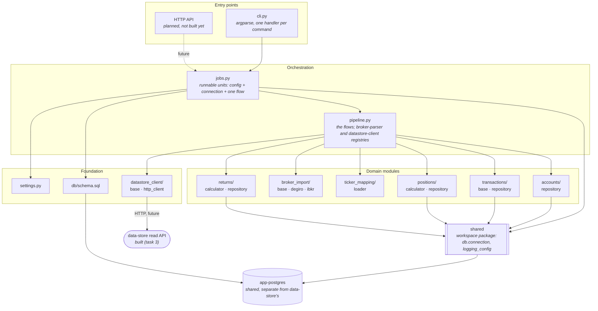
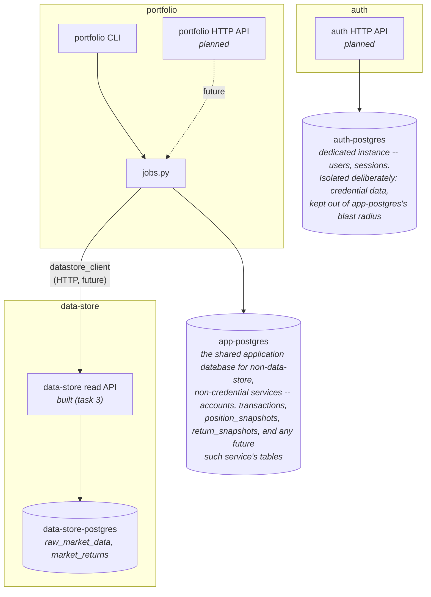

# portfolio architecture

How this service is put together and why. For *what the tables look like* see
[`schema.md`](schema.md), the column-level proposal signed off on per
[`../../../.claude/rules/data-schema.md`](../../../.claude/rules/data-schema.md); every entity
below is still described conceptually rather than as DDL. This document covers the layering, the
boundaries between modules, and the decisions that would otherwise look arbitrary — mirroring the
shape of [`data-store`'s own architecture doc](../../data-store/docs/architecture.md).

## What the service is responsible for

Recording every transaction across brokerage accounts — for multiple users, each seeing only their
own — and deriving positions and returns from that record at any point in time, not just "now."
Two things go in:

- **Transactions** — entered manually, or imported from a broker's export file (Degiro, IBKR
  today; more brokers later). Every transaction's native-currency amount is stored exactly as the
  broker reported it — the immutable source of truth — alongside a EUR-equivalent frozen at
  transaction time.
- **Manual ticker links** — the user's own mapping from a broker-reported instrument (an ISIN or a
  ticker symbol, depending on the broker) to the canonical ticker `data-store` prices (e.g.
  `0700.HK`). Defined in a YAML config file today; the plan is to move this to database-backed,
  UI-managed mappings once the application has a UI (see "Configuration" and the cross-cutting
  decision below). Never inferred, never fuzzy-matched, whichever way it's stored.

Two things are derived, not entered — both **materialized**, not computed live:

- **Position snapshots** — quantity and average cost per account per instrument, rebuilt by
  replaying the transaction log.
- **Return snapshots** — realized and unrealized returns per position, rebuilt from position
  snapshots plus prices and FX rates read from `data-store`.

It does **not** fetch or store market prices or FX rates itself, and does **not** run its own
yfinance (or any other) ingestion — `data-store` already owns getting external market data into
Postgres correctly; portfolio consumes it through a read API rather than duplicating that
machinery. See "Cross-service prerequisite" below.

**Explicit non-goals:**

- Not a source of truth for market prices or FX rates — that's `data-store`.
- Not a tax-lot / FIFO engine — cost basis is average-cost, blended (see cross-cutting decisions).
- Not (yet) an HTTP service — CLI only, though the design keeps that door open.
- Not a place that guesses a ticker mapping. An unmapped instrument blocks its own calculation,
  visibly, never a silent skip.
- Not the owner of *authentication or user identity* — credentials, sessions, login, and the
  `users` record itself belong to `auth` from the start (see
  [`auth/docs/architecture.md`](../../auth/docs/architecture.md)). Portfolio keeps no local `users`
  table, not even a placeholder — `accounts.user_id` is a plain UUID column holding the id `auth`
  issues at signup.

## Layering

Dependencies point one way, downward. Nothing in a lower layer imports from a higher one.



**Portfolio owns no `db/connection.py`.** Opening a connection, wrapping a transaction, and
applying a schema file are identical in every service here, so they live once in the
[`shared`](../../shared/docs/architecture.md) workspace package — extracted during the auth build
when its copy turned out near-identical to data-store's. Portfolio imports
`shared.db.connection` and `shared.logging_config` rather than growing a third copy; `db/` here
holds only `schema.sql`, which is genuinely portfolio's own. Repository modules import
`transaction`; `jobs.py` imports `get_connection` and `apply_schema`.

**`jobs.py` is the seam that matters**, for the same reason as data-store's: each `run_*` there is
one complete operation — load settings, open a connection, run the flow, close the connection,
return a structured result. `cli.py` is argument parsing plus a call into it, and nothing else. A
future HTTP API route is a call into it and nothing else. Anything that lived in only one of those
two would be, by construction, untested by the other.

That result is a plain dict of builtins, built by portfolio's own `run_result.py` — following the
same two-key `{"status", "rows_saved"}` plus per-flow named-counts contract as
[`data-store/run_result.py`](../../data-store/src/data_store/run_result.py), and the same
`ok` / `partial` / `nothing_to_do` status vocabulary. **Replicated independently, not imported** —
the two services don't share code across their boundary any more than they share a database.

The rule that keeps this honest, same as data-store's: **`pipeline.py` never touches SQL or HTTP
directly, and the domain modules never decide *what* to import or rebuild.** Orchestration knows
which account, which file, which date range; domain modules know how to parse one broker's file or
read/write one table.

## The three-file shape of a domain module

| Module | Shape | Deviation from the three-file default, and why |
|---|---|---|
| `accounts/` | `repository.py` only | No external source and no `base.py` — a broker and an account are user-declared reference data, created through a CLI command, not parsed or fetched. Every read here takes a `user_id`, and every other domain module's queries are reached only by first going through an account scoped to that user — this is the one place multi-user isolation is enforced, not repeated independently by each module. |
| `broker_import/` | `base.py` (the `BrokerParser` Protocol) + `degiro.py`, `ibkr.py` (the `*_source.py` equivalent — but they read a local export file, not a network call) | **No `repository.py`.** A parser hands back in-memory `CanonicalTransaction` records; persistence is owned entirely by `transactions/repository.py`, so a manually-entered transaction and an imported one are written through the exact same path. Splitting persistence into `broker_import/` would let the two paths drift. |
| `ticker_mapping/` | `loader.py` only | **No `repository.py`.** The mapping lives in a YAML config file (`configs/ticker_mappings.yaml`), not a database table — mirroring `data-store`'s `yfinance_exchange_suffixes.yaml` reference-config pattern. `loader.py` reads and validates the file into an in-memory lookup; nothing here talks to Postgres. No `base.py` — nothing else is expected to implement a "mapping provider." |
| `transactions/` | `base.py` (the `CanonicalTransaction` record shape) + `repository.py` | `base.py` here holds a **data shape**, not a `Protocol` — the contract is "what a normalized transaction looks like," which multiple producers (`broker_import` parsers, manual CLI entry) must fill in, not a swappable behavior one class implements. |
| `positions/` | `calculator.py` (pure) + `repository.py` | Same shape as data-store's `returns/`: no `base.py`, no `*_source.py` — the input is this service's own `transactions` and `ticker_mapping` tables, not an external provider. |
| `returns/` | `calculator.py` (pure) + `repository.py` | Same shape again, plus one more thing to disclose: it also needs prices and FX rates from `datastore_client`. Those are fetched by `pipeline.py` and handed into `calculator.py` as plain data — the calculator itself stays pure and knows nothing about HTTP, keeping it as unit-testable as data-store's `returns/calculator.py`. |
| `datastore_client/` | `base.py` (a `DataStoreClient` Protocol) + `http_client.py` | This is the `*_source.py` role, but the "provider" is another in-house service's read API rather than a third party — see "Cross-service prerequisite" below for why `http_client.py` can't be fully implemented yet. |

**One cross-domain dependency worth disclosing up front**, in the spirit of data-store's disclosed
deviations: `broker_import/base.py`'s `BrokerParser.parse()` returns `list[CanonicalTransaction]`,
so `broker_import` imports the record shape from `transactions/base.py`. That's the one place a
domain module reaches into another domain's module rather than staying self-contained — accepted
because the alternative (each parser inventing its own intermediate shape, reconciled later) is
exactly the drift the extension point exists to prevent.

## Extension points: the broker-import registry

Same pattern as data-store's `SCRAPERS` / `MARKET_DATA_SOURCES` — a `Protocol` plus a registry dict
at the top of `pipeline.py`, no branching in flow functions.

```python
# broker_import/base.py
class BrokerParser(Protocol):
    broker_key: str  # fills CanonicalTransaction.broker; accounts.broker is the persisted
                      # source of truth, not a transactions column (see schema.md)

    def parse(self, file_path: Path, account_id: str) -> list["CanonicalTransaction"]:
        """Parse one broker export file into normalized transactions for one account.

        account_id is supplied by the caller, not discovered from the file -- Degiro's own
        export has no account-identifying column at all.
        """
        ...
```

The canonical intermediate representation both Degiro's flat blotter and IBKR's multi-section dump
get parsed into (conceptually — a field list, not DDL):

```python
# transactions/base.py
@dataclass(frozen=True)
class CanonicalTransaction:
    broker: str                                   # "degiro" | "ibkr" | ...
    account_id: str
    broker_transaction_ref: str                    # natural id if the broker gives one,
                                                     # else a stable content hash (see risk below)
    transaction_type: TransactionType               # BUY | SELL | DEPOSIT | WITHDRAWAL |
                                                     # DIVIDEND | FX | FEE | ADJUSTMENT
    trade_datetime: datetime
    instrument_identifier: str | None               # ISIN (Degiro) or Symbol (IBKR); None for
                                                     # cash-only rows (deposits, adjustments)
    instrument_identifier_kind: Literal["ISIN", "SYMBOL"] | None
    quantity: Decimal | None                        # signed: +buy, -sell
    price: Decimal | None                           # per unit, native currency
    native_currency: str                             # ISO 4217, as the broker reports it
    native_amount: Decimal                           # signed cash-flow, broker's own figure --
                                                      # the source of truth
    eur_amount: Decimal                              # signed, frozen at transaction time
    fx_rate: Decimal | None
    fx_rate_source: Literal["broker_reported", "companion_row", "datastore_series"] | None
    fees_native: Decimal | None
```

Registry:

```python
# pipeline.py
BROKER_PARSERS: dict[str, BrokerParser] = {
    "degiro": DegiroParser(),
    "ibkr": IbkrParser(),
}
```

**Worked example — adding a third broker** (e.g. Trading212): write `broker_import/trading212.py`
implementing `BrokerParser`, add one line — `"trading212": Trading212Parser()`.
`import-transactions --broker trading212 --file ... --account ...` works with no change to
`pipeline.py`'s flow function, `jobs.py`, or `cli.py`'s argument shape (only its `--broker` choices
grow).

**What each existing parser has to do, concretely:**

- **`degiro.py`**: single flat CSV, one header row. European locale — comma decimals,
  `DD-MM-YYYY` dates — parsed explicitly, not auto-detected. `Value EUR` maps straight to
  `eur_amount` (`fx_rate_source = "broker_reported"` when `Exchange rate`/`AutoFX Fee` are
  populated). Quantity sign gives `transaction_type` (BUY/SELL) directly. The sample file has **no
  account-identifying column at all** — which account a file belongs to is supplied by the caller
  (`--account`), never parsed from the file.
- **`ibkr.py`**: the file is a multi-section dump (`Statement` / `Summary` / `Transaction History`
  interleaved, different column counts per section) — the parser's first job is filtering to rows
  where the first column is `Transaction History`, everything else is noise for this purpose. ISO
  dates, dot decimals. Instruments are identified by `Symbol`, not ISIN. `Transaction Type` values
  (`Buy`, `Deposit`, `Adjustment`, `Forex Trade Component`, ...) map into the canonical
  `TransactionType` vocabulary — an unrecognized type is a parse error, not a silent catch-all.
  USD-denominated trades have no EUR-equivalent column; `eur_amount` must be computed, either from
  a matching `Forex Trade Component` companion row (see the risk below) or, failing that, from
  `data-store`'s daily FX rate series for the trade date.

**Disclosed trade-off, matching data-store's style**: `parse(file_path, account_id)` assumes a
broker's history always arrives as one downloadable file. A future broker exposing only a
paginated API, not a file export, would have to be adapted into "write it to a temp file, then
parse it," or the Protocol would need broadening. Accepted for now, same reasoning data-store used
for its single `MarketDataSource` Protocol: both known brokers are file-export-based, and there's
nothing to generalize from yet.

**Design risk — IBKR row identity.** Degiro gives an `Order ID` that's a genuine natural key.
IBKR's `Transaction History` rows have no equivalent — re-importing a file whose date range
overlaps a previous import (a very likely user workflow: "export everything again to catch up")
has no broker-given way to tell "already have this row" from "new row." `broker_transaction_ref`
for IBKR will need to be a content hash (date + symbol + type + amounts) rather than a
broker-issued id. Flag this explicitly rather than assume dedup is free — worth confirming the
hash's exact input fields at schema sign-off, since a hash that's too narrow silently merges two
genuinely different same-day trades, and one that's too wide creates duplicates on reimport.

**Design risk — matching IBKR's FX companion rows to their parent trade.** `Forex Trade Component`
rows aren't linked to the trade they funded by any explicit key — only by same-day proximity and
(usually) a proportional amount. On a day with multiple same-currency trades this match is
heuristic, not exact. The fallback — pricing the trade's EUR-equivalent from `data-store`'s FX rate
series instead — is why the currency decision below matters beyond point-in-time valuation: it's
also the backstop for import-time computation when the companion-row match is ambiguous or absent.

## Conceptual entity model

Per [`data-schema.md`](../../../.claude/rules/data-schema.md), this is the entity shape and
identity — not column-level DDL, which needs its own sign-off pass.

- **User** — owned entirely by `auth`, not portfolio (see "Explicit non-goals" above). There is no
  `users` table here, not even a stand-in: `Account` holds `user_id` as a plain UUID column
  referencing the id `auth` issues at signup — the same non-owning reference shape used for
  `canonical_ticker` into `data-store`'s world, except there's no local row backing it at all.
  Nothing here enforces the UUID is real; it's trusted input, the same way a `canonical_ticker` is
  trusted without a foreign key. Authentication — credentials, sessions, login — is out of scope for
  this document and belongs to `auth`.
- **Broker** — identified by a short key (`"degiro"`, `"ibkr"`, ...). The same set as
  `broker_import`'s registry keys; effectively reference data, not user-editable.
- **Account** — identified by a user-chosen id/label; references one Broker and exactly one User (an
  `auth`-issued UUID, not a local row).
  Any broker-side account identifier (e.g. IBKR's masked `U***57423`) is **not stored at all** — a
  file never self-identifies its account (see Degiro above), so matching is always by the
  caller-supplied `--account`, which leaves a stored broker-side id as display-only data with no
  reader. See [`schema.md`](schema.md)'s `accounts` section. Every downstream entity (Transaction,
  PositionSnapshot, ReturnSnapshot) is scoped by Account and therefore transitively by User — there
  is no cross-user query path. **Stated assumption, not confirmed**: one user per account, no
  shared/joint accounts.
- **TickerLink** (the manual mapping) — identified by `(instrument_identifier_kind,
  instrument_identifier)`, e.g. `(ISIN, IE00B4L5Y983)` or `(SYMBOL, IWDA)`; maps to a
  `canonical_ticker` string (a `data-store` `raw_market_data.ticker` spelling, e.g. `IWDA.AS`).
  **Now defined in `configs/ticker_mappings.yaml`, not a database table** — see "Configuration"
  below and the cross-cutting decision on ticker-mapping storage. `PositionSnapshot`/
  `ReturnSnapshot` reference the resolved `canonical_ticker` string directly rather than a
  surrogate id, since there's no database row for a foreign key to point at.
  - **Key scoping, carried over unchanged**: `ISIN` mappings are global (an ISIN is globally
    unique by design, so one mapping covers every ISIN-based broker); `SYMBOL` mappings are scoped
    per-broker (a raw ticker symbol is *not* globally unambiguous — two exchanges can reuse the
    same symbol for different instruments). Expressed in the YAML as two top-level sections — a
    flat `isin:` map and a `symbol:` map nested one level under each broker key — rather than the
    two partial unique indexes a database table would need for the same guarantee. Keying `SYMBOL`
    mappings without a broker qualifier risks silently reusing a mapping that isn't actually the
    same instrument on a future symbol-based broker.
- **Transaction** — identified by a surrogate id; references an Account; carries `(account_id,
  broker_transaction_ref)` unique together for idempotent re-import (the broker is the account's,
  not the row's — see [`schema.md`](schema.md)); carries the raw
  `instrument_identifier`/`kind` as reported (for traceability back to the source file/row) — **not**
  a hard foreign key to TickerLink at write time, since a transaction must be importable *before*
  its instrument is mapped. The mapping gap is a first-class, visible state (surfaced by the
  positions/returns rebuild, not by import failing).
- **PositionSnapshot** — identified by `(account, ticker_link, as_of_date)`; wholly derived,
  rebuildable, never hand-edited. **Proposed grain, flagged for schema sign-off**: event-driven —
  one row per date a transaction actually changed the position, with "position as of date D" read
  as "the latest snapshot ≤ D." Cheap, and matches how the position genuinely changes (only on a
  transaction).
- **ReturnSnapshot** — identified by `(account, ticker_link, price_date)`; derived from
  PositionSnapshot plus `data-store` prices/FX; wholly derived, rebuildable. **Proposed grain,
  flagged for schema sign-off**: daily — one row per priced trading day the position was open,
  since a *return* changes every day the price moves even with zero transactions, so it can't be
  event-driven the same way. Mirrors `market_returns`'s own daily grain in data-store. **Bounded,
  not open-ended**: "was open" means from the position's first non-zero `PositionSnapshot` through
  the trading day it closes to zero, inclusive — `rebuild-returns` stops generating new rows for a
  ticker once the latest `PositionSnapshot` shows zero quantity with no later re-opening
  transaction. Rows already written for the open window are never deleted, so they remain available
  for historical charting; the grain just doesn't grow forever for a position nobody still holds.

## The flows

| Flow | Command | Cadence | Reads | Writes |
|---|---|---|---|---|
| Account setup | `account add --user <id> --broker <key>` | rare, manual | — | `accounts` (and `brokers` if new) |
| Ticker linking | — (hand-edit the YAML file) | manual, as unmapped instruments surface | — | `configs/ticker_mappings.yaml` (edited directly, not through the service) |
| List unmapped instruments | `list-unmapped-instruments` | manual, on demand | `transactions`, `configs/ticker_mappings.yaml` | — (read-only report) |
| Manual transaction entry | `add-transaction` | ad hoc | — | `transactions` |
| Broker file import | `import-transactions --broker <key> --file <path> --account <id>` | manual, on demand | export file | `transactions` (idempotent on `(account_id, broker_transaction_ref)`) |
| Positions rebuild | `rebuild-positions` | after transactions change | `transactions`, `configs/ticker_mappings.yaml` | `position_snapshots` |
| Returns rebuild | `rebuild-returns` | after positions rebuild or new prices land | `position_snapshots`, `data-store` read API | `return_snapshots` |

**A load-bearing consequence of the entity model above, worth stating directly:** `rebuild-positions`
needs no price data at all — quantity and average cost are pure functions of the transaction log.
So **everything except `returns/` and the "current market value" feature can be built, tested and
shipped before `data-store`'s read API exists.** That sequencing fact changes what "blocked on the
prerequisite" actually means in practice — it's one flow, not the whole service.

**Both rebuilds are full rebuilds, same reasoning as data-store's `calculate-returns`**: a
late-arriving ticker mapping, or a corrected/added historical transaction, changes every snapshot
from that point forward, so incremental append would serve stale rows. Rebuild scope is per
account (an isolatable failure unit, mirroring data-store's per-ticker/per-group isolation).

**An unmapped instrument blocks its own rebuild, loudly** — `rebuild-positions`/`rebuild-returns`
process every other account/instrument normally, and report the blocked ones by name in the
completion summary with a `partial` status, following the same `run_result` contract and
`nothing_to_do` vs. `partial` vs. `ok` distinction data-store already established (and the
repo-wide logging rule: "nothing to do" must never look like "something failed silently").

## Cross-service prerequisite: the data-store read API

**This section describes what portfolio needs from it; `data-store`'s own `docs/architecture.md`
("Read API" section) owns the design and is authoritative on the current shape.** Built as task 3
of the cross-service roadmap (`tasks.md`) — no longer a future dependency, but `http_client.py`
below hasn't been written against it yet.

`returns/` (and any future "current market value of a position" feature) needs, conceptually,
three read operations against `data-store`, all of which now exist:

1. **Price series for a canonical ticker** over a date range — `GET /prices/{ticker}`, backed by
   `market_returns`. Returns `split_adjusted_close`, `future_split_factor`, and the four return
   columns (`price_return`, `dividend_return`, `simple_return`, `log_return`), nullable together
   on a ticker's first stored date — `http_client.py` must preserve those nulls rather than
   coercing them to 0.
2. **FX rate series for a currency pair** over a date range, in the *same shape* as a price
   series (a list of `{date, value}` points) — `GET /fx/{base}/{quote}`. **Correction to an
   earlier assumption here**: this is *not* modeled as another yfinance-style ticker (e.g.
   `EURUSD=X`) reusing `market_data/`'s ingestion machinery. `data-store` deliberately kept FX in
   its own `fx_rates` table (no OHLC, dividends, or splits to carry), and the API instead derives
   any requested pair — direct, inverse, or triangulated through `config/currencies.yaml`'s
   configured base currency — from whatever `fx_rates` actually stores. The response shape still
   satisfies the "same shape as a price series" intent (`{date, rate}` points); only the
   ingestion-reuse assumption was wrong.
3. **Ticker existence/validity check** — `GET /tickers/{ticker}`, reporting `exists` (ingested at
   all) and `has_returns` (whether `calculate-returns` has run for it) separately, plus the
   covered date range. Lets a `configs/ticker_mappings.yaml` entry naming a `canonical_ticker`
   `data-store` doesn't track be caught by `list-unmapped-instruments` or a validation command,
   rather than failing silently at returns-rebuild time.

All three require `Authorization: Bearer <INTERNAL_API_SECRET>` — the same shared-secret model
`auth/docs/architecture.md` describes — and `source` is a query parameter defaulting to
`yfinance` on every endpoint, since `source` is part of the primary key on data-store's side.

`datastore_client/base.py` defines the `DataStoreClient` Protocol portfolio's domain code depends
on; `http_client.py` is the implementation that calls the now-built API. Because the rest of the
domain (`positions/`, `transactions/`, `broker_import/`, `ticker_mapping/`) depends only on the
Protocol, not the HTTP implementation, a local stub/fixture-backed implementation of
`DataStoreClient` remains enough to build and test everything except `returns/` without a live
data-store instance. Writing `http_client.py` against the real API is `returns/`'s own task
(task 8), not a joint prerequisite any more.

## Configuration

Much smaller than data-store's, since portfolio has no scraping/exchange-resolution reference data
of its own:

| File | Committed? | Why |
|---|---|---|
| `.env` (`PORTFOLIO_DATABASE_URL`, `APP_POSTGRES_ADMIN_DATABASE_URL`, later `DATASTORE_API_URL`/credential) | no — gitignored | Credentials, per-environment. **Not** the bare `DATABASE_URL`: data-store already owns that name, and both suites can run in one pytest process where a shared name would collide — the same reasoning behind `AUTH_DATABASE_URL`. `PORTFOLIO_DATABASE_URL` names the *service*, not the instance, so a future service sharing `app-postgres` gets its own name and its own role. `APP_POSTGRES_ADMIN_DATABASE_URL` is the one exception — it names the *instance*, because the admin role it points at is the shared container's own bootstrap role, not any one service's; see the role/schema paragraph above. |
| `.env.example` | yes | Template, matching data-store's convention |
| `configs/ticker_mappings.yaml` | no — gitignored | This deployment's own ISIN/symbol → canonical-ticker choices — personal/deployment data, not generic reference data, the same reasoning `data-store` applies to `etfs.yaml`/`tracked_tickers.yaml`. |
| `configs/ticker_mappings.yaml.example` | yes | Template, matching `data-store`'s `etfs.yaml.example` convention. |

No YAML config for broker parsing — the broker registry is code (a new broker is a new file plus
one registry line), not data, since unlike data-store's exchange-suffix mapping there's no
reference table of *known-good* per-broker quirks to maintain outside code. Accounts are still
**database rows created via CLI commands** — they're the user's own data, not reference data
shared across environments, so they belong in the database the rest of the service already treats
as the source of truth. **Ticker mappings are the one exception**: for now they're config-file
rows, not database rows or CLI-entered data — see the cross-cutting decision below for why, and
the migration path once a UI exists. The path is meant to resolve the same way `data-store/settings.py`
resolves its own config paths — an env var override defaulting to a service-root-relative path.
`portfolio/settings.py` now exists, but only loads `PORTFOLIO_DATABASE_URL` so far; the
ticker-mapping path resolution described here still needs to be added to it.

## Deployment



**Three separate Postgres instances, not two.** Portfolio never opens a connection to
`data-store`'s or `auth`'s database, and neither of those opens one to portfolio's — the boundary
between services is always an API, full stop. `data-store` has its own, dedicated database because
its ingestion machinery and schema evolve independently. **`auth` also gets its own, dedicated
database — a deliberate exception, not an oversight**: credentials and session tokens are the most
sensitive data in the system, and isolating them at the database level keeps a bug or injection in
portfolio's code path from ever reaching auth's tables, consistent with this repo's
[`security.md`](../../../.claude/rules/security.md) rule to give credential-handling code extra
scrutiny. **`app-postgres` remains the shared database for every other future non-data-store
service** — the one such a service uses instead of standing up a fourth instance — but that sharing
principle stops at the credential boundary; `auth` is the one deliberate carve-out from it.

**`app-postgres`'s compose file lives at `services/portfolio/docker-compose.yml`**, even though the
instance is meant to be shared, because portfolio is its only tenant today and every other service
here keeps its own containers next to its own code. Naming it `app-postgres` rather than
`portfolio-postgres` is the part that matters: the container is not portfolio's to own, only
portfolio's to start. Moving it somewhere neutral belongs to the end-to-end deployment task, once
there is a second tenant to justify the move — noted here rather than left as a silent oddity.

Inside that one instance the **database is named for the instance (`app`) and the role for the
service (`portfolio`)**. A second service on `app-postgres` gets its own role in the same database
rather than its own database, so the shared-application-database claim above stays true in the
schema and not just in the container name.

**That role is a real, enforced boundary, not an aspiration.** The official postgres image always
grants superuser to whatever role it bootstraps via `POSTGRES_USER` — there is no env-var way
around that — so `docker-compose.yml` and `ci.yml` bootstrap a separate admin role
(`APP_POSTGRES_ADMIN_USER`) that the running app never connects as. `portfolio db init`
(`jobs.py`'s `_ensure_role_and_schema`) uses that admin role exactly once, to create the
non-superuser `portfolio` role and a like-named schema it owns (`CREATE SCHEMA portfolio
AUTHORIZATION portfolio`) — Postgres denies cross-schema access by default, so owning the schema
is the entire isolation mechanism, no further `GRANT`s needed. A role's default `search_path`
resolves `"$user"` to the schema matching its own name first, which is why `schema.sql`'s table
names stay unqualified. A second tenant follows the same recipe: its own `<service>_DATABASE_URL`
with its own role name, and `db init` creates its role/schema the same way — never reusing
`portfolio`'s. The one thing this doesn't solve is the admin role itself, which remains a
superuser for as long as the stock postgres image bootstraps it that way; the guarantee is that
nothing beyond one `db init` bootstrap step ever holds that privilege, not that no superuser
exists on the instance.

## Cross-cutting decisions

Each stated as a rule, with rationale and the rejected alternative, in data-store's
documented-trade-off style.

**Every transaction stores its native-currency amount exactly as the broker reported it, plus a
EUR-equivalent frozen at transaction time; point-in-time valuation additionally needs a daily FX
rate series, not one-off conversions.** The native amount is the immutable audit trail back to the
broker's own statement — anything derived from it (EUR totals, returns) must be reconstructable
and re-checkable against that source. *Rejected: storing only a EUR-normalized amount* — simpler,
but loses the ability to reconcile against what the broker actually reported, and can't
distinguish "the broker's number" from "our conversion of it" when the two are later found to
disagree. *Rejected: converting on the fly from a single current rate* — wrong for
realized-gain-at-transaction-time analysis, which needs the rate that applied when the trade
happened, not today's.

**Portfolio calls a `data-store` read API for tickers, prices and FX rates; it never reads
`data-store`'s Postgres directly, and never runs its own price/FX ingestion.** Keeps the
"each service owns its database" boundary intact and avoids two independently-drifting copies of
yfinance ticker-resolution logic `data-store` has already built and hardened. *Rejected: portfolio
reads `data-store`'s Postgres directly* — couples the two services' schemas and deployments, and
breaks the separate-database boundary the moment either schema changes. *Rejected: portfolio runs
its own FX/price ingestion* — duplicates real, non-trivial machinery (ticker resolution, exchange
suffixes, split-adjustment) that already exists and is already correct in one place.

**Cost basis is average cost (blended), not FIFO lot tracking.** Much simpler domain model — no
lot ledger, no lot-matching logic on every sale — and sufficient for the stated goal of position
value and return "at any point in time." *Rejected: FIFO lot tracking* — more precise for
tax-lot-level realized-gain reporting, but requires tracking individual purchase lots and matching
sales against them in order, a materially bigger domain model for a use case not currently
required. Notable enough to flag as a plausible v2 if tax-lot-level precision becomes a real
requirement later.

**Positions and returns are materialized — rebuilt into stored tables from the transaction log,
not computed live on every read.** Matches `data-store`'s own `returns/` shape (full rebuild per
run), and means a future HTTP API serves reads from a table, not from replaying years of
transactions on every request. *Rejected: compute on every read* — simpler to reason about
freshness, but gets slower as transaction history grows, and would force the future API to either
replay history per request or build its own cache — reinventing materialization anyway, just less
deliberately.

**CLI first; orchestration is plain callables so a future HTTP API adds a caller, not a rewrite.**
Mirrors data-store's `jobs.py` seam — `cli.py`/a future API route are both argument parsing plus
one call into `jobs.run_*`. *Rejected: build the domain against a web framework's handlers from day
one* — couples domain logic to HTTP concerns (request parsing, status codes) before an API is
actually being built, the same coupling `jobs.py` exists to prevent between data-store's CLI and
Airflow.

**Every account belongs to exactly one user, and `accounts/repository.py` is the single chokepoint
every other domain module's queries pass through to get there.** Isolation is enforced in one
place, not asserted independently by each module. *Rejected: scope every table's queries by
`user_id` directly, module by module* — correct in principle, but repeats the same check
everywhere instead of making a cross-user leak structurally hard to introduce by accident.

**An unmapped ticker link blocks that instrument's calculation, loudly — never a silent skip.**
Directly required by the domain: silently omitting an unmapped position would understate the
portfolio without any visible sign of why. Structurally this is the same "nothing to do vs.
something went wrong" distinction data-store's `run_result` already encodes (`partial`, not `ok`,
when something is skipped) — portfolio's rebuild flows reuse that contract rather than inventing a
new one.

**Logging follows the same convention data-store settled on**: `logger.info`/`warning` to stderr
via a `configure_logging()` call at every entry point, a command's actual result to stdout — since
portfolio is a CLI service in the same shape, and the reasoning ("logs go to stderr, results go to
stdout" so output stays pipeable and ordered) applies unchanged.

**Ticker mappings are defined in a YAML config file (`configs/ticker_mappings.yaml`), not database
rows, for now — with a planned move to database-backed, UI-managed mappings once the application
has a UI.** Gets a working mapping mechanism immediately with zero CRUD/CLI investment in a
mechanism that's expected to be replaced soon anyway, and mirrors `data-store`'s own precedent for
this exact shape of data — a mostly-static, hand-maintained lookup table
(`yfinance_exchange_suffixes.yaml`) that's reference data rather than something the pipeline
writes. *Rejected: build the `ticker_links` table and a `link-ticker` CLI command now* — real,
working code (partial unique indexes, an `ON CONFLICT` upsert, a CLI command) that would need to be
thrown away or migrated the moment a UI takes over the same responsibility; better to defer that
investment until the UI actually exists and its real requirements (multi-user editing? an audit
history of who changed a mapping and when?) are known. **Known sharp edge, stated plainly**: the
file is shared, deployment-wide config — not scoped per user — matching `TickerLink`'s original
design (ISIN mappings were always meant to be global, symbol mappings scoped only by broker, never
by user). A future database-backed version should preserve that scoping, not silently make
mappings per-user. **Migration path, not designed yet**: when the UI arrives,
`ticker_mapping/loader.py` is expected to be replaced by a database-backed repository — very likely
close to the `ticker_links` table design already proposed once in `schema.md`'s history; the YAML
file at that point either seeds a one-time import or is retired. Not decided now — flagged as a
known future schema change, the same way `schema.md` already flags a future `realized_gains`
table.

## Testing

| | Needs | Covers |
|---|---|---|
| `tests/unit/` | nothing | Broker parsers (`degiro.py`, `ibkr.py`) against fixture files; `positions/calculator.py` and `returns/calculator.py` as pure functions over in-memory transaction/price frames; pipeline orchestration with fake repositories and a fake `DataStoreClient`; the IBKR dedup-hash logic |
| `tests/integration/` | live Postgres | `transactions/repository.py`'s idempotent-import upsert semantics, `accounts/`, `ticker_mapping/`, `positions/repository.py`, `returns/repository.py`, schema migration idempotency, full rebuild flows end-to-end |

`datastore_client/http_client.py` is tested against a fake implementing the `DataStoreClient`
Protocol, the same way data-store's pipeline tests stub `save_*` and swap source registries for
fakes — there is no live-`data-store` integration test in this service's suite, since that
boundary is the API contract itself, not something this service's tests should own verifying
end-to-end. Worth flagging as an open question once the API exists: where does a *contract* test
for that boundary live — here, in `data-store`, or a shared test — since neither service's suite by
itself can currently catch a drift in the other.

## Where to start reading

1. `pipeline.py` — the flows; everything else is in service of these.
2. `transactions/base.py` — the `CanonicalTransaction` shape every producer converges on; read
   this before either parser.
3. `broker_import/degiro.py` and `broker_import/ibkr.py` — the two very different raw shapes, side
   by side, converging on the same record.
4. `positions/calculator.py` — the most representative "derived, materialized" domain module;
   `returns/calculator.py` next, since it's the one with an external dependency
   (`datastore_client`) deliberately kept out of the pure function itself.
5. `jobs.py` — how configuration, a connection and a flow become one runnable operation, ready for
   a future API caller alongside the CLI.
