# portfolio architecture

How this service is put together and why. For *what the tables look like* see
[`schema.md`](schema.md), the column-level proposal signed off on per
[`../../../.claude/rules/data-schema.md`](../../../.claude/rules/data-schema.md); every entity
below is still described conceptually rather than as DDL. This document covers the layering, the
boundaries between modules, and the decisions that would otherwise look arbitrary — mirroring the
shape of [`data-store`'s own architecture doc](../../data-store/docs/architecture.md).

Seven companions hold the rest, split out to keep each file under the repo's 64KB limit:
[`flows.md`](flows.md) (every flow and its entry points, the HTTP API, and what portfolio reads
from data-store), [`risk-flows.md`](risk-flows.md) (the risk and Labs flows, in detail),
[`modules.md`](modules.md) (each domain module's shape and why),
[`broker-import.md`](broker-import.md) (the broker-parser plugin surfaces),
[`deployment.md`](deployment.md) (containers and databases), [`testing.md`](testing.md)
(what each test tier covers), and [`cross-cutting-decisions.md`](cross-cutting-decisions.md)
(the service-wide rules and their rejected alternatives).
A structural change may need any of the eight updated.

## What the service is responsible for

Recording every transaction across brokerage accounts — for multiple users, each seeing only their
own — and deriving positions and returns from that record at any point in time, not just "now."
Two things go in:

- **Transactions** — entered manually, or imported from a broker's export file via an installed
  broker-parser plugin. Every transaction's native-currency amount is stored exactly as the
  broker reported it — the immutable source of truth — alongside a EUR-equivalent frozen at
  transaction time.
- **Ticker mappings** — the mapping from a broker-reported instrument (an ISIN or a ticker symbol,
  depending on the broker) to the canonical ticker `data-store` prices (e.g. `0700.HK`). Global,
  stored in the `ticker_mappings` table and managed by an admin from `web`'s admin page (see the
  [cross-cutting decision](cross-cutting-decisions.md)). Never inferred, never fuzzy-matched.
  Manual entry doesn't need one: it records a `data-store` ticker directly (`TICKER`).

Two things are derived, not entered — both **materialized**, not computed live:

- **Position snapshots** — quantity and average cost per account per instrument, rebuilt by
  replaying the transaction log.
- **Return snapshots** — realized and unrealized returns per position, rebuilt from position
  snapshots plus prices and FX rates read from `data-store`.

It does **not** fetch or store market prices or FX rates itself, and does **not** run its own
yfinance (or any other) ingestion — `data-store` already owns getting external market data into
Postgres correctly; portfolio consumes it through a read API rather than duplicating that
machinery. See [`flows.md`](flows.md)'s "Cross-service prerequisite".

**Explicit non-goals:**

- Not a source of truth for market prices or FX rates — that's `data-store`.
- Not a tax-lot / FIFO engine — cost basis is average-cost, blended (see
  [`cross-cutting-decisions.md`](cross-cutting-decisions.md)).
- Not a place that guesses a ticker mapping. An unmapped instrument blocks its own calculation,
  visibly, never a silent skip.
- Not the owner of *authentication or user identity* — credentials, sessions, login, and the
  `users` record itself belong to `auth` from the start (see
  [`auth/docs/architecture.md`](../../auth/docs/architecture.md)). Portfolio keeps no local `users`
  table, not even a placeholder — `accounts.user_id` is a plain UUID column holding the id `auth`
  issues at signup.

## Layering

Dependencies point one way, downward. Nothing in a lower layer imports from a higher one.

```mermaid
flowchart TD
    subgraph entry["Entry points"]
        CLI["cli.py<br/><i>argparse, one handler per command</i>"]
        API["api/<br/><i>FastAPI, built at task 9</i>"]
    end

    subgraph orch["Orchestration"]
        JOBS["jobs.py<br/><i>runnable units: config + connection + one flow</i>"]
        AJOBS["analytics_jobs.py<br/><i>the read-only analytics jobs: backtest,<br/>ex-post, ex-ante, what-if, look-through</i>"]
        PIPE["pipeline.py<br/><i>the flows; broker-parser/cashflow-parser (entry-point discovered)<br/>and datastore-client registries</i>"]
        HFLOW["holdings/flows.py<br/><i>reads that span a user's accounts (PF-1, PF-5)</i>"]
        LFLOW["labs/flows.py<br/><i>backtest fetches, concurrent (LB-4);<br/>risk-free fetch (RK-8)</i>"]
        TFLOW["twr/flows.py<br/><i>portfolio TWR: rows + data-store fetch (RK-10)</i>"]
        RFLOW["risk/flows.py<br/><i>ex-post risk: TWR + risk-free fetch (RK-11);<br/>ex-ante risk of a mix (RK-17)</i>"]
        BFLOW["benchmark/flows.py<br/><i>the request's benchmark: fetch + wording (RK-13)</i>"]
        LTFLOW["look_through/flows.py<br/><i>classify holdings + fund snapshots (RK-22)</i>"]
    end

    subgraph domain["Domain modules"]
        ACC["accounts/<br/>repository"]
        IMP["broker_import/<br/>base · discovery<br/><i>implementations installed as plugins</i>"]
        MAP["ticker_mapping/<br/>base · repository"]
        TXN["transactions/<br/>base · repository"]
        POS["positions/<br/>calculator · repository"]
        RET["returns/<br/>calculator · performance · repository"]
        HOLD["holdings/<br/>aggregator"]
        LABS["labs/<br/>calculator · risk<br/><i>backtests (LB-3); their risk table (RK-8)</i>"]
        TWR["twr/<br/>calculator<br/><i>holdings-based daily TWR (RK-10)</i>"]
        EURR["eur_returns/<br/>calculator · fetch · eligibility<br/><i>daily EUR returns, shared with risk (RK-5);<br/>data-store fan-out (RK-10);<br/>risk path's wording (RK-17)</i>"]
        RISK["risk/<br/>types · weekly · quality · history<br/>windows · risk_free · var_mask<br/>measures · drawdown · tail · single_series<br/>covariance · listwise · ex_ante<br/>correlation · pairing · relative · ex_post<br/>ex_ante_report<br/><i>pure library (RK-6, RK-7, RK-15, RK-16, RK-11, RK-13, RK-17);<br/>first caller labs/risk (RK-8)</i>"]
        BENCH["benchmark/<br/>base<br/><i>the benchmark's return series and status (RK-13)</i>"]
        LT["look_through/<br/>calculator · issuer · instruments<br/><i>exposures and concentration of a mix (RK-22)</i>"]
    end

    subgraph found["Foundation"]
        SET["settings.py"]
        DB["db/schema.sql"]
        ERR["errors.py<br/><i>PortfolioError and subclasses</i>"]
        DSC["datastore_client/<br/>base · http_client<br/><i>get_fx_rate built (task 14);<br/>price/FX-series/ticker methods built (task 8);<br/>risk-free series built (RK-4);<br/>ETF funds and holdings (RK-22)</i>"]
    end

    SH[["shared<br/><i>workspace package: db.connection, logging_config</i>"]]
    PG[("app-postgres<br/><i>shared, separate from data-store's</i>")]
    DSAPI(["data-store read API<br/><i>built (task 3)</i>"])

    CLI --> JOBS
    API --> JOBS
    API --> AJOBS
    AJOBS --> JOBS
    JOBS --> PIPE
    JOBS --> HFLOW
    AJOBS --> LFLOW
    LFLOW --> LABS
    LABS --> EURR
    LABS --> RISK
    LFLOW --> DSC
    JOBS --> TFLOW
    TFLOW --> ACC
    TFLOW --> POS
    TFLOW --> RET
    TFLOW --> EURR
    TFLOW --> TWR
    TWR --> RET
    TWR --> EURR
    AJOBS --> RFLOW
    RFLOW --> TFLOW
    RFLOW --> RISK
    RFLOW --> DSC
    RFLOW --> EURR
    LFLOW --> BFLOW
    RFLOW --> BFLOW
    BFLOW --> BENCH
    BFLOW --> EURR
    BFLOW --> DSC
    BENCH --> EURR
    BENCH --> RISK
    LABS --> BENCH
    AJOBS --> LTFLOW
    LTFLOW --> LT
    LTFLOW --> DSC
    LT --> DSC
    HFLOW --> ACC
    HFLOW --> POS
    HFLOW --> RET
    HFLOW --> HOLD
    HFLOW --> PIPE
    JOBS --> SET
    JOBS --> DB
    JOBS --> ERR
    JOBS --> DSC
    PIPE --> ACC
    PIPE --> IMP
    PIPE --> MAP
    PIPE --> TXN
    PIPE --> POS
    PIPE --> RET
    PIPE --> DSC
    PIPE --> ERR
    TXN --> ERR
    JOBS --> SH
    ACC --> SH
    TXN --> SH
    MAP --> SH
    POS --> SH
    RET --> SH
    LABS --> DSC
    SH --> PG
    DB --> PG
    DSC -->|HTTP| DSAPI
```

**Portfolio owns no `db/connection.py`.** Opening a connection, wrapping a transaction, and
applying a schema file are identical in every service here, so they live once in the
[`shared`](../../shared/docs/architecture.md) workspace package — extracted during the auth build
when its copy turned out near-identical to data-store's. Portfolio imports
`shared.db.connection` and `shared.logging_config` rather than growing a third copy; `db/` here
holds only `schema.sql`, which is genuinely portfolio's own. Repository modules import
`transaction`; `jobs.py` imports `get_connection` and `apply_schema`.

**`jobs.py` is the seam that matters**, for the same reason as data-store's: each `run_*`/`get_*`
there is one complete operation — load settings, open a connection, run the flow, close the
connection, return a result. `cli.py` is argument parsing plus a call into it, and nothing else.
`api/routes.py` (built at task 9) is a call into it and nothing else, too. Anything that lived in
only one of those two would be, by construction, untested by the other.

**The read-only analytics jobs live in `analytics_jobs.py`**: Labs' backtest, ex-post and
ex-ante risk, the what-if (RK-19) and the look-through. They are the same kind of runnable unit
and follow the same conventions. They moved out when `jobs.py` crossed the 64 KB file limit (at
RK-19). They are the natural cut: none of them writes, they all build a data-store client, and
they share no helper with the write jobs except `jobs.require_datastore_client`, which became
public for that. Only `api/routes.py` calls them; the CLI has no analytics commands.

That result is a plain dict of builtins, built by portfolio's own `run_result.py` — following the
same two-key `{"status", "rows_saved"}` plus per-flow named-counts contract as
[`data-store/run_result.py`](../../data-store/src/data_store/run_result.py), and the same
`ok` / `partial` / `nothing_to_do` status vocabulary. **Replicated independently, not imported** —
the two services don't share code across their boundary any more than they share a database.

The rule that keeps this honest, same as data-store's: **`pipeline.py` never touches SQL or HTTP
directly, and the domain modules never decide *what* to import or rebuild.** Orchestration knows
which account, which file, which date range; domain modules know how to parse one broker's file or
read/write one table.

**Cross-account reads live in `holdings/flows.py`, not `pipeline.py` (PF-1).** It is the same
layer as `pipeline.py`, orchestration over domain modules, and follows the same rule: no SQL of
its own. It sits beside it rather than in it because `pipeline.py` is near the 64 KB file limit,
and every flow there is per account while these span all of a user's accounts. It holds PF-1's
`list_holdings` and PF-5's `list_portfolio_returns`. `jobs.get_holdings` and
`jobs.get_portfolio_returns` call it the way the other `get_*` jobs call `pipeline.py`. It
doesn't call into `pipeline.py` at all, and nothing in `pipeline.py` imports `holdings/`.

**The portfolio TWR's orchestration lives in `twr/flows.py` (RK-10)**, not in
`holdings/flows.py`, because it is the first read of user data that also calls data-store: it
reads every account's `return_snapshots` (for the weights) and latest `position_snapshots` (for
which pairs are closed), then fetches each held ticker's prices and FX through
`eur_returns/fetch.py`. Keeping `holdings/flows.py` database-only keeps `GET /holdings` and
`GET /returns/portfolio` working when data-store is down. User isolation is the same: accounts
come from `accounts/repository.list_by_user`, and every row read is by one of their ids. One
ticker's failed fetch excludes and names that ticker, never the whole series.
`jobs.get_portfolio_twr` builds the data-store client and opens one connection, as
`get_portfolio_returns` does.

**Labs orchestration lives in `labs/flows.py` (LB-4)**, beside `labs/calculator.py`, for the
same file-size reason as `holdings/flows.py`, and because a backtest opens no database
connection at all: nothing is stored, and every input is data-store's. `analytics_jobs.get_backtest`
builds the data-store client and calls it, with no connection to open or close.
- **It is the service's first concurrent fan-out.** A mix of up to 50 assets needs two or three
  data-store calls each, so sequential calls would put several seconds between the user and the
  page. The client is synchronous (`requests`), so the fan-out is a `ThreadPoolExecutor` of 8
  rather than an async client. An async client would mean a second implementation of
  `DataStoreClient` for one caller. 8 in flight is a modest load on data-store, which serves
  sync routes from its own thread pool with one connection per request.
- **The failure-isolation unit is one asset.** That is the same reasoning as the rebuilds'
  per-pair catch, applied to a read. A failed call is a `failed` status in the response, not a
  502, so one bad ticker can't blank a whole lab. A failed FX fetch fails every asset in that
  currency.
- **The fetch itself is `eur_returns/fetch.py`'s (RK-10)**, lifted out of this module unchanged
  when the portfolio TWR needed the same fan-out. `labs/flows.py` keeps what is Labs' own: the
  wording of each status, the log lines, and the mapping of the calculator's ineligible reasons
  back to a status. The shared module neither words nor logs, because the TWR words "no FX
  series for <CCY>" where Labs says "no FX rate". The risk path's wording and per-ticker log
  lines are `eur_returns/eligibility.py` (RK-17), lifted out of `twr/flows.py` when ex-ante
  risk needed the same thing; it logs on the caller's logger, so each line stays under its flow.
- **The risk section adds one sequential call (RK-8).** `get_risk_free_series` runs after the
  price fetch, not beside it, because its range is the span the backtest turned out to have
  (from just before the assets' common start to their common end), which only the prices tell.
  Fetching the whole series from 1999 alongside the prices was the alternative; it would save
  one round trip at the cost of about 7,000 points a request. Like a ticker, the call fails
  alone: no rates stored, or a raised call, greys downside deviation, Sharpe and Sortino with a
  reason and is logged, and the backtest still answers 200.
- **The risk table's arithmetic is `labs/risk.py`**, pure, beside the calculator, rather than in
  `risk/`. `risk/` imports nothing from portfolio, so the code that turns Labs' series into the
  library's `ReturnSeries` belongs with Labs. Its rules are in that module's docstring.

**The benchmark has a package of its own, `benchmark/` (RK-13)**, because two flows need the
same thing: Labs' backtest, ex-post risk and ex-ante risk (RK-17, for its correlation
matrix) all measure against the benchmark a request names
(`VWCE.DE` by default), and both must fetch it, word its failures and report its first date the
same way.
- **`benchmark/flows.py` fetches; `benchmark/base.py` is pure.** The flow goes through
  `eur_returns/fetch.py` for the one ticker, over its whole history so the first date it reports
  is the benchmark's own, and logs the outcome. `base.py` holds the types and turns what was
  fetched into the daily and weekly EUR returns (spec stream 1). `labs/risk.py`, which is pure,
  imports only `base.py`. *Rejected: putting it in `risk/flows.py`*, which Labs would then import
  for a fetch, against the layering; and in `eur_returns/`, which neither words nor logs.
- **`risk/` still imports nothing from portfolio.** The flows hand the library a
  `relative.BenchmarkReturns` (first date and weekly returns), or the reason there is none.
- **The benchmark is a fetch that fails alone, like the risk-free rate.** An unknown, empty or
  unreachable benchmark greys the relative figures with its reason and is logged; the backtest
  and the ex-post response still answer 200. It is fetched even when it is also in a Labs mix:
  two more data-store calls, and one code path.
- **It is never saved and never swapped.** It is a request parameter: saving a choice needs a
  settings schema, deferred. A window it doesn't cover is greyed with its first day rather than
  measured against another index (spec §5.6).

**Look-through has a package of its own, `look_through/` (RK-22)**, rather than living in
`risk/`. `risk/` is a float library of return statistics that imports nothing from portfolio;
look-through is Decimal arithmetic on a mix's weights and data-store's holdings snapshots, with
no returns at all. It keeps the three-file shape: `calculator.py` (pure), `flows.py` (the only
module that calls data-store), and two small pure modules of its own rules, `issuer.py` and
`instruments.py`.
- **What data-store can't say is a table in code** (`instruments.py`): which tickers are ETCs,
  with their commodity and its currency, and which share classes are currency-hedged.
  `asset_type` is wrong for some ETCs, and no source records a hedge. *Rejected: a config file
  for portfolio*, which has none and would gain a loader and a deploy step for three rows; *and
  correcting data-store*, which needs a schema change. Changing a row is a reviewed code change
  on purpose: a wrong row silently moves exposure between buckets.
- **The calculator imports `datastore_client/base.py`'s `EtfHoldings`**, as `labs/` imports
  `PricePoint`, rather than defining a look-alike the flow would copy into.
- **The two list calls fail the request; the per-asset calls don't.** Without the fund list or
  `asset_type`, an ETF would be read as a stock, a wrong answer rather than a partial one. A
  failed ticker-info call leaves that asset out, and a failed snapshot shows that fund
  unmapped. See [`risk-flows.md`](risk-flows.md)'s "Look-through exposures".

**Built as of task 5** — `add_account`, `list_accounts`, `add_manual_transaction`. `pipeline.py`
(not a per-flow `service.py`) is where the `with transaction(conn):` boundary lives, the role
`auth/src/auth/service.py` plays for that service; repository functions never commit, matching
`accounts/repository.py` and `transactions/repository.py` below.

**Built as of task 6** — `import_transactions`, `list_unmapped_instruments`, and the real
`BROKER_PARSERS` registry replacing task 5's placeholder `KNOWN_BROKERS` tuple.

**Revised after task 6** — `add_account` no longer reads `BROKER_PARSERS` at all. The original
version gated account creation on `broker in tuple(BROKER_PARSERS)`, which meant an install with
no broker-parser plugins available (`BROKER_PARSERS` empty) could create *no* account at all —
and since `add_manual_transaction` requires an existing account, that also silently broke manual
entry, a flow with no real dependency on any parser. `broker` is now a free-text label at account
creation, validated only for non-blank and within the column's length (`InvalidBroker`);
`BROKER_PARSERS` is read only by
`import_transactions` (and the parallel `import_cashflow`, below), the one place a parser is
actually needed. `pipeline.list_available_brokers()` / `portfolio broker list` / `GET /brokers`
reports what's currently registered, and which import kinds each broker supports.

**Revised again — broker code extracted.** `BROKER_PARSERS`/`CASHFLOW_PARSERS` are no longer
hardcoded dicts; both are built once, at import time, by `broker_import/discovery.py` reading
`importlib.metadata.entry_points()` under the `stakehold.broker_parsers` /
`stakehold.cashflow_parsers` groups. `pipeline.py` itself imports nothing broker-specific — see
[`broker-import.md`](broker-import.md). No concrete parser implementation lives in this package at all — they
moved to a separate, privately-installed plugin package (not a dependency of this one; this repo
has no reference to it, by name or otherwise) that registers under the same two groups. A
deployment with no such plugin installed still creates accounts and records transactions
manually — see the "Revised after task 6" note above — and `import-transactions`/`import-cashflow`
fail with a named, self-diagnosing error (`BrokerParserNotFound`) rather than a missing-file
crash.

**Revised once more — a malformed plugin install no longer takes every command down with it.**
Discovery for each of the two registries still runs once, at `pipeline.py` import time, but a
`BrokerPluginError` raised during either one (a duplicate entry-point name, a `broker_key` that
disagrees with its registered name, or a plugin that fails to load/instantiate at all) is now
caught right there and stashed as `_BROKER_DISCOVERY_ERROR`/`_CASHFLOW_DISCOVERY_ERROR` instead
of propagating out of the module import. It's re-raised lazily, only from the functions that
actually read the affected registry (`import_transactions` for `BROKER_PARSERS`,
`import_cashflow` for `CASHFLOW_PARSERS`, `list_available_brokers` for both) — so a broken broker-parser plugin
still can't block `db init`, `account add`, `add-transaction`, or `list-unmapped-instruments`,
none of which read either registry. The two registries fail independently of each other too: a
broken cashflow-parser plugin doesn't stop `import-transactions` from working.

**Built as of task 14** — `import_cashflow`, and `datastore_client/http_client.py`'s
`get_fx_rate`, pulled forward from task 8 because one broker's cash-ledger export needed a live
FX lookup mid-parse (see [`flows.md`](flows.md)'s "Cross-service prerequisite"). `import_cashflow` is a separate
flow function, not a branch inside `import_transactions` — see [`flows.md`](flows.md)'s "Cash-ledger
imports needing a live FX lookup" for why. Its `broker` parameter and the parallel `CASHFLOW_PARSERS`
registry are a later generalization (same extraction prep as above) — task 14 itself built it
hardcoded to that one broker.

**Built as of task 7** — `rebuild_positions`, and the new `positions/calculator.py` +
`positions/repository.py` it composes. Needed a new read this task added to
`transactions/repository.py`: `list_by_accounts(conn, account_ids, *, transaction_types=None)`,
which fetches every one of `account_ids`' transaction logs in one round trip and groups them by
`account_id` — every prior read there was either scoped by `user_id`
(`list_distinct_instruments`) or a write. `list_by_account(conn, account_id)` is a thin
single-account wrapper over it, kept for a caller that only ever needs one. Unlike every flow
above it, this one opens more than one transaction boundary per call: one `with transaction(conn):`
per `(account, canonical_ticker)` pair, so each pair's delete-then-insert replacement is atomic on
its own without making the whole rebuild one all-or-nothing transaction (`schema.md`'s "Loading
strategy" for `position_snapshots`). That same per-pair boundary is also the run's
failure-isolation unit: a driver-level failure (not a `PortfolioError`) writing or pruning one
pair is caught there, logged, and reported in the run result rather than aborting every account
still left to process — see [`flows.md`](flows.md)'s "A rebuild's own failure isolation". See "Three decisions task 7
had to settle" under the flows table in [`flows.md`](flows.md) for the cost-basis, transaction-type, and anomaly-handling
choices that weren't pinned down before this task.

**Built as of task 8** — `rebuild_returns`, and the new `returns/calculator.py` +
`returns/repository.py` it composes, plus `datastore_client`'s `get_price_series`,
`get_fx_rate_series`, and `get_ticker_info`. For each `(account, ticker)` pair
`positions_repository.list_tickers` reports, `get_ticker_info` runs first, cached per ticker for
the whole run: a ticker data-store doesn't track, or hasn't had `calculate-returns` run for,
blocks only that pair — reported in `blocked`, loudly, never a silent skip, the returns-side
equivalent of `rebuild_positions`' unmapped-instrument handling. The fetch window per pair is
bounded, not open-ended: from `position_snapshots`' first stored row (always the position's
opening date) through today if the latest snapshot is still open, or through its closing date if
not — `compute_returns` itself never invents a date outside what `get_price_series` actually
returns for that window. Every pair's compute-and-save (`get_price_series`, `get_fx_rate_series`
per distinct non-EUR currency, `compute_returns`, `returns_repository.replace_snapshots` inside its
own `with transaction(conn):`) is wrapped in one `try/except Exception`, deliberately *broader*
than `rebuild_positions`' own per-pair catch (which only wraps driver-level exceptions, since
repositories never raise `PortfolioError`): this is the first rebuild flow with an HTTP
dependency, and a `DataStoreApiError` for one ticker must not abort every other account/ticker
still left to process, the same reasoning `rebuild_positions` used to justify its own isolation in
the first place. Caught failures land in `failed_pairs`, same shape as `rebuild_positions`'.

**Schema amendment, decided mid-task-8**: `return_snapshots` as originally signed off computed
only `unrealized_return_eur` (mark-to-market), with no path for `DIVIDEND` transactions at all —
contradicting this document's own task-7 note (below) that cash events are "left entirely to
`returns/`." Three columns were added — `dividends_received_eur`, `total_return_eur`,
`total_return_pct` — see `schema.md`'s amended `return_snapshots` section for the full proposal
and sign-off. The practical consequence for this module: `rebuild_returns` needs `mappings:
TickerMappings` after all (reversing what an earlier pass of this document implied `returns/`
wouldn't need), because resolving a `DIVIDEND` transaction's `instrument_identifier`/`kind` to the
same `canonical_ticker` its account's `BUY`/`SELL` rows resolved to is exactly
`accounts_repository`/`mappings.resolve`'s existing job — `position_snapshots.canonical_ticker`
being pre-resolved doesn't help here, since dividends are read from `transactions` directly, not
from `position_snapshots`. `transactions_repository.list_by_accounts(transaction_types=
("DIVIDEND",))` is fetched once per run, batched across every account in scope, the same
regression the positions rebuild's own batched fetch guards against. A `DIVIDEND` row that
doesn't resolve is silently excluded from `dividends_received_eur` — the identical sharp edge
already documented below for positions (an instrument split across a mapped and an unmapped
identifier kind for one broker), not a new one, and it does not block the ticker's rebuild, since
the ticker may still be fully computable from its `BUY`/`SELL` rows regardless.

## The three-file shape of a domain module

Moved to [`modules.md`](modules.md): each domain module's shape, why it deviates from the
three-file default, and the notes on `errors.py` and `broker_import`'s one cross-domain
dependency.

## Extension points: the broker-import registries

Moved to [`broker-import.md`](broker-import.md): the `BrokerParser`/`CashflowParser` Protocols,
their entry-point registries, and how each parser builds its `broker_transaction_ref`.

## Conceptual entity model

Per [`data-schema.md`](../../../.claude/rules/data-schema.md), this is the entity shape and
identity — not column-level DDL, which needs its own sign-off pass.

- **User** — owned entirely by `auth`, not portfolio (see "Explicit non-goals" above). There is no
  `users` table here, not even a stand-in: `Account` holds `user_id` as a plain UUID column
  referencing the id `auth` issues at signup — the same non-owning reference shape used for
  `canonical_ticker` into `data-store`'s world, except there's no local row backing it at all.
  Nothing here enforces the UUID is real; it's trusted input, the same way a `canonical_ticker` is
  trusted without a foreign key. Authentication — credentials, sessions, login — is out of scope for
  this document and belongs to `auth`.
- **Broker** — identified by a short, free-text key an account's `--broker` names (not validated
  against a fixed list — see the "Extension points" section). A key with an installed parser is
  also a `BROKER_PARSERS`/`CASHFLOW_PARSERS` registry key; one without is still a legitimate
  broker, just one this deployment can't auto-import from.
- **Account** — identified by a user-chosen id/label; references one Broker and exactly one User (an
  `auth`-issued UUID, not a local row).
  Any broker-side account identifier a plugin's export happens to carry is **not stored at all**
  — no known export format self-identifies its account, so matching is always by the
  caller-supplied `--account`, which leaves a stored broker-side id as display-only data with no
  reader. See [`schema.md`](schema.md)'s `accounts` section. Every downstream entity (Transaction,
  PositionSnapshot, ReturnSnapshot) is scoped by Account and therefore transitively by User — there
  is no cross-user query path. **Stated assumption, not confirmed**: one user per account, no
  shared/joint accounts.
- **TickerLink** (the mapping) — identified by `(instrument_identifier_kind,
  instrument_identifier)`, e.g. `(ISIN, IE00B4L5Y983)` or `(SYMBOL, IWDA)`; maps to a
  `canonical_ticker` string (a `data-store` `raw_market_data.ticker` spelling, e.g. `IWDA.AS`).
  Stored in the global `ticker_mappings` table — see [`schema.md`](schema.md) and the
  [cross-cutting decision](cross-cutting-decisions.md) on ticker-mapping storage.
  `PositionSnapshot`/`ReturnSnapshot` reference the resolved `canonical_ticker` string directly
  rather than a mapping id, so re-pointing or deleting a mapping never cascades into derived rows;
  the next rebuild recomputes them instead.
  - **Key scoping, carried over unchanged**: `ISIN` mappings are global (an ISIN is globally
    unique by design, so one mapping covers every ISIN-based broker); `SYMBOL` mappings are scoped
    per-broker (a raw ticker symbol is *not* globally unambiguous — two exchanges can reuse the
    same symbol for different instruments). Enforced by a CHECK (an ISIN row has no broker, a
    SYMBOL row must have one) and two partial unique indexes, one per kind. Keying `SYMBOL`
    mappings without a broker qualifier risks silently reusing a mapping that isn't actually the
    same instrument on a future symbol-based broker.
- **Transaction** — identified by a surrogate id; references an Account; carries `(account_id,
  broker_transaction_ref)` unique together for idempotent re-import (the broker is the account's,
  not the row's — see [`schema.md`](schema.md)); carries the raw
  `instrument_identifier`/`kind` as reported (for traceability back to the source file/row) — **not**
  a hard foreign key to TickerLink at write time, since a transaction must be importable *before*
  its instrument is mapped. The mapping gap is a first-class, visible state (surfaced by the
  positions/returns rebuild, not by import failing).
- **PositionSnapshot** — identified by `(account, ticker_link, as_of_date)`; wholly derived,
  rebuildable, never hand-edited. **Proposed grain, flagged for schema sign-off**: event-driven —
  one row per date a transaction actually changed the position, with "position as of date D" read
  as "the latest snapshot ≤ D." Cheap, and matches how the position genuinely changes (only on a
  transaction).
- **ReturnSnapshot** — identified by `(account, ticker_link, price_date)`; derived from
  PositionSnapshot plus `data-store` prices/FX; wholly derived, rebuildable. **Proposed grain,
  flagged for schema sign-off**: daily — one row per priced trading day the position was open,
  since a *return* changes every day the price moves even with zero transactions, so it can't be
  event-driven the same way. Mirrors `market_returns`'s own daily grain in data-store. **Bounded,
  not open-ended**: "was open" means from the position's first non-zero `PositionSnapshot` through
  the trading day it closes to zero, inclusive — `rebuild-returns` stops generating new rows for a
  ticker once the latest `PositionSnapshot` shows zero quantity with no later re-opening
  transaction. A closed position's rows stay available for historical charting, because every
  rebuild recomputes its whole window and replaces its rows with the result; the grain just
  doesn't grow forever for a position nobody still holds. Rows that no current transaction
  supports (before a window start that moved later, or for a ticker with no position snapshots
  left) are removed: see `schema.md`'s loading strategy for `return_snapshots`, amended
  2026-10-10 when transactions became deletable.

## The flows

Moved to [`flows.md`](flows.md), together with the **HTTP API** and the **cross-service
prerequisite on the data-store read API**: the flow table (command, endpoint, cadence, reads,
writes), the rebuild-after-write and ticker-mapping follow-on rules, manual entry, cash-ledger
imports, the HTTP error-mapping contract, and what portfolio reads from data-store.

## Configuration

Much smaller than data-store's, since portfolio has no scraping/exchange-resolution reference data
of its own:

| File | Committed? | Why |
|---|---|---|
| `.env` (`PORTFOLIO_DATABASE_URL`, `APP_POSTGRES_ADMIN_DATABASE_URL`, `DATASTORE_API_URL`, `INTERNAL_API_SECRET`, `PORTFOLIO_INTERNAL_SECRET`, `PORTFOLIO_API_HOST`, `PORTFOLIO_API_PORT`) | no — gitignored | Credentials, per-environment. **Not** the bare `DATABASE_URL`: data-store already owns that name, and both suites can run in one pytest process where a shared name would collide — the same reasoning behind `AUTH_DATABASE_URL`. `PORTFOLIO_DATABASE_URL` names the *service*, not the instance, so a future service sharing `app-postgres` gets its own name and its own role. `APP_POSTGRES_ADMIN_DATABASE_URL` is the one exception — it names the *instance*, because the admin role it points at is the shared container's own bootstrap role, not any one service's; see the role/schema paragraph above. **`INTERNAL_API_SECRET` is likewise deliberately unprefixed** (built at task 14), matching data-store's own env var name exactly — it's the one shared credential both sides of an internal *outbound* call (to data-store) must agree on, not a portfolio-owned setting. **`PORTFOLIO_INTERNAL_SECRET` (built at task 9) is a separate, prefixed credential for the *inbound* direction** — what `web` sends as `X-Internal-Secret` when calling portfolio's own HTTP API, matching `AUTH_INTERNAL_SECRET`'s convention. Keeping the inbound and outbound secrets distinct means either can be rotated without touching the other; a deployment could otherwise be tempted to reuse one secret both ways, at the cost of one leak compromising both edges. `PORTFOLIO_API_HOST`/`PORTFOLIO_API_PORT` default to `0.0.0.0`/`8002` (web is 8000, auth 8001, data-store's read API 8082). All four API-related settings are optional at `load_settings()` — the CLI must keep working with no API ever run; `create_app()` checks `PORTFOLIO_INTERNAL_SECRET` itself at startup, data-store's own pattern, and `import-cashflow`/`rebuild-returns` check `DATASTORE_API_URL`/`INTERNAL_API_SECRET` themselves. |
| `.env.example` | yes | Template, matching data-store's convention |

`PORTFOLIO_RETURNS_REFRESH_SECONDS` (default `21600`) isn't a `settings.py` setting: only the
`returns-refresh-all` container's shell loop reads it, between runs of `rebuild-returns --all`.
Set it in the environment `docker compose` runs with, like the other compose-level variables.

No YAML config for broker parsing — the broker registry is code (a new broker is a new file plus
one registry line), not data, since unlike data-store's exchange-suffix mapping there's no
reference table of *known-good* per-broker quirks to maintain outside code. Accounts are still
**database rows created via CLI commands** — they're the user's own data, not reference data
shared across environments, so they belong in the database the rest of the service already treats
as the source of truth. Ticker mappings are database rows too, in `ticker_mappings`; they used to be
a config file (`configs/ticker_mappings.yaml`, read via `PORTFOLIO_TICKER_MAPPINGS_PATH`), which is
retired along with that setting — see [`cross-cutting-decisions.md`](cross-cutting-decisions.md).
The file stays in `.gitignore` so a leftover local copy can't be committed.

## Deployment

Moved to [`deployment.md`](deployment.md): the containers, the three Postgres instances and why,
the `portfolio` role's isolation on `app-postgres`, and how broker-parser plugins get into the image.

## Cross-cutting decisions

Moved to [`cross-cutting-decisions.md`](cross-cutting-decisions.md): the service-wide rules
(native amounts plus a frozen EUR equivalent, materialized derived tables, average-cost basis,
ticker-mapping storage and the rest), each with its rationale and rejected alternative.

## Testing

Moved to [`testing.md`](testing.md): what `tests/unit/` and `tests/integration/` cover, task
by task, and why `datastore_client` is tested against a faked `requests.get` rather than a live
data-store.

## Where to start reading

1. `pipeline.py` — the flows; everything else is in service of these.
2. `transactions/base.py` — the `CanonicalTransaction` shape every producer converges on; read
   this before `broker_import/`.
3. `broker_import/base.py` and `discovery.py` — the two Protocols and how implementations are
   found. A concrete parser's own raw-format handling lives in whatever plugin package is
   installed, not in this repo — see that package's own docs for the counterpart reading (a
   `BrokerParser` and the `CashflowParser` counter-example, the one shape that couldn't stay pure
   the way a plain export parser does).
4. `positions/calculator.py` — the most representative "derived, materialized" domain module;
   `returns/calculator.py` next, since it's the one with an external dependency
   (`datastore_client`) deliberately kept out of the pure function itself.
5. `jobs.py` — how configuration, a connection and a flow become one runnable operation, called by
   both the CLI and the HTTP API.
6. `api/routes.py` and `api/app.py` — the HTTP entry point; read after `jobs.py`, since a route is
   argument parsing plus one call into it and nothing else. See [`flows.md`](flows.md)'s "HTTP API".
