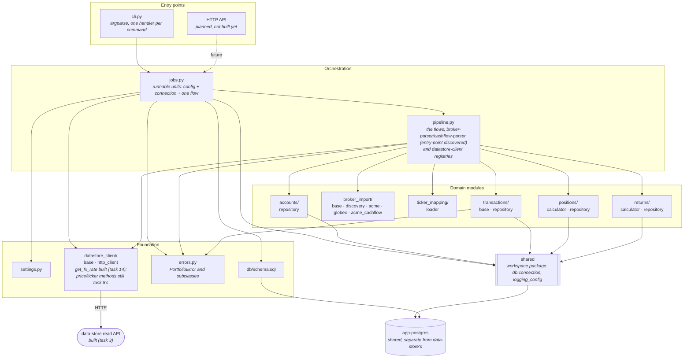
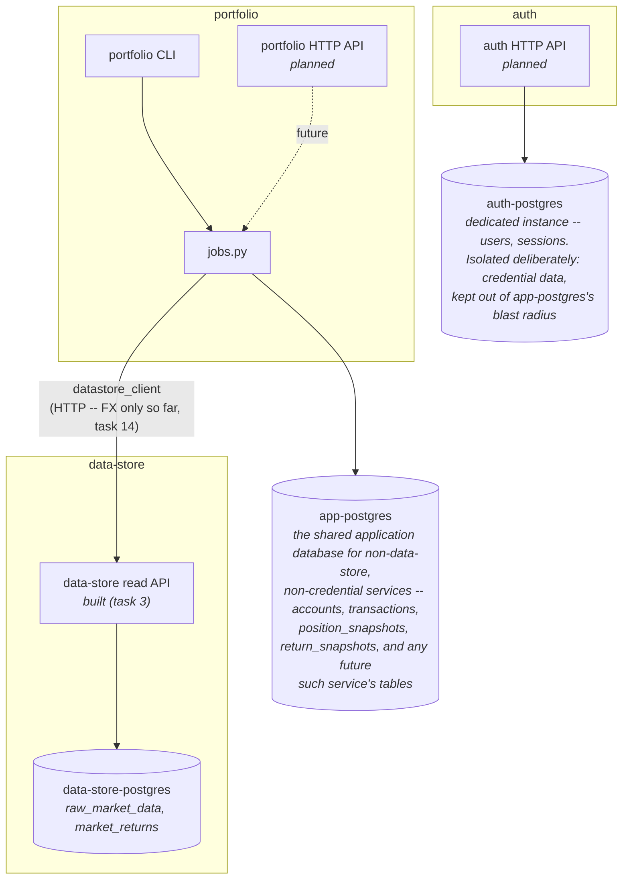

# portfolio architecture

How this service is put together and why. For *what the tables look like* see
[`schema.md`](schema.md), the column-level proposal signed off on per
[`../../../.claude/rules/data-schema.md`](../../../.claude/rules/data-schema.md); every entity
below is still described conceptually rather than as DDL. This document covers the layering, the
boundaries between modules, and the decisions that would otherwise look arbitrary — mirroring the
shape of [`data-store`'s own architecture doc](../../data-store/docs/architecture.md).

## What the service is responsible for

Recording every transaction across brokerage accounts — for multiple users, each seeing only their
own — and deriving positions and returns from that record at any point in time, not just "now."
Two things go in:

- **Transactions** — entered manually, or imported from a broker's export file (Acme, Globex
  today; more brokers later). Every transaction's native-currency amount is stored exactly as the
  broker reported it — the immutable source of truth — alongside a EUR-equivalent frozen at
  transaction time.
- **Manual ticker links** — the user's own mapping from a broker-reported instrument (an ISIN or a
  ticker symbol, depending on the broker) to the canonical ticker `data-store` prices (e.g.
  `0700.HK`). Defined in a YAML config file today; the plan is to move this to database-backed,
  UI-managed mappings once the application has a UI (see "Configuration" and the cross-cutting
  decision below). Never inferred, never fuzzy-matched, whichever way it's stored.

Two things are derived, not entered — both **materialized**, not computed live:

- **Position snapshots** — quantity and average cost per account per instrument, rebuilt by
  replaying the transaction log.
- **Return snapshots** — realized and unrealized returns per position, rebuilt from position
  snapshots plus prices and FX rates read from `data-store`.

It does **not** fetch or store market prices or FX rates itself, and does **not** run its own
yfinance (or any other) ingestion — `data-store` already owns getting external market data into
Postgres correctly; portfolio consumes it through a read API rather than duplicating that
machinery. See "Cross-service prerequisite" below.

**Explicit non-goals:**

- Not a source of truth for market prices or FX rates — that's `data-store`.
- Not a tax-lot / FIFO engine — cost basis is average-cost, blended (see cross-cutting decisions).
- Not (yet) an HTTP service — CLI only, though the design keeps that door open.
- Not a place that guesses a ticker mapping. An unmapped instrument blocks its own calculation,
  visibly, never a silent skip.
- Not the owner of *authentication or user identity* — credentials, sessions, login, and the
  `users` record itself belong to `auth` from the start (see
  [`auth/docs/architecture.md`](../../auth/docs/architecture.md)). Portfolio keeps no local `users`
  table, not even a placeholder — `accounts.user_id` is a plain UUID column holding the id `auth`
  issues at signup.

## Layering

Dependencies point one way, downward. Nothing in a lower layer imports from a higher one.



**Portfolio owns no `db/connection.py`.** Opening a connection, wrapping a transaction, and
applying a schema file are identical in every service here, so they live once in the
[`shared`](../../shared/docs/architecture.md) workspace package — extracted during the auth build
when its copy turned out near-identical to data-store's. Portfolio imports
`shared.db.connection` and `shared.logging_config` rather than growing a third copy; `db/` here
holds only `schema.sql`, which is genuinely portfolio's own. Repository modules import
`transaction`; `jobs.py` imports `get_connection` and `apply_schema`.

**`jobs.py` is the seam that matters**, for the same reason as data-store's: each `run_*` there is
one complete operation — load settings, open a connection, run the flow, close the connection,
return a structured result. `cli.py` is argument parsing plus a call into it, and nothing else. A
future HTTP API route is a call into it and nothing else. Anything that lived in only one of those
two would be, by construction, untested by the other.

That result is a plain dict of builtins, built by portfolio's own `run_result.py` — following the
same two-key `{"status", "rows_saved"}` plus per-flow named-counts contract as
[`data-store/run_result.py`](../../data-store/src/data_store/run_result.py), and the same
`ok` / `partial` / `nothing_to_do` status vocabulary. **Replicated independently, not imported** —
the two services don't share code across their boundary any more than they share a database.

The rule that keeps this honest, same as data-store's: **`pipeline.py` never touches SQL or HTTP
directly, and the domain modules never decide *what* to import or rebuild.** Orchestration knows
which account, which file, which date range; domain modules know how to parse one broker's file or
read/write one table.

**Built as of task 5** — `add_account`, `list_accounts`, `add_manual_transaction`. `pipeline.py`
(not a per-flow `service.py`) is where the `with transaction(conn):` boundary lives, the role
`auth/src/auth/service.py` plays for that service; repository functions never commit, matching
`accounts/repository.py` and `transactions/repository.py` below.

**Built as of task 6** — `import_transactions`, `list_unmapped_instruments`, and the real
`BROKER_PARSERS` registry replacing task 5's placeholder `KNOWN_BROKERS` tuple.

**Revised after task 6** — `add_account` no longer reads `BROKER_PARSERS` at all. The original
version gated account creation on `broker in tuple(BROKER_PARSERS)`, which meant an install with
no broker-parser plugins available (`BROKER_PARSERS` empty) could create *no* account at all —
and since `add_manual_transaction` requires an existing account, that also silently broke manual
entry, a flow with no real dependency on any parser. `broker` is now a free-text label at account
creation, validated only for non-blank (`InvalidBroker`); `BROKER_PARSERS` is read only by
`import_transactions` (and the parallel `import_cashflow`, below), the one place a parser is
actually needed. `pipeline.list_available_brokers()` / `portfolio broker list` reports what's
currently registered, for discoverability.

**Revised again — broker code extracted.** `BROKER_PARSERS`/`CASHFLOW_PARSERS` are no longer
hardcoded dicts; both are built once, at import time, by `broker_import/discovery.py` reading
`importlib.metadata.entry_points()` under the `stakehold.broker_parsers` /
`stakehold.cashflow_parsers` groups. `pipeline.py` itself imports nothing broker-specific — see
"Extension points" below. `acme.py`, `globex.py`, and `acme_cashflow.py` no longer live in this
package at all — they moved to a separate, privately-installed plugin package (not a dependency
of this one; this repo has no reference to it) that registers under the same two groups. A
deployment with no such plugin installed still creates accounts and records transactions
manually — see the "Revised after task 6" note above — and `import-transactions`/`import-cashflow`
fail with a named, self-diagnosing error (`BrokerParserNotFound`) rather than a missing-file
crash.

**Built as of task 14** — `import_cashflow`, and `datastore_client/http_client.py`'s
`get_fx_rate`, pulled forward from task 8 because Acme's cash-ledger export needs it (see
"Cross-service prerequisite" below). `import_cashflow` is a separate flow function, not a
branch inside `import_transactions` — see "The Acme cash-ledger import" below for why. Its
`broker` parameter and the parallel `CASHFLOW_PARSERS` registry are a later generalization (same
extraction prep as above) — task 14 itself built it Acme-only, hardcoded.

## The three-file shape of a domain module

| Module | Shape | Deviation from the three-file default, and why |
|---|---|---|
| `accounts/` | `repository.py` only | No external source and no `base.py` — a broker and an account are user-declared reference data, created through a CLI command, not parsed or fetched. Every read here takes a `user_id`, and every other domain module's queries are reached only by first going through an account scoped to that user — this is the one place multi-user isolation is enforced, not repeated independently by each module. **Deliberately no unscoped `get_by_id(account_id)`** alongside `get_by_label` — that absence is the design, not an oversight: it removes the one shortcut that would let a caller reach an account without proving it owns it. |
| `broker_import/` | `base.py` (the `BrokerParser` and `CashflowParser` Protocols) + `discovery.py` (entry-point lookup, populating `pipeline.py`'s two registries) + `acme.py`, `globex.py` (the `*_source.py` equivalent — but they read a local export file, not a network call) + `acme_cashflow.py` (task 14 — implements `CashflowParser` via a `AcmeCashflowParser` adapter, not `BrokerParser`; see "The Acme cash-ledger import" below) | **No `repository.py`.** A parser hands back in-memory `CanonicalTransaction` records; persistence is owned entirely by `transactions/repository.py`, so a manually-entered transaction and an imported one are written through the exact same path. Splitting persistence into `broker_import/` would let the two paths drift. **The four implementation files are entry-point plugins, not statically imported** — `discovery.py` is the only file in this module `pipeline.py` imports directly. |
| `ticker_mapping/` | `loader.py` only | **No `repository.py`.** The mapping lives in a YAML config file (`configs/ticker_mappings.yaml`), not a database table — mirroring `data-store`'s `yfinance_exchange_suffixes.yaml` reference-config pattern. `loader.py` reads and validates the file into an in-memory lookup; nothing here talks to Postgres. No `base.py` — nothing else is expected to implement a "mapping provider." |
| `transactions/` | `base.py` (the `CanonicalTransaction` record shape) + `repository.py` | `base.py` here holds a **data shape**, not a `Protocol` — the contract is "what a normalized transaction looks like," which multiple producers (`broker_import` parsers, manual CLI entry) must fill in, not a swappable behavior one class implements. |
| `positions/` | `calculator.py` (pure) + `repository.py` | Same shape as data-store's `returns/`: no `base.py`, no `*_source.py` — the input is this service's own `transactions` and `ticker_mapping` tables, not an external provider. |
| `returns/` | `calculator.py` (pure) + `repository.py` | Same shape again, plus one more thing to disclose: it also needs prices and FX rates from `datastore_client`. Those are fetched by `pipeline.py` and handed into `calculator.py` as plain data — the calculator itself stays pure and knows nothing about HTTP, keeping it as unit-testable as data-store's `returns/calculator.py`. |
| `datastore_client/` | `base.py` (a `DataStoreClient` Protocol) + `http_client.py` | This is the `*_source.py` role, but the "provider" is another in-house service's read API rather than a third party. **`get_fx_rate` built at task 14**, pulled forward from its original task 8 slot because Acme's cash-ledger import needs it; the price-series and ticker-existence methods `returns/` needs remain task 8's own work — see "Cross-service prerequisite" below. |

**`errors.py` is not a domain module** — it's a single Foundation-layer file (`PortfolioError` plus
`UnknownBroker`, `AccountNotFound`, `AccountLabelConflict`, `InvalidTransaction`, and, as of task 6,
`BrokerMismatch`, `BrokerFileError`, `TickerMappingError`), not one per module, so `jobs.py` can
catch every domain-level failure `pipeline.py` or a pure validator raises with one
`except PortfolioError`. Repositories never raise these — they let the driver's own exceptions
(e.g. `psycopg.errors.UniqueViolation`) propagate uncaught, same as `auth`. `BrokerMismatch` is
`import_transactions`'s own guard, not one the original design called for: `--broker` is otherwise
redundant with the resolved account's own `broker` column, but a cheap explicit check catches
importing an Globex file into a Acme account (or vice versa) as a named error rather than a parser
crash or, worse, transactions silently attributed to the wrong broker.

**One cross-domain dependency worth disclosing up front**, in the spirit of data-store's disclosed
deviations: `broker_import/base.py`'s `BrokerParser.parse()` returns `list[CanonicalTransaction]`,
so `broker_import` imports the record shape from `transactions/base.py` (and, for the same reason,
so does `acme_cashflow.py`, task 14, despite not being a `BrokerParser`). That's the one place a
domain module reaches into another domain's module rather than staying self-contained — accepted
because the alternative (each parser inventing its own intermediate shape, reconciled later) is
exactly the drift the extension point exists to prevent.

## Extension points: the broker-import registries

Same pattern as data-store's `SCRAPERS` / `MARKET_DATA_SOURCES` — a `Protocol` plus a registry
dict, no branching in flow functions — but populated by `broker_import/discovery.py` reading
entry points rather than hardcoded in `pipeline.py`. Two independent Protocol/registry pairs, not
one: `BrokerParser`/`BROKER_PARSERS` (plain export files, read by `import_transactions`) and
`CashflowParser`/`CASHFLOW_PARSERS` (cash-ledger formats needing a live FX lookup mid-parse, read
by `import_cashflow`). A broker key can appear in one registry, the other, both, or neither,
independently — `"acme"` is in both today, nothing enforces they agree.

```python
# broker_import/base.py  (built as of task 6; CashflowParser added during extraction prep)
class BrokerParser(Protocol):
    broker_key: str  # the registry key (e.g. "acme"). accounts.broker is the persisted
                      # source of truth for which broker an account belongs to; nothing on
                      # CanonicalTransaction repeats it (see below).

    def parse(self, file_path: Path, account_id: int) -> list["CanonicalTransaction"]:
        """Parse one broker export file into normalized transactions for one account.

        account_id is the resolved accounts.id (BIGINT), supplied by the caller after
        resolving --account through accounts/repository.py's get_by_label -- not discovered
        from the file itself. Acme's own export has no account-identifying column at all.
        """
        ...


ResolveFxRate = Callable[[str, date], Decimal | None]


class CashflowParser(Protocol):
    broker_key: str  # same role as BrokerParser.broker_key, in the separate CASHFLOW_PARSERS
                      # registry.

    def parse(
        self, file_path: Path, account_id: int, resolve_fx_rate: ResolveFxRate
    ) -> list["CanonicalTransaction"]:
        """Parse one cash-ledger export. Unlike BrokerParser.parse, carries resolve_fx_rate
        explicitly -- only for formats whose rows have no EUR-equivalent at all."""
        ...
```

```python
# broker_import/discovery.py
BROKER_PARSER_GROUP = "stakehold.broker_parsers"
CASHFLOW_PARSER_GROUP = "stakehold.cashflow_parsers"


def discover_broker_parsers() -> dict[str, "BrokerParser"]:
    return _discover(BROKER_PARSER_GROUP)


def discover_cashflow_parsers() -> dict[str, "CashflowParser"]:
    return _discover(CASHFLOW_PARSER_GROUP)
```

`_discover` instantiates every class registered under the group (`entry_points(group=...)`),
raising `BrokerPluginError` — fail-fast, matching this file's "unrecognized type is a parse
error" ethos — on either two installed plugins claiming the same key within one group, or a
loaded parser's own `broker_key` disagreeing with the name it registered under. Editing a
`[project.entry-points]` table does nothing until the owning package is reinstalled
(`entry_points()` reads installed `.dist-info/entry_points.txt`, not `pyproject.toml` live) —
worth remembering before assuming a registration change took effect.

`broker_import/base.py`, `acme.py`, and `globex.py` are built as of task 6 -- see
`broker_import/acme.py` and `broker_import/globex.py`'s own module docstrings for exact parsing
rules; what follows here records the design-level facts, several of which correct assumptions an
earlier pass of this document made before real export files were available to check them against.

The canonical intermediate representation both Acme's flat blotter and Globex's multi-section dump
get parsed into -- **built as of task 5** (`transactions/base.py`), so this is the real shape, not
a proposal:

```python
# transactions/base.py
@dataclass(frozen=True)
class CanonicalTransaction:
    account_id: int                                 # the resolved accounts.id, not a label
    broker_transaction_ref: str                      # natural id if the broker gives one,
                                                       # else a stable content hash (see risk below)
    transaction_type: str                             # BUY | SELL | DEPOSIT | WITHDRAWAL |
                                                       # DIVIDEND | FX | FEE | ADJUSTMENT
    trade_datetime: datetime
    instrument_identifier: str | None                 # ISIN (Acme) or Symbol (Globex); None for
                                                       # cash-only rows (deposits, adjustments)
    instrument_identifier_kind: str | None             # "ISIN" | "SYMBOL"
    quantity: Decimal | None                          # signed: +buy, -sell
    price: Decimal | None                             # per unit, native currency
    native_currency: str                               # ISO 4217, as the broker reports it
    native_amount: Decimal                             # signed cash-flow, broker's own figure --
                                                        # the source of truth
    eur_amount: Decimal                                # signed, frozen at transaction time
    fx_rate: Decimal | None                            # required whenever native_currency != EUR
    fx_rate_source: str | None                          # "broker_reported" | "companion_row" |
                                                        # "datastore_series" | "manual"
    fees_native: Decimal | None
```

**Two corrections against the version of this shape drafted before task 5 was built.** No
`broker` field: `schema.md` dropped the functionally-dependent `transactions.broker` *column* at
sign-off (task 4), and keeping it on the in-memory record would let a producer disagree with its
own account about who the broker is for no benefit — a parser fills `CanonicalTransaction` without
it, and `broker_key` above stays purely a registry key. `account_id` is `int`
(`accounts.id`, a `BIGSERIAL`), not `str` — resolving a caller-supplied label to that id, scoped by
`user_id`, is `accounts/repository.py`'s job, done before a `CanonicalTransaction` is ever built.
`transactions/base.py`'s `validate()` enforces the field-level rules above, including that a
non-EUR row must carry an `fx_rate` — a producer (manual entry, or a future broker parser) that
skips resolving one is rejected, not persisted as a gap to patch up later.

Registries, populated once at import time:

```python
# pipeline.py
BROKER_PARSERS: dict[str, BrokerParser] = discover_broker_parsers()
CASHFLOW_PARSERS: dict[str, CashflowParser] = discover_cashflow_parsers()
```

Today's two `BROKER_PARSERS` entries and one `CASHFLOW_PARSERS` entry all resolve to
implementations installed from a separate, privately-maintained plugin package — see the
"Revised again — broker code extracted" note above. Nothing in this repo names that package or
depends on it; it's discovered purely through the two entry-point groups above, at whatever
process picks up its installed metadata.

**`BROKER_PARSERS` is read in exactly one place outside its own definition: `import_transactions`**
(via `BROKER_PARSERS.get(broker)`, raising `BrokerParserNotFound` when nothing is registered for
the given key). **`CASHFLOW_PARSERS` is read the same way, exactly once, by `import_cashflow`.**
`add_account` deliberately reads neither — see the "Revised after task 6" note above for why
account creation and manual entry must work with both registries empty.
`pipeline.list_available_brokers()` (`portfolio broker list`) reads `BROKER_PARSERS`, read-only,
for discoverability; it does not currently also report `CASHFLOW_PARSERS` availability.

**Worked example — adding a third broker** (e.g. Trading212): implement `BrokerParser` and
register it under the `stakehold.broker_parsers` entry-point group as `trading212 = "...:
Trading212Parser"` in whatever package provides it (this one, today; a separate installable
package, once the extraction below completes) — no change to `pipeline.py`'s flow function,
`jobs.py`, or `cli.py`'s argument shape. `import-transactions --broker trading212 --file ...
--account ...` works as soon as that package is installed and its metadata is picked up
(`entry_points()`, at next process start).

**What each parser actually does, verified against a real export from each broker:**

- **`acme.py`**: single flat CSV, one header row (validated positionally against a tuple, since
  two of the export's columns are unnamed currency markers that would otherwise collapse under
  `csv.DictReader`). European locale — comma decimals, `DD-MM-YYYY` dates, `HH:MM` local time
  interpreted as `Europe/Amsterdam` and converted to UTC. `Value EUR` maps straight to
  `eur_amount`; `Local value` to `native_amount`; `Exchange rate` to `fx_rate` directly (already in
  `to_eur`'s native-per-EUR convention, so no re-derivation needed) with `fx_rate_source =
  "broker_reported"` whenever the row isn't EUR. `AutoFX Fee` and the third-party fee column are
  both EUR regardless of the trade's native currency; `fees_native` converts their sum to native
  currency via `fx_rate` (`eur_fees` when EUR, `eur_fees * fx_rate` otherwise). Quantity sign gives
  `transaction_type` (BUY/SELL) directly. The sample file has **no account-identifying column at
  all** — which account a file belongs to is supplied by the caller (`--account`), never parsed
  from the file.
- **`globex.py`**: the file is a multi-section dump (`Statement` / `Summary` / `Transaction History`
  interleaved, different column counts per section) — the parser's first job is filtering to rows
  where the first column is `Transaction History`, everything else is noise for this purpose. ISO
  dates with no time of day (stored at midnight UTC, rather than inventing a time the file never
  states), dot decimals, `-` as the null marker. Instruments are identified by `Symbol`, not ISIN.
  `Transaction Type` values (`Buy`, `Deposit`, `Adjustment`, `Forex Trade Component`, ...) map into
  the canonical vocabulary — an unrecognized type is a parse error, not a silent catch-all. Only
  `Buy`/`Sell` are treated as trades; every other type is a cash-only row (`native_currency` EUR,
  `native_amount = eur_amount = Net Amount`, no instrument) — the available sample export contains
  no `Sell`, `Withdrawal`, or `Dividend` row, so that generalization, and whether Globex signs a
  Sell's `Quantity` negative the way Acme does, is **unverified**; re-check against real examples
  of any of the three before trusting this at scale. `Forex Trade Component` rows are treated as
  cash-only too, deliberately with **no instrument identifier** — `EUR.USD` is a currency pair, not
  an instrument to map, and storing it as one would permanently demand a ticker mapping for it.

  **Correction to the two risks an earlier pass of this document flagged here, both resolved by
  reading a real export rather than assumed:** `Gross Amount`/`Net Amount` are already reported in
  Globex's own EUR base currency (`Summary` confirms `Base Currency,EUR`) — confirmed by recovering
  Globex's real $1 minimum commission from a USD trade's EUR-denominated `Commission`, converted back
  to native currency at the trade's own derived rate. This means **neither of the risks below
  applies**: there is no data-store FX-series fallback needed at import time, and there is no
  FX-companion-row matching to get right, because a trade's EUR-equivalent is a column Globex already
  provides, not something this parser has to derive from a same-day heuristic match. For a non-EUR
  trade, `native_amount` is derived as `quantity * price`, signed to match `Gross Amount`'s cash-
  flow direction; `fx_rate = native_amount / eur_amount` (already in `to_eur`'s convention); and
  `fees_native = Commission * fx_rate`. `Forex Trade Component` rows themselves needed no special
  handling once treated as ordinary cash-only rows — see above.

**Disclosed trade-off, matching data-store's style**: `parse(file_path, account_id)` assumes a
broker's history always arrives as one downloadable file. A future broker exposing only a
paginated API, not a file export, would have to be adapted into "write it to a temp file, then
parse it," or the Protocol would need broadening. Accepted for now, same reasoning data-store used
for its single `MarketDataSource` Protocol: both known brokers are file-export-based, and there's
nothing to generalize from yet.

**Design risk, confirmed real rather than theoretical — Acme's `Order ID` is not row-unique.**
An earlier pass of this document called it "a genuine natural key"; a real export disproves that —
a partial fill of one order produces multiple rows sharing the same Order ID (verified: two rows,
9 shares and 1 share, same order, same timestamp). Using it alone as `broker_transaction_ref` would
collide with `(account_id, broker_transaction_ref)`'s unique index and silently drop a fill under
`ON CONFLICT ... DO NOTHING`. `acme.py`'s ref is instead
`<order_id>:<12-char content hash>:<occurrence index>` — the hash disambiguates genuinely different
fills sharing an order id regardless of row order in the file, and the occurrence index (over rows
identical in both order id and hash) disambiguates truly identical rows rather than collapsing
them. Verified against the full real export: 82 rows in, 82 distinct refs out.

**Design decision — Globex row identity.** As anticipated, Globex's `Transaction History` rows carry no
broker-issued id at all, so `broker_transaction_ref` is a content hash over (date, symbol, type,
quantity, price, price currency, gross amount, commission, net amount) plus an occurrence index
over rows identical in that hash — the same shape as Acme's, minus the natural-key prefix.
Verified against the full real export: 68 rows in, 68 distinct refs out.

## Conceptual entity model

Per [`data-schema.md`](../../../.claude/rules/data-schema.md), this is the entity shape and
identity — not column-level DDL, which needs its own sign-off pass.

- **User** — owned entirely by `auth`, not portfolio (see "Explicit non-goals" above). There is no
  `users` table here, not even a stand-in: `Account` holds `user_id` as a plain UUID column
  referencing the id `auth` issues at signup — the same non-owning reference shape used for
  `canonical_ticker` into `data-store`'s world, except there's no local row backing it at all.
  Nothing here enforces the UUID is real; it's trusted input, the same way a `canonical_ticker` is
  trusted without a foreign key. Authentication — credentials, sessions, login — is out of scope for
  this document and belongs to `auth`.
- **Broker** — identified by a short key (`"acme"`, `"globex"`, ...). The same set as
  `broker_import`'s registry keys; effectively reference data, not user-editable.
- **Account** — identified by a user-chosen id/label; references one Broker and exactly one User (an
  `auth`-issued UUID, not a local row).
  Any broker-side account identifier (e.g. Globex's masked `U***57423`) is **not stored at all** — a
  file never self-identifies its account (see Acme above), so matching is always by the
  caller-supplied `--account`, which leaves a stored broker-side id as display-only data with no
  reader. See [`schema.md`](schema.md)'s `accounts` section. Every downstream entity (Transaction,
  PositionSnapshot, ReturnSnapshot) is scoped by Account and therefore transitively by User — there
  is no cross-user query path. **Stated assumption, not confirmed**: one user per account, no
  shared/joint accounts.
- **TickerLink** (the manual mapping) — identified by `(instrument_identifier_kind,
  instrument_identifier)`, e.g. `(ISIN, IE00B4L5Y983)` or `(SYMBOL, IWDA)`; maps to a
  `canonical_ticker` string (a `data-store` `raw_market_data.ticker` spelling, e.g. `IWDA.AS`).
  **Now defined in `configs/ticker_mappings.yaml`, not a database table** — see "Configuration"
  below and the cross-cutting decision on ticker-mapping storage. `PositionSnapshot`/
  `ReturnSnapshot` reference the resolved `canonical_ticker` string directly rather than a
  surrogate id, since there's no database row for a foreign key to point at.
  - **Key scoping, carried over unchanged**: `ISIN` mappings are global (an ISIN is globally
    unique by design, so one mapping covers every ISIN-based broker); `SYMBOL` mappings are scoped
    per-broker (a raw ticker symbol is *not* globally unambiguous — two exchanges can reuse the
    same symbol for different instruments). Expressed in the YAML as two top-level sections — a
    flat `isin:` map and a `symbol:` map nested one level under each broker key — rather than the
    two partial unique indexes a database table would need for the same guarantee. Keying `SYMBOL`
    mappings without a broker qualifier risks silently reusing a mapping that isn't actually the
    same instrument on a future symbol-based broker.
- **Transaction** — identified by a surrogate id; references an Account; carries `(account_id,
  broker_transaction_ref)` unique together for idempotent re-import (the broker is the account's,
  not the row's — see [`schema.md`](schema.md)); carries the raw
  `instrument_identifier`/`kind` as reported (for traceability back to the source file/row) — **not**
  a hard foreign key to TickerLink at write time, since a transaction must be importable *before*
  its instrument is mapped. The mapping gap is a first-class, visible state (surfaced by the
  positions/returns rebuild, not by import failing).
- **PositionSnapshot** — identified by `(account, ticker_link, as_of_date)`; wholly derived,
  rebuildable, never hand-edited. **Proposed grain, flagged for schema sign-off**: event-driven —
  one row per date a transaction actually changed the position, with "position as of date D" read
  as "the latest snapshot ≤ D." Cheap, and matches how the position genuinely changes (only on a
  transaction).
- **ReturnSnapshot** — identified by `(account, ticker_link, price_date)`; derived from
  PositionSnapshot plus `data-store` prices/FX; wholly derived, rebuildable. **Proposed grain,
  flagged for schema sign-off**: daily — one row per priced trading day the position was open,
  since a *return* changes every day the price moves even with zero transactions, so it can't be
  event-driven the same way. Mirrors `market_returns`'s own daily grain in data-store. **Bounded,
  not open-ended**: "was open" means from the position's first non-zero `PositionSnapshot` through
  the trading day it closes to zero, inclusive — `rebuild-returns` stops generating new rows for a
  ticker once the latest `PositionSnapshot` shows zero quantity with no later re-opening
  transaction. Rows already written for the open window are never deleted, so they remain available
  for historical charting; the grain just doesn't grow forever for a position nobody still holds.

## The flows

| Flow | Command | Cadence | Reads | Writes |
|---|---|---|---|---|
| Account setup | `account add --user <id> --broker <key> --label <label>` | rare, manual | — | `accounts` |
| Account listing | `account list --user <id>` | manual, on demand | `accounts`, scoped by `user_id` | — (read-only report) |
| Broker-plugin discovery | `broker list` | manual, on demand | `BROKER_PARSERS` (in-memory) | — (read-only report) |
| Ticker linking | — (hand-edit the YAML file) | manual, as unmapped instruments surface | — | `configs/ticker_mappings.yaml` (edited directly, not through the service) |
| List unmapped instruments | `list-unmapped-instruments --user <id>` | manual, on demand | `transactions` joined to `accounts` (scoped by `user_id`, and to pick up each instrument's owning broker), `configs/ticker_mappings.yaml` | — (read-only report) |
| Manual transaction entry | `add-transaction --user <id> --account <label> --ref <key> --type <type> --datetime <iso8601> --amount <decimal> --currency <ISO4217> [--instrument <id> --instrument-kind ISIN\|SYMBOL] [--quantity <d>] [--price <d>] [--fx-rate <d>] [--fees <d>]` | ad hoc | `accounts`, scoped by `user_id` | `transactions` (idempotent on `(account_id, broker_transaction_ref)`, keyed by the mandatory `--ref`) |
| Broker file import | `import-transactions --user <id> --broker <key> --file <path> --account <label>` | manual, on demand | export file, `accounts` scoped by `user_id` | `transactions` (idempotent on `(account_id, broker_transaction_ref)`) |
| Acme cash-ledger import | `import-cashflow --user <id> --broker <key> --file <path> --account <label>` | manual, on demand | export file, `accounts` scoped by `user_id`, data-store's FX read API (`datastore_client`) for non-EUR rows | `transactions` (idempotent on `(account_id, broker_transaction_ref)`) |
| Positions rebuild | `rebuild-positions` | after transactions change | `transactions`, `configs/ticker_mappings.yaml` | `position_snapshots` |
| Returns rebuild | `rebuild-returns` | after positions rebuild or new prices land | `position_snapshots`, `data-store` read API | `return_snapshots` |

**No separate `brokers` table** ever materialized — `schema.md` settled on `broker` as a plain
string on `accounts`, so `account add` writes only to `accounts`, never a second table.
`account add --broker <key>` is free text, checked only for non-blank (`InvalidBroker`) — it is
**not** validated against `BROKER_PARSERS` or any other fixed list of names, on purpose: account
creation and manual transaction entry must both work with zero broker-parser plugins installed.
`--broker <key>` only needs to match a registered parser at `import-transactions` time.

**A load-bearing consequence of the entity model above, worth stating directly:** `rebuild-positions`
needs no price data at all — quantity and average cost are pure functions of the transaction log.
So **everything except `returns/` and the "current market value" feature can be built, tested and
shipped before `data-store`'s read API exists.** That sequencing fact changes what "blocked on the
prerequisite" actually means in practice — it's one flow, not the whole service.

**Both rebuilds are full rebuilds, same reasoning as data-store's `calculate-returns`**: a
late-arriving ticker mapping, or a corrected/added historical transaction, changes every snapshot
from that point forward, so incremental append would serve stale rows. Rebuild scope is per
account (an isolatable failure unit, mirroring data-store's per-ticker/per-group isolation).

**An unmapped instrument blocks its own rebuild, loudly** — `rebuild-positions`/`rebuild-returns`
process every other account/instrument normally, and report the blocked ones by name in the
completion summary with a `partial` status, following the same `run_result` contract and
`nothing_to_do` vs. `partial` vs. `ok` distinction data-store already established (and the
repo-wide logging rule: "nothing to do" must never look like "something failed silently").

### Manual transaction entry

`add-transaction`'s `--ref` is **mandatory**, unlike a broker import where `broker_transaction_ref`
comes from the file. That's what makes manual entry idempotent by construction: re-running the
same command with the same `--ref` hits `(account_id, broker_transaction_ref)`'s `ON CONFLICT ...
DO NOTHING` and reports `nothing_to_do`, exactly like re-importing an overlapping file. A caller
who wants a one-off, throwaway entry still has to choose a ref (e.g. a UUID) — there's no
auto-generated fallback, because a generated ref would make every invocation a *new* row instead of
a safe re-run, silently defeating the idempotency the mandatory flag exists to give.

The EUR side of a transaction is computed locally, not fetched. `--currency EUR` requires no rate:
`eur_amount = native_amount`. Any other currency requires `--fx-rate`, read as **native currency
units per 1 EUR** (e.g. `--currency USD --fx-rate 1.0850` means EUR 1 buys USD 1.085), so
`eur_amount = native_amount / fx_rate`, rounded half-up to `eur_amount`'s own four decimal places
(`transactions/base.py`'s `to_eur`). The stored `fx_rate_source` is `"manual"` — a fourth value
added to the vocabulary `schema.md` originally documented as `broker_reported` / `companion_row` /
`datastore_series`, none of which fit a rate the user typed in; see `schema.md`'s amendment.

**Known limitation, partly revisited at task 14**: a non-EUR manual entry still has no fallback to
`data-store`'s FX series — if the caller doesn't know the day's rate, `add-transaction` simply fails
with `InvalidTransaction` rather than looking one up. `datastore_client.get_fx_rate` now exists
(built for `import-cashflow` below), so this is technically reachable, but wiring
`add-transaction` to it wasn't part of what task 14 was asked to do — left as an explicit, easy
follow-up rather than done as a drive-by.

### The Acme cash-ledger import

Acme's `Transactions.csv` (`acme.py`, above) carries trades only — deposits, withdrawals,
dividends, and dividend tax live in a second, separate export: the "Account" cash-ledger CSV.
`broker_import/acme_cashflow.py` parses it via its module-level `parse_cashflows` function, but
**deliberately does not implement `BrokerParser`** — it implements the separate `CashflowParser`
Protocol instead (through the `AcmeCashflowParser` adapter class), registered in
`CASHFLOW_PARSERS`, not `BROKER_PARSERS`. The reason is structural, not incidental:
`BrokerParser.parse(file_path, account_id)` is pure — no I/O beyond the file itself, by design,
matching the "domain modules never decide *what* to import" layering rule — but this file
format's rows carry **no EUR-equivalent at all**, unlike `Transactions.csv`'s `Value EUR` column
or Globex's EUR-base amounts, so a non-EUR row's `eur_amount` needs a live FX-rate lookup mid-parse.
Widening `BrokerParser.parse()` to carry a `datastore_client` parameter for every implementation
— including `acme.py` and `globex.py`, neither of which ever needs one — was rejected in favor of
a second, parallel registry: `pipeline.import_cashflow` resolves rates through `datastore_client`
and hands whatever `CashflowParser` is registered for `--broker` a plain `resolve_fx_rate`
callable — `acme_cashflow.py`'s own `parse_cashflows` stays pure and testable against a fake
callable, no HTTP client required, with the adapter class doing only the Protocol-shape
translation. `import-cashflow --user <id> --broker <key> --file <path> --account <label>` is
therefore its own CLI command, not a file-type-sniffing branch inside `import-transactions
--broker acme`.

**Row filtering, verified against a real, ~900-row export.** Every row carrying an Order Id
duplicates a trade or trading fee already imported via `acme.py`/`Transactions.csv` (confirmed:
the same Order Id values appear in both exports) and is skipped outright. Among the rest, several
categories are Acme's own internal cash/currency housekeeping — sweeps between its own
sub-ledgers, FX conversion legs, its money-market cash fund, and a one-off "fund compensation" row
tied to that same fund — none of which move money into or out of the account from the user's
perspective, and are skipped too rather than imported as noise:

```python
# broker_import/acme_cashflow.py
_INTERNAL_NOISE_EXACT = {
    "Acme Cash Sweep Transfer", "FX Withdrawal", "FX Credit",
    "ACME kompensacja Funduszu Rynku Pieniężnego",
}
_INTERNAL_NOISE_PREFIXES = ("Konwersja funduszu gotówkowego",)  # internal cash-fund buy/sell
```

The remaining real cash events map into the canonical vocabulary, decided category by category
(not guessed at) against the actual descriptions in the real export:

| Description | Type | Notes |
|---|---|---|
| `Depozyt`, `flatex Deposit`, `Transfer from your Cash Account at flatexACME Bank: ...` | DEPOSIT | |
| `Wypłata`, `Transfer to your Cash Account at flatexACME Bank: ...` | WITHDRAWAL | |
| `Dywidenda`, `Capital Return` | DIVIDEND | Tied to the row's ISIN. |
| `Podatek Dywidendowy` (dividend withholding tax) | FEE | A separate row from the gross dividend, not netted into it — mirrors how trading fees are kept separate from trade value elsewhere in this service. |
| `Flatex Interest`, `Flatex Interest Income`, `ADR/GDR Pass-Through Fee`, `ACME Exchange Connection Fee ...` | FEE | |
| `Member get Member Promocja` (a referral bonus) | ADJUSTMENT | The one genuine one-off; reuses the same catch-all Globex's FX-translation adjustment already occupies, rather than inventing a type for a single row. |

**Sharp edge in the file itself**: `Transfer (from|to) your Cash Account at flatexACME Bank`
rows carry **no Change currency/amount at all** — unlike every other row, the figure exists only
embedded in the free-text description (e.g. `"...: 1 128 EUR"`, thousands-separated with a space
or NBSP), so this one category is parsed by regex against the description rather than by column.

**FX resolution**: for a non-EUR row, `resolve_fx_rate(currency, on_date)` calls
`datastore_client.get_fx_rate("EUR", currency, on_date)`, which looks back up to 7 days for the
most recent point at or before `on_date` (covering a weekend/holiday with no traded rate) and
returns `None` if nothing is found in that window. `None` is not silently tolerated — the row's
`transaction_type` still requires a resolvable `eur_amount`, so an unresolvable rate raises
`BrokerFileError` rather than being persisted with a gap. The stored `fx_rate_source` is
`"datastore_series"` — the first real use of a vocabulary value `schema.md` had reserved but no
producer had actually written until now. Verified against the full real export: 339 real cash
events kept out of 889 raw rows, 173 of them needing a resolved rate, none unresolvable, no ref
collisions.

**Locale caveat, stated plainly**: the classification tables above were built against a real,
**Polish-locale** Acme account statement — Description strings are locale-specific, not a stable
enum the way Globex's `Transaction Type` is. An export in a different display language will raise
`BrokerFileError` on its first unrecognized string rather than silently miscategorizing it (the
same "unrecognized type is a parse error" policy `globex.py` already follows), but extending this to
another locale means adding that locale's strings to the tables above, not guessing at a
translation.

## Cross-service prerequisite: the data-store read API

**This section describes what portfolio needs from it; `data-store`'s own `docs/architecture.md`
("Read API" section) owns the design and is authoritative on the current shape.** Built as task 3
of the cross-service roadmap (`tasks.md`). `http_client.py` now exists, but only implements the
second operation below — pulled forward at task 14 because Acme's cash-ledger import needed it,
not because `returns/` was ready to consume it yet.

`returns/` (and any future "current market value of a position" feature) needs, conceptually,
three read operations against `data-store`, all of which now exist on data-store's side:

1. **Price series for a canonical ticker** over a date range — `GET /prices/{ticker}`, backed by
   `market_returns`. Returns `split_adjusted_close`, `future_split_factor`, and the four return
   columns (`price_return`, `dividend_return`, `simple_return`, `log_return`), nullable together
   on a ticker's first stored date — `http_client.py` must preserve those nulls rather than
   coercing them to 0. **Not yet built** — still `returns/`'s own work (task 8).
2. **FX rate series for a currency pair** over a date range, in the *same shape* as a price
   series (a list of `{date, value}` points) — `GET /fx/{base}/{quote}`. **Correction to an
   earlier assumption here**: this is *not* modeled as another yfinance-style ticker (e.g.
   `EURUSD=X`) reusing `market_data/`'s ingestion machinery. `data-store` deliberately kept FX in
   its own `fx_rates` table (no OHLC, dividends, or splits to carry), and the API instead derives
   any requested pair — direct, inverse, or triangulated through `config/currencies.yaml`'s
   configured base currency — from whatever `fx_rates` actually stores. The response shape still
   satisfies the "same shape as a price series" intent (`{date, rate}` points); only the
   ingestion-reuse assumption was wrong. **Built at task 14** as `DataStoreClient.get_fx_rate(base,
   quote, on_date)` — a single-date lookup with a 7-day look-back for the nearest earlier point,
   not yet the full series signature this bullet describes; `returns/` needing a whole series over
   a date range is still task 8's own extension of `http_client.py`, not a rewrite of it.
3. **Ticker existence/validity check** — `GET /tickers/{ticker}`, reporting `exists` (ingested at
   all) and `has_returns` (whether `calculate-returns` has run for it) separately, plus the
   covered date range. Lets a `configs/ticker_mappings.yaml` entry naming a `canonical_ticker`
   `data-store` doesn't track be caught by `list-unmapped-instruments` or a validation command,
   rather than failing silently at returns-rebuild time. **Not yet built** — still task 8's work.

All three require `Authorization: Bearer <INTERNAL_API_SECRET>` — the same shared-secret model
`auth/docs/architecture.md` describes — and `source` is a query parameter defaulting to
`yfinance` on every endpoint, since `source` is part of the primary key on data-store's side.

`datastore_client/base.py` defines the `DataStoreClient` Protocol portfolio's domain code depends
on; `http_client.py` is the implementation that calls the now-built API — `get_fx_rate` only, as
of task 14. Because the rest of the domain (`positions/`, `transactions/`, `broker_import/`,
`ticker_mapping/`) depends only on the Protocol, not the HTTP implementation, a local
stub/fixture-backed implementation of `DataStoreClient` remains enough to build and test
everything, `import-cashflow` included (see its own tests, and
`tests/integration/test_acme_cashflow_import.py`), without a live data-store instance. Adding
the price-series and ticker-existence methods to `http_client.py` is `returns/`'s own remaining
task (task 8), not a joint prerequisite any more.

## Configuration

Much smaller than data-store's, since portfolio has no scraping/exchange-resolution reference data
of its own:

| File | Committed? | Why |
|---|---|---|
| `.env` (`PORTFOLIO_DATABASE_URL`, `APP_POSTGRES_ADMIN_DATABASE_URL`, `DATASTORE_API_URL`, `INTERNAL_API_SECRET`) | no — gitignored | Credentials, per-environment. **Not** the bare `DATABASE_URL`: data-store already owns that name, and both suites can run in one pytest process where a shared name would collide — the same reasoning behind `AUTH_DATABASE_URL`. `PORTFOLIO_DATABASE_URL` names the *service*, not the instance, so a future service sharing `app-postgres` gets its own name and its own role. `APP_POSTGRES_ADMIN_DATABASE_URL` is the one exception — it names the *instance*, because the admin role it points at is the shared container's own bootstrap role, not any one service's; see the role/schema paragraph above. **`INTERNAL_API_SECRET` is likewise deliberately unprefixed** (built at task 14), matching data-store's own env var name exactly — it's the one shared credential both sides of an internal call must agree on, not a portfolio-owned setting. Both are optional at `load_settings()` — only `import-cashflow` needs them, checked by `run_import_cashflow` itself. |
| `.env.example` | yes | Template, matching data-store's convention |
| `configs/ticker_mappings.yaml` | no — gitignored | This deployment's own ISIN/symbol → canonical-ticker choices — personal/deployment data, not generic reference data, the same reasoning `data-store` applies to `etfs.yaml`/`tracked_tickers.yaml`. |
| `configs/ticker_mappings.yaml.example` | yes | Template, matching `data-store`'s `etfs.yaml.example` convention. |

No YAML config for broker parsing — the broker registry is code (a new broker is a new file plus
one registry line), not data, since unlike data-store's exchange-suffix mapping there's no
reference table of *known-good* per-broker quirks to maintain outside code. Accounts are still
**database rows created via CLI commands** — they're the user's own data, not reference data
shared across environments, so they belong in the database the rest of the service already treats
as the source of truth. **Ticker mappings are the one exception**: for now they're config-file
rows, not database rows or CLI-entered data — see the cross-cutting decision below for why, and
the migration path once a UI exists. The path resolves the same way `data-store/settings.py`
resolves its own config paths — `PORTFOLIO_TICKER_MAPPINGS_PATH`, an env var override defaulting to
`configs/ticker_mappings.yaml`, resolved relative to the service root via the same
`_SERVICE_ROOT`/`_resolve` mechanism, added to `portfolio/settings.py` at task 6.

## Deployment



**Three separate Postgres instances, not two.** Portfolio never opens a connection to
`data-store`'s or `auth`'s database, and neither of those opens one to portfolio's — the boundary
between services is always an API, full stop. `data-store` has its own, dedicated database because
its ingestion machinery and schema evolve independently. **`auth` also gets its own, dedicated
database — a deliberate exception, not an oversight**: credentials and session tokens are the most
sensitive data in the system, and isolating them at the database level keeps a bug or injection in
portfolio's code path from ever reaching auth's tables, consistent with this repo's
[`security.md`](../../../.claude/rules/security.md) rule to give credential-handling code extra
scrutiny. **`app-postgres` remains the shared database for every other future non-data-store
service** — the one such a service uses instead of standing up a fourth instance — but that sharing
principle stops at the credential boundary; `auth` is the one deliberate carve-out from it.

**`app-postgres`'s compose file lives at `services/portfolio/docker-compose.yml`**, even though the
instance is meant to be shared, because portfolio is its only tenant today and every other service
here keeps its own containers next to its own code. Naming it `app-postgres` rather than
`portfolio-postgres` is the part that matters: the container is not portfolio's to own, only
portfolio's to start. Moving it somewhere neutral belongs to the end-to-end deployment task, once
there is a second tenant to justify the move — noted here rather than left as a silent oddity.

Inside that one instance the **database is named for the instance (`app`) and the role for the
service (`portfolio`)**. A second service on `app-postgres` gets its own role in the same database
rather than its own database, so the shared-application-database claim above stays true in the
schema and not just in the container name.

**That role is a real, enforced boundary, not an aspiration.** The official postgres image always
grants superuser to whatever role it bootstraps via `POSTGRES_USER` — there is no env-var way
around that — so `docker-compose.yml` and `ci.yml` bootstrap a separate admin role
(`APP_POSTGRES_ADMIN_USER`) that the running app never connects as. `portfolio db init`
(`jobs.py`'s `_ensure_role_and_schema`) uses that admin role exactly once, to create the
non-superuser `portfolio` role and a like-named schema it owns (`CREATE SCHEMA portfolio
AUTHORIZATION portfolio`) — Postgres denies cross-schema access by default, so owning the schema
is the entire isolation mechanism, no further `GRANT`s needed. A role's default `search_path`
resolves `"$user"` to the schema matching its own name first, which is why `schema.sql`'s table
names stay unqualified. A second tenant follows the same recipe: its own `<service>_DATABASE_URL`
with its own role name, and `db init` creates its role/schema the same way — never reusing
`portfolio`'s. The one thing this doesn't solve is the admin role itself, which remains a
superuser for as long as the stock postgres image bootstraps it that way; the guarantee is that
nothing beyond one `db init` bootstrap step ever holds that privilege, not that no superuser
exists on the instance.

## Cross-cutting decisions

Each stated as a rule, with rationale and the rejected alternative, in data-store's
documented-trade-off style.

**Every transaction stores its native-currency amount exactly as the broker reported it, plus a
EUR-equivalent frozen at transaction time; point-in-time valuation additionally needs a daily FX
rate series, not one-off conversions.** The native amount is the immutable audit trail back to the
broker's own statement — anything derived from it (EUR totals, returns) must be reconstructable
and re-checkable against that source. *Rejected: storing only a EUR-normalized amount* — simpler,
but loses the ability to reconcile against what the broker actually reported, and can't
distinguish "the broker's number" from "our conversion of it" when the two are later found to
disagree. *Rejected: converting on the fly from a single current rate* — wrong for
realized-gain-at-transaction-time analysis, which needs the rate that applied when the trade
happened, not today's.

**Portfolio calls a `data-store` read API for tickers, prices and FX rates; it never reads
`data-store`'s Postgres directly, and never runs its own price/FX ingestion.** Keeps the
"each service owns its database" boundary intact and avoids two independently-drifting copies of
yfinance ticker-resolution logic `data-store` has already built and hardened. *Rejected: portfolio
reads `data-store`'s Postgres directly* — couples the two services' schemas and deployments, and
breaks the separate-database boundary the moment either schema changes. *Rejected: portfolio runs
its own FX/price ingestion* — duplicates real, non-trivial machinery (ticker resolution, exchange
suffixes, split-adjustment) that already exists and is already correct in one place.

**Cost basis is average cost (blended), not FIFO lot tracking.** Much simpler domain model — no
lot ledger, no lot-matching logic on every sale — and sufficient for the stated goal of position
value and return "at any point in time." *Rejected: FIFO lot tracking* — more precise for
tax-lot-level realized-gain reporting, but requires tracking individual purchase lots and matching
sales against them in order, a materially bigger domain model for a use case not currently
required. Notable enough to flag as a plausible v2 if tax-lot-level precision becomes a real
requirement later.

**Positions and returns are materialized — rebuilt into stored tables from the transaction log,
not computed live on every read.** Matches `data-store`'s own `returns/` shape (full rebuild per
run), and means a future HTTP API serves reads from a table, not from replaying years of
transactions on every request. *Rejected: compute on every read* — simpler to reason about
freshness, but gets slower as transaction history grows, and would force the future API to either
replay history per request or build its own cache — reinventing materialization anyway, just less
deliberately.

**CLI first; orchestration is plain callables so a future HTTP API adds a caller, not a rewrite.**
Mirrors data-store's `jobs.py` seam — `cli.py`/a future API route are both argument parsing plus
one call into `jobs.run_*`. *Rejected: build the domain against a web framework's handlers from day
one* — couples domain logic to HTTP concerns (request parsing, status codes) before an API is
actually being built, the same coupling `jobs.py` exists to prevent between data-store's CLI and
Airflow.

**Every account belongs to exactly one user, and `accounts/repository.py` is the single chokepoint
every other domain module's queries pass through to get there.** Isolation is enforced in one
place, not asserted independently by each module. *Rejected: scope every table's queries by
`user_id` directly, module by module* — correct in principle, but repeats the same check
everywhere instead of making a cross-user leak structurally hard to introduce by accident.

**An unmapped ticker link blocks that instrument's calculation, loudly — never a silent skip.**
Directly required by the domain: silently omitting an unmapped position would understate the
portfolio without any visible sign of why. Structurally this is the same "nothing to do vs.
something went wrong" distinction data-store's `run_result` already encodes (`partial`, not `ok`,
when something is skipped) — portfolio's rebuild flows reuse that contract rather than inventing a
new one.

**Logging follows the same convention data-store settled on**: `logger.info`/`warning` to stderr
via a `configure_logging()` call at every entry point, a command's actual result to stdout — since
portfolio is a CLI service in the same shape, and the reasoning ("logs go to stderr, results go to
stdout" so output stays pipeable and ordered) applies unchanged.

**Ticker mappings are defined in a YAML config file (`configs/ticker_mappings.yaml`), not database
rows, for now — with a planned move to database-backed, UI-managed mappings once the application
has a UI.** Gets a working mapping mechanism immediately with zero CRUD/CLI investment in a
mechanism that's expected to be replaced soon anyway, and mirrors `data-store`'s own precedent for
this exact shape of data — a mostly-static, hand-maintained lookup table
(`yfinance_exchange_suffixes.yaml`) that's reference data rather than something the pipeline
writes. *Rejected: build the `ticker_links` table and a `link-ticker` CLI command now* — real,
working code (partial unique indexes, an `ON CONFLICT` upsert, a CLI command) that would need to be
thrown away or migrated the moment a UI takes over the same responsibility; better to defer that
investment until the UI actually exists and its real requirements (multi-user editing? an audit
history of who changed a mapping and when?) are known. **Known sharp edge, stated plainly**: the
file is shared, deployment-wide config — not scoped per user — matching `TickerLink`'s original
design (ISIN mappings were always meant to be global, symbol mappings scoped only by broker, never
by user). A future database-backed version should preserve that scoping, not silently make
mappings per-user. **Migration path, not designed yet**: when the UI arrives,
`ticker_mapping/loader.py` is expected to be replaced by a database-backed repository — very likely
close to the `ticker_links` table design already proposed once in `schema.md`'s history; the YAML
file at that point either seeds a one-time import or is retired. Not decided now — flagged as a
known future schema change, the same way `schema.md` already flags a future `realized_gains`
table.

## Testing

| | Needs | Covers |
|---|---|---|
| `tests/unit/` | nothing | **Built as of task 6**: `broker_import/acme.py` and `globex.py` against fixture files trimmed from real exports (`tests/unit/broker_import/fixtures/`), including the content-hash dedup logic for both brokers and Acme's shared-Order-ID partial-fill case; `ticker_mapping/loader.py`; `pipeline.import_transactions`/`list_unmapped_instruments` against fake repositories and a fake parser. **Built as of task 14**: `broker_import/acme_cashflow.py` against a fixture trimmed from a real cash-ledger export, with a plain fake `resolve_fx_rate` callable (no `DataStoreClient` needed at that layer); `datastore_client/http_client.py` against a faked `requests.get`; `pipeline.import_cashflow` against a fake `DataStoreClient`. **Not yet built**: `positions/calculator.py` and `returns/calculator.py` as pure functions over in-memory transaction/price frames (tasks 7–8) |
| `tests/integration/` | live Postgres | **Built as of task 6**: re-importing the same file is a no-op (`tests/integration/test_broker_import.py`), `list_distinct_instruments`'s multi-user isolation and broker attribution; task 4/5's `accounts`, `transactions` idempotent-upsert, and schema-migration-idempotency coverage. **Built as of task 14**: `import_cashflow`'s idempotent reimport and broker-mismatch rejection (`test_acme_cashflow_import.py`), routed through `pipeline.py` directly with a stub `DataStoreClient` rather than through `jobs.py`'s real `HttpDataStoreClient` — see below. **Not yet built**: `ticker_mapping/` (nothing there talks to Postgres — see the module table), `positions/repository.py`, `returns/repository.py`, full rebuild flows end-to-end (tasks 7–8) |

**`datastore_client/http_client.py` itself is tested against a faked `requests.get`, not a live
data-store instance** — status codes, the lookback-window request shape, and error mapping to
`DataStoreApiError` are covered entirely in `tests/unit/datastore_client/test_http_client.py`.
Every *other* module that depends on `DataStoreClient` (`pipeline.import_cashflow`,
`broker_import/acme_cashflow.py` via its `resolve_fx_rate` callable) is tested against a
fake/stub implementing the Protocol instead, the same way data-store's pipeline tests stub
`save_*` and swap source registries for fakes. There is no live-`data-store` integration test
anywhere in this service's suite, since that boundary is the API contract itself, not something
this service's tests should own verifying end-to-end. Worth flagging as an open question: where
does a *contract* test for that boundary live — here, in `data-store`, or a shared test — since
neither service's suite by itself can currently catch a drift in the other.

## Where to start reading

1. `pipeline.py` — the flows; everything else is in service of these.
2. `transactions/base.py` — the `CanonicalTransaction` shape every producer converges on; read
   this before either parser.
3. `broker_import/acme.py` and `broker_import/globex.py` — the two very different raw shapes, side
   by side, converging on the same record. `broker_import/acme_cashflow.py` next, as the
   counter-example: the one file format that couldn't stay pure the way the other two do.
4. `positions/calculator.py` — the most representative "derived, materialized" domain module;
   `returns/calculator.py` next, since it's the one with an external dependency
   (`datastore_client`) deliberately kept out of the pure function itself.
5. `jobs.py` — how configuration, a connection and a flow become one runnable operation, ready for
   a future API caller alongside the CLI.
