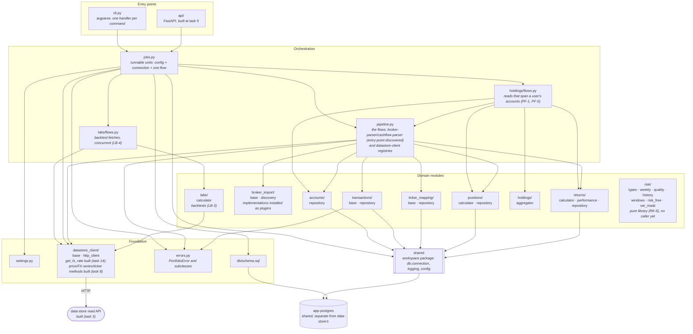

# portfolio architecture

How this service is put together and why. For *what the tables look like* see
[`schema.md`](schema.md), the column-level proposal signed off on per
[`../../../.claude/rules/data-schema.md`](../../../.claude/rules/data-schema.md); every entity
below is still described conceptually rather than as DDL. This document covers the layering, the
boundaries between modules, and the decisions that would otherwise look arbitrary — mirroring the
shape of [`data-store`'s own architecture doc](../../data-store/docs/architecture.md).

Three companions hold the rest, split out to keep each file under the repo's 64KB limit:
[`flows.md`](flows.md) (every flow and its entry points, the HTTP API, and what portfolio reads
from data-store), [`broker-import.md`](broker-import.md) (the broker-parser plugin surfaces) and
[`deployment.md`](deployment.md) (containers and databases).
A structural change may need any of the four updated.

## What the service is responsible for

Recording every transaction across brokerage accounts — for multiple users, each seeing only their
own — and deriving positions and returns from that record at any point in time, not just "now."
Two things go in:

- **Transactions** — entered manually, or imported from a broker's export file via an installed
  broker-parser plugin. Every transaction's native-currency amount is stored exactly as the
  broker reported it — the immutable source of truth — alongside a EUR-equivalent frozen at
  transaction time.
- **Ticker mappings** — the mapping from a broker-reported instrument (an ISIN or a ticker symbol,
  depending on the broker) to the canonical ticker `data-store` prices (e.g. `0700.HK`). Global,
  stored in the `ticker_mappings` table and managed by an admin from `web`'s admin page (see the
  cross-cutting decision below). Never inferred, never fuzzy-matched. Manual entry doesn't need
  one: it records a `data-store` ticker directly (`TICKER`).

Two things are derived, not entered — both **materialized**, not computed live:

- **Position snapshots** — quantity and average cost per account per instrument, rebuilt by
  replaying the transaction log.
- **Return snapshots** — realized and unrealized returns per position, rebuilt from position
  snapshots plus prices and FX rates read from `data-store`.

It does **not** fetch or store market prices or FX rates itself, and does **not** run its own
yfinance (or any other) ingestion — `data-store` already owns getting external market data into
Postgres correctly; portfolio consumes it through a read API rather than duplicating that
machinery. See [`flows.md`](flows.md)'s "Cross-service prerequisite".

**Explicit non-goals:**

- Not a source of truth for market prices or FX rates — that's `data-store`.
- Not a tax-lot / FIFO engine — cost basis is average-cost, blended (see cross-cutting decisions).
- Not a place that guesses a ticker mapping. An unmapped instrument blocks its own calculation,
  visibly, never a silent skip.
- Not the owner of *authentication or user identity* — credentials, sessions, login, and the
  `users` record itself belong to `auth` from the start (see
  [`auth/docs/architecture.md`](../../auth/docs/architecture.md)). Portfolio keeps no local `users`
  table, not even a placeholder — `accounts.user_id` is a plain UUID column holding the id `auth`
  issues at signup.

## Layering

Dependencies point one way, downward. Nothing in a lower layer imports from a higher one.

**Portfolio owns no `db/connection.py`.** Opening a connection, wrapping a transaction, and
applying a schema file are identical in every service here, so they live once in the
[`shared`](../../shared/docs/architecture.md) workspace package — extracted during the auth build
when its copy turned out near-identical to data-store's. Portfolio imports
`shared.db.connection` and `shared.logging_config` rather than growing a third copy; `db/` here
holds only `schema.sql`, which is genuinely portfolio's own. Repository modules import
`transaction`; `jobs.py` imports `get_connection` and `apply_schema`.

**`jobs.py` is the seam that matters**, for the same reason as data-store's: each `run_*`/`get_*`
there is one complete operation — load settings, open a connection, run the flow, close the
connection, return a result. `cli.py` is argument parsing plus a call into it, and nothing else.
`api/routes.py` (built at task 9) is a call into it and nothing else, too. Anything that lived in
only one of those two would be, by construction, untested by the other.

That result is a plain dict of builtins, built by portfolio's own `run_result.py` — following the
same two-key `{"status", "rows_saved"}` plus per-flow named-counts contract as
[`data-store/run_result.py`](../../data-store/src/data_store/run_result.py), and the same
`ok` / `partial` / `nothing_to_do` status vocabulary. **Replicated independently, not imported** —
the two services don't share code across their boundary any more than they share a database.

The rule that keeps this honest, same as data-store's: **`pipeline.py` never touches SQL or HTTP
directly, and the domain modules never decide *what* to import or rebuild.** Orchestration knows
which account, which file, which date range; domain modules know how to parse one broker's file or
read/write one table.

**Cross-account reads live in `holdings/flows.py`, not `pipeline.py` (PF-1).** It is the same
layer as `pipeline.py`, orchestration over domain modules, and follows the same rule: no SQL of
its own. It sits beside it rather than in it because `pipeline.py` is near the 64 KB file limit,
and every flow there is per account while these span all of a user's accounts. It holds PF-1's
`list_holdings` and PF-5's `list_portfolio_returns`. `jobs.get_holdings` and
`jobs.get_portfolio_returns` call it the way the other `get_*` jobs call `pipeline.py`. It
doesn't call into `pipeline.py` at all, and nothing in `pipeline.py` imports `holdings/`.

**Labs orchestration lives in `labs/flows.py` (LB-4)**, beside `labs/calculator.py`, for the
same file-size reason as `holdings/flows.py`, and because a backtest opens no database
connection at all: nothing is stored, and every input is data-store's. `jobs.get_backtest`
builds the data-store client and calls it, with no connection to open or close.
- **It is the service's first concurrent fan-out.** A mix of up to 50 assets needs two or three
  data-store calls each, so sequential calls would put several seconds between the user and the
  page. The client is synchronous (`requests`), so the fan-out is a `ThreadPoolExecutor` of 8
  rather than an async client. An async client would mean a second implementation of
  `DataStoreClient` for one caller. 8 in flight is a modest load on data-store, which serves
  sync routes from its own thread pool with one connection per request.
- **The failure-isolation unit is one asset.** That is the same reasoning as the rebuilds'
  per-pair catch, applied to a read. A failed call is a `failed` status in the response, not a
  502, so one bad ticker can't blank a whole lab. A failed FX fetch fails every asset in that
  currency.

**Built as of task 5** — `add_account`, `list_accounts`, `add_manual_transaction`. `pipeline.py`
(not a per-flow `service.py`) is where the `with transaction(conn):` boundary lives, the role
`auth/src/auth/service.py` plays for that service; repository functions never commit, matching
`accounts/repository.py` and `transactions/repository.py` below.

**Built as of task 6** — `import_transactions`, `list_unmapped_instruments`, and the real
`BROKER_PARSERS` registry replacing task 5's placeholder `KNOWN_BROKERS` tuple.

**Revised after task 6** — `add_account` no longer reads `BROKER_PARSERS` at all. The original
version gated account creation on `broker in tuple(BROKER_PARSERS)`, which meant an install with
no broker-parser plugins available (`BROKER_PARSERS` empty) could create *no* account at all —
and since `add_manual_transaction` requires an existing account, that also silently broke manual
entry, a flow with no real dependency on any parser. `broker` is now a free-text label at account
creation, validated only for non-blank and within the column's length (`InvalidBroker`);
`BROKER_PARSERS` is read only by
`import_transactions` (and the parallel `import_cashflow`, below), the one place a parser is
actually needed. `pipeline.list_available_brokers()` / `portfolio broker list` / `GET /brokers`
reports what's currently registered, and which import kinds each broker supports.

**Revised again — broker code extracted.** `BROKER_PARSERS`/`CASHFLOW_PARSERS` are no longer
hardcoded dicts; both are built once, at import time, by `broker_import/discovery.py` reading
`importlib.metadata.entry_points()` under the `stakehold.broker_parsers` /
`stakehold.cashflow_parsers` groups. `pipeline.py` itself imports nothing broker-specific — see
[`broker-import.md`](broker-import.md). No concrete parser implementation lives in this package at all — they
moved to a separate, privately-installed plugin package (not a dependency of this one; this repo
has no reference to it, by name or otherwise) that registers under the same two groups. A
deployment with no such plugin installed still creates accounts and records transactions
manually — see the "Revised after task 6" note above — and `import-transactions`/`import-cashflow`
fail with a named, self-diagnosing error (`BrokerParserNotFound`) rather than a missing-file
crash.

**Revised once more — a malformed plugin install no longer takes every command down with it.**
Discovery for each of the two registries still runs once, at `pipeline.py` import time, but a
`BrokerPluginError` raised during either one (a duplicate entry-point name, a `broker_key` that
disagrees with its registered name, or a plugin that fails to load/instantiate at all) is now
caught right there and stashed as `_BROKER_DISCOVERY_ERROR`/`_CASHFLOW_DISCOVERY_ERROR` instead
of propagating out of the module import. It's re-raised lazily, only from the functions that
actually read the affected registry (`import_transactions` for `BROKER_PARSERS`,
`import_cashflow` for `CASHFLOW_PARSERS`, `list_available_brokers` for both) — so a broken broker-parser plugin
still can't block `db init`, `account add`, `add-transaction`, or `list-unmapped-instruments`,
none of which read either registry. The two registries fail independently of each other too: a
broken cashflow-parser plugin doesn't stop `import-transactions` from working.

**Built as of task 14** — `import_cashflow`, and `datastore_client/http_client.py`'s
`get_fx_rate`, pulled forward from task 8 because one broker's cash-ledger export needed a live
FX lookup mid-parse (see [`flows.md`](flows.md)'s "Cross-service prerequisite"). `import_cashflow` is a separate
flow function, not a branch inside `import_transactions` — see [`flows.md`](flows.md)'s "Cash-ledger
imports needing a live FX lookup" for why. Its `broker` parameter and the parallel `CASHFLOW_PARSERS`
registry are a later generalization (same extraction prep as above) — task 14 itself built it
hardcoded to that one broker.

**Built as of task 7** — `rebuild_positions`, and the new `positions/calculator.py` +
`positions/repository.py` it composes. Needed a new read this task added to
`transactions/repository.py`: `list_by_accounts(conn, account_ids, *, transaction_types=None)`,
which fetches every one of `account_ids`' transaction logs in one round trip and groups them by
`account_id` — every prior read there was either scoped by `user_id`
(`list_distinct_instruments`) or a write. `list_by_account(conn, account_id)` is a thin
single-account wrapper over it, kept for a caller that only ever needs one. Unlike every flow
above it, this one opens more than one transaction boundary per call: one `with transaction(conn):`
per `(account, canonical_ticker)` pair, so each pair's delete-then-insert replacement is atomic on
its own without making the whole rebuild one all-or-nothing transaction (`schema.md`'s "Loading
strategy" for `position_snapshots`). That same per-pair boundary is also the run's
failure-isolation unit: a driver-level failure (not a `PortfolioError`) writing or pruning one
pair is caught there, logged, and reported in the run result rather than aborting every account
still left to process — see [`flows.md`](flows.md)'s "A rebuild's own failure isolation". See "Three decisions task 7
had to settle" under the flows table in [`flows.md`](flows.md) for the cost-basis, transaction-type, and anomaly-handling
choices that weren't pinned down before this task.

**Built as of task 8** — `rebuild_returns`, and the new `returns/calculator.py` +
`returns/repository.py` it composes, plus `datastore_client`'s `get_price_series`,
`get_fx_rate_series`, and `get_ticker_info`. For each `(account, ticker)` pair
`positions_repository.list_tickers` reports, `get_ticker_info` runs first, cached per ticker for
the whole run: a ticker data-store doesn't track, or hasn't had `calculate-returns` run for,
blocks only that pair — reported in `blocked`, loudly, never a silent skip, the returns-side
equivalent of `rebuild_positions`' unmapped-instrument handling. The fetch window per pair is
bounded, not open-ended: from `position_snapshots`' first stored row (always the position's
opening date) through today if the latest snapshot is still open, or through its closing date if
not — `compute_returns` itself never invents a date outside what `get_price_series` actually
returns for that window. Every pair's compute-and-save (`get_price_series`, `get_fx_rate_series`
per distinct non-EUR currency, `compute_returns`, `returns_repository.replace_snapshots` inside its
own `with transaction(conn):`) is wrapped in one `try/except Exception`, deliberately *broader*
than `rebuild_positions`' own per-pair catch (which only wraps driver-level exceptions, since
repositories never raise `PortfolioError`): this is the first rebuild flow with an HTTP
dependency, and a `DataStoreApiError` for one ticker must not abort every other account/ticker
still left to process, the same reasoning `rebuild_positions` used to justify its own isolation in
the first place. Caught failures land in `failed_pairs`, same shape as `rebuild_positions`'.

**Schema amendment, decided mid-task-8**: `return_snapshots` as originally signed off computed
only `unrealized_return_eur` (mark-to-market), with no path for `DIVIDEND` transactions at all —
contradicting this document's own task-7 note (below) that cash events are "left entirely to
`returns/`." Three columns were added — `dividends_received_eur`, `total_return_eur`,
`total_return_pct` — see `schema.md`'s amended `return_snapshots` section for the full proposal
and sign-off. The practical consequence for this module: `rebuild_returns` needs `mappings:
TickerMappings` after all (reversing what an earlier pass of this document implied `returns/`
wouldn't need), because resolving a `DIVIDEND` transaction's `instrument_identifier`/`kind` to the
same `canonical_ticker` its account's `BUY`/`SELL` rows resolved to is exactly
`accounts_repository`/`mappings.resolve`'s existing job — `position_snapshots.canonical_ticker`
being pre-resolved doesn't help here, since dividends are read from `transactions` directly, not
from `position_snapshots`. `transactions_repository.list_by_accounts(transaction_types=
("DIVIDEND",))` is fetched once per run, batched across every account in scope, the same
regression the positions rebuild's own batched fetch guards against. A `DIVIDEND` row that
doesn't resolve is silently excluded from `dividends_received_eur` — the identical sharp edge
already documented below for positions (an instrument split across a mapped and an unmapped
identifier kind for one broker), not a new one, and it does not block the ticker's rebuild, since
the ticker may still be fully computable from its `BUY`/`SELL` rows regardless.

## The three-file shape of a domain module

| Module | Shape | Deviation from the three-file default, and why |
|---|---|---|
| `accounts/` | `repository.py` only | No external source and no `base.py` — a broker and an account are user-declared reference data, created through a CLI command, not parsed or fetched. Every read here takes a `user_id`, and every other domain module's queries are reached only by first going through an account scoped to that user — this is the one place multi-user isolation is enforced, not repeated independently by each module. **Deliberately no unscoped `get_by_id(account_id)`** alongside `get_by_label` — that absence is the design, not an oversight: it removes the one shortcut that would let a caller reach an account without proving it owns it. |
| `broker_import/` | `base.py` (the `BrokerParser` and `CashflowParser` Protocols) + `discovery.py` (entry-point lookup, populating `pipeline.py`'s two registries) | **No `repository.py`.** A parser hands back in-memory `CanonicalTransaction` records; persistence is owned entirely by `transactions/repository.py`, so a manually-entered transaction and an imported one are written through the exact same path. Splitting persistence into `broker_import/` would let the two paths drift. **No concrete implementation lives in this module at all** — every `BrokerParser`/`CashflowParser` is an entry-point plugin from a separately-installed package; `discovery.py` is the only file here `pipeline.py` imports directly, and it never imports a concrete parser either. |
| `ticker_mapping/` | `base.py` (the `TickerMappings` lookup) + `repository.py` | `base.py` holds the in-memory lookup every rebuild resolves through, `resolve(kind, identifier, broker)`; `repository.py` persists the global `ticker_mappings` table and loads it into that lookup once per run (`load_all`), so a rebuild resolves every row against one consistent set rather than querying per row. No `*_source.py` — mappings are entered by an admin, not fetched. Until the admin page existed this was a YAML file and `loader.py`; see the cross-cutting decision on ticker-mapping storage. |
| `transactions/` | `base.py` (the `CanonicalTransaction` record shape) + `repository.py` | `base.py` here holds a **data shape**, not a `Protocol` — the contract is "what a normalized transaction looks like," which multiple producers (`broker_import` parsers, manual CLI entry) must fill in, not a swappable behavior one class implements. |
| `positions/` | `calculator.py` (pure) + `repository.py` | **Built at task 7.** Same shape as data-store's `returns/`: no `base.py`, no `*_source.py` — the input is this service's own `transactions` and `ticker_mapping` tables, not an external provider. One deliberate deviation from "repositories never commit": `positions/repository.py` still never commits, but `pipeline.rebuild_positions` opens the `with transaction(conn):` boundary once *per `(account, canonical_ticker)` pair* rather than once per flow, because `schema.md`'s delete-then-insert contract requires each pair's replacement to be atomic on its own, not the whole rebuild run. |
| `returns/` | `calculator.py` (pure) + `performance.py` (pure) + `repository.py` | **Built at task 8.** Same shape again, plus one more thing to disclose: it also needs prices and FX rates from `datastore_client`. Those are fetched by `pipeline.py` and handed into `calculator.py` as plain data — the calculator itself stays pure and knows nothing about HTTP, keeping it as unit-testable as data-store's `returns/calculator.py`. A second thing to disclose, surfaced only once `return_snapshots`' original mark-to-market-only design turned out not to account for dividend income: `calculator.py` also takes a `DividendEvent` sequence per pair, needing no `datastore_client` call at all (`transactions.eur_amount` is already frozen in EUR) — but resolving which `DIVIDEND` transactions belong to which ticker is `pipeline.rebuild_returns`'s job, via the same `mappings.resolve` `rebuild_positions` already uses for `BUY`/`SELL`. `returns/` is therefore not quite as decoupled from `ticker_mapping/` as `position_snapshots` being pre-resolved might suggest. **`performance.py`**: one pure function, `compute_series`, that sums stored `return_snapshots` rows from every account a user holds into one series per priced day, keyed on (account, ticker) and forward-filled per pair. It writes nothing; see "The portfolio series is summed here, on read" below. It once also computed time-weighted growth since inception (`GET /returns/growth`, plus `growth_pct`/`by_ticker` on `GET /returns/portfolio`); that was removed, see "Growth since inception was removed" below. |
| `holdings/` | `aggregator.py` (pure) + `flows.py` (orchestration) | **Built at PF-1, extended at PF-5.** No `repository.py` and no table of its own: it reads `positions/` and `returns/` latest rows through their repositories and sums them per ticker across a user's accounts, on read. PF-5's cross-account return series is orchestrated here too, with `returns/performance.py` as its pure part. `aggregator.py` is pure, like the calculators. `flows.py` is the orchestration around it, kept out of `pipeline.py` (see Layering). Rows stay keyed on (account, ticker) until the final merge, so the same ticker in two accounts can't collapse into one account's row, the bug UI-11 documented in web's `aggregate_portfolio_returns`. See "Holdings across accounts are summed here, on read" below. |
| `labs/` | `calculator.py` (pure) + `flows.py` (orchestration) | **Built at LB-3, extended at LB-4.** Backtests a mix of assets for Labs: each asset's and the buy-and-hold mix's % return in EUR over 1M to 5Y and Max, plus the daily growth series for one period. No `repository.py`: nothing is stored (saving labs is deferred), and the inputs are data-store's, not this service's tables. No `base.py`: the input is `datastore_client`'s own `PricePoint`/`FxPoint`, so the calculator imports those shapes from `datastore_client/base.py` (the same one-way dependency `returns/calculator.py` has) rather than defining look-alikes the endpoint would have to copy into. The caller picks each asset's FX series, so this module never maps a currency code (`TickerInfo.fx_currency` already did). The rules, including how a NULL return is bridged and why, are in the module docstring. **LB-9**: the mix holds only the assets that cover each period, re-weighted, and names the rest in `left_out`; Max is each asset's whole history, with the mix rebalanced to its target weights as each asset joins. `flows.py` (LB-4) fetches the inputs and gives every requested asset a status: included, not tracked, no history yet, no FX rate, or failed (see Layering's "Labs orchestration"). `Period` is a `StrEnum`, so the API parses and writes `"1M"` to `"Max"` without a mapping of its own. |
| `risk/` | pure library modules, no `flows.py` yet | **Built at RK-6** (tasks-risk-thread.md); the rules are in [`docs/domain/risk.md`](../../../docs/domain/risk.md). The foundations the risk measures build on: the return-series, window and `RiskFigure` types; weekly W-FRI aggregation; gap and suspect-row accounting; the §4.5 minimums; ACT/360 risk-free compounding; the VaR day mask. **No I/O and no imports from other portfolio modules**, not even `datastore_client`: callers convert to EUR (RK-5) and pass plain floats, so every spec golden test runs against the library alone. **Floats and numpy, not `Decimal`**: risk figures are statistical estimates with sampling error far above float rounding, and the later measures need quantiles and matrix maths. Money stays `Decimal`. Three agreed rules worth knowing before reading the code, each argued in its module docstring: partial weeks at a series' edges are dropped, so every week is Friday to Friday and assets line up; `has_suspect_rows` is any return above 100%, because data-store nulls every other such row; and the VaR mask counts a day as traded when data-store has a row for it. **Known limitation of that last rule:** data-store keeps rows for some zero-volume holidays, so one can pass the mask. The fix is to expose `volume` on data-store's price endpoint (RK-31). The orchestration (`risk/flows.py`, with logging) arrives with the first endpoint (RK-8, RK-11). |
| `datastore_client/` | `base.py` (a `DataStoreClient` Protocol) + `http_client.py` | This is the `*_source.py` role, but the "provider" is another in-house service's read API rather than a third party. **`get_fx_rate` built at task 14**, pulled forward from its original task 8 slot because a cash-ledger import needed it. **`get_price_series`, `get_fx_rate_series`, and `get_ticker_info` built at task 8** — see [`flows.md`](flows.md)'s "Cross-service prerequisite". `get_fx_rate_series` is a range-returning sibling of `get_fx_rate`, not a replacement: `returns/calculator.py` needs a whole date range's rates per `(account, ticker)` pair, and repeating a single-date `get_fx_rate` call per priced day would cost one HTTP round trip per day instead of one per pair; `get_fx_rate` itself is untouched and still serves `import_cashflow`'s single-date lookup. **`lookup_ticker` and `add_`/`list_`/`update_tracked_ticker` built at TK-7** (ticker onboarding): pure pass-throughs that share one `_tracked_request`, mapping `data-store`'s meaningful refusals to `TickerRequestRefused` and anything else to `DataStoreApiError`. **LB-2** (labs): `PricePoint` also carries `simple_return` and `TickerInfo` carries `currency`/`fx_currency`, so a backtest can chain data-store's total returns and pick each asset's FX pair; no new method. `simple_return` keeps NULL as `None` (a gap, never 0), and a missing key is a `DataStoreApiError` rather than a silent gap; a missing currency is `None`, since it can only leave an asset without an FX pair, never yield a wrong figure. **LB-4**: `get_ticker_info` and `get_price_series` quote the ticker as one path segment, as the tracked-ticker methods already did, because Labs passes them tickers a user typed rather than ones read from stored positions. |

**`errors.py` is not a domain module** — it's a single Foundation-layer file (`PortfolioError` plus
`InvalidBroker`, `AccountNotFound`, `AccountLabelConflict`, `InvalidTransaction`, and, as of task 6,
`BrokerFileError`, `TickerMappingError`, plus `BrokerParserNotFound` and `BrokerPluginError` from
the broker-plugin extraction, `DataStoreApiError` from task 14, and `UnknownTicker`,
`InvalidTickerMapping` and `TickerMappingNotFound` from manual ticker entry and the admin mapping
page), not one per module, so every
domain-level failure `pipeline.py` or a pure validator raises shares one parent. Repositories
never raise these — they let the driver's own exceptions (e.g. `psycopg.errors.UniqueViolation`)
propagate uncaught, same as `auth`. **`jobs.py` itself no longer catches `PortfolioError`** — see
[`flows.md`](flows.md)'s "HTTP API" for why that changed at task 9 and what each entry point does with it instead.

**Revised — `--broker` dropped from `import-transactions`/`import-cashflow`, and `BrokerMismatch`
removed with it.** The original design took `--broker` as an explicit argument on both commands
and raised `BrokerMismatch` if it disagreed with the resolved account's own `broker` column — but
that column is *always* available once `--account` resolves (`AccountNotFound` fires first if it
doesn't), which made `--broker` pure input to re-validate against data the system already had.
Both flows now look the parser up from `account.broker` directly, which removes `BrokerMismatch`
as an error class entirely (nothing is left that can disagree with itself) and one CLI flag users
had to get right on every import.

**One cross-domain dependency worth disclosing up front**, in the spirit of data-store's disclosed
deviations: `broker_import/base.py`'s `BrokerParser.parse()` and `CashflowParser.parse()` both
return `list[CanonicalTransaction]`, so `broker_import` imports the record shape from
`transactions/base.py` — and so, transitively, does any installed plugin implementing either
Protocol. That's the one place a domain module reaches into another domain's module rather than
staying self-contained — accepted because the alternative (each parser inventing its own
intermediate shape, reconciled later) is exactly the drift the extension point exists to prevent.

## Extension points: the broker-import registries

Moved to [`broker-import.md`](broker-import.md): the `BrokerParser`/`CashflowParser` Protocols,
their entry-point registries, and how each parser builds its `broker_transaction_ref`.

## Conceptual entity model

Per [`data-schema.md`](../../../.claude/rules/data-schema.md), this is the entity shape and
identity — not column-level DDL, which needs its own sign-off pass.

- **User** — owned entirely by `auth`, not portfolio (see "Explicit non-goals" above). There is no
  `users` table here, not even a stand-in: `Account` holds `user_id` as a plain UUID column
  referencing the id `auth` issues at signup — the same non-owning reference shape used for
  `canonical_ticker` into `data-store`'s world, except there's no local row backing it at all.
  Nothing here enforces the UUID is real; it's trusted input, the same way a `canonical_ticker` is
  trusted without a foreign key. Authentication — credentials, sessions, login — is out of scope for
  this document and belongs to `auth`.
- **Broker** — identified by a short, free-text key an account's `--broker` names (not validated
  against a fixed list — see the "Extension points" section). A key with an installed parser is
  also a `BROKER_PARSERS`/`CASHFLOW_PARSERS` registry key; one without is still a legitimate
  broker, just one this deployment can't auto-import from.
- **Account** — identified by a user-chosen id/label; references one Broker and exactly one User (an
  `auth`-issued UUID, not a local row).
  Any broker-side account identifier a plugin's export happens to carry is **not stored at all**
  — no known export format self-identifies its account, so matching is always by the
  caller-supplied `--account`, which leaves a stored broker-side id as display-only data with no
  reader. See [`schema.md`](schema.md)'s `accounts` section. Every downstream entity (Transaction,
  PositionSnapshot, ReturnSnapshot) is scoped by Account and therefore transitively by User — there
  is no cross-user query path. **Stated assumption, not confirmed**: one user per account, no
  shared/joint accounts.
- **TickerLink** (the mapping) — identified by `(instrument_identifier_kind,
  instrument_identifier)`, e.g. `(ISIN, IE00B4L5Y983)` or `(SYMBOL, IWDA)`; maps to a
  `canonical_ticker` string (a `data-store` `raw_market_data.ticker` spelling, e.g. `IWDA.AS`).
  Stored in the global `ticker_mappings` table — see [`schema.md`](schema.md) and the cross-cutting
  decision on ticker-mapping storage. `PositionSnapshot`/`ReturnSnapshot` reference the resolved
  `canonical_ticker` string directly rather than a mapping id, so re-pointing or deleting a mapping
  never cascades into derived rows; the next rebuild recomputes them instead.
  - **Key scoping, carried over unchanged**: `ISIN` mappings are global (an ISIN is globally
    unique by design, so one mapping covers every ISIN-based broker); `SYMBOL` mappings are scoped
    per-broker (a raw ticker symbol is *not* globally unambiguous — two exchanges can reuse the
    same symbol for different instruments). Enforced by a CHECK (an ISIN row has no broker, a
    SYMBOL row must have one) and two partial unique indexes, one per kind. Keying `SYMBOL`
    mappings without a broker qualifier risks silently reusing a mapping that isn't actually the
    same instrument on a future symbol-based broker.
- **Transaction** — identified by a surrogate id; references an Account; carries `(account_id,
  broker_transaction_ref)` unique together for idempotent re-import (the broker is the account's,
  not the row's — see [`schema.md`](schema.md)); carries the raw
  `instrument_identifier`/`kind` as reported (for traceability back to the source file/row) — **not**
  a hard foreign key to TickerLink at write time, since a transaction must be importable *before*
  its instrument is mapped. The mapping gap is a first-class, visible state (surfaced by the
  positions/returns rebuild, not by import failing).
- **PositionSnapshot** — identified by `(account, ticker_link, as_of_date)`; wholly derived,
  rebuildable, never hand-edited. **Proposed grain, flagged for schema sign-off**: event-driven —
  one row per date a transaction actually changed the position, with "position as of date D" read
  as "the latest snapshot ≤ D." Cheap, and matches how the position genuinely changes (only on a
  transaction).
- **ReturnSnapshot** — identified by `(account, ticker_link, price_date)`; derived from
  PositionSnapshot plus `data-store` prices/FX; wholly derived, rebuildable. **Proposed grain,
  flagged for schema sign-off**: daily — one row per priced trading day the position was open,
  since a *return* changes every day the price moves even with zero transactions, so it can't be
  event-driven the same way. Mirrors `market_returns`'s own daily grain in data-store. **Bounded,
  not open-ended**: "was open" means from the position's first non-zero `PositionSnapshot` through
  the trading day it closes to zero, inclusive — `rebuild-returns` stops generating new rows for a
  ticker once the latest `PositionSnapshot` shows zero quantity with no later re-opening
  transaction. A closed position's rows stay available for historical charting, because every
  rebuild recomputes its whole window and replaces its rows with the result; the grain just
  doesn't grow forever for a position nobody still holds. Rows that no current transaction
  supports (before a window start that moved later, or for a ticker with no position snapshots
  left) are removed: see `schema.md`'s loading strategy for `return_snapshots`, amended
  2026-10-10 when transactions became deletable.

## The flows

Moved to [`flows.md`](flows.md), together with the **HTTP API** and the **cross-service
prerequisite on the data-store read API**: the flow table (command, endpoint, cadence, reads,
writes), the rebuild-after-write and ticker-mapping follow-on rules, manual entry, cash-ledger
imports, the HTTP error-mapping contract, and what portfolio reads from data-store.

## Configuration

Much smaller than data-store's, since portfolio has no scraping/exchange-resolution reference data
of its own:

| File | Committed? | Why |
|---|---|---|
| `.env` (`PORTFOLIO_DATABASE_URL`, `APP_POSTGRES_ADMIN_DATABASE_URL`, `DATASTORE_API_URL`, `INTERNAL_API_SECRET`, `PORTFOLIO_INTERNAL_SECRET`, `PORTFOLIO_API_HOST`, `PORTFOLIO_API_PORT`) | no — gitignored | Credentials, per-environment. **Not** the bare `DATABASE_URL`: data-store already owns that name, and both suites can run in one pytest process where a shared name would collide — the same reasoning behind `AUTH_DATABASE_URL`. `PORTFOLIO_DATABASE_URL` names the *service*, not the instance, so a future service sharing `app-postgres` gets its own name and its own role. `APP_POSTGRES_ADMIN_DATABASE_URL` is the one exception — it names the *instance*, because the admin role it points at is the shared container's own bootstrap role, not any one service's; see the role/schema paragraph above. **`INTERNAL_API_SECRET` is likewise deliberately unprefixed** (built at task 14), matching data-store's own env var name exactly — it's the one shared credential both sides of an internal *outbound* call (to data-store) must agree on, not a portfolio-owned setting. **`PORTFOLIO_INTERNAL_SECRET` (built at task 9) is a separate, prefixed credential for the *inbound* direction** — what `web` sends as `X-Internal-Secret` when calling portfolio's own HTTP API, matching `AUTH_INTERNAL_SECRET`'s convention. Keeping the inbound and outbound secrets distinct means either can be rotated without touching the other; a deployment could otherwise be tempted to reuse one secret both ways, at the cost of one leak compromising both edges. `PORTFOLIO_API_HOST`/`PORTFOLIO_API_PORT` default to `0.0.0.0`/`8002` (web is 8000, auth 8001, data-store's read API 8082). All four API-related settings are optional at `load_settings()` — the CLI must keep working with no API ever run; `create_app()` checks `PORTFOLIO_INTERNAL_SECRET` itself at startup, data-store's own pattern, and `import-cashflow`/`rebuild-returns` check `DATASTORE_API_URL`/`INTERNAL_API_SECRET` themselves. |
| `.env.example` | yes | Template, matching data-store's convention |

`PORTFOLIO_RETURNS_REFRESH_SECONDS` (default `21600`) isn't a `settings.py` setting: only the
`returns-refresh-all` container's shell loop reads it, between runs of `rebuild-returns --all`.
Set it in the environment `docker compose` runs with, like the other compose-level variables.

No YAML config for broker parsing — the broker registry is code (a new broker is a new file plus
one registry line), not data, since unlike data-store's exchange-suffix mapping there's no
reference table of *known-good* per-broker quirks to maintain outside code. Accounts are still
**database rows created via CLI commands** — they're the user's own data, not reference data
shared across environments, so they belong in the database the rest of the service already treats
as the source of truth. Ticker mappings are database rows too, in `ticker_mappings`; they used to be
a config file (`configs/ticker_mappings.yaml`, read via `PORTFOLIO_TICKER_MAPPINGS_PATH`), which is
retired along with that setting — see the cross-cutting decision below. The file stays in
`.gitignore` so a leftover local copy can't be committed.

## Deployment

Moved to [`deployment.md`](deployment.md): the containers, the three Postgres instances and why,
the `portfolio` role's isolation on `app-postgres`, and how broker-parser plugins get into the image.

## Cross-cutting decisions

Each stated as a rule, with rationale and the rejected alternative, in data-store's
documented-trade-off style.

**Every transaction stores its native-currency amount exactly as the broker reported it, plus a
EUR-equivalent frozen at transaction time; point-in-time valuation additionally needs a daily FX
rate series, not one-off conversions.** The native amount is the immutable audit trail back to the
broker's own statement — anything derived from it (EUR totals, returns) must be reconstructable
and re-checkable against that source. *Rejected: storing only a EUR-normalized amount* — simpler,
but loses the ability to reconcile against what the broker actually reported, and can't
distinguish "the broker's number" from "our conversion of it" when the two are later found to
disagree. *Rejected: converting on the fly from a single current rate* — wrong for
realized-gain-at-transaction-time analysis, which needs the rate that applied when the trade
happened, not today's.

**Portfolio calls a `data-store` read API for tickers, prices and FX rates; it never reads
`data-store`'s Postgres directly, and never runs its own price/FX ingestion.** Keeps the
"each service owns its database" boundary intact and avoids two independently-drifting copies of
yfinance ticker-resolution logic `data-store` has already built and hardened. *Rejected: portfolio
reads `data-store`'s Postgres directly* — couples the two services' schemas and deployments, and
breaks the separate-database boundary the moment either schema changes. *Rejected: portfolio runs
its own FX/price ingestion* — duplicates real, non-trivial machinery (ticker resolution, exchange
suffixes, split-adjustment) that already exists and is already correct in one place.

**Cost basis is average cost (blended), not FIFO lot tracking.** Much simpler domain model — no
lot ledger, no lot-matching logic on every sale — and sufficient for the stated goal of position
value and return "at any point in time." *Rejected: FIFO lot tracking* — more precise for
tax-lot-level realized-gain reporting, but requires tracking individual purchase lots and matching
sales against them in order, a materially bigger domain model for a use case not currently
required. Notable enough to flag as a plausible v2 if tax-lot-level precision becomes a real
requirement later.

**Positions and returns are materialized — rebuilt into stored tables from the transaction log,
not computed live on every read.** Matches `data-store`'s own `returns/` shape (full rebuild per
run), and means the HTTP API's `GET /positions`/`GET /returns` (task 9) serve reads from a table,
not from replaying years of transactions on every request. *Rejected: compute on every read* —
simpler to reason about freshness, but gets slower as transaction history grows, and would have
forced the API to either replay history per request or build its own cache — reinventing
materialization anyway, just less deliberately.

**The portfolio series is summed here, on read (PF-5).** `GET /returns/portfolio` sums every
account's `return_snapshots` rows per date. Nothing is stored: it is one linear pass over rows
that are already materialized, with no history replay and no `datastore_client` call, so the cost
the decision above guards against doesn't arise. Rows are keyed on (account, ticker): keyed on
the ticker alone, as they were before PF-5, the same ticker in two accounts would collapse into
one forward-filled series, the bug UI-11 documented in web. *Why the forward-fill is in Python,
not SQL:* it needs a calendar join per (account, ticker) pair to express in SQL. *Known cost:*
the read is every return row the user has, one query per account, with no range applied, since a
pair last priced before `start` must still carry its value into the range. `start`/`end` crop
only the response.

**Growth since inception was removed.** Portfolio used to compute a time-weighted growth figure
on read (`returns/performance.py`'s `compute_growth`/`compute_ticker_growth`, served by
`GET /returns/growth` and as `growth_pct`/`by_ticker` on `GET /returns/portfolio`), shown by web
as a tile, a column and a chart view. The user didn't want it in the portfolio views:
performance analysis of that kind lives in `labs/` instead (the labs roadmap thread). With it
went the only reason for these reads to touch `transactions` and `ticker_mappings`
(`pipeline.list_trade_flows`), so the portfolio series now reads `return_snapshots` alone. The
formula and its known limits are in git history (and `docs/roadmap-archive/portfolio-view.md`).
`labs/` doesn't use it: a backtest holds a fixed mix with no cash flows in or out, so there is
nothing to time-weight.

**Holdings across accounts are summed here, on read (PF-1).** `GET /holdings` sums each user's
latest position and return rows per ticker. Nothing is stored: it reads the same latest rows
`GET /positions` and `GET /returns/latest` serve, one pair of queries per account, so there is no
history to replay. *Rejected: summing in `web`* — web would make two calls per account, and
PF-5's cross-account return series needs a server-side path anyway, since fetching every
account's full history into web is what UI-11 avoided as too expensive. The rules:

- **A row is a ticker with an open position (`quantity != 0`) in at least one account.** Only
  those positions feed it. A negative quantity is kept, as web's `filter_open_positions` keeps
  it: it is a replay anomaly to show, not hide.
- **Units and cost come from positions, values from return rows**, as web's per-account page
  joins them. Percentages are recomputed from summed euros, never averaged.
- **No partial sums.** If any contributing account has no return row for the ticker yet, the
  row's value figures are null and it reads `priced = false`; the per-account breakdown still
  shows what is priced.
- **Native figures only when the currencies agree.** Otherwise they are null and the row reads
  `mixed_currency = true`. EUR figures are always summed.
- **The totals follow the home page's rule**, not the rows'. web's `summarize_accounts` sums every
  latest return row, closed tickers included, because a closed position's dividends are still
  part of the return. Totals built from the open rows would leave them out and disagree with the
  home page, so the response carries a separate `totals` object worked out that way.

*Known limits:* holdings merge only when they resolve to the same `canonical_ticker`, so two
listings of one fund (`IWDA.AS`, `SWDA.L`) stay separate rows. The read is 2N queries for N
accounts; a single query joining through `accounts` is the fix if that ever matters, as long as
it still starts from `accounts.user_id`.

**CLI first; orchestration is plain callables so the HTTP API added a caller, not a rewrite.**
Mirrors data-store's `jobs.py` seam — `cli.py`/`api/routes.py` are both argument parsing plus one
call into `jobs.run_*`/`jobs.get_*`. *Rejected: build the domain against a web framework's
handlers from day one* — would have coupled domain logic to HTTP concerns (request parsing,
status codes) years before task 9 needed them, the same coupling `jobs.py` exists to prevent
between data-store's CLI and Airflow. Confirmed rather than merely assumed at task 9: the API
route bodies really did end up as one call into an existing `jobs.py` function each, with no
domain logic duplicated.

**Every account belongs to exactly one user, and `accounts/repository.py` is the single chokepoint
every other domain module's queries pass through to get there.** Isolation is enforced in one
place, not asserted independently by each module. *Rejected: scope every table's queries by
`user_id` directly, module by module* — correct in principle, but repeats the same check
everywhere instead of making a cross-user leak structurally hard to introduce by accident.

**An unmapped ticker link blocks that instrument's calculation, loudly — never a silent skip.**
Directly required by the domain: silently omitting an unmapped position would understate the
portfolio without any visible sign of why. Structurally this is the same "nothing to do vs.
something went wrong" distinction data-store's `run_result` already encodes (`partial`, not `ok`,
when something is skipped) — portfolio's rebuild flows reuse that contract rather than inventing a
new one.

**Logging follows the same convention data-store settled on**: `logger.info`/`warning` to stderr
via a `configure_logging()` call at every entry point, a command's actual result to stdout — since
portfolio is a CLI service in the same shape, and the reasoning ("logs go to stderr, results go to
stdout" so output stays pipeable and ordered) applies unchanged.

**Ticker mappings live in the database (`ticker_mappings`), managed by an admin.** One global
table, written from `web`'s admin page (or the `ticker-mapping` CLI, for when `web` is down), read
once per rebuild into the same in-memory `TickerMappings` lookup the rest of the pipeline already
used. Saving or deleting one rebuilds the affected accounts' positions (see "Positions follow every
ticker-mapping change").

*Why it moved:* for most of the project this was a hand-edited YAML file, chosen to defer a CRUD
investment until a UI existed. The file was baked into the image at build time, so every mapping
fix meant editing a file on the host and rebuilding a container, and a new user's imported
instrument stayed blocked until the operator did that. Once `web` had an admin role, the file was
the bottleneck.

*Global, not per user,* as the YAML always was and `TickerLink` was always designed: an ISIN or a
broker's symbol names the same instrument whoever holds it, so a per-user table would make every
user map the same ETF separately. The cost is that changing a mapping needs a role above "user" —
the admin role (`auth`'s `users.is_admin`). **The admin check lives only in `web`**
(`require_admin`); portfolio's mapping endpoints trust their internal-secret caller like every
other endpoint here, since a check in portfolio would rest on the same trust (a forwarded flag)
and add nothing. `updated_by` records which admin last set a mapping.

*Rejected: keep the YAML and add a mount* — fixes the rebuild-to-edit problem but not the
operator-only one, and gives no way to see what's waiting to be mapped. *Rejected: a mappings
table per user* — see above. *Rejected: importing the YAML file on first `db init`* — one-off code
for a handful of entries in the only deployment; the admin page lists exactly what needs mapping
instead.

## Testing

| | Needs | Covers |
|---|---|---|
| `tests/unit/` | nothing | **Built at RK-6**: `risk/` as pure functions over hand-computed fixtures, each value worked out in a comment (weekly aggregation with a NULL day, a no-trade week and a holiday Friday; the 2% gap budget, suspect-row and minimum-history boundaries, each checked one below, at and one above; ACT/360 risk-free compounding over a weekend, before 1999 and with no look-ahead; the VaR mask across two exchange calendars; NaN refused and non-overlapping series reported). Every boundary test was checked by breaking its rule on purpose and seeing the test fail. **Built at LB-3**: `labs/calculator.py` as a pure function over hand-computed fixtures (drifting weights against daily rebalancing, two exchange calendars, a USD asset with a flat price under a moving rate, a NULL gap, short and non-overlapping histories, clamped period starts, normalized weights). **Built as of task 6**: `ticker_mapping/` (`base.py`'s `resolve`, `repository.load_all`); `pipeline.import_transactions`/`list_unmapped_instruments` against fake repositories and a fake `BrokerParser`. **Built as of task 14**: `datastore_client/http_client.py` against a faked `requests.get`; `pipeline.import_cashflow` against a fake `DataStoreClient` and a fake `CashflowParser`. **Broker-plugin discovery**: `broker_import/discovery.py` against a faked `entry_points()` (`tests/unit/broker_import/test_discovery.py`) — no installed plugin required. Any given broker's own parsing logic is tested in that plugin's own repo, against its own fixtures, not here. **Built as of task 7**: `positions/calculator.py` as a pure function over in-memory `CanonicalTransaction` sequences (average-cost blending, sell-to-zero reset, the two anomaly cases, and the cross-account/cross-currency independence case); `pipeline.rebuild_positions` against fake repositories (blocked-instrument reporting, per-pair commit boundaries, account/user scoping, stale-ticker pruning, the one-batched-call fetch across every account in a whole-portfolio rebuild, and a driver-level failure on one pair being caught and reported in `failed_pairs` rather than aborting the rest of the run). **Built as of task 8**: `returns/calculator.py` as a pure function over in-memory `PositionSnapshot`/`PricePoint`/`FxPoint`/`DividendEvent` sequences (EUR vs. non-EUR conversion, a price date preceding any FX point being skipped rather than zeroed, the zero-cost-basis → `None` pct rule for both `unrealized_return_pct` and `total_return_pct`, dividend accumulation including the reopened-position case); `datastore_client/http_client.py`'s three new methods against a faked `requests.get`, same convention as `get_fx_rate`'s own tests; (**LB-2** added `simple_return` parsing — NULL, flat 0, missing key, unparseable — and the currency fields, null or absent); `pipeline.rebuild_returns` against fake repositories and a fake `DataStoreClient` (ticker-existence blocking, an isolated `DataStoreApiError`-style failure per pair, the bounded window for an open vs. closed position, `DIVIDEND` resolution via `mappings` including the unresolvable-instrument case, and the batched dividend-transaction fetch). **Built as of task 9**: the four new read flows (`list_transactions`/`list_positions`/`list_returns`/`list_latest_returns`) and the two new repository reads each backs (`positions_repository.list_latest_snapshots`, `returns_repository.list_snapshots`/`list_latest_snapshots`) against fake repositories/connections; `tests/unit/api/` (`test_security.py` calling `require_internal_secret` directly, including the non-ASCII-header-is-401-not-500 regression; `test_app.py` — `/docs`/`/redoc`/`/openapi.json` all 404, `create_app` raising `SettingsError` with no secret configured, every exception handler's status mapping parametrized over each `PortfolioError` subclass; `test_routes_{accounts,transactions,positions,returns,ticker_mappings}.py` against a bare app with `require_internal_secret` overridden, `data-store`'s own `tests/unit/api/conftest.py` pattern — argument coercion, status codes, and the upload routes' temp-file-deleted-on-both-success-and-raise contract). |
| `tests/integration/` | live Postgres | **Built as of task 6**: re-importing the same file is a no-op (`tests/integration/test_broker_import.py`, against a synthetic `BrokerParser`), `list_distinct_instruments`'s multi-user isolation and broker attribution; task 4/5's `accounts`, `transactions` idempotent-upsert, and schema-migration-idempotency coverage. **Built as of task 14**: `import_cashflow`'s idempotent reimport and broker-mismatch rejection (`test_cashflow_import.py`, against a synthetic `CashflowParser`), routed through `pipeline.py` directly with a stub `DataStoreClient` rather than through `jobs.py`'s real `HttpDataStoreClient` — see below. Neither integration test depends on any broker plugin being installed. **Built as of task 7**: `rebuild-positions` end-to-end through the real CLI/pipeline/repository stack (`test_rebuild_positions.py`) — the delete-then-insert replacement contract a fake can't prove (a re-run replaces rows rather than duplicating them), `--account` scoping and the whole-portfolio (no `--account`) case rebuilding every account via the batched `list_by_accounts` fetch, per-user isolation, an unmapped instrument blocking with exit code 1, and a bad `--account` label exiting cleanly rather than crashing. **Built as of task 8**: `rebuild-returns` end-to-end through the real CLI stack (`test_rebuild_returns.py`) — a true-upsert re-run overwriting values in place rather than duplicating rows (the contract a fake can't prove), a closed position's window stopping at the closing date, an untracked ticker blocking with exit code 1, `--account` scoping, per-user isolation, and a real `DIVIDEND` transaction flowing through to `dividends_received_eur`/`total_return_eur`. `jobs.HttpDataStoreClient` is monkeypatched to a stub for all of these — matching `test_cashflow_import.py`'s precedent that the real HTTP path is `http_client.py`'s own unit tests' job, not this suite's. **Built as of task 9**: `test_api.py` drives a real `create_app()` with `TestClient` against live Postgres — create-account-then-list-it, an unknown account label returning 404 not 500, a second user's account label staying invisible to the first (the isolation chokepoint through the real HTTP boundary), a missing secret returning 401 on every route but `/health`, and add-transaction → rebuild-positions → read-positions end to end. **Built with the admin mapping page**: `test_api.py` sets mappings through the real API — rebuilding every affected account across users, a SYMBOL mapping applying only at its broker, re-pointing in place, an unknown ticker rejected, delete and its 404 — and checks the table's CHECK and partial unique indexes directly. |

**`datastore_client/http_client.py` itself is tested against a faked `requests.get`, not a live
data-store instance** — status codes, the lookback-window request shape, and error mapping to
`DataStoreApiError` are covered entirely in `tests/unit/datastore_client/test_http_client.py`.
Every *other* module that depends on `DataStoreClient` (`pipeline.import_cashflow`, and any
installed `CashflowParser` via its `resolve_fx_rate` callable) is tested against a fake/stub
implementing the Protocol instead, the same way data-store's pipeline tests stub `save_*` and
swap source registries for fakes. There is no live-`data-store` integration test anywhere in
this service's suite, since that boundary is the API contract itself, not something this
service's tests should own verifying end-to-end. Worth flagging as an open question: where does
a *contract* test for that boundary live — here, in `data-store`, or a shared test — since
neither service's suite by itself can currently catch a drift in the other.

## Where to start reading

1. `pipeline.py` — the flows; everything else is in service of these.
2. `transactions/base.py` — the `CanonicalTransaction` shape every producer converges on; read
   this before `broker_import/`.
3. `broker_import/base.py` and `discovery.py` — the two Protocols and how implementations are
   found. A concrete parser's own raw-format handling lives in whatever plugin package is
   installed, not in this repo — see that package's own docs for the counterpart reading (a
   `BrokerParser` and the `CashflowParser` counter-example, the one shape that couldn't stay pure
   the way a plain export parser does).
4. `positions/calculator.py` — the most representative "derived, materialized" domain module;
   `returns/calculator.py` next, since it's the one with an external dependency
   (`datastore_client`) deliberately kept out of the pure function itself.
5. `jobs.py` — how configuration, a connection and a flow become one runnable operation, called by
   both the CLI and the HTTP API.
6. `api/routes.py` and `api/app.py` — the HTTP entry point; read after `jobs.py`, since a route is
   argument parsing plus one call into it and nothing else. See [`flows.md`](flows.md)'s "HTTP API".
