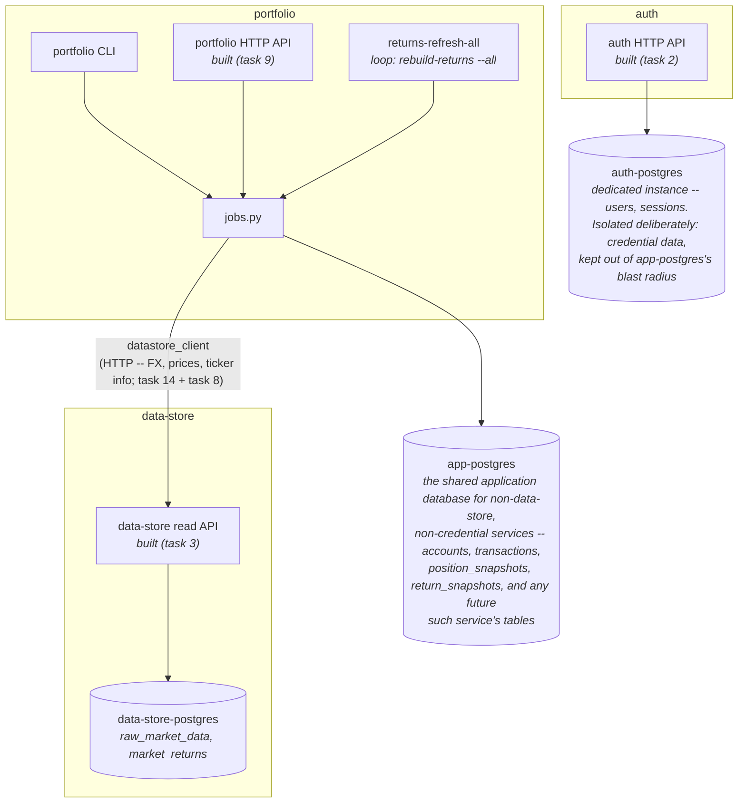

# portfolio deployment

Companion to [`architecture.md`](architecture.md), split out of it to keep both files under the
repo's 64KB limit. It covers the containers, the databases portfolio and its neighbours run on,
and how broker-parser plugins reach the image. Sections named here without a file are in
`architecture.md`.

## Deployment

**Three separate Postgres instances, not two.** Portfolio never opens a connection to
`data-store`'s or `auth`'s database, and neither of those opens one to portfolio's — the boundary
between services is always an API, full stop. `data-store` has its own, dedicated database because
its ingestion machinery and schema evolve independently. **`auth` also gets its own, dedicated
database — a deliberate exception, not an oversight**: credentials and session tokens are the most
sensitive data in the system, and isolating them at the database level keeps a bug or injection in
portfolio's code path from ever reaching auth's tables, consistent with this repo's
[`security.md`](../../../.claude/rules/security.md) rule to give credential-handling code extra
scrutiny. **`app-postgres` remains the shared database for every other future non-data-store
service** — the one such a service uses instead of standing up a fourth instance — but that sharing
principle stops at the credential boundary; `auth` is the one deliberate carve-out from it.

**`app-postgres` runs with `log_statement=mod`** (`docker-compose.yml`'s `command:`), logging
every `INSERT`/`UPDATE`/`DELETE`/`TRUNCATE` — including a direct `psql` connection bypassing
`portfolio`'s own code — to the container's own log. See `auth/docs/architecture.md`'s
"Deployment" section for the incident that prompted this across all three instances.

**`app-postgres`'s compose file lives at `services/portfolio/docker-compose.yml`**, even though the
instance is meant to be shared, because portfolio is its only tenant today and every other service
here keeps its own containers next to its own code. Naming it `app-postgres` rather than
`portfolio-postgres` is the part that matters: the container is not portfolio's to own, only
portfolio's to start.

**Considered and left as-is at task 13 (end-to-end integration)**: that task put every service's
*API* on one shared network (`stakehold-net`) but added no second database tenant — nothing beyond
`portfolio` opens a connection to `app-postgres`, so the trigger for moving this container's
ownership out of `services/portfolio/` still hasn't arrived. Revisit only if a second service ever
needs a direct `app-postgres` connection, not merely another service that talks to `portfolio` over
HTTP.

Inside that one instance the **database is named for the instance (`app`) and the role for the
service (`portfolio`)**. A second service on `app-postgres` gets its own role in the same database
rather than its own database, so the shared-application-database claim above stays true in the
schema and not just in the container name.

**That role is a real, enforced boundary, not an aspiration.** The official postgres image always
grants superuser to whatever role it bootstraps via `POSTGRES_USER` — there is no env-var way
around that — so `docker-compose.yml` and `ci.yml` bootstrap a separate admin role
(`APP_POSTGRES_ADMIN_USER`) that the running app never connects as. `portfolio db init`
(`jobs.py`'s `_ensure_role_and_schema`) uses that admin role exactly once, to create the
non-superuser `portfolio` role and a like-named schema it owns (`CREATE SCHEMA portfolio
AUTHORIZATION portfolio`) — Postgres denies cross-schema access by default, so owning the schema
is the entire isolation mechanism *between services*, no further `GRANT`s needed. A role's default `search_path`
resolves `"$user"` to the schema matching its own name first, which is why `schema.sql`'s table
names stay unqualified. A second tenant follows the same recipe: its own `<service>_DATABASE_URL`
with its own role name, and `db init` creates its role/schema the same way — never reusing
`portfolio`'s. The one thing this doesn't solve is the admin role itself, which remains a
superuser for as long as the stock postgres image bootstraps it that way; the guarantee is that
nothing beyond one `db init` bootstrap step ever holds that privilege, not that no superuser
exists on the instance.

**Within portfolio, a second role separates users' data (TA-6).** Row-level security limits the
`portfolio` role to one user's rows at a time. `db init` also creates `portfolio_cross_user`,
named by `PORTFOLIO_CROSS_USER_DATABASE_URL`, on the same admin connection, because `BYPASSRLS`
can only be granted by a superuser. The `portfolio` role then grants it `USAGE` on its schema and
`SELECT` on `accounts`, `transactions`, `position_snapshots` and `ticker_mappings`, nothing more.
It has no like-named schema, so `db init` sets its `search_path` to `portfolio`. Every portfolio
container that runs cross-user commands gets the URL: `api` (ticker mappings and the admin
unmapped list), `returns-refresh-all` and `returns-refresh-new-tickers`. See `architecture.md`'s
"User isolation" for why this is a role and not a policy exemption.

**Broker-parser plugins get into the image as wheels dropped into `services/portfolio/plugins/`.**
The Dockerfile's `uv sync --frozen` installs only the workspace, so a plugin installed into the
host `.venv` (`uv pip install -e`) never reached the container. The API then reported "no parser
registered … Currently registered: (none)" even though the same import worked from the host CLI.
A follow-up `RUN` step installs every `*.whl` in that directory on top of the locked environment,
and installs nothing when the directory holds only its README. The directory is gitignored apart
from that README, so the repo still never names a plugin (see [`broker-import.md`](broker-import.md)). Alternatives
rejected:
- An extra Compose build context pointing at the plugin's source checkout. Every
  `docker-compose*.yml` that builds this image tag (`api`, `db-init`, and the `stakehold-net`
  overlay's `returns-refresh-all`) would have to repeat it, and a build that missed it would
  silently overwrite the shared tag with a plugin-less image.
- An auto-loaded `docker-compose.override.yml`. The stack is started with explicit `-f` flags,
  which skip auto-loading.

Known sharp edges:
- The wheel's own dependencies, unlike the workspace's, aren't pinned by `uv.lock`.
- The wheel is a build-time snapshot, like the image's code. A plugin change needs `uv build`
  then `docker compose build`.
- Two versions of one plugin's wheel left side by side both install, so discovery fails on the
  duplicate entry-point name (`BrokerPluginError`). That is loud, not silent.
